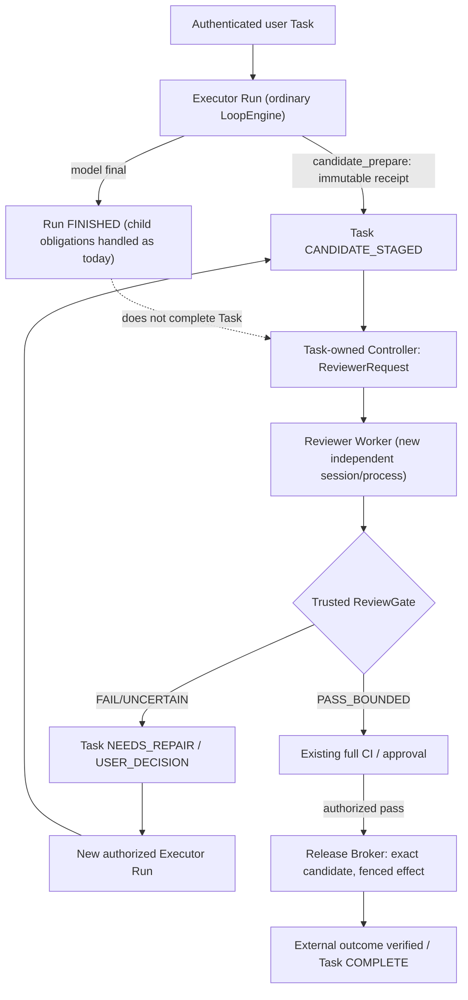

# ADR — LFL Dual-Agent Assurance v4.1：P0 决策冻结与实现前拷问

> 日期：2026-10-11（北京时间）
> 状态：**PROPOSED / 待独立审查；不是上线规则、没有执行 RED→GREEN**
> 源码核对锚：`main@99cf68982c10c5aee42bb996ed164d3d60b4a460`（实施前须重新取证）
> 基线：`docs/DESIGN-20261011-dual-agent-assurance-v4.md`
> 本 ADR 补充并**优先解释** v4 的 Reviewer 生命周期、副作用入口、租约、审查结果和崩溃窗口；不改变当前生产设置。

## 0. 决策记录（结论与依据）

| ID | 拍板 | 理由 | 适用与反对条件 |
| --- | --- | --- | --- |
| ADR-01 | **选择方案 (a) 的狭义形态**：模型 Run 正常 final，不修改现有 completion gate；冻结候选由**独立 Task-owned Reviewer Worker** 在父 Run 生命周期外审查，最终交付/发布通过受控 Release Broker | 当前 `engine.py` 的普通异步 child 在 parent final 时机械取消；强制等待 child 与现有语义冲突 | 工人可以在隔离 workspace 编辑/局部测试；**只有需要独立审查的最终动作**延迟到 Gate 后。严格禁止宣称“原 `spawn_subagent` 运行中 child 可以自动跨父 Run 存活” |
| ADR-02 | **作用域封闭的 Effect Manifest**：按工具 **name+action/args+底层执行面+身份/凭证** 分类；未分类一律不准进入 assurance 受控 Task 的副作用通道 | `execute_command` / `browser_operate` 可复合产生远端发布；`service_control(status)` 与 `publish` 不同类 | P0 先冻结覆盖清单和绕过路径，P1 可限定受控实验任务，P2 自动接管必须完成全部受影响副作用 fence/对账覆盖 |
| ADR-03 | **唯一物理执行权属于现有 FleetStore**；TaskControlStore 只保存 Task→Run/lease expected binding 和控制意图，绝不第二次签发 worker 租约 | v4 `1.1(3)` 已这么规定，本 ADR 将其升格为强制检验 | 旧 Fleet 仅覆盖特定 workspace/child；需扩展主 Task 物理 worker 映射，不假称现成上线 |
| ADR-04 | **副作用结果未知一律不自动重放**：`started` 而无可信 `settled`，视为 `OUTCOME_UNKNOWN`，不得推断“未执行” | kill -9 / 网络断开可发生在远端完成与本地 receipt 间；v4 I-06 已有原则 | 允许只读核对外部 operation ID；经实证平台幂等与原 key 作用域一致才可安全 retry；仍需记账 |
| ADR-05 | **角色变化由可信状态机自动触发，模型只可建议**；Reviewer 的权限和会话由 Controller 新建并记录，任何作者同会话换 prompt 均无效 | 换帽子不改变权限、完成状态或确认偏差 | Executor→Guardian/Reviewer 角色不可原地自升级；Guard 带 provenance 并用强只读执行域 |
| ADR-06 | **Schema 与最小 reader/writer 骨架在 P0 同步冻结**，先 provider-free 单进程/跨进程及 crash tests，不先改主 LoopEngine | 避免只有 YAML 没有可验证版本、CAS、持久状态与迁移规则 | 当前仅列出合同；骨架源码和实测结果尚未产出，不能视为 P0 通过 |

### 0.1 对 LFL 审查的逐条裁决

LFL 指出的 completion gate 冲突、Effect Manifest 范围、role trigger 与 crash window 都是**应立即补强的结构问题**。两点精准化修订：

1. `engine.py` 主模型正常 final 时，取消的是**仍 running 的异步 children**；`terminal-but-unread` 不阻塞 final，也不是再次取消。不能把“终止 child 未消费”与“running child 被取消”混为一谈。
2. 原 v4 已明确“FleetStore 唯一 lease”以及“started-but-unknown 禁自动重放”；本 ADR 不以此声称新机制已实施，仅将原则改成**可核验的权限、状态、crash/竞态验收合同**。

## 1. ADR-01：Run completion 与 Task completion 必须不同

### 1.1 现状证据

- `src/llm_loop/core/loop/engine.py:2406-2424`：模型正常 final 后调用 `async_obligations`，遇到仍 running 的 child 就 `cancel_session`；注释强调程序不得强迫模型读取 child 或强开下一轮。
- `engine.py:2531-2536`：非正常 completed 也取消未决异步 children。
- `src/llm_loop/subagent/runner.py:455-475` 的 `pending_obligations` 只报告仍 `running` 的 child；`terminal-but-unread` 不属于 completion gate。
- `src/llm_loop/tools/builtin/spawn_subagent.py` 创建**父会话生命周期内**的 child，不能作为 Task-owned 后 final 必须继续的 Reviewer 直接替代。

### 1.2 备选方案与裁决

| 选项 | 优势 | 风险/冲突 | 裁决 |
| --- | --- | --- | --- |
| (a) 任务级独立 reviewer，release 延后 | 不改变主 LoopEngine final；可跨父 Run/进程恢复；Task 状态清晰 | 必须新增 Task-owned reviewer launcher、持久 candidate/receipt 和安全出口 | **ADOPT（推荐）** |
| (b) 扩展 `async_obligations`，在 reviewer 结束前阻塞模型 final | 初步接线简单 | 改已有稳定的 final 语义；长模型会话被外部审查拖住；继承父会话卡顿失效 | **REJECT for production** |
| (c) 工人自觉等待 child 审完再 final | 无需复杂代码，可做 provider-free 可行性探针 | 不可由机械保证，模型可提前 final；下次崩溃无法继续 | **允许对照试验，但不能作为审查硬门** |

**狭义 (a) 的关键范围**：不是把所有 `edit_file` / `execute_command` 的每次副作用都延迟到审查后。Executor 在**隔离的非发布工作区**可以执行获授权的本地候选编辑、lint 与 targeted tests；只能提交候选快照到 `TaskCandidateStore`。经过 Reviewer、既定 CI/审批之后，`ReleaseBroker` 才获得执行“对外、正式提交、部署、内容发布”的资格。敏感/不可逆动作即使用户把它作为中间步骤，也要受独立 Task grant 和适用的 EffectFence 约束，不能因名字叫“中间任务”而绕过。

### 1.3 Task 的可见生命周期



**Run `completed` 不等于 Task `COMPLETE`**。若用户看到模型说“代码好了”，UI 仍应显示“候选已准备，独立审查/全量测试待完成”；禁止回写假的全局 done。Executor 正常 final 但没有可信 `CANDIDATE_STAGED` 时，Task 进入 `AWAITING_CANDIDATE` 或 `RECONCILIATION_REQUIRED`，不能由 Controller 从模型最后一句话捏造候选。若候选已经由用户明确取消或 Task STOP sticky，则 Reviewer 不能继续派发涉及模型费用/对外数据的工作。

### 1.4 Task-owned Reviewer 的强制启动协议

1. **触发者**：可信 `CandidateCoordinator` 接到 `candidate_prepare` 已提交的 `CANDIDATE_STAGED` 事件；模型最终回答、`agent_message`、`worker_claim` 都不触发直接 release。
2. **受信任身份**：从 `task_id`、已冻结 `acceptance_sha`、`candidate_sha`、`review_policy_version`、原 principal 与允许模型/预算生成 `review_request_id`；Reviewer 的父对象是逻辑 Task，不是正在终止的旧 `run_generation`。
3. **独立运行**：可以复用 SubAgentRunner 的模型循环、SessionStore、Evidence、ProviderCallCoordinator 等库，但必须提供新的 `TaskOwnedReviewerLauncher`、独立 session 与 execution profile，**不得把现有 `spawn_subagent` 运行中的 child 伪装成独立 Worker**。父 Run final 的 `cancel_session` 不影响它；真人 Task STOP / 控制撤权仍应严格传播。
4. **完成**：终态 `result_id + generation + report_digest` 由 Task Controller 读取；候选漂移/认证失败 → `UNCERTAIN`，不能 release。
5. **守护与重试**：child 运行中仅观察；超时不等于 terminal；退出后 `ORPHANED` 依 lease/settlement 对账；不能直接重 spawn 产生两个相互竞争的 Reviewer。

### 1.5 Release Broker 的真实权威位置

`ReleaseBroker` 是**由实际身份与凭证隔离保护**的受控出口，而不是模型再加一个叫“发布”的工具：应由它核对 `Task grant ∧ candidate digest ∧ ReviewReceipt ∧ 原完整 CI/平台授权 ∧ current control_epoch ∧ effect WAL`。发布密钥/生产服务控制权不得出现在 Reviewer 或普通 Executor 的容器/环境中。原有 `r9_commit.sh` 全量 CI/提交队列仍为适用范围内的后续权威；本 ADR 不授权移除或替代它。对于无隔离凭证的 shell/浏览器直通道，无法承诺 Release Broker 具有强制性，必须将该执行面列为 P1 NO-GO。

**正式代码提交的精确耦合**：对于使用 `scripts/r9_commit.sh` 的受管提交，必须使已审 `candidate_tree_oid` 与脚本在提交队列锁内实际生成的 `PROBE` tree **逐字一致**。不能只在运行耗时 CI 之前校验工作树，随后假设 index/HEAD 未被其他任务修改。若旧 `r9_commit.sh` 入口没有能力消费或验证该 review receipt，应增加外层受控资格接口并在其原有提交锁/PROBE 验证边界集成；不直接删除已有全部测试和安全扫描。无法证明无 TOCTOU 时，保持审查建议态而不是正式强制门。

此设计兼容普通 Task：默认 assurance flags OFF 时，现有父子完成语义、已有授权发布流程原样保留；只有明确 opt-in 的 assurance Task 进入新 Task-owned 审查与 gated-release。

## 2. ADR-02：受控副作用覆盖清单的分类合同

### 2.1 分类必须到 action、执行地点和 credential scope

| 等级 | 示例与边界 | 允许的相位 | P0 门禁 |
| --- | --- | --- | --- |
| `READ_LOCAL` | `read_file`、`read_evidence`，且 owner 范围与缓存/文件真实版本已校验 | Examiner/Reviewer/Executor | 只读 ACL + exact ref |
| `READ_REMOTE` | `web_fetch` / `web_search` / `browser_perceive`（存在网络、隐私与成本） | 明确授权的 Executor；Reviewer 必须有额外限定 | URL/data egress 授权，不能因为 _READONLY_TOOLS 中列了就当无风险 |
| `STAGE_LOCAL` | `edit_file`、隔离工作区中限定命令的 `execute_command`、候选文件生成/本地测试 | 仅 Executor + 当前 Task/lease 授权 | 独立 worktree 和无发布凭证，候选内容寻址，程序区分读/写 |
| `EXTERNAL_MUTATION` | `browser_operate`、`send_feishu_message` / `send_feishu_attachment` / `create_feishu_doc`、远端调用、第三方工作项写入 | 按真人明确授权及 Task/Effect manifest | WAL + 作用域 + 幂等/UNKNOWN + 对外回执；发布类动作还须 ReviewGate |
| `RELEASE` | `service_control(action=publish/update/restart)`、文章提交/公开发布、真正 Git merge/push、受管部署 | Task 的已授权受控出口 | Reviewer PASS + 既定 CI/平台资格 + ReleaseBroker + 外部终态核对 |
| `CONTROL_MUTATION` | `service_control(release/adopt/override/verify_acknowledge)`、`schedule/schedule_cancel`、`job_kill`、`spawn_subagent`、其他重派发/权限变化 | 单独管理/任务授权，并非 Reviewer | 强权限检验；不得借通用 prompt 或 shell 冒充控制操作 |
| `UNKNOWN_OR_COMPOSITE` | `execute_command` 任意 shell / 其后台 job，脚本包装器、插件/MCP 动态工具、browser click 可能发布、工具内嵌调用 | 未经过证明之前全部拒绝高保障模式中的生产副作用 | 默认 `DENY_UNCLASSIFIED_EFFECT`；无法隔离 CLI/凭证则不得激活 |

**本表是 P0 的起始快照，非完整的工具注册清单**。当前 `factory.py` 通过静态注册、运行模式过滤、浏览器动态 opt-in、introspection registry 与可选外部工具装配；必须在真实 runtime 由 `ToolRegistry.names()/schemas` 联合 source registration 生成版本指纹，逐项核对注册名、别名、参数组合、内部委托到的真实 effect sink。`service_control(status)` 只读，`service_control(publish/update/restart/...)` 不可归为同一个权限。含浏览器 click 的自然语言“只是点击按钮”可能实际触发发布，分类未知时默认不可作为自由执行的候选阶段动作。

### 2.2 Effect Manifest v1 合同

```yaml
schema: lfl.dual_assurance.effect_manifest/v1
manifest_revision: 1
source_repo_head: <exact head>
runtime_tool_registry_fingerprint: <hash of executable registry & enabled options>
rows:
  - tool_name: service_control
    selector: {action: "publish"}                 # closed predicate, not prompt
    effect_class: RELEASE
    physical_sink: managed_service_deployment_store
    dispatch_entrypoints: [registry_call, underlying_cli_or_host_action]
    credential_domain: managed_service_operator
    candidate_gate: REQUIRED
    user_grant: REQUIRED
    lease_fence_coverage: VERIFIED | UNVERIFIED | NOT_APPLICABLE
    task_control_epoch_check: VERIFIED | UNVERIFIED
    tool_wal_coverage: VERIFIED | UNVERIFIED
    idempotency_support: NONE | REPLAY_SAFE_SAME_KEY | EXTERNAL_QUERY
    external_operation_id_ref: <ref-or-null>
    crash_reconcile_method: <trusted method-or-null>
    gate_owner: <actual implementation>
    evidence: [<test/source ref>]
    source_version: <file/hash>
    status: QUALIFIED | BLOCKED | UNKNOWN
```

**关键要求**：`gate_owner` 必须是执行前阻断的实际源代码/OS 边界，不得写成 Reviewer prompt；任何 `UNVERIFIED` 不升级为 `VERIFIED`。Manifest 以精确 runtime/tool config hash 约束，新增插件、运行时重新注册、Browser real-profile 变化或 tool schema 修改都需要重新分类。

### 2.3 为什么“全纳入/全不纳入”是错误的二选一

- **审查资格门**只保护标记为 `REVIEW_REQUIRED` 的候选最终交付/发布；不是强行审查所有文件读写和工作过程每个命令。
- **Stop/接管围栏**保护 assurance Task 的所有**已声明且获准的新物理可变更动作**；可以按阶段/工具覆盖逐项资格放行，**但绝不把未覆盖的动作默认为“安全直通”**。当某任务确实依赖未知工具，不能开启这个 Task 的自动接管。
- **旧 legacy 路径**缺省 OFF 不受影响；但不能将只覆盖一部分工具的 opt-in Task 宣称“全面安全可接管”。
- **绕过与复合动作**：`execute_command` 能 `git push`、HTTP POST、执行脚本绕过 registry 独立工具分类；如果进程仍持有生产密钥或操作系统写权限，单纯 ToolRegistry policy 不是安全隔离。P0 必须证明此模式受 OS 沙箱/无生产凭证/ReleaseBroker 权限域约束，或拒绝上线。

### 2.4 P0 必须冻结的“实际覆盖清单”

除了表格起始案例，扫描并记录：`ToolRegistry` 直接工具、introspection 注册、`execute_command` 和异步 job、`browser_operate` 底层 CDP action、Feishu outbound、`service_control` 各 action、Git/部署 CLI、Web/Feishu HTTP endpoints、`CodeArtsDispatch`、scheduler/deferred actions、用户直接文件变更、动态插件/MCP 以及任何持有生产凭证的进程/线程。对每个渠道填上 `QUALIFIED / BLOCKED / UNKNOWN`，P0 闭合差集为零才称“覆盖清单冻结”。“未知”项目可以保留，但被相关 Task 依赖时就是 NO-GO，不能挪进“豁免”。

## 3. ADR-03：只复用 Fleet 物理租约，禁止双中心执行权

### 3.1 唯一权威与身份定义

- `FleetStore.current_lease(workspace_id)` 是 worker 物理租约的**唯一权威**；`TaskControlStore.active_binding` 是读取和验证映射的指针，不允许自己生成 lease_generation 或决断 worker 可写。
- 一个 Task 可跨多个 `Run` 和多个已结算的 `Fleet run_key`，但任何时刻只能有一个获准产生受管新副作用的 Executor。`lease_generation` 的值必须来自真实 FleetStore CAS。
- 现有 `SubAgentRunner` 的 `_begin_fleet_run` / `_renew_fleet_run` / `_fleet_fence_lost` 证明 child 已有可复用围栏，但当前 `factory.py` 仅在 Fleet 配置存在时装配；**主 Runner 不能因有 `SubAgentRunner` 就被假设已自动纳入同一 Fleet 物理 workspace**。这是 P0 的专项适配资格。
- 角色不对应新的 Fleet 租约表。Reviewer 只获得其独立 Session/Run 的**只读执行许可**，并不是业务 Task 的当前写入 lease holder。

### 3.2 双存储不可原子提交时的失效安全

`TaskControlStore` 和 `FleetStore` 无共享事务。严格采用 `PREPARED → BOUND → ADMITTED` 的可恢复协议：

1. 观察 `task_revision`、`control_epoch`、旧 `run_key+lease_id+generation`、有无 `STOP`、WAL/outbound unknown；构造可信 observation digest。
2. 只有过期 lease 的 CAS reclaim，或已经批准并完整记录理由的 operator force reclaim，才进入 Fleet 竞争；未到期不凭模型“卡顿”抢权。
3. 新 Fleet lease CAS 成功后持久 `PROMOTION_PREPARED`，此时**未取得派发权**；跨进程存活的 Supervisor 只可观察。
4. 以 `expected_task_revision+control_epoch` 在 TaskControlStore 写 active binding；期间 Stop/cancel 修改 epoch → CAS 失败，撤回或等待 lease 回收，零派发。
5. 派发前比较最新 TaskControlStore+FleetStore+SessionStore 与准确 worker 身份；任何不一致 fail closed。
6. 旧代的迟到 `settled` 仅作历史审计，不能改写新的 Task 完成、Review PASS 或外部发布状态。

这和原 v4 `7.1` 一致，但明确了**无第二套 lease**、单 Task 独占含义与主/子 Runner 的适配差异。`PROMOTION_PREPARED` 与 `BOUND` 之间任何 crash 留下的 orphan lease 只能自动只读对账/回收，不得由任意 agent 自发补跑工具。

## 4. ADR-04：Kill -9 窗口的三层事实与幂等契约

### 4.1 严格区分三个“完成”

| 事实类型 | 条件 | 可以得出的结论 |
| --- | --- | --- |
| `dispatch_declared` | WAL declaration 已持久 | 工具准备调用；不能推定实际派发 |
| `dispatch_started` | 本地派发意图已持久并已跨越开始边界 | **可能**已有外部副作用；直到可信回执/远端对账之前均是 UNKNOWN |
| `remote_applied` | 第三方实际系统对该 exact operation_id/idempotency_key 提供可核验权威事实 | 可以推断该特定远端操作已生效，不等于整 Task/内容已合格 |
| `receipt_committed` | 本地完整 Tool WAL 回执落盘并与来源状态一致 | 可以恢复本地结果；仍需区分平台受理、待审、公网公开和实际发布 |

禁止“回执没找到 = 没执行”。也禁止因为 `remote_applied` 就把其他后继子动作猜成成功。

### 4.2 EffectAttempt v1（P0 最小数据）

```yaml
schema: lfl.dual_assurance.effect_attempt/v1
attempt_id: <trusted unique>
task_id: <trusted owner-scoped task>
task_control_epoch: 5
run_generation: <exact>
lease_id: <Fleet lease>
lease_generation: 3
tool_name: browser_operate
action_digest: <hash of canonical submitted action>
effect_manifest_hash: <exact runtime manifest>
effect_class: EXTERNAL_MUTATION
idempotency:
  classification: NONE | EXTERNAL_EXACT_KEY | PROVEN_REPLAY_SAFE
  stable_key_ref: <ref-or-null>
  provider_contract_sha: <verified contract-or-null>
dispatch:
  state: DECLARED | STARTED | RESULT_RECEIVED | RESULT_COMMITTED
  started_event_seq: <seq-or-null>
  local_receipt_ref: <ref-or-null>
remote:
  authority: <platform/service identifier>
  operation_id: <nullable exact id>
  state: NOT_OBSERVED | APPLIED | NOT_APPLIED_PROVEN | UNKNOWN
  observation_ref: <trusted remote receipt-or-null>
resolution: NO_REPLAY | EXACT_KEY_RETRY_ALLOWED | RECONCILED | MANUAL_DECISION
```

`NOT_APPLIED_PROVEN` 只能来自平台明确支持的权威否认或可证明的物理未派发状态，不能因 `404`、超时或 UI 列表暂时没显示就判为未执行。`EXTERNAL_EXACT_KEY` 重试需要同一用户授权、同一逻辑操作、同一 exact key/内容摘要，并在真实平台文档/试验中证明该 key 能阻止多次效果；若 key 只用于本地记账，则不得放行。

### 4.3 Crash window 矩阵

| 崩溃边界 | 本地/远端可能事实 | 恢复默认行为 |
| --- | --- | --- |
| A. `declared` 之前 | 没有可信物理派发证据 | 先从 Tool WAL 恢复任务，不凭会话摘要重做 |
| B. `declared` 之后、`started` 之前 | 可证明没有调用时可分配新 attempt | 恢复原 declaration；另行决策是否派发 |
| C. `started` 已持久，网络请求是否成功未知 | 远端可能未收到、已收到、已执行 | **OUTCOME_UNKNOWN，禁止自动重复该外部操作** |
| D. 远端已实际生效，本地 response/receipt 前 kill -9 | 远端已变，本地仅见 started | 查询远端 exact operation ID/权威事实，归入 RECONCILED；**不得再发第二次** |
| E. 本地 receipt 已落盘，Task binding/最终提交前 kill -9 | 原动作有 durable 事实，后续 Task 可能尚未完成 | 幂等恢复/对账状态，不把已做动作复制为新执行 |
| F. Stop 与远端派发并发 | 一方成功在先，或已有 in-flight | 以 durable stop/dispatch 顺序和远端事实报告，不能抹除在途请求 |

不将 `kill -9` 视为系统异常的可捕获异常。P0 采用**独立目标子进程 + 本地 fake remote service（不同持久库）+ parent driver**，在上述真实持久化分界注入硬杀，重启观察器比较：

- exact Task/Run/lease 身份与持久 WAL 是否仍可读；
- remote effect 次数是 0/1 还是出现危险的 2；
- 各 checkpoint 是否明示 `UNKNOWN`，是否在没有确切幂等合同的情况下重发；
- 客户端断开/进程终止是否虚报 Stop/settled；
- 是否留下 orphan lease 或版本漂移后仍可被任务成功结算。

必须使用**临时隔离数据目录与假发布/假远端**，禁止对生产 Web/飞书、真实 provider、Git 主线或真实浏览器发布使用 kill -9 注入；driver 不通过任意 PID 匹配杀真实服务。

## 5. ADR-05：Reviewer/Executor 角色强制转换状态机

### 5.1 程序触发源（非模型授权）

| 机械事实 | 受信任状态转移 | 谁可以产生 |
| --- | --- | --- |
| 原目标和 acceptance 已持久冻结 | `TASK_ACCEPTED → EXECUTOR_ACTIVE` | 已认证 Task ingress + Grant/Coordinator |
| 完整候选 `candidate_prepare` 以 exact digest 持久 | `EXECUTOR_ACTIVE → CANDIDATE_STAGED` | 当前合法 Executor 通过有限 staging 接口，Coordinator 校验 |
| 冻结候选风险级别需要独立审查 | `CANDIDATE_STAGED → REVIEW_REQUESTED` | Trusted ReviewPolicy 根据版本规则生成 |
| 有已批准 model budget + owner-scoped 只读输入 + 独立会话能力 | `REVIEW_REQUESTED → REVIEWER_ACTIVE` | Trusted TaskOwnedReviewerLauncher，不能由 Worker prompt |
| reviewer terminal/result/源/hash 全部通过 | `REVIEWER_ACTIVE → REVIEW_VALIDATED` | ReviewGate 编排器；报告自报 PASS 不足 |
| 完整 CI/平台授权 + candidate digest 未变 | `REVIEW_VALIDATED → RELEASE_ELIGIBLE` | ReleaseBroker/原完整受管提交门禁 |
| Task Stop 持久 | `ANY_ACTIVE → CONTROLLED_STOP / OUTCOME_UNKNOWN` | 受认证用户 + Task Control 状态，而非模型 |
| 旧执行权过期且 WAL 已对账，新的 Fleet CAS 成功且 Task 绑定一致 | `EXECUTOR_LOST → PROMOTED_EXECUTOR` | 可信 Coordinator，原用户授权子集内 |

**永远禁止**：Reviewer 自身持有业务写入 lease、刚修改候选的 Executor 原会话即成为其 Reviewer、模型给出 `role=guardian` 文本就执行强制抢占、已失权旧代回写 PASS 或发布状态。

### 5.2 独立上下文、权限与模型身份

- Reviewer 的模型输入只含冻结 `objective/acceptance`、`candidate_ref/hash`、有权读取的文件/证据与专用审查规则，不带原 Executor 逐轮历史；`inherit=False` 的父 turn 不自动注入事实可复用，但**不能**假定它自动提供只读工具面。
- Reviewer 默认用独立 Session/Run、不同执行身份和只读沙箱；如 Executor 失败后 Guardian 被提升继续写文件，新的候选必须由**新的 Reviewer Session** 评价，而不是让提升者“换角色自审”。
- 同模型新会话主要降低上下文锚定，不消除同模型系统性偏差；换不同模型是可选、需要预算/数据外发授权的对照试验，不是 v4.1 的权限安全证明。
- 如果 Reviewer 无法读取某条 owner-scoped Evidence 或冻结文件，状态是 `REVIEW_UNAVAILABLE` 或 `UNCERTAIN`；不能借模型自身全局工具权限去读别人的资料。

## 6. ADR-06：P0 最小读写器骨架必须有可验收的版本语义

这部分是**接口和负例要求**，不是宣称已经实现。建议在独立 worktree 里用最小单机事务存储做实验（如 stdlib SQLite，`synchronous=FULL` 及 WAL 需在实际 macOS 上做崩溃复核），先不接入 Web/Feishu 主进程。不要为 v4.1 再造另一套 Fleet 租约账本。

### 6.1 只含必需字段的闭合读写器接口

```python
# Proposed interface contracts only: no implementation shipped
SCHEMA_VERSION = "lfl.dual_assurance.task_control/v1"

class TaskControlReader:
    def load_exact(self, task_id: str, authenticated_owner: str) -> "TaskSnapshot":
        """Reject unknown version, invalid owner, corruption, partial/dirty record."""

    def list_pending_intents(self, task_id: str, after_seq: int) -> list["ControlIntent"]:
        """Return durable, ordered intents; never infer 'no Stop' from read error."""

class TaskControlWriter:
    def create_once(self, frozen_input: "FrozenTaskInput") -> "TaskSnapshot":
        """CAS create: exact replay returns original; changed payload rejects."""

    def append_intent_cas(self, task_id: str, expected_revision: int,
                          intent: "ControlIntent") -> "CommittedIntent":
        """Atomic intent + control_epoch + Stop fence; fail-closed on uncertainty."""

    def prepare_binding_cas(self, task_id: str, expected_revision: int,
                            observed_fleet_lease: "LeaseRef") -> "PreparedBinding":
        """Does not mint a Fleet lease and never grants effect dispatch."""

    def commit_binding_cas(self, task_id: str, expected_revision: int,
                           prepared_ref: str) -> "TaskSnapshot":
        """Only bind exact current Fleet lease; stale control_epoch rejects."""
```

建议明确 schema 版本、字段的 null/空数组差异、字段必须/可选、拒绝未知字段、精确 UTF-8/整数时间、内容 SHA、owner/工作区作用域、CAS revision 递增、意图 `idempotency_key` 重放和冲突。读取未知未来版本只允许审计式原始字节备份/告警，**不得自动重置为空任务**。数据目录权限与 SQLite 本地文件读写、checkpoint 恢复、密钥泄漏风险均在 P0 单独验收。

### 6.2 骨架最小单测义务

- 创建后重读完全相同的 schema/version/owner/hash；重复 create 同输入幂等，改一个字节冲突。
- 两个不同进程同时 `append_intent_cas`，恰好一个 revision 胜者，任何丢失/乱序 STOP 都失败。
- STOP intent 与 control_epoch 在**同一个持久事务**；硬杀前后不存在 Stop 已受理但门禁看不到的状态。
- 无效 schema version、缺必填、旧版无迁移、JSON/SQLite 损坏、存储只读/磁盘满，全部明确拒绝，不返回“空 Task”。
- 读者不能因 `task_id` 可猜而跨 principal/workspace 读取记录；secret 永不存入普通 JSON 和日志。
- Task binding 只接受真实 Fleet 所返回的 lease ref；伪造和过期 generation 拒绝；Prepared 发生后 crash 不授予 dispatch。

## 7. P0 新增实测矩阵及验收边界

v4 已有 `T01–T30` 的设计测试，本 ADR 在其上追加 **P0-X01–X12**。均未执行；必须先冻结测试合同，随后以独立工作树实现 RED→GREEN。

| ID | 试验 | 必须证明的结论 |
| --- | --- | --- |
| P0-X01 | 父 Run final 前有运行中普通 child / 已 terminal 但 unread child | 前者仍按现有规则取消；后者不阻塞 final；没有反向修改 LoopEngine completion gate |
| P0-X02 | 父 Run 已 final，Task 已 CANDIDATE_STAGED，Task-owned Reviewer 独立结算 | 父 Run 可 terminal，但 Task 未 COMPLETE；ReviewWorker 真正独立生命周期且获真人 STOP 可停 |
| P0-X03 | 父 Run final 无任何候选，但模型回答宣称“已完成并发布” | Task 保持 AWAITING_CANDIDATE，ReleaseBroker 零派发 |
| P0-X04 | 隐式 shell 执行 git push/HTTP POST、浏览器 click 发布、`service_control(action=status/publish)` | action-sensitive 分类；未分类或缺凭证隔离的路径被硬拒，不因工具 name 伪装 |
| P0-X05 | runtime 新增动态工具或插件、真实注册表指纹改变 | Effect Manifest 立即过期；资格拒绝或重新签发，不出现未经审查新出口 |
| P0-X06 | 两个 Controller 同时操作同一 Task/lease，分别持锁/崩溃 | 无双写；Fleet 唯一租约；Task 绑定与 lease 漂移使 dispatch fail-closed |
| P0-X07 | 子进程在 WAL started 后 kill -9，假远端未确认是否生效 | OUTCOME_UNKNOWN；没有本地“无回执即未执行”的重放 |
| P0-X08 | 假远端持久提交成功后、local receipt 之前 kill -9 | 重启查询 remote exact op ID，不重复副作用；远端计数保持 1 |
| P0-X09 | 同一平台具确证幂等接口，同 key+exact action 恢复与改 key 重试对照 | 只有确证同 key 的同一操作可安全重试；改 key/范围拒绝 |
| P0-X10 | STOP 与 dispatch-start 边界并发 + controller 进程硬杀 | 已落盘 STOP 阻断之后的新 dispatch；已在途远端动作只标实际事实/未知 |
| P0-X11 | Executor 提交候选后自行标 role=reviewer+PASS；或当前 reviewer 无数据权限 | 不存在自动切换或自审绕过；Reviewer 独立新会话、只读 profile；权限不足显式不确定 |
| P0-X12 | TaskControlStore 旧/坏/未知 schema；两进程 CAS；存储短暂只读 | reader/writer 拒绝非法与回退；持久事实不丢，版本与权限校验一致 |

### 7.1 P0 精确交付物

1. **一份 ADR**：ADR-01–ADR-06 是否被实现负责人和独立 Reviewer 接受；重要反对意见记录在案。
2. **一份闭合 Effect Manifest**：从真实运行注册表和可能绕过的物理入口枚举、人工核实并冻结 digest；标明 `QUALIFIED / BLOCKED / UNKNOWN`，按 action 区分。
3. **一个最小 reader/writer 骨架**：在独立 worktree 实现受控闭合 schema、跨进程 CAS、Stop 原子持久和故障注入，**不先接入主 Run**。
4. **一套真实 hard-kill harness**：`P0-X07/X08/X10` 使用 temp dirs 和假远端，父 driver 可证明未发送第二次外部副作用。
5. **一份评测回执**：测试命令、代码版本、实际通过/失败、证据 hash、未覆盖工具/风险；未满足硬门时 `NO-GO`，不将“已设计”冒充“已测试”。

### 7.2 立即 NO-GO 与可推进部分

| 条件 | 允许推进 | 必须阻断 |
| --- | --- | --- |
| Task-owned Reviewer 生命周期和候选持久回执尚未通过 | 设计审查、原 `spawn_subagent` 生命周期事实负例、只读文档检查 | 生产 `review-first` 发布硬门 |
| 存在 `execute_command` 任意 shell/生产凭证绕过 | 脱敏、隔离工作树的候选构建及非生产模拟 | 宣称 ReleaseBroker 为不可绕过的生产门 |
| Fleet 在实际目标面未装配/覆盖主 Run | 只读租约盘点和独立假 worker CAS | 主 Task 自动接管及生产可变更副作用 |
| 远端动作结果缺回执且无平台 exact-key 合同 | 只读查询、向用户报告 UNKNOWN、等待人工决策 | 自动再次发布/删除/通知/付款 |
| Schema reader/writer 无持久故障测试 | 完善 schema、单机模拟测试 | 上线持久 Stop 保证 |
| Kill -9 验证只做了 Python 异常捕获 | provider-free 的编排功能测试 | 宣称“跨进程崩溃安全已验证” |

## 8. 再次反问本 ADR：剩余不可由 P0 文档解决的风险

**R1：Task-owned Reviewer 也是 Agent，会不会脱离用户 Stop？** 不可以。Task-owned 仅指它不随原 Executor 的 Run final 被取消；它必须监听**同一 Task 的真人 STOP/control_epoch**，使 provider 与工具的新派发 fail-closed。

**R2：ReleaseBroker 自己直接调用外部服务会不会复制现有控制机制？** 不应重造 `service_control` 或 `r9_commit.sh` 的业务逻辑。Broker 只签“谁、哪一份候选、完成哪些门禁、能调用哪个原有权威入口”，然后交给原子提交/受管部署入口处理；这些入口如有绕过渠道必须切断其生产凭证或明确 NO-GO。

**R3：只按 `tool_name+action` 分类是否够？** 不够。命令脚本、浏览器 click、动态插件和网络代理可跨多种 effect sink。分类必须向下追到**底层凭证/进程/物理副作用**，否则工具面禁令会被实际执行面绕过。

**R4：有 `remote_applied` 是否可以说整个 Task 完成？** 不可以。需区分平台受理、内容公开与验收通过；外部事实只证明精确操作，而非用户目标整体完成。

**R5：双存储协调失败时能否“恢复最后一个值”？** 不可以。TaskControl、Fleet 与 Session/Tool WAL 不能线性合并，必须显式 `BOUND_DRIFT/UNKNOWN` 和无副作用恢复协议；盲目 last-writer-wins 会凭空创造执行权。

**R6：计划把所有工具都围起来是否带来无限实施量？** 是，因此只对确切 opt-in assurance Task 生效，并按完成 Gate 分层推进。**缩小被保护的任务/工具资格范围**，不在既定范围中允许未覆盖工具直通；这避免“部分保护造成安全错觉”。

## 9. 采纳裁决与下一阶段

**建议将当前 v4 采纳为架构基线，并把本 ADR-01–06 作为正式 P0 冻结候选。优先顺序：ADR-01 completion/release 选择 → ADR-02 Effect Manifest → ADR-03/04 主 Run lease + kill -9 事实 → ADR-05 role trigger → ADR-06 schema 骨架。**

本 ADR 与 v4 文档均尚未通过真正 RED→GREEN 和独立 Reviewer 复核。下一步只建议在**隔离 worktree** 进行源码提交级别的契约骨架/假平台负例测试，完毕才考虑主循环改动或 Web-only opt-in；没有现阶段对生产接管、发布或全量 CI 变更的授权。
