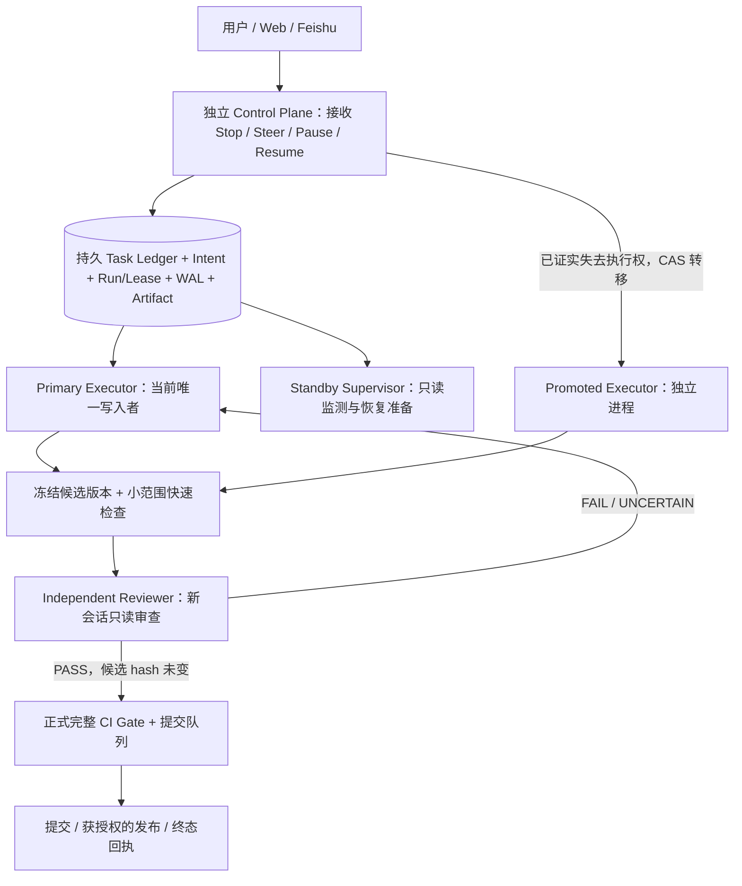

# LFL 双 Agent 连续性保障、独立审查前置与实时控制：分析及实施建议

> 状态：**PROPOSAL / 待讨论，未实施**
> 日期：2026-10-11（北京时间）
> 只读源码锚：`main@99cf68982c10c5aee42bb996ed164d3d60b4a460`
> 适用范围：LFL 主 Agent、子 Agent、长任务、代码变更验收、内容审稿与用户实时控制。
> 本文不构成修改生产权限、自动发布、绕过全面测试或自动强制接管的授权。

## 0. 核心结论

**建议推进，但不是“给子 Agent 开足权限”这么简单。** 已有独立子会话、非阻塞启动、父子通信、成果回收、有限续话、持久化日志和可选的 Fleet lease。最有价值的下一步是把这些能力连成两条可靠链路：

1. **连续性链路**：当主 Agent 响应慢、失联或被终止，外置于模型调用的控制面先核实当前任务、运行身份及未决副作用；在安全条件满足时，以单一执行所有者原则将任务交由独立工作进程接管，并保留同一个逻辑任务与用户控制入口。
2. **质量效率链路**：执行者完成候选改动后，先跑低成本确定性检查，再将**冻结的候选版本**交给“干净上下文、专门审查提示词、只读工具”的独立审查 Agent；没有阻断问题才进入正式全量测试与提交。测试门禁**一项不减**，减少的是明显有缺陷的候选反复触发昂贵全量测试的次数。

核心不变量：**同一任务，同一时刻只允许一个可变更动作的有效所有者；审查者和观察者不持有写权限；执行权转移必须是可审计的机械事实，而不是模型的主观判断。**

此设计应称为 **Dual-Agent Continuity + Independent Review Gate**。它不是两套模型同时自由修改同一仓库，也不是把子 Agent 的审稿成功直接外推为“自动接管已可靠”。

## 1. 当前 LFL 事实与缺口

| 能力 | 已核实的实现 | 本提案仍需解决 |
| --- | --- | --- |
| 子 Agent 独立会话与后台执行 | `SubAgentRunner` 为 child 创建独立 session，`start()` 启动 daemon thread；`spawn_subagent` 非阻塞返回 child ID | 进程死亡时线程随之死亡；不能当作跨进程热备或主任务接管 |
| 专用通信通道 | `agent_message` 支持直接 parent ↔ child；`subagent_result` 回收结果；拓扑、投递及 terminal 有持久回执 | 它不是独立的用户控制面；主 Agent 卡在模型/工具调用时，不能靠其下一轮模型决策来及时响应用户 |
| 上下文隔离 | child 不默认继承父级所有 turn；`inherit` 提供去除私有推理/回放数据的检索型 parent-context artifact | 完整恢复仍需逻辑 Task 状态、当前执行边界、工具 WAL、Artifact 与权限事实；不能只复制聊天记录 |
| 续话 | `agent_followup` 允许已终止直接 child 同会话续话；每 child 最多 2 次、每父最多 4 次、15 分钟窗口、每次最多 6 轮 | 这是有界 follow-up，不是长期 supervisor，也不能取代持久 Task-to-Run 映射 |
| 并发执行权 | `ProjectCoordinator`/`FleetStore` 已有 lease、generation CAS、TTL reclaim、effect fence、settlement；存量实现对未过期 lease 拒绝自动接管 | Fleet 装配是显式 opt-in（`fleet_workspace_root` 缺省为空）；能力主要绑定 child run/workspace，尚不能据此宣称整个主任务的自动交接已经打通 |
| 工具权限 | 子 Agent 继承父执行域；显式 discovery scope 不可扩权；工具自身继续校验授权；`requires` 可预检能力缺口 | supervisor、reviewer、接管 executor 需要**不同角色和按任务缩小的授权**，不可简单把父 Agent 全量权限开放给备用 Agent |
| 正式代码测试/提交 | `scripts/ci_gate.sh`：Ruff、环境声明、Pyright、tier0、全量 pytest；`scripts/r9_commit.sh`：隔离 PROBE 候选树、全量门禁、提交锁及安全扫描 | 缺少与**确切候选树绑定**的独立审查 PASS 机械门；不得以 reviewer PASS 跳过或降低既有全量门禁 |
| 内容审稿实践 | `docs/promotion/STATUS-20261010-second-batch.md` 记录独立 LFL Web 会话只读审稿、稿件/图片 SHA 绑定、PASS 后投稿、公开 URL 独立验收 | 这是**独立审稿会话的成功案例**，不能未经核实就说它已由 `SubAgentRunner` 统一实现；可复制其“角色隔离 + 证据锁定 + 发布前置”方法 |

关键证据入口：

- `src/llm_loop/subagent/runner.py`：`SubAgentRunner.__init__`、`start`、`_begin_fleet_run`、`_renew_fleet_run`、`followup_current`、`_persist_delegated_task`、`_execute_subagent`。
- `src/llm_loop/tools/builtin/spawn_subagent.py`、`agent_message.py`、`agent_followup.py`、`subagent_result.py`：子会话与通信语义。
- `src/llm_loop/factory.py`：`SubAgentRunner` 与可选 `ProjectCoordinator` 的装配，`cancel_parent` hook。
- `src/llm_loop/fleet/coordinator.py`、`fleet/store.py`：租约续期、过期回收、未过期强制接管必须有 operator 授权。
- `src/llm_loop/subagent/runner.py` 工具回执链：declaration → started → effect → finished → receipt committed；started-but-unknown 不自动重执行。
- `src/llm_loop/introspection/tools_skills.py`：现有 `code_review` 实际是启发式清单/异味扫描，**不是**独立模型语义代码审查的替代品。
- `scripts/ci_gate.sh`、`scripts/r9_commit.sh`：正式测试不得降级的现有契约。

## 2. 澄清“权限没给到位”：要补的是三种不同的权威

1. **工具能力**：角色能否访问所需文件、测试命令、事件查询、任务结果。可以用现有 `requires` 做早期能力探针，但必须区分“工具已注册”“父域允许”“角色被授权”“实际可执行”，不能把能力发现当授权。
2. **任务所有权**：备用 Agent 是否**可以变成当前任务的唯一执行者**。这是协调器依据 lease/generation/CAS、终止及副作用日志判断的权威，不应由 LLM 发一句“我接管了”产生。
3. **外部动作授权**：是否允许访问外部 Provider、部署、发布文章、推送仓库、删除或改动生产数据。子 Agent 只能继承既有真人授权的**子集**；任务接管不创造新的用户授权，也不覆盖 TaskBudget 等现有特殊约束。

建议角色矩阵：

| 角色 | 默认能力 | 严格禁止/条件 |
| --- | --- | --- |
| Primary Executor | 依真人任务授权执行、写候选工作树、运行有界工具 | 不得绕过全量门禁、不可暗改生产、不可越权自签发新预算 |
| Standby / Supervisor | 只读观察 run/lease/heartbeat/WAL/Task checkpoints；提出恢复计划、向用户报告风险 | 默认无写入、发布、Provider 扩额或强制抢占权限；不能凭“感觉卡顿”直接接管 |
| Promoted Executor | 只有权威协调器签发**一次性的接管令牌**后，才取得指定 Task + workspace + operation scope 的写权限 | 旧代 generation 失效，所有真实副作用仍需工具侧重新校验 lease/fence/授权 |
| Independent Reviewer | 只读冻结差异、相关源码、测试规范、工具回执、内容素材；输出结构化审查报告 | 不改代码、不修改测试、不发布、不签 PASS 后自行合并 |
| Publisher / Release Operator | 在审核 PASS 且既有真人授权与平台/生产条件满足时执行**特定**发布动作 | 不得把审查通过当作新增授权；重复投稿、未决远端动作先核对权威回执 |

## 3. 推荐逻辑架构（职责分离，而不是两份主 Agent）



实现建议：**Supervisor 和 Control Plane 必须在主执行进程之外**，至少可由独立服务/worker 调度。正常 `spawn_subagent` 的 daemon thread 继续用于轻量并行与独立审查，但不能被包装成主进程崩溃保障。独立进程也必须依赖持久存储和权威 fencing；“两进程存活”本身不足以确保正确恢复。

不建议再造第二份 SessionStore、FleetStore、Goal 或独立预算账本。应在现有权威记录之上增加薄的 **Task-to-Run 映射和监督调度层**，不把代码测试/发布逻辑塞进 Agent prompt。

## 4. 连续性：按状态决定是否接管

区分以下状态，避免把“慢”判成“死”：

| 观测状态 | 推荐行为 | 是否允许自动接管 |
| --- | --- | --- |
| 主 Agent 有心跳、有合法未到期模型/工具调用，响应缓慢 | 控制面立即 ACK；展示阶段与 deadline；可只读并行审阅现有进度 | **否** |
| 长时间无 token 输出，但工作进程和有界工具仍存活 | 标记 `SUSPECTED_STALL`，核对进程、工具 attempt、deadline、取消状态 | **否**，不能仅因超时感受抢权 |
| 旧执行进程确实死亡，lease 到期，原代 effect fence 可验证 | 按旧 lease generation 做 CAS；只有新 generation 成功者取得指定任务执行权 | **有条件是**，先确认未决副作用 |
| 进程存活但不可响应，旧操作能被有界中止并确认已失权 | 通过既有显式授权的控制器执行受控取消、回读 WAL，再进行受限交接 | **有条件是**，需要可信中止证明和 fencing |
| 旧 lease 未过期，或旧副作用状态 `started-but-unknown` | 保持 `HANDOFF_BLOCKED / NEEDS_RECONCILIATION`，继续收集服务端回执或请操作者判定 | **否**；不能默认重做动作 |
| 用户显式 Stop | 外部控制面持久化 Stop intent，立即禁止新的 side effects；尝试中止活跃调用并回传实际执行状态 | **否**，Stop 优先级高于自动恢复 |
| 原任务已提交/终态 settled | 只读恢复事实、展示终态；拒绝启动第二个执行者 | **否** |

任务恢复协议（**拟新增，不是当前已有 API**）：

1. `observe(task_id)`：读取 Task/Session/Run/lease/generation/工具 execution_id/last receipt/未决外部操作/授权原文，生成不可变 observation hash。
2. `reconcile()`：查进程、Provider attempt、工具 WAL 与外部系统真实状态；区分 `NOT_STARTED`、`SETTLED`、`UNKNOWN`。如外部系统不支持 idempotency/reconciliation，必须保留 UNKNOWN，不声称端到端 exactly-once。
3. `takeover_decide()`：由程序核验 lease 到期或经过授权且已证实的取消/终止；未过期强制接管继续沿用 `force_reclaim_run` 的 operator 身份与理由，不交给模型判断。
4. `promote(expected_generation, task_hash, scope)`：CAS 成功才签发有时效、指定任务的接管令牌；失败的竞争者只读退出。工具产生真实副作用时再次核验令牌与 generation。
5. `resume()`：新执行者从原 Task 的 checkpoint/前次 terminal receipts 构建新的执行 Run。**逻辑任务 ID 保持不变，执行 Run/session/generation 可以更新**；用户界面继续显示同一任务的接续谱系，而不是无提示重跑原始请求。
6. `settle()`：权威 terminal 后统一释放执行权，向用户给出“由谁接管、从哪一步续跑、哪些动作未重复”的证据回执。

### 4.1 实时控制应独立于大模型回合

用户 `Stop` / `Pause` / `Steer` / `Resume` / `Takeover-request` 先抵达可信控制面，写入 `control_intent`，回执明确区分 `RECEIVED`、`APPLIED`、`REJECTED`、`PENDING_UNCERTAIN`。不能把“收到停止命令”直接说成“物理调用已停止”。

控制优先级建议：`Stop / revoke > 安全围栏 > 用户新指令 > 已批准接管 > 普通任务推进 > 后台优化`。实时控制入口必须在模型/网络调用卡顿时仍能响应；处理中的不可中断外部动作应显示 `PENDING_UNCERTAIN`，而非虚报成功。**只有有界、可证实地杀停的 worker 才能给出强取消保证**。

现有 `agent_message` 用于直接父子沟通，适合“协作层”；新的独立控制面不能通过伪造 parent 身份向任意 child 发送消息，必须有单独受控 API 和审计事件。默认不允许凭控制命令增加工具权限。

## 5. 独立审查前置：提高首次通过率，而非替换测试

你提到的投稿审查流程值得复用：**先由另一会话独立审稿，绑定稿件和图片 hash；PASS 才提交到平台；公开验收再核对真实 URL**。代码交付同样可以用“候选先验审查”，但程序审查还必须核对修改范围、测试覆盖、兼容性及竞态。

建议代码执行的稳定流程：

```text
执行者完成小步候选
  → Ruff / Pyright / 直接受影响单测 / 必要的负例（快速确定性反馈）
  → 冻结 candidate_id + base HEAD + tree/diff SHA + touched paths + 测试环境指纹
  → 独立 Reviewer（全新会话，只读工具，专用审查提示词）
       ├─ FAIL / UNCERTAIN → 指向具体证据的最小修复 → 重新快速检查及必要重审
       └─ PASS（精确 candidate hash）→ 相关集成/相邻回归 → 正式完整 ci_gate
  → 候选与 PASS hash 一致 + 全量 gate 合格 → 原有受管提交程序
  → 有授权再部署/发布；终态外部回执单独核验
```

**关键边界：**原 `r9_commit.sh` 仍是正式全量测试 + 提交队列的权威路径。新增 Reviewer Pass Gate 放在其**前面**，且必须以同一候选的精确 tree/diff hash 核对，不能修改/替换现有 `ci_gate.sh` 的全量条件。全量失败时按 touched-set + 原始失败基线归因；修复后相关审查与全量门禁是否失效由**文件/依赖范围与候选 hash** 机械决定，不以模型自称“小修”直接放行。

建议独立审查的输入是可引用的完整**证据包**，而非父 Agent 的长推理历史：

- 原任务目标与不可变授权边界、完整验收条件、风险清单；冻结的候选树/hash 与精确 diff。
- 修改文件与关键调用方、接口契约、数据库/并发/错误路径、相关测试代码及失败前基线。
- 工具和外部动作的真实执行回执（标注 `UNKNOWN`）、已有问题、已授权/禁止动作。
- 必要的 Method/Experience 仅作参考，不能从自报经验自动推定代码已正确。

审查回答固定为结构化 `PASS | FAIL | UNCERTAIN`，每项发现含：`severity`、`file:line` / receipt ref、可复现机制、影响、最小修复、建议目标测试。`PASS` 仅表示**在已审范围内未发现阻断问题**；不能保证全量测试永不失败。Reviewer 默认无写权限，不能修改测试令其绿灯，更不能自签“已全量验证”。

推荐专用 Reviewer system prompt（摘要）：

> 你是 LFL 独立审查者，不是执行者。只依据当前冻结候选与可引用证据审查，不继承原执行者的推理结论；优先寻找反例、竞态、权限绕过、错误吞没、错误验收、未覆盖分支和既有行为退化。严格区分已读代码、已运行测试和推测。只读，不修改任何文件、不发布、不擅自扩大范围。证据不足时输出 UNCERTAIN，禁止用自信语气冒充 PASS。输出必须包含审查的精确 candidate hash 与范围。

建议内容审稿单独使用另一套 Profile（事实来源、研究限制、文字原创性、图片 SHA、平台规则、URL 验收），不把代码审查 Prompt 生硬套到文章。尤其现有投稿示例的“独立 Web 审稿会话”应先作为已验证工作流复用，之后才评估迁移到内建 SubAgentRunner 的行为等价性。

## 6. 候选状态机与门禁回执（建议新增）

**Task**（逻辑生命周期）：`OPEN → RUNNING → REVIEW_PENDING → QUALIFYING → COMPLETE`，旁路 `STALLED / HANDOFF_PENDING / HANDOFF_BLOCKED / CANCELLED / FAILED`。
**Candidate**（版本级，不随 Task 偷变）：`DRAFT → FROZEN → REVIEW_PASS/REVIEW_FAIL/REVIEW_UNCERTAIN → CI_PASS/CI_FAIL → COMMITTED`。
**Takeover**（执行权级）：`OBSERVED → RECONCILING → ELIGIBLE → CLAIMED → RESUMED → SETTLED`，拒绝态显式 `DENIED/UNKNOWN`。

建议每个回执至少包含：`task_id`、`parent_session_id`、`executor_run_id`、`worker_id`、`lease_id`、`lease_generation`、`candidate_tree_hash`、`reviewer_session_id`、`review_verdict`、`reviewed_hash`、`test_manifest_hash`、`tool_execution_receipts`、`authorization_scope_id`、`result_state`、`timestamp`。按敏感等级裁剪输出，密钥/私有推理/内部授权 token 不进入模型提示或共享审查包。

审查 PASS 与全面测试 PASS 必须分别记录。**评审者说“通过”不是提交/发布动作；收到操作控制请求不是操作已落地；工具调用返回不等于外部结果已生效。**

## 7. 最小试验、负例与放行标准

先在隔离 worktree、provider-free 模拟环境完成契约测试，再决定是否进行单会话、受控真实模型/工具 canary；不改 main、不重启生产，也不触发真实投稿。

### 7.1 连续性 / 实时控制试验

| 用例 | 预期机械结果 |
| --- | --- |
| 主 Agent 正常但慢，模型调用尚在规定 deadline 内 | supervisor 能只读监督；零误抢占 |
| 主 Agent 的模型/网络卡死，用户按 Stop | 控制面独立回执；无后续新副作用；若不可证明已停止则显示不确定 |
| 主执行 worker 被强制结束（独立进程） | 持久化 Task 可找到；经 TTL/fence/CAS **唯一**接管者接续，保持任务身份 |
| 两个 standby 同时尝试接管 | 恰好一个 CAS winner；其他 fail closed；旧 generation 执行副作用被拒 |
| 旧外部动作仅有 `started`，没有 settlement | 拒绝自动重复；支持从原系统核对并保留 UNKNOWN |
| 旧 lease 未到期但用户请求恢复 | 不隐式 force_reclaim；走 operator 有理由授权或等待可证实的中止/到期 |
| 用户 Stop 与自动接管同时到达 | Stop/revoke 优先；无恢复后继续跑的意外动作 |
| 新会话/进程上下文缺失、Task hash 改变、权限不足 | 显式拒绝，不用猜测上下文或重发完整用户请求 |

### 7.2 审查 / 测试效率对照

冻结相同基线任务与风险分层，比较 `传统开发→多次全量` 与 `快速检查→独立审查→一次或更少无效全量`。同时包含已知正常和故意注入缺陷的任务，避免只测有缺陷的样本。

记录 `first-pass green rate`、`time-to-green`、`全量 CI 触发次数`、`全量失败后返工次数`、`端到端 token/Provider 成本`、`审查误放/误拦`、`正确交付率`。**以正确率不下降为首要条件**；减少全量测试次数是结果而非不可违背的目标。对真实用户输入外发 Provider 的授权仍单独检查，任何测试额度不因 reviewer/standby 身份自动扩大。

初版放行原则：权限/租约越权、重复外部副作用、错误认领完成、误抢占正常慢任务的**预注册负例均须 0**；全量测试门禁不降级。速度收益与误判率需基于真实对照填写，不能先填“提升 50%”等未经测量的结论。

## 8. 建议的推进顺序（小闭环，而非大重构）

**P0 — 只读核验 + 契约冻结：**梳理当前 User Task、Session、Run、SubAgent、Fleet lease、Tool WAL、TaskBudget 的真实权威边界；把 `controller_command`、`task_resume_snapshot`、`review_receipt` 的 schema 与拒绝路径及负例先定下来。核查生产实际是否开启 Fleet，不能从默认配置推断 live 值。

**P1 — 先拿审查收益：**在独立工作树增加 reviewer-only 子执行面与候选 SHA 绑定，最小修复循环先跑 targeted tests → 独立 review → 原有全量 gate；用 6–10 个冻结代表性任务衡量误放与 time-to-green。优先复用已实践的文章独立审查机制，代码审查另设专用 Profile。

**P2 — 安全接管小试：**基于既有 Fleet lease 与 WAL 增加 Task-to-Run 持久映射、一次性接管令牌及 worker 进程隔离。只在**可证明 worker 死亡/lease 过期/已证实中止**的场景做模拟自动接管；不开放不明状态的强制接管。证明旧代 fenced、双 standby CAS 与“started-unknown 绝不重放”。

**P3 — 用户实时控制与 Web-only canary：**将 Stop/Steer/Pause 状态写入独立控制面；使长模型调用期间也可读/可撤销（若底层无法安全杀停则如实显示未知）；先单 Task/单用户/单服务验证，再考虑 Feishu/Learning。最后再决定是否放宽角色权限或开启自动接管默认值。

已有的 `r9_commit.sh` 提交锁、PROBE 候选快照、安全扫描、全量测试路径保持权威，不为追求速度绕过。高影响动作仍按已有发布审批流程执行。建议所有新增自动化缺省 OFF，先 shadow observe，再受控 opt-in。

## 9. 我建议的决策与需要避免的误区

**建议批准的设计方向**：支持子 Agent 担任监督/审查者、支持独立 worker 安全接管；优先落地“冻结候选 + 独立审查 + 全量门禁”以快速获取效率收益，同时补齐跨进程连续性最小契约。短期无需赋予子 Agent 无限工具权限。

**明确暂不建议**：

- 主 Agent 心跳慢就让子 Agent 直接覆写工作树，或给备用 Agent 永久管理员权限。
- 将 child thread 当作主进程故障后的真正热备。
- 用自然语言交接摘要代替持久 Task/Run/lease/WAL 与外部副作用核对。
- 把“审查 PASS”当作测试 PASS，把审核 PASS 当作用户发布授权或平台成功发布。
- 因短期测试效率目标而跳过现有正式全量测试、禁用回归负例或冲掉外部已有未提交工作。

**下一阶段建议的一个最小交付**：只出 `DESIGN + schema + provider-free RED/绿对照`，覆盖：正常慢请求不得被抢权、确证进程死亡后 CAS 唯一接管、审查不匹配候选 SHA 时拒绝放行。三个负例通过且权威边界明确后，再实现单场景真实子 Agent 接管及审查闸门。

---

### 证据口径与限制

此文依据上述 `main@99cf68982` 读取的源码和 `docs/promotion/STATUS-20261010-second-batch.md` 记录形成，**没有验证当前生产 Fleet 开关、主服务健康、跨进程热备部署，也没有运行新的全面测试/真实接管**。所有新增接口、状态和测试验收标准均为建议，不是现有已上线功能。开发前还应针对与主线并行的工作树做新鲜的 Git status/HEAD 验证；未经授权不合并、不部署、不覆盖既有未提交材料。
