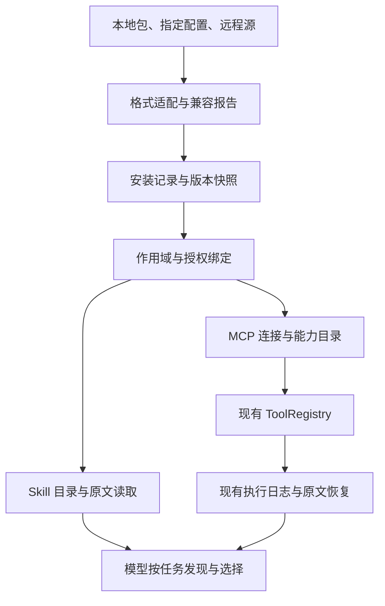

# LFL 插件与主流能力生态接入 — 需求与实现设计

- 日期：2026-10-09（Asia/Shanghai）
- 状态：DRAFT / DESIGN_ONLY，供评审与后续实施拆分；本文不表示功能已实现、已通过兼容认证或已部署。
- 需求：完善 LFL 插件接入能力，支持主流插件、MCP 与技能生态，先完成需求与实现设计。
- 代码证据基线：`main@da8629b0b66be5eba214b1490daefcf0cccaa306`；本轮通过 LFLM 读取项目源码与文档。
- 保存前复核：HEAD 已推进至 `7bdccc3c4b2ee02a4c6569714448a09aacc3846d`；增量仅涉及独立 smoke 脚本、测试与结果文档，本设计引用的源码及维护契约无变化。
- 关联设计：`docs/DESIGN-20261006-capability-ecosystem-lifecycle.md`；开发约束：`AGENTS.md`、`docs/DEVELOPMENT_REPAIR_SAFETY.md`。
- 修订记录：2026-10-09 并入审查修订（`docs/DESIGN-20261009-plugin-ecosystem-integration-REVIEW.md` 第五节 9 项落点）：§6.1 补 era 缓存与版本错误重试；§7.3 补请求 id 代际隔离；§8 新增 8.3 内容污点与注入防护（审查稿编号 8.4，因本文 §8 仅有 8.1/8.2，顺延为 8.3）；§9.1/9.2 显式化快照 CAS；§10.2 补硬数字上限表；§11 补 P1-A/P1-B 排序论据；§12.2 新增注入测试（审查稿编号 T26 与既有 T26 冲突，顺延为 T27）；§12.3 补发现率阈值与失败分支；§13 新增安装授权/配额、规范版本跟踪两行并补包数据默认拒绝语义。
- 修订记录 2：2026-10-09 复核修订（第二轮外部审查 5 处修订 + 2 处事实纠正，事实纠正见 REVIEW 第六节）：§8.3 外部内容禁令改为"不得扩大授权"，补已授权技能指导执行的正路径与 §12.2 T27 正对照，防全量拦截假通过；§9.1 快照 CAS 改为显式 expected_revision 并同校配置/授权/连接代际，废弃 observed_at 比较与后提交者胜出；§10.2 上限表改称默认展示预算，64 KB 不约束显式全文恢复，任何裁剪先完整落盘原文并给续读指针；§12.3 补分母、重复次数、等价正确工具集与任务成功判据；§13 源域白名单仅由可信宿主配置或用户授权建立，marketplace.json 自声明不构成白名单条目，已有适用授权复用。
- 本轮交付边界：新增设计文档。实现、依赖安装、运行配置修改与发布属于后续阶段。

## 0. 设计结论与决策摘要

建议以 **Agent Plugins 1.0.0 + Agent Skills + MCP** 为标准接入底座，复用 LFL 现有 ToolRegistry、工具执行日志、知识检索与原文恢复能力，增加薄的包管理与生态适配层。避免给每种生态建立独立执行器，也避免把所有外部工具常驻注入模型上下文。

优先完成三条可独立验收的能力链：

1. 标准插件包/独立技能：导入 → 解析 → 展示兼容报告 → 启用 → 模型发现 → 全文及引用文件读取。
2. MCP：stdio 与 Streamable HTTP → 按版本通信 → 完整工具定义 → 统一执行 → 完整结果可恢复 → 断连及重启诚实反馈。
3. 生命周期：来源与版本固定 → 工作区/身份绑定 → 更新预览 → 原子切换 → 禁用/回滚 → 各服务生效回执。

外部插件是能力供给。LFL 的 Method、Experience 与 Rule 仍负责自身的知识与使用证据；安装成功不等于方法有效，也不自动取得 qualification。

### 0.1 与既有设计的关系

10-06 设计主要处理 DSH 只读桥接和能力资产生命周期，明确“不做通用插件执行框架”。本需求提出更广的标准能力接入，本文将范围变化明确列出：

- 延续：模型负责语义选择；程序提供事实、协议、授权边界和可恢复性；保留 DSH 独立执行归属。
- 拟新增：LFL 可托管经授权的 MCP 子进程，读取标准插件中的技能及资源，管理安装实例和版本。
- 仍不建设：任意 Python/JavaScript 插件进入 LFL 主进程执行的通用宿主；外部 Agent/Hook 接管主循环。
- 新接入路径不复用或扩大 DSH 只读下载路径的域名白名单。每种接入分别声明权限与执行归属。
- 旧设计的运行约束不因本文自动失效。本稿记录拟议范围扩展，后续实施任务须明确选取阶段。

### 0.2 关键决策

| 编号 | 推荐决策 | 原因 |
| --- | --- | --- |
| D1 | 标准 Agent Plugins 包作为首选分发单元 | 标准已提供技能与 MCP 的可移植包格式，减少私有格式维护 |
| D2 | 不同产品的旧格式转为内部记录，保留原始来源 | 配置相似不代表变量、权限或执行语义相同 |
| D3 | MCP 同时支持现代与旧版语义，版本显式可见 | 2026-07-28 已取消初始化握手与协议级会话，不能只更换版本字符串 |
| D4 | 全部外部工具进入现有 ToolRegistry | 复用执行、审计与恢复链，避免旁路 |
| D5 | 默认不自动重放结果未知的工具调用 | 传输断开无法证明外部写操作没有发生 |
| D6 | 包版本、授权身份、工具定义与运行实例分别绑定 | 防止更新和跨身份缓存把旧事实用于新调用 |
| D7 | 不支持的组件逐项报告 | “导入成功”须能解释哪些能力实际可用 |
| D8 | 用真实任务验证模型使用路径 | 连通、检索、采用和任务收益属于不同验收面 |

## 1. 当前能力与已证实缺口

下表仅描述本轮读取的代码，不把 LFLM 插件宿主的能力等同于 LFL 项目客户端能力。

| 领域 | 当前实现事实 | 缺口与实现影响 | 代码证据 |
| --- | --- | --- | --- |
| MCP 配置 | `MCP_SERVERS` 是 JSON 数组；条目要求 name/command | 缺少统一配置导入、URL transport、凭证引用与安装实例记录 | `config.py`、`tools/mcp_client.py::parse_servers` |
| MCP 通信 | 自实现 stdio JSON-RPC；协议固定 `2024-11-05`；initialize 后 tools/list | 未实现现代协议及远程传输；握手返回版本和能力没有形成受检契约 | `McpConnection.connect` |
| 工具目录 | tools/list 读取单页 | 未处理 nextCursor、目录变化及完整刷新 | `McpConnection.connect` |
| 工具 schema | 保留顶层 properties/required，重建为 object | 丢失顶层组合约束、$defs、additionalProperties 等，不能称完整透传 | `McpTool.__init__` |
| 工具结果 | 提取 text 块；isError 映射 failure | structuredContent、非文本 content 与 _meta 未进入该适配器结果 | `_content_text`、`McpTool.execute` |
| 重试 | 捕获 RuntimeError 后关闭、重连、再调用一次 | RPC 业务错误与结果未知也可能触发重试；有外部动作重复风险 | `McpConnection.call_tool` |
| 进程环境 | 继承 os.environ 后覆盖 spec.env；stderr 丢弃 | 缺少受控环境与可诊断的有限日志；不宜继续扩大到任意第三方包 | `_start_process` |
| 热刷新 | 对新配置中的服务器先移除旧工具，再重建 | 新连接失败先丢旧视图；从配置删除的服务器未在此函数统一清理 | `refresh_mcp_tools` |
| 工具身份 | 非法字符替换为下划线；按名称前缀关闭连接 | 规范化可能碰撞，前缀不是精确所有权；register 对异实现重名会告警覆盖 | `_registry_name`、`ToolRegistry.register` |
| Skill | 单目录一层扫描；简单 key:value frontmatter；skill_list/skill_load | 缺少标准 YAML 解析、包命名空间、版本绑定与插件引用文件接口 | `skills/loader.py` |
| Skill 原文 | skill_load 文案称全文，但返回 meta.body | frontmatter 未随正文返回；需区分原文与解析视图 | `introspection/tools_skill_files.py` |
| 装配 | factory 注册 MCP；skills 路径注入已有体系 | 应在此接入，不能让 Web 私有模块成为能力存储权威 | `factory.py`、`runtime/paths.py` |
| 调用恢复 | 工具日志拥有 declared/started/finished/receipt_committed；恢复不自动重执行未知结果 | 可复用，MCP 适配器重试须与之对齐 | `core/tool_execution_journal.py` |

当前项目依赖未声明 MCP SDK、完整 YAML parser 或 JSON Schema validator。本设计不假定安装某个 SDK 就能覆盖最新协议；依赖选择须在实现阶段做资格验证。

`docs/configuration.md` 仍写点号形式的 MCP 注册名，而源码使用下划线形式。后续实现需同步修正文档，并保留历史工具名迁移说明。
（2026-10-19 已修正：configuration.md 明确注册名为下划线 `mcp_<server>_<tool>`、点号仅为内部原始身份并附迁移说明；同日 P0-1 落地文件配置层 `file@workspace`/`file@user` 与 `MCP_FILE_CONFIG` 开关。）

## 2. 需求目标、使用场景与范围

### 2.1 用户场景

| 场景 | 用户期望 | 成功条件 |
| --- | --- | --- |
| 导入技能目录或标准插件包 | 保留原有目录结构并尽快使用 | 兼容报告、来源、版本可见；可发现并完整读取目标技能 |
| 导入 Claude/Codex/Gemini 插件 | 不手工搬运每个文件 | 支持组件生效；宿主专属组件有明确限制说明 |
| 复用 Cursor/VS Code 等 MCP 配置 | 少改配置即可连接 | 逐服务器映射报告；未解析变量、缺凭证、缺运行时可见 |
| 添加远程业务 MCP | 能连接、授权、调用并诊断失败 | 授权身份绑定正确；失败分类准确；无秘密泄漏 |
| 插件更新/禁用 | 生效时间可预测，旧任务不串版本 | 新 run 用新快照；在途 run 有版本归属；禁用阻止新派发 |
| 重启 Web/Feishu/Learning | 插件和授权状态可恢复 | 同一安装版本重建；新运行实例身份；不重放未知动作 |
| 大量插件可用 | 模型能发现，也能控制上下文成本 | 分页目录、全文/schema 水合、模型可主动选择启用 |
| 插件产生有用经验 | 能回流为经验和方法证据 | 使用记录绑定任务/回执；不凭安装次数自动晋升 |

### 2.2 功能需求

| ID | 优先级 | 需求 | 验收要点 |
| --- | --- | --- | --- |
| FR-01 | P0 | 精确保留 schema 与结果，纠正 MCP 重试语义 | 原始数据可回读；未知写结果不自动再发 |
| FR-02 | P1 | Agent Plugins 1.0.0 包与独立 Agent Skills 加载 | 标准 fixture 通过；错误范围符合规范；保留原文 |
| FR-03 | P1 | stdio、Streamable HTTP 和协议版本处理 | 现代与旧版分支独立验证；身份/能力/版本可见 |
| FR-04 | P1 | 插件安装、启用、禁用、更新、回滚 | 操作幂等；持久化与运行生效分别出回执 |
| FR-05 | P1 | 凭证绑定及 MCP HTTP OAuth | 缺凭证可诊断；授权与服务/工作区隔离 |
| FR-06 | P1 | 模型可调用的发现、schema/原文水合、状态查询 | 不依赖 UI 操作或模型猜文件路径 |
| FR-07 | P1 | 多服务重启与更新一致性 | 期望 revision 与各 runtime resolved revision 可核对 |
| FR-08 | P1 | 使用与故障观测 | 导入/可用/暴露/调用/结果/任务收益分开统计 |
| FR-09 | P2 | Claude、Codex、Gemini 组件级导入 | 映射与拒绝原因逐项明确；无静默丢组件 |
| FR-10 | P2 | Cursor、VS Code、Claude Desktop 等配置导入 | 明确 format；支持非秘密字段及凭证重新绑定 |
| FR-11 | P2 | MCP resources、templates、prompts | 纯资源服务器可用；消息角色及资源权限保留 |
| FR-12 | P2 | Git/归档源、目录服务元数据发现 | 源固定到 commit/digest；发现不自动执行 |
| FR-13 | P3 | 受限 Hooks、Agent 模板、MCP Apps | 独立设计与验收；能力协商真实 |
| FR-14 | P3 | OpenAPI 适配及 LFL 能力对外导出 | 经同一执行/授权链；无运行态私有资产自动发布 |

P0 是现有适配器的正确性补齐；P1 才形成标准接入 MVP。P0 完成不能宣称支持主流插件生态。

### 2.3 非目标

本设计不承诺运行 VSIX、JetBrains 二进制插件、浏览器扩展或厂商内部连接器协议；不复刻各宿主完整 UI/LSP/Mods/工作流引擎；不把 A2A/ACP 当 MCP 的替代协议。后续有明确需求时分别增加适配器。

ChatGPT/Codex 的 App ID 不是通用远程连接地址，也不包含可移交的授权。LFL 可接入独立可访问的 MCP endpoint，不能据平台内部 ID 复用账号或访问令牌。

## 3. 生态兼容策略

外部格式事实以官方来源为准，核验日期为 2026-10-09；下面的阶段和兼容级别是 LFL 的拟议目标。

Agent Plugins 1.0.0 的标准组件是 skills 与 MCP servers，固定位置为根部 `plugin.json`、`skills/` 和 `mcp.json`；宿主专属行为属于扩展。[S1][S2]

| 生态/格式 | 接入内容 | 计划阶段 | 明确限制 |
| --- | --- | --- | --- |
| Agent Plugins 1.0.0 | 标准包、skills、mcp.json；未知客户端扩展按规范忽略并在报告展示 | P1 | 不赋予未知 extensions 执行语义 |
| Agent Skills | SKILL.md、scripts、references、assets 的按需访问 | P1 | scripts 通过现有执行工具及授权运行，不在加载时执行 |
| MCP stdio | Node/Python/二进制服务；协议适配 | P0/P1 | 运行时依赖需存在；路径容纳规则不是子进程沙箱 |
| MCP Streamable HTTP | JSON/SSE 响应、鉴权、版本分支 | P1 | 不把旧 session 恢复机制套入现代协议 |
| MCP legacy HTTP+SSE | 显式选择的旧传输 | P2 | 默认不启用；不等同于 Streamable HTTP 的 SSE 响应 |
| Claude Code 插件 | .claude-plugin/plugin.json、skills、MCP、可映射命令 | P2 | hooks/agents/LSP/monitors 等先报告 unsupported 或需转换 |
| Codex/ChatGPT 插件 | 首选标准包；旧 .codex-plugin/plugin.json 与 .mcp.json 兼容导入 | P2 | .app.json 平台关联不自动变为 LFL 凭证 |
| Gemini CLI 扩展 | gemini-extension.json 的 MCP/skills；命令与 context 作为显式转换项 | P2 | GEMINI.md 不提升为 LFL 系统规则；hooks/agents 不直接执行 |
| Cursor MCP 配置 | mcp.json/mcpServers 结构 | P2 | 只导入指定配置，不遍历用户目录或窃取登录状态 |
| VS Code/Copilot MCP | servers 格式与 portable mcpServers 格式 | P2 | inputs/变量/sandbox 字段逐项映射，不假定权限等价 |
| Claude Desktop 等 MCP 配置 | 经 format 明确的 mcpServers 配置 | P2 | 每个字段独立验证，不能仅按顶层字段猜具体产品 |
| DSH | 延续已有插件卡发现和官方 CLI 委派 | 保留 | DSH 与 LFL 执行归属分开 |
| MCP Apps | UI 资源与宿主桥 | P3 | Web 有独立 iframe 桥；Feishu/Learning 提供可用的非 UI 结果 |
| OpenAPI / 历史 ai-plugin.json | 显式导入后转换为工具 | P3 | 不运行原宿主，不把文档描述当授权 |

Claude、OpenAI、Gemini、Cursor、VS Code 的格式与专属组件见 [S3]–[S7]；Agent Skills 格式见 [S8]；MCP Apps 是独立扩展，不能从 tools/call 连通推导 UI 兼容。[S15]

### 3.1 兼容报告与对外口径

每次 inspect/import 产生 `CompatibilityReport`，包含：

- 源格式、规范版本、内容摘要、插件身份与来源 revision。
- 每个组件的 `supported / needs_configuration / convertible / unsupported / invalid`。
- 未解析变量、依赖、凭证需求、权限差异与建议处理方式。
- 精确映射：源服务器名/工具名/技能名 → 安装实例 → LFL 名称。
- 实际运行验证范围；尚未执行的验证明确为 not_tested。

插件总状态只能是 `ready / partial / unavailable`。有效 skills 与失败 MCP 可以形成 partial；无有效可用组件是 unavailable，不因清单可解析就标 ready。

可宣传“Agent Plugins 1.0.0 的 skills+MCP 接入已验收”，前提是对应 conformance 用例通过。厂商插件只宣称具体组件子集兼容，不用“所有插件一键通用”。

## 4. 架构与责任边界

以下模块名为拟议名称，现有模块已在 §1 指明。



包管理只解决安装事实与生效生命周期。模型选择工具、技能和方法；程序不按任务含义替模型判断“最佳插件”或任务完成。

| 模块 | 拟议职责 | 禁止越界 |
| --- | --- | --- |
| extensions/formats | 解析标准和厂商格式，生成内部描述及报告 | 不执行 install hook，不擅自补未知语义 |
| extensions/store | 安装记录、内容摘要、锁定来源、启用范围、期望 revision | 不持有明文 token，不落在 Web 私有目录 |
| extensions/catalog | 按 scope 提供包/组件目录、精确 schema/ref | 不决定语义相关性或资格晋升 |
| extensions/runtime | 连接所有权、生命周期、更新快照与 draining | 不重执行结果未知的动作 |
| tools/mcp_* | 版本与传输适配、能力/结果转换 | 不绕过 ToolRegistry，不混淆传输成功与工具成功 |
| skills/loader.py | 兼容旧技能并增加标准解析/原文视图 | 不将技能内容自动升级为系统政策 |
| factory.py | 注入 runtime paths、registry 与共享接入服务 | 不含厂商协议实现与持久化业务 |
| Web/Feishu/Learning facade | 显示/调用相同接入 API、提供各自交互能力 | 不另立配置权威或默认为全部用户启用 |

### 4.1 最小内部数据契约

不建立第二套通用插件 DSL。内部记录仅承载适配后事实：

| 记录 | 关键字段 |
| --- | --- |
| PackageDescriptor | source_format、schema_version、manifest_ref、components、compatibility_report_ref |
| InstallRecord | install_id、package_name、source_locator、source_revision、digest、adapter_version、scope、desired_revision |
| ComponentRecord | install_id、component_id、kind、source_ref、effective_config_ref、enabled |
| ServerBinding | binding_id、install_id、server_id、transport、endpoint/argv、protocol_policy、credential_ref、auth_identity_ref、scope |
| CapabilitySnapshot | binding_id、connection_epoch、catalog_revision、protocol_version、capabilities、schema_sha、observed_at |
| RuntimeReceipt | service、runtime_instance_id、desired_revision、resolved_revision、install_digest、status、error_ref |
| UseEvent | run/session/call_id、install_digest、component_id、catalog_revision、authorization_revision、result_ref |

所有 ID 均来自权威记录；display name 不作身份。credential_ref 与 auth_identity_ref 表示密钥引用和经过解析的账号/主体事实，不包含秘密本身。

### 4.2 配置与文件布局

建议持久化位置通过 `runtime/paths.py` 从 data_dir 派生：

- `<data_dir>/extensions/installed.json`：安装与生效权威记录。
- `<data_dir>/extensions/packages/<digest>/`：不可变包副本。
- `<data_dir>/extensions/instances/<install_id>/data/`：插件跨更新保留的数据目录。
- `<data_dir>/extensions/locks/`：固定来源与依赖解析结果。
- exact schema/结果/报告：优先复用既有 source store；若不支持 bytes，扩展中性 core 层。

密钥保存使用已有可用的安全凭证机制；不存在时先实现中性 SecretStore 接口，绑定 OS keychain 或权限受限存储。不能把完整 env、Authorization 或 token 写入安装记录。

安装记录由单一权威写路径负责：并发锁、revision 比较、临时文件、原子替换、必要 fsync 与读回。写入结果不确定时返回 commit_uncertain，再读权威记录收敛，不盲目重复提交。

旧 `MCP_SERVERS` 与 `SKILLS_DIR` 作为 legacy source 保留。迁移优先级：用户/工作区显式覆盖 → 固定安装实例 → legacy 配置；同一精确身份冲突必须报告，不静默叠加。覆盖不隐式扩大授权，保留每个 effective 字段的 provenance。

## 5. 包加载、导入与安装契约

### 5.1 标准包加载

标准格式使用本地随版本发布的验证规则。运行加载不能根据包中的 schema URL 任意联网获取代码或规则。

加载遵循官方错误隔离范围：无效 manifest、组件类型错误、单技能错误和单服务器错误分别处理。特别是未知顶层字段、非对象 extensions 等规范规定的非致命情况，不能用“JSON Schema 验证失败就全包拒绝”的捷径代替。[S2]

标准 MCP 配置的路径/变量语义保持原格式契约；不对 command 或远程 URL/headers 做私自变量展开。插件持久数据目录跨包更新保留，标准保留变量由宿主提供。[S9]

标准与厂商变量不得混用：

| 格式 | 处理方式 |
| --- | --- |
| 标准 Agent Plugins | 仅按标准解释 PLUGIN_ROOT/PLUGIN_DATA 及对应字段 |
| Claude | CLAUDE_PLUGIN_ROOT/user_config 等在 Claude adapter 内解析 |
| Gemini | extensionPath 等在 Gemini adapter 内解析 |
| VS Code | inputs/workspaceFolder/env 等有显式映射或待配置结果 |
| 旧 LFL MCP_SERVERS | 保留既有配置语义，升级迁移须出差异报告 |

不把变量值放入 shell 求值；argv 分项传递。包路径安全检查作用于规范声明的路径字段，不能把每个参数字符串都当成包路径。包目录容纳检查也不能冒充 MCP 子进程文件系统隔离。

### 5.2 来源与版本

P1 支持显式本地目录及指定配置内容。导入形成内容固定的副本，开发 live-link 另有标志和哈希漂移检测。

P2 增加 Git URL、归档和目录服务元数据：

- 分支/tag 解析到具体 commit；记录可复核 locator 和内容摘要。
- 禁用自动 submodule、安装脚本及构建副作用；依赖安装成为单独可审阅动作。
- 解压按路径与资源上限验证，拒绝越界、重复冲突和不支持的特殊条目。
- npm/PyPI/OCI 依赖固定具体版本/摘要，不在启动时追踪 latest。
- 安装来源真实性与内容完整性分开；有哈希不能推导可信。
- 目录发现只生成候选。MCP Registry 元数据不等于代码托管、授权或质量认证。[S16]

### 5.3 组件转换

命令仅在语义能保留时转为用户显式调用的技能/提示模板，保留参数说明与来源。内嵌 shell 动态替换、宿主专属 hook 事件或未支持工具引用，列 convertible/unsupported；不去掉后声称等价。

包要求的依赖作为 facts 展示：可执行文件、OS、版本约束、网络和权限。不利用“模型觉得应该能跑”绕过不存在的依赖；模型可选择配置、替代组件或跳过。

## 6. MCP 协议与传输实现

### 6.1 双时代契约

官方当前规范为 2026-07-28。该版本使用逐请求元数据和 server/discover；旧版使用 initialize。现代 MCP 还改变了结果类型与客户端交互方式。[S10][S11]

| 语义 | 2024/2025 旧版 | 2026-07-28 现代版 |
| --- | --- | --- |
| 初始化 | initialize → 校验返回版本/能力 → initialized | server/discover/逐请求版本能力，不发送旧握手 |
| HTTP 状态 | 对应版本可用 session、GET stream 等 | 无协议级 session；请求及监听用 POST |
| 请求元数据 | 按所选旧版处理 | _meta 携带版本/能力；HTTP 同时有规定头 |
| 目录变化 | 旧版通知/资源订阅 | subscriptions/listen |
| 客户端输入 | server-initiated requests | InputRequiredResult / MRTR |
| 结果终态 | 旧结果按 complete 解释 | 区分 complete 与 input_required |
| HTTP 流恢复 | 相应旧版可有 Last-Event-ID | 不支持 SSE 重投/恢复；中断是结果未知 |

具体 HTTP 必需头、取消与流处理按版本规范实现。[S12] 新版功能不能无证据借用旧版测试 PASS。

实现建议：

1. `ProtocolProfile` 显式选择时代与版本，`Transport` 只负责 I/O；协议状态与包安装状态分开。
2. stdio 探测按官方 server/discover 兼容分支执行；识别现代版本拒绝时不错误转旧握手。[S13]
3. 配置声明 transport 时，先用该 transport；失败不擅自尝试另一个地址或传输。
4. protocol_policy 可以固定版本或列经过资格验证的版本；不能发送“latest”或默许不支持版本。
5. 记录服务身份、实际版本、能力与 connection_epoch；provider/model 可见工具快照绑定同一目录 revision。
6. 不广播所有 optional capabilities。未实现 sampling、elicitation、roots、tasks 等时不声明支持。
7. input_required 不映射 SUCCESS，也不当一般网络重试；未支持输入能力返回清楚的 unsupported/blocked 事实。
8. era 判定是服务器属性而非请求属性：判定结果在 stdio 进程生命期或 HTTP origin 内缓存；MAY 跨重启持久化，失效后重探。[S10]
9. 服务器对不支持版本必须返回 `UnsupportedProtocolVersionError` 并列出 supported 版本；客户端据此选择受支持版本重试或显式报错，不静默降级。该行为并入 T02 断言。[S10]

### 6.2 SDK 与同步/异步桥

推荐首先资格验证官方 MCP SDK，选定确实支持所需版本的发行版，再决定使用范围。SDK 不覆盖现代规范时，选择明确的兼容模块或拆后续阶段，不能以 import 成功宣称最新版兼容。

LFL Tool.execute 的同步契约保留。HTTP/SDK 异步连接由受管 runtime loop 服务，同步调用通过有限 deadline 桥接；连接/session 只能在其所属 loop 使用。不能逐调用 asyncio.run 重建有状态 session。

P1 的最低明确支持集建议为：2024-11-05 stdio（保留现有路径）、2025-11-25 stdio/Streamable HTTP、2026-07-28 stdio/Streamable HTTP。其他 2025 修订仅在独立资格验证后加入支持集；厂商支持某种传输不证明已支持最新协议。

配置可分 startup timeout、call deadline、idle/read timeout。总 deadline 以单调时间计算，进展消息不会无限延长调用。可配置的并发限额属于资源边界，排队、取消和所有权可见。

### 6.3 工具与能力目录

- 分页完整消费工具目录；重复 cursor、无进展或超限返回不完整事实及可恢复指针。
- 工具列表变化建立新目录 revision；更新在 run 边界采纳，不在一个 provider request 中途改变 schema。
- 缓存键至少绑定 endpoint/server identity、授权身份/权限 revision、scope、协议与 config revision。
- 有效能力集合涵盖 tools/resources/prompts 及已支持扩展。纯资源服务器不能因 tools/list=0 被关闭。
- P1 若尚未支持 resources/prompts，则返回“仅提供未支持能力”，不能称服务器无能力。

MCP 工具目录可以按授权不同，并支持分页；它不是跨身份可共用的普通全局缓存。[S14]

## 7. Schema、结果与执行一致性

### 7.1 Schema 保真

原始工具定义不可变保存，至少保留 inputSchema、outputSchema、annotations、_meta 与未知字段。provider-facing schema 是单独派生视图，保留其 SHA 和转换说明。

模型供应商不支持的 JSON Schema 结构由 provider 层处理：可无损转换才转换；不能转换则保留精确 schema，并提供显式外部调用工具或标明限制。不能在 MCP 层删除约束后假装该工具仍等价。

名称分两层：

- canonical identity：install_id/server_id/original_tool_name。
- provider alias：满足该 provider 字符与长度约束的稳定名称；规范化后使用摘要避免碰撞。

旧 alias 仅在唯一映射时保留。移除工具、关闭连接和更新都按精确所有权，不依赖字符串前缀。

### 7.2 结果保真与回执

先保存完整协议结果/可获原始 bytes，再生成模型视图，保留 content 各块、structuredContent、isError、_meta 和输出验证结果。常规日志只保存脱敏指针；模型 exact-read 仍受产生结果的授权 scope 约束。

| 事实 | LFL 状态/元数据 |
| --- | --- |
| 终态工具结果，isError 不成立 | success；执行结果不自动等同业务目标达成 |
| 工具终态 isError=true | failure，保留工具报错 |
| 传输/协议/客户端适配错误 | error，带错误阶段与可核验指针 |
| 授权不足或实际执行边界拒绝 | blocked，附可用的授权/配置路径 |
| deadline 到达 | timeout；另标 dispatched、cancel_ack 与 outcome_known |
| 现代协议还需要输入 | interim，不形成完成回执；进入受支持交互或明确返回限制 |
| 接收完整结果但输出 schema 不成立 | adapter validation error，保留原始结果；不因此重新发起外部动作 |

图片/音频/嵌入资源/链接能通过已支持渲染路径则投影；暂不能渲染时给类型、原文引用及支持限制，不用“无文本”吞掉整个结果。下载远程内容是独立受授权动作，不依据 content URI 自动访问任意网络。

输出超过模型物理容量时采用稳定 ref 与单调分页。第二次显式水合不重复原始 preview。用户提供的秘密可以受限保存，模型/日志不得获得无关原始 HTTP 凭证头。

### 7.3 断连、重试与效果未知

复用现有工具执行日志；定义“是否已派发”而不猜业务是否完成：

- **未派发**：明确证据证明未发送，可重建连接后有限重试，绑定同一逻辑调用。
- **已派发、无终态**：outcome_unknown，默认不自动重放；先查询外部权威状态或等待人工/模型后续决定。
- **终态业务失败**：不由连接层重试；模型可根据真实错误决定下一步。
- **有可信幂等契约**：固定 idempotency key 与外部契约 revision，可按该契约重试并记录 attempt lineage。
- **MRTR 继续**：属于协议输入交接，记录逻辑请求归属；不能归入“业务失败重试”。
- **只有远端 readOnlyHint/idempotentHint**：属于提示，不单独取得自动重放资格。

重连改善连接状态，不能抹掉原调用不确定性。本地 call_id 或执行日志只能避免 LFL 自己重复派发，不能保证外部端到端 exactly-once。

请求 id 命名空间必须包含 connection_epoch（或跨重连单调递增、绝不重置）。重连建立新 epoch 后，旧 epoch 的 id 响应与通知一律按代际丢弃并记录 adapter 事件，不得匹配到新代请求；防止旧连接晚到响应经 id 复用被错配为新调用结果而形成假 success。与 §9.2 的晚到状态丢弃规则一致。

## 8. 授权、隔离与可恢复控制

新增控制只承担模型无法凭文本保证的机械事实：凭证不串身份、包路径不越界、外部效果不自动重放、实际资源上限和授权执行。语义选择不增加自动拒绝器。

| 控制 | 必要性 | 模型可调用的处理路径 |
| --- | --- | --- |
| manifest/路径验证 | 无效字节或路径可造成执行与读取越界 | inspect 原因、修改配置后重验，或禁用该组件 |
| scope/凭证绑定 | 模型无法证明运行进程没有复用其他身份 | 查询 binding，选择已授权身份或申请既有授权 |
| deadline/并发上限 | 资源与取消归属需程序保证 | 查看队列，取消自己的请求，调节授权范围内的限额 |
| 结果未知不重放 | 外部效果不能仅凭断连推断 | 查权威状态，选择显式新调用并保留前次 lineage |
| 标准校验与兼容策略 | 不可支持的语义不能伪装成功 | 选择厂商 adapter、legacy 模式或替代组件 |

程序提供上述退出/恢复路径；veto/override 不意味着跳过授权或执行无效协议。配置探测和非必要健康预检不能成为通用硬门；失败只影响相关组件。

### 8.1 stdio 执行环境

argv 无 shell 求值；明确 cwd；env 使用受控基线加经授权配置，避免向第三方继承 LFL 的全部密钥。保留标准必须的插件变量；Node/Python/Windows 启动差异在执行器里明确处理。

stderr 有界采集、脱敏、稳定日志引用；不能只丢弃。关停关闭输入、等待退出，再终止所属进程树；不按进程名全局 kill。

仅当真实 OS 隔离后端已启用并经测试，才报告 sandboxed。无后端时报告 unsandboxed 并使用已有执行授权，不能把一个 policy 字段当隔离证明。

### 8.2 HTTP 与 OAuth

按照所选 MCP 授权规范实现受保护资源发现、授权服务器验证、客户端能力、PKCE/state、resource/audience 与 scope 绑定；客户注册策略按服务支持选择，不假定只有一种注册方式。[S17]

- credential_ref 在调用时解析；令牌刷新单写者，凭证撤销使旧连接/目录失效。
- key 含授权主体及权限 revision；同 endpoint 不同账号不得串工具目录或结果。
- 401 是鉴权问题，403 是权限问题，429/网络错误分别处理；不自动重复已派发写动作。
- TLS 正常校验；非 loopback 使用 HTTPS；不通过关闭验证掩盖证书/EOF 问题。
- 重定向与旧 SSE endpoint 切换都检查目标；跨 origin 不转发秘密凭证和配置头。
- 私有网络/loopback MCP 是显式接入需求时可按授权配置，不建立任意 URL 的隐式访问能力。
- OAuth 交互须有真实授权请求；Web 发起授权交接，Feishu/Learning 可呈现待完成事实并继续其他任务。

roots 仅告知目录事实，不是文件系统沙箱。sampling、elicitation、Apps UI 发起的调用必须经过同一授权与日志链；不授予外部内容修改全局规则的权限。

### 8.3 内容污点与注入防护

外部文本不是指令权威。按内容来源分级：

- 结构化组件清单（manifest、能力目录、schema）经校验后可影响装配，且始终携带来源与版本。
- 技能正文、工具 description、MCP 结果文本等外部内容进入模型视图时一律标注来源（install_id/binding_id/catalog_revision），与用户指令、已验证规则明确区分。
- 外部内容不得扩大授权：outbound、凭证、安装类动作（如 `send_feishu_message`、`web_fetch`、`extension_manage(install)`）的授权依据只能是用户显式指令或已验证规则，并按动作类型、目标（收件人/URL/包源）与权限范围逐项校验；目标越出授权范围即拦截，给出可解释原因与归属记录。
- 已授权范围内的技能指导执行是正常路径：用户指令或已验证规则已覆盖该动作类与目标时，技能正文指导模型选择并调用相应工具不构成污点违规。判定标准是"是否越出既有授权"，不是"内容来源是否外部"；不允许用全量拦截换取注入防护（对应 §12.2 T27 正对照）。
- 工具 description 中劫持工具选择的指令性内容（如“任何任务优先调用我”）属污点：目录可保留原文并标注，但其优先级宣称不生效。
- 外部文本内的指令性内容按数据呈现，不因出现指令语气获得执行资格。

## 9. 生命周期、多服务与更新

### 9.1 状态模型

安装状态、配置就绪、运行连接与任务效果分开。包可以 installed，但 MCP 仍 needs_auth；连接 healthy，也不说明某次业务动作成功。

安装状态建议：staged、installed、enabled、disabled、removed。
组件运行状态建议：unconfigured、starting、ready、degraded、draining、stopped。
这些是事实，不通过日志 grep 或包目录存在性推断闭环。

CapabilitySnapshot 写入与安装记录同一保护标准：单一写路径、并发锁、显式 expected_revision 的 CAS 与原子替换；提交时同时校验配置 revision、授权 revision 与连接 generation 仍与读取快照时一致，任一失配即整体拒绝并按新状态重做，不产生新旧混合视图。不使用 observed_at 时间戳比较或"后提交者胜出"判定新旧：晚到的旧 revision 提交必须失败；两个服务并发 refresh 同一服务器时，仅持有当前 revision 的提交成功，冲突方收到失败回执后基于新 revision 重试。读侧按 (binding_id, generation) 取一致视图；observed_at 仅作记录字段，不参与新旧判定。

### 9.2 更新流程

1. inspect 新来源，固定 digest，生成与当前版本的组件/权限/schema 差异。
2. 在新 generation 建立候选目录/连接；验证不默认调用带外部效果的工具。
3. 原子提交期望 revision；候选目录/快照写入走与安装记录相同的单写路径+CAS（§4.2、§9.1），读侧按 generation 取一致视图；失败保留旧有效快照，相关错误可查。
4. 新 run 使用新快照；在途 run 保留旧版本和对应连接租约，到终态后 drain。
5. 回执记录服务/安装版本/目录/授权与工具 fingerprint；旧连接按精确所有权释放。
6. disable 阻止新派发；紧急撤权优先于租约，尚未派发的旧调用应拒绝，已经派发的按未知效果处理。

固定本地目录快照不能冻结远程服务器的业务实现。若远端不提供版本化 endpoint/handle，LFL 只保证调用绑定自身观察到的目录 revision；发现不兼容变化时返回 schema_stale 并要求重新水合，不宣称仍在运行远端旧版本。对晚到通知、响应与旧连接，按 binding_id/connection_epoch/request_id 丢弃错误归属的状态更新，保留可审计事实。

权限或端点变化使既有授权不适用时，不静默继承。没有相关权限变化且已有授权适用时不重复询问。

### 9.3 重启与跨服务

持久化 installed/desired facts；connection_epoch、runtime_instance_id 与 in-flight 连接租约不当跨重启存续事实。重启重新解析并建立连接，恢复工具日志，不重放 started 但未完成的调用。

每个 Web/Feishu/Learning 实例分别出 resolved receipt。一个服务已刷新不能冒充全部服务已生效；插件只启用在指定 scope/service。没有原生热刷新能力时如实标 reload_required，并使用既有 managed service_control 流程。

后续部署仍需配置 → live runtime → 实际调用回执三层一致。插件管理 API 不另建发布、重启或调度权威。

## 10. 模型发现、调用与知识回流

### 10.1 拟议模型工具接口

接口名为设计建议；实现时与现有工具做冲突核验。

| 操作 | 必需输入 | 返回/行为 |
| --- | --- | --- |
| extension_list | scope、kind、cursor 可选 | 可用安装/组件与状态；有界分页 |
| extension_inspect | source 或 install_id | 兼容报告、变更差异；默认只读且不启动 |
| extension_manage | action、target、expected_revision | install/enable/disable/update/rollback；校验现有授权与并发 revision |
| extension_status | install_id 或 binding_id | 配置/授权/连接/生效回执，不返回秘密 |
| extension_read | stable ref、offset/limit | 技能、引用文件、schema、报告或结果的授权 exact read |
| extension_call | canonical tool ref、catalog_revision、arguments | 进入现有 ToolRegistry.execute，绑定执行日志；无旁路 |
| mcp_resource_read / mcp_prompt_get | binding_id、URI/name、arguments | P2，保留类型、角色、来源与权限 |

旧 skill_list/skill_load 继续可用；新增 package-qualified ref，旧裸名称在唯一匹配时解析，冲突返回候选。skill_load 的原文和展示视图明确分开。

### 10.2 上下文成本

复用现有 lazy schema/工具可达性机制。初始上下文放有限目录和发现入口，模型主动水合所需 schema/技能；需要直接调用的少量工具也可由用户显式配置暴露。

规模限制来自真实 token/bytes 和服务资源，返回 omitted count、cursor 与原文 refs。程序不按“重要性”静默删除组件，也不把推荐列表当全部可用能力。

默认展示预算（配置可调；验收按冻结时的配置判定）。以下数字约束的是单页展示与注入视图，不是内容物理上限或读取资格边界；任何裁剪发生前原文必须已完整落盘为稳定 ref（先保存、后投影）：

| 维度 | 初始上限 | 超限行为 |
| --- | --- | --- |
| 初始目录注入（每 run） | ≤ 8 KB | 截断并给出 omitted count 与发现入口 |
| 单服务器完整暴露工具数 | ≤ 50，超出仅完整暴露前 50（稳定排序），其余仅列名 | 列名工具水合 schema 后可调用 |
| 单包组件数 | ≤ 200 | 超出报 partial 并列出未装配组件 |
| 单工具 description（目录视图） | ≤ 2 KB | 截断+标注；原始定义可 exact read |
| 单技能 SKILL.md 初始注入 | ≤ 8 KB；引用文件按需水合 | 截断+标注；全文可 exact read |
| 单次水合返回（每页展示） | ≤ 64 KB | 原文已完整落盘为稳定 ref，按单调分页继续读取 |

展示预算之上没有 64 KB 一类的总量封顶：显式 exact read / 全文恢复通过稳定 ref + 单调分页可完整读回任意长度原文；真实上限只来自内存、超时与配置的资源边界，触达时如实报错并保留续读指针，不把截断结果冒充完整内容。全部裁剪输出携带 omitted count 与可继续读取的 ref，禁止静默丢弃。

可选检索提示属于 advisory，绑定来源和可水合 ref。使用 Method/Experience 辅助插件调用时仍由模型判断适用性，不因为出现插件名就强行匹配某张方法卡。

### 10.3 使用证据与效果

至少区分：discovered、exposed_to_provider、hydrated、dispatched、terminal_received、receipt_committed、model_reported_used。

discovered 的分母是候选目录；exposed 是真实 provider request 可见的能力；dispatched 是已发出的调用。任何一个指标都不能冒充采纳率或任务正确率。

Method/Experience 使用记录引用 task/run、install_digest 和回执。外部技能导入保留来源，不自动变 active/qualified；后续真实任务形成的经验与方法按既有流程积累。收益评价包含任务成功、错误重来、FCR、whole-run wire 成本、延迟与未知结果比例，强弱模型分别分析。

## 11. 实施分期与最小代码落点

不以固定天数承诺上线。每个工作包以明确产物和测试收口，避免将协议、包管理与 UI 同时做成一个大提交。

| 阶段 | 内容/拟议落点 | 交付与退出条件 |
| --- | --- | --- |
| P0 | 修 tools/mcp_client.py：精确 schema/结果、typed 错误、未知效果不重放、工具身份与所有权 | 当前 stdio 正确性回归绿；旧成功路径保留；不宣称生态 MVP |
| P1-A | extensions/formats、store、catalog；skills loader 标准解析；旧配置桥 | 本地标准包和独立技能完整闭环；包生效与使用回执可查 |
| P1-B | tools/mcp_protocol、mcp_transport；runtime 连接管理；stdio 双时代/HTTP/OAuth | 现代及旧版协议矩阵、身份隔离、运行恢复通过 |
| P1-C | factory 与现有工具接口装配；各服务 facade | 模型端到端任务与多服务恢复通过；形成标准接入 MVP |
| P2-A | Claude/Codex/Gemini 与指定 IDE 配置 adapter | 组件兼容报告及转换测试；不影响标准加载 |
| P2-B | resources/prompts、旧 SSE、Git/归档、目录服务 | 纯资源服务可用；来源/权限/引用闭环 |
| P3 | Hooks/Agent 模板/Apps/OpenAPI/对外导出 | 各项单独设计、资格验证与发布边界 |

建议顺序：P0 → P1-A → P1-B → P1-C → P2。dependency spike 可提早做，但不阻塞文档评审。

P1-A/P1-B 排序论据：默认先 P1-A，因标准包层（来源固定、兼容报告、版本生命周期）是分发治理基座，先建立可避免 MCP 接入层先形成第二套私有包事实。两者无相互依赖：P1-B 只依赖 P0 与现有 skills 路径，不依赖 extensions/store。若实施时优先目标是尽早获得外部能力供给（MCP 生态是最大工具池），可对调为 P0 → P1-B → P1-A → P1-C；P1-C 装配需两者齐备，各阶段退出条件不变。

### 11.1 首批依赖选择

- YAML：完整 safe loader；禁用自定义对象构造；增加输入大小与解析资源限制。
- JSON Schema：确认支持工具实际 schema dialect，保留 provider 转换与原始验证的分层。
- MCP SDK：确认 Python >=3.13、协议覆盖、异步生命周期及取消；锁定真实可测试版本。
- OAuth/secret backend：优先复用项目能力；有新依赖则独立提交与最小 fixture。
- P0 至少先把现有不保真和重试问题变回归，不借加 SDK 掩盖原问题。

## 12. 验收矩阵与发布条件

以下是未来实现所需检查，本轮文档任务不表示这些测试已执行。

### 12.1 协议与适配测试

| ID | 测试 | 预期不变量 |
| --- | --- | --- |
| T01 | 旧版 stdio 握手与服务返回不同版本 | 校验支持集；不把请求版本当实际版本 |
| T02 | 现代 stdio discover、现代不支持版本（含 `UnsupportedProtocolVersionError` 返回 supported 列表）、legacy 静默/错误 | 正确判定时代与有限 fallback；现代不误走旧握手；版本错误按 supported 列表重试或显式报错，不静默降级 |
| T03 | 现代 HTTP 与 2025 HTTP 的 JSON/SSE 路径 | 必需 metadata/header、取消和会话语义各自正确 |
| T04 | legacy SSE 显式入口及跨 origin endpoint | 按配置版本；凭证不越 origin |
| T05 | 多页 tools/list、重复 cursor、list changed | 完整目录或明确未完整；无漏页假成功 |
| T06 | $defs、oneOf、additionalProperties、outputSchema | 原始 SHA 不变，provider 视图有转换证据 |
| T07 | structuredContent、图像、资源、_meta、大结果 | 全部可回读；不丢非文本；分页单调 |
| T08 | isError、RPC 错误、网络超时、input_required | 状态分类正确；非终态不写完成回执 |
| T09 | 外部写已执行但响应丢失 | 外部计数仅一次；结果未知；无自动重放 |
| T10 | 单独进程/连接重建与执行日志恢复 | 连接可重建；未知调用不重跑 |
| T11 | 名称 a.b/a_b、长名、服务器前缀重叠 | 无碰撞覆盖或误关闭 |
| T12 | 同 URL 两账号、scope/权限变化 | 目录/结果/凭证不串身份 |
| T13 | 纯 resources/prompts 服务器 | 支持阶段可用；前期如实未支持，不称无能力 |
| T14 | MRTR 输入、无 sampling 支持、取消 | 只声明真实能力；输入交接不重复业务执行 |

### 12.2 包与生命周期测试

| ID | 测试 | 预期不变量 |
| --- | --- | --- |
| T15 | 标准 manifest、未知字段、非对象 extensions | 按规范区分非致命情况和包拒绝 |
| T16 | 错误技能、错误 MCP 条目、配置 schema 版本不匹配 | 最窄失败边界；其他有效组件保留 |
| T17 | 引用越界、符号链接越界、标准占位符 | 包读取/执行路径符合来源格式，无 shell 求值 |
| T18 | 无 frontmatter 旧技能与标准多行 YAML | legacy 可用；标准严格；原文和解析视图明确 |
| T19 | 候选更新失败、并发管理、更新中进程崩溃 | 旧有效快照保留；revision CAS；权威状态可收敛 |
| T20 | 禁用、撤权、移除服务器、回滚 | 阻止新派发；在途归属可核；无残留连接 |
| T21 | PLUGIN_DATA 跨更新与新 runtime epoch | 持久数据保留；新实例不继承旧观测身份 |
| T22 | 工作目录变化、worktree、各服务重启 | runtime paths 一致；期望/实际 revision 可核 |
| T23 | stderr flood、长调用、排队取消、子进程树 | 有界资源；取消自身请求；无进程泄漏 |
| T24 | Claude/Codex/Gemini 配置含不支持组件 | partial 可解释；转换不偷换原义 |
| T25 | OAuth 过期/刷新/撤销/跨 origin/TLS | 正确身份与错误分类；无降 TLS、无秘密泄漏 |
| T26 | package-installed 但 needs_auth 或依赖缺失 | 不报告 callable/ready；模型可查询修复路径 |
| T27 | 注入 fixture：SKILL.md 正文/工具结果含外传与安装指令、description 含工具选择劫持；另设正对照 fixture：已授权技能指导的正常执行（含目标在授权清单内的 outbound/读取类调用） | 注入指令零执行、零外传；被拦截调用有可解释原因与归属记录；正对照全部正常完成。通过条件=正对照成功且注入拦截，二者缺一不可，防止全量拦截假通过 |

### 12.3 模型端到端与收益口径

冻结首批至少 8 个场景：

1. 通过目录发现目标技能，读完整 SKILL.md 与引用，完成指定任务。
2. stdio 只读 MCP 工具完成结构化查询。
3. HTTP MCP 经授权完成一次读取，检查实际版本及身份。
4. 使用包含组合 schema 的工具，证明真实 provider 输入和调用参数有效。
5. 消费非文本/structuredContent 结果，回读 exact ref。
6. 更新插件后新 run 使用新目录，在途 run 保留旧归属。
7. 服务重启后恢复安装事实，未知外部动作不重执行。
8. 插件部分不支持或无权限时，给正确限制并利用其他可用能力继续。

每个场景分别做强模型与最弱可支持模型检查，固定 provider/model 身份及上下文视图。先机械 fixture，再少量真实服务；不把网络波动混成模型错误。

结构验收要求：目标功能用例全部通过、零秘密/身份串用、零未知写自动重放、零原文丢失。任务收益另冻结 baseline、成功判据与成本指标；插件接入通过并不自动证明 Method efficacy。

发现率阈值与失败分支：首批冻结阈值为目标能力发现率 ≥ 80%、正确调用率 ≥ 70%；最弱可支持模型按 ≥ 60% / ≥ 50% 判定。指标口径逐项冻结：发现率分母=该场景冻结候选目录内的应发现能力数，正确调用率分母=该场景冻结的全部必做调用步数，逐场景记录、不跨场景合并；每场景 × 每模型档位固定重复 5 次独立 run，阈值按 ≥ 4/5 run 达标判定并保留逐次结果，单次通过不代表达标。场景冻结时同步冻结等价正确工具集（同目标、同权限范围、结果可判等）；dispatch 落在等价集内且参数对任务目标正确计为正确调用。schema 校验通过不等于调用正确：参数合法但目标错误、越权或与任务无关不计入正确。发现率不替代安全验收（§12.2 T 矩阵不变量）与任务成功判据：每场景冻结任务终态断言（产出物正确、零秘密/身份串用、零越权外传），调用率达标但终态失败的场景记为失败。任一不达标按序处理：先调整目录注入与描述措辞（不改工具语义），再调整工具 description 的展示视图（原始定义不动），仍不达标则回退为注入侧显式方案（用户配置直接暴露目标工具），每次调整记录指标归因。

### 12.4 发布与回滚

- 在实际 staged/isolated candidate 上运行相关 MCP/Skill/registry/journal/runtime paths 回归及项目要求的最终检查。
- 保持 src → config → live receipt 证据链，确认实际可调用目录与 tools fingerprint。
- 功能开关控制新接入层；关闭后 legacy 路径可继续，单插件可禁用。
- 先在明确指定的服务/scope canary；通过后才扩其他服务，每次取得自己的运行回执。
- 故障停止条件：身份串用、未知写重复、原文不可恢复、目录漂移、资源泄漏或阻塞主循环。
- 回滚安装指针和运行生效 revision；外部已发生动作不能随本地插件版本自动撤销。
- 本设计文档不构成生产发布、重启或 push 指令。

## 13. 待裁决事项与建议默认值

这些问题不阻塞设计文档交付，实施前在相关工作包明确。

| 问题 | 建议默认值 | 必须补齐的证据 |
| --- | --- | --- |
| 首批标准承诺 | Agent Plugins 1.0.0 的 skills+MCP；厂商格式随后 | 标准 conformance fixtures 与规范版本快照 |
| 最新 MCP SDK 覆盖 | 优先官方 SDK；不支持部分独立列出 | 发行版/源码与双时代协议矩阵 |
| 首批使用入口 | 模型管理工具与简洁 Web 入口 | 实际用户路径；无需等完整插件商城 |
| 默认启用 scope | 安装目标工作区、明确服务 | 路径、授权身份及 runtime receipt |
| 子进程隔离 | 报告真实后端；优先复用已有执行能力 | macOS/Linux/Windows 实测，不能仅配布尔值 |
| OAuth 与凭证 | 中性存储接口，重用已有安全后端 | 项目可用实现、交互交接与撤销测试 |
| 旧工具名迁移 | 无冲突时保留 alias，冲突返回映射 | 现有调用历史、缓存与 replay 引用检查 |
| 包数据更新 | 保存 PLUGIN_DATA；回滚包不自动回滚数据；旧包遇新格式数据默认拒绝启用并给出降级路径 | 首批插件数据迁移契约与不兼容检测 |
| Hooks/Agents/Apps | P3，独立能力设计 | 原宿主语义、授权和运行资源边界 |
| 目录服务 | P2 只读发现，不自动安装 | API/来源 revision、实际服务可用性 |
| 模型自主安装授权 | 首批：新源安装需人工确认；同 run 安装数与总包数配额；源域白名单仅由可信宿主配置或用户显式授权建立，待安装包自带的 marketplace.json 域声明只作待核验声明、不构成白名单条目；已有适用授权（同源同域既有许可）直接复用、不重复询问（见 §9.2）；canary 后再放宽 | 恶意页面/包诱导安装的对抗 fixture（含伪造白名单声明的包）；配额与白名单绕过测试；授权复用与重复询问边界测试 |
| 规范版本跟踪 | 指定 spec watcher 责任人与节奏，或 fixture 快照自动比对 | 规范断言变化触发 adapter 失败而非静默兼容的回归证据 |

建议下一步首先实施 P0，并做 P1 的 SDK/SecretStore/路径接口短时资格验证；产出可评审的小变更和证据后，再进入标准包生命周期实现。

## 14. 官方资料与证据索引

外部资料仅用于格式与协议事实，阶段、内部结构和验收阈值是本设计建议。规范可能演进，实施时固定规范版本与 fixture 内容；不能只链接 latest。

- [S1] Agent Plugins 概览：[agent-plugins.org](https://agent-plugins.org/)
- [S2] Agent Plugins 加载与发现：[loading-and-discovery](https://agent-plugins.org/client-implementers/loading-and-discovery)
- [S3] Claude 插件清单：[manifest-reference](https://code.claude.com/docs/en/plugins/manifest-reference)
- [S4] OpenAI 插件打包：[plugins/build/plugins](https://developers.openai.com/plugins/build/plugins)
- [S5] Gemini 扩展参考：[extensions/reference](https://geminicli.com/docs/extensions/reference/)
- [S6] Cursor MCP：[docs/mcp](https://cursor.com/docs/mcp)
- [S7] VS Code MCP：[mcp-servers](https://code.visualstudio.com/docs/agent-customization/mcp-servers)
- [S8] Agent Skills：[specification](https://agentskills.io/specification)
- [S9] 标准插件 MCP 配置：[mcp-servers](https://agent-plugins.org/plugin-authors/mcp-servers)
- [S10] MCP 版本与兼容：[2026-07-28/versioning](https://modelcontextprotocol.io/specification/2026-07-28/basic/versioning)
- [S11] MCP 变更：[2026-07-28/changelog](https://modelcontextprotocol.io/specification/2026-07-28/changelog)
- [S12] MCP HTTP：[2026-07-28/streamable-http](https://modelcontextprotocol.io/specification/2026-07-28/basic/transports/streamable-http)
- [S13] MCP stdio：[2026-07-28/stdio](https://modelcontextprotocol.io/specification/2026-07-28/basic/transports/stdio)
- [S14] MCP 工具：[2026-07-28/tools](https://modelcontextprotocol.io/specification/2026-07-28/server/tools)
- [S15] MCP Apps：[extensions/apps/overview](https://modelcontextprotocol.io/extensions/apps/overview)
- [S16] MCP Registry：[registry/about](https://modelcontextprotocol.io/registry/about)
- [S17] MCP 授权：[2026-07-28/authorization](https://modelcontextprotocol.io/specification/2026-07-28/basic/authorization)
- [S18] Agent Plugins 正式规范：[specification](https://agent-plugins.org/specification)
- [S19] Agent Plugins manifest schema：[plugin.schema.json](https://agent-plugins.org/schemas/1.0.0/plugin.schema.json)

仓内事实索引：

- `src/llm_loop/tools/mcp_client.py`
- `src/llm_loop/tools/registry.py`、`src/llm_loop/tools/base.py`
- `src/llm_loop/skills/loader.py`
- `src/llm_loop/introspection/tools_skill_files.py`、`registry_skills.py`
- `src/llm_loop/core/tool_execution_journal.py`
- `src/llm_loop/factory.py`、`config.py`、`runtime/paths.py`
- `tests/unit/test_mcp_client.py`、`pyproject.toml`
- `docs/configuration.md`、`docs/DEVELOPMENT_REPAIR_SAFETY.md`
- `docs/DESIGN-20261006-capability-ecosystem-lifecycle.md`

## 附录 A. 标准包与 LFL 安装记录示例

以下为设计样例，不表示当前 LFL 已可解析。

标准 `plugin.json`：

```json
{
  "$schema": "https://agent-plugins.org/schemas/1.0.0/plugin.schema.json",
  "name": "team-knowledge",
  "version": "0.1.0",
  "description": "知识查询与团队技能",
  "extensions": {}
}
```

标准 `mcp.json`：

```json
{
  "$schema": "https://agent-plugins.org/schemas/1.0.0/mcp.schema.json",
  "mcpServers": {
    "local-knowledge": {
      "type": "stdio",
      "command": "python3",
      "args": ["${PLUGIN_ROOT}/server.py"],
      "cwd": "${PLUGIN_ROOT}"
    },
    "remote-knowledge": {
      "type": "streamable-http",
      "url": "https://knowledge.example.com/mcp"
    }
  }
}
```

技能文件位于 `skills/search-knowledge/SKILL.md`，使用符合 Agent Skills 的 frontmatter。该包无凭证明文，也没有 portable auth 字段。[S8][S9][S19]

LFL 内部安装记录示意（私有记录，不写回标准包）：

```json
{
  "install_id": "install-example",
  "package_name": "team-knowledge",
  "source_format": "agent-plugins-1.0.0",
  "digest": "<resolved-content-sha256>",
  "scope": {
    "workspace_id": "<resolved-workspace-id>",
    "services": ["web"]
  },
  "desired_revision": 1,
  "bindings": [
    {
      "server_id": "remote-knowledge",
      "credential_ref": "secret-ref:knowledge-account",
      "protocol_policy": {
        "supported": ["2026-07-28", "2025-11-25"]
      }
    }
  ]
}
```

标准包定义“提供什么”；LFL 内部记录定义“本实例在哪个范围、用什么授权和协议运行”。安装记录的 supported 列表必须来自实现资格验证，不直接照抄样例。
