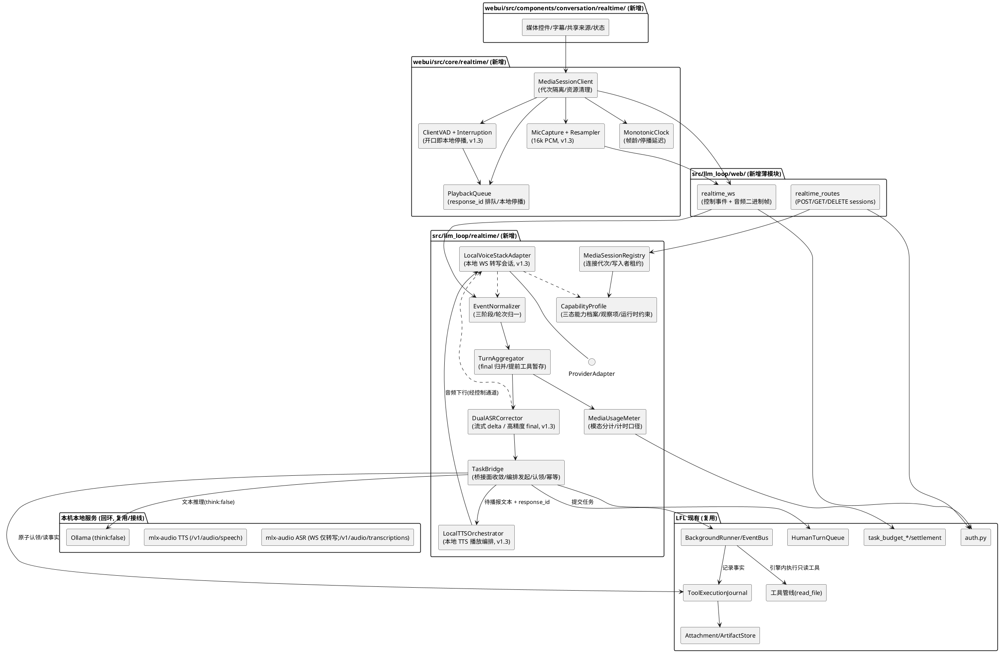
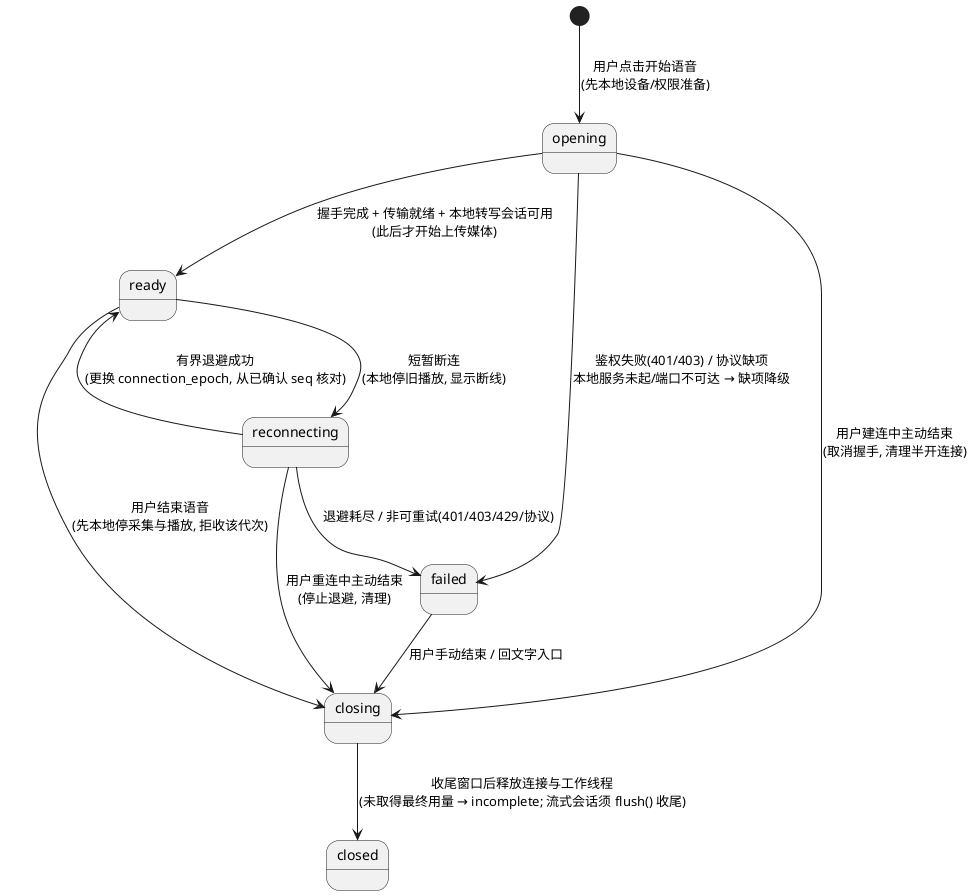
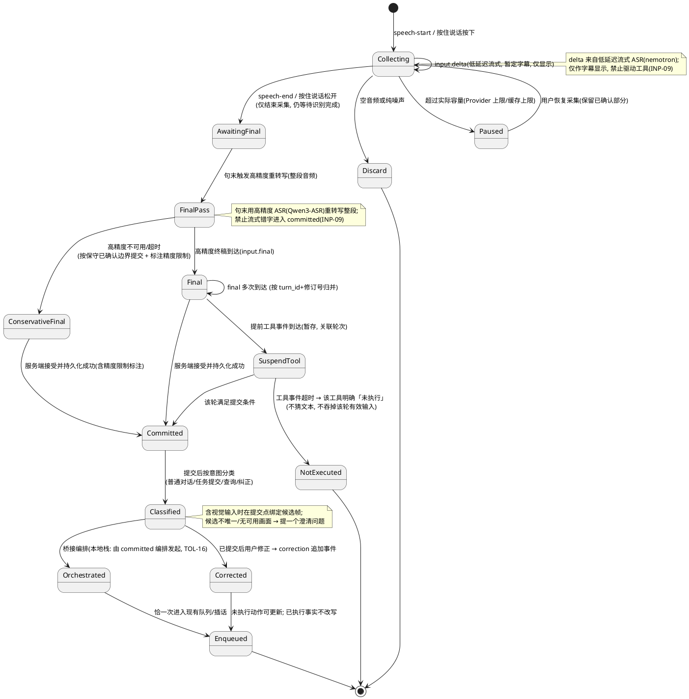
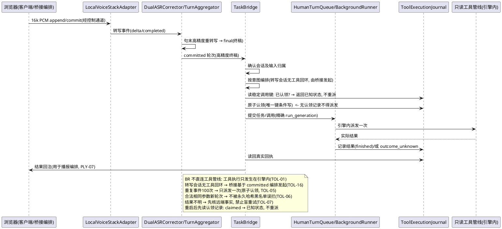
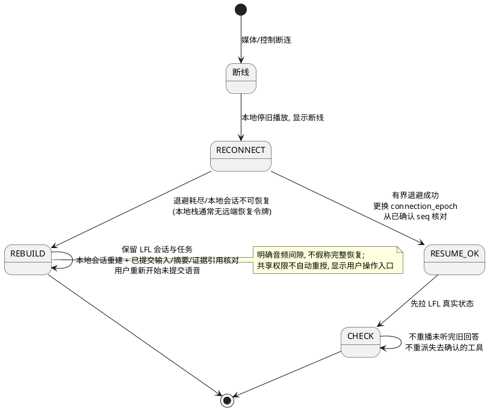
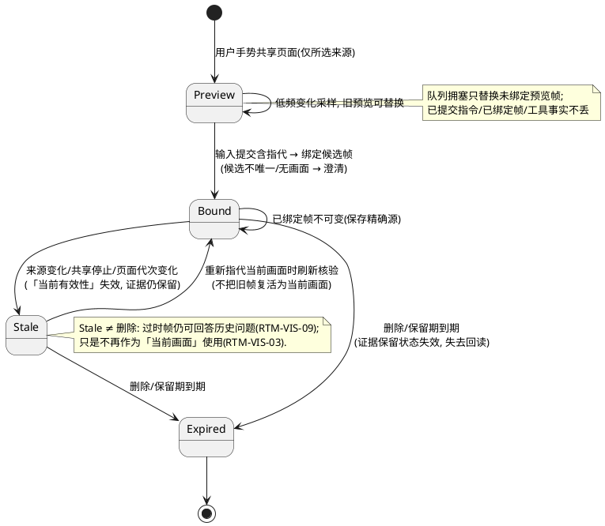
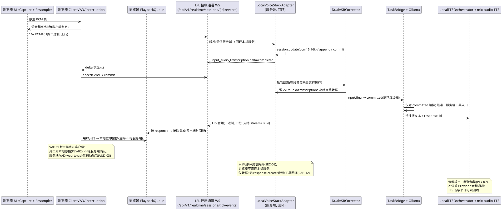
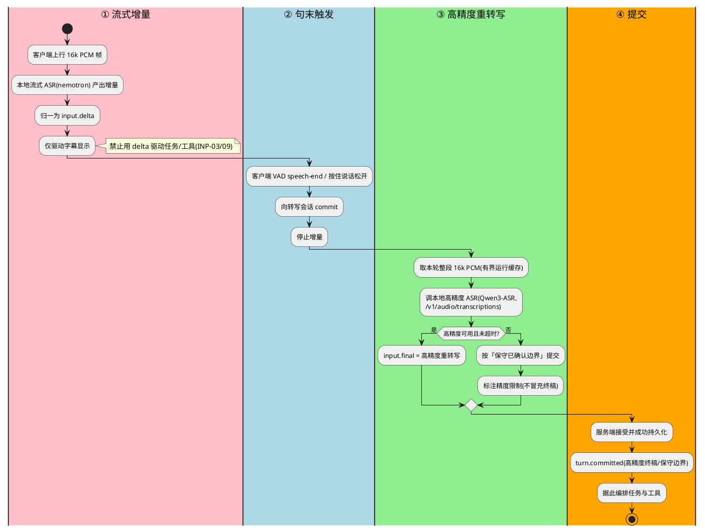
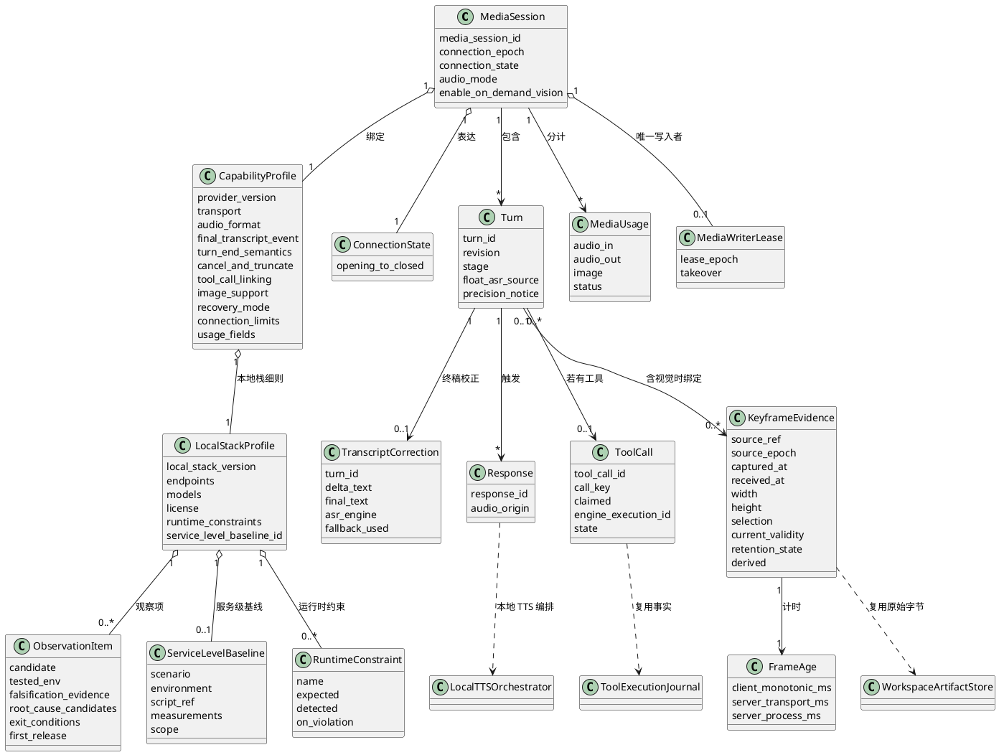

# LFL 实时多模态增量实现方案设计（design）

| 项 | 值 |
|---|---|
| 特性名 | `realtime_multimodal` |
| 文档角色 | **增量技术设计（HOW）**；对应 SDD 归档 `.codeartsdoer/specs/realtime_multimodal/design.md` |
| 权威需求条款 | `docs/SPEC-20261023-realtime-multimodal-requirements-v1.md`（**v1.2，163 条** `RTM-<GROUP>-<NN>`，**冲突以其为准**） |
| SDD 需求索引 | `.codeartsdoer/specs/realtime_multimodal/spec.md`（v1.2，索引非权威） |
| 原始设计依据 | `docs/LFL-实时多模态-需求实现设计书-20261023.md`（§6–§9 为本章结构来源） |
| 事实基线 | `main@36a3388e`；本章代码结论以当前仓库真实结构为准 |
| 覆盖范围 | 设计书 §6 总体设计、§7 会话/事件/工具契约、§8 音频/中断/视觉、§9 恢复/资源/预算/安全边界；M0–M4 实施计划 |
| 设计版本 | **v1.3（本地实时语音栈接线）**：在 **v1.2 正文（实现契约补充）** 基础上**定点增补**——新增 **本地 Provider 栈接线设计**（浏览器采集含 16k 重采样 → 本地 `WS /v1/realtime` 仅转写 → Ollama `think:false` → 桥接编排本地 TTS → 浏览器播放）、**客户端侧 VAD/打断落点**、**INP-09 双 ASR 终稿校正数据流**、**CAP-13 观察项登记结构**、**CAP-14 运行时约束校验与报错点**、**服务级 / 浏览器链路两套性能口径**（OBS-05/09、EVD-06），并据本地栈重述 **M0 探针 A/B 为「部分解除」**、给出 **M1 接线设计**。**保留既有 8 项实现契约与 D1–D22 决策**；**不新增需求条数、不扩大首版范围** |
| 约束 | 只定义架构、组件、接口契约、事件时序、数据模型与选型；不写逐行实现代码，不生成 tasks.md |

> **本设计的三条前提（v1.3 增补第四条）**
> 1. **权威关系**：需求冲突一律以主规格为准；本设计不新增条款，只做「HOW」落地。
> 2. **实施组织**：**163 条**用于追溯，实施按**用户可运行的闭环**组织（M0 探针 → M1 音频闭环 → M2 任务闭环 → M3 视觉与联合验收 → M4 可写），不为 163 条各设一道门槛（`SPEC §0.7`）。
> 3. **阶段落点**：计时、用量记录、连接代次隔离、本地停播在 **M0/M1** 建立；页面共享完整要求归 **M3**，不阻塞首个音频闭环（`SPEC §0.8`、`SDD §7`）。
> 4. **本地栈前提（v1.3 新增）**：首版实时语音链路**已选定并冻结为本地 Provider 栈**（`mlx-audio` OpenAI 兼容 ASR/TTS + Ollama 本地文本 + 本地流式 TTS，`SPEC RTM-CAP-11`），**撤销**「必须远端实时 Provider」默认假设。`WS /v1/realtime` **只是转写会话**（无 `response.create`、不产出音频、无工具回环，`RTM-CAP-12`）→ **音频输出与工具调用由客户端/桥接编排**（`RTM-PLY-07`、`RTM-TOL-16`）。本机已完成**服务级**端到端实测，**浏览器链路（麦克风采集/播放/VAD/打断）尚未接入**（`RTM-EVD-06`）——**服务级实测数值不得作为 M1/M3 浏览器链路验收值**（`RTM-OBS-09`）。

---

# 一、需求与存量功能关系分析

本章逐项核对 **163 条**需求与当前仓库真实代码的对应关系，是增量设计的基础。所有结论均标注真实文件位置；`src/llm_loop/realtime/`、`webui/src/core/realtime/`、`webui/src/components/conversation/realtime/`、`tests/realtime/` 经核实**当前不存在**，属待新增落点。**v1.3**在此基础上增补**本地语音栈**这一「服务级已通、仓库外、待接线」的维度（§1.1.2、§1.2.8）。

## 1.1 需求功能与存量功能对比

### 1.1.1 可复用底座（存量已实现，14 项）

下列 **14 项**是存量代码中**已实现的可复用底座**，新增实时多模态应**优先复用**，不得重造。**它们只是复用底座，不计为实时多模态功能的交付进度**——连续听说、页面视觉、唯一工具桥接、三类停止、连接代次隔离等仍需按本设计**新增并验收**。匹配度说明判定依据。

| 需求功能 | 存量功能 | 代码位置 | 匹配度 |
|---|---|---|---|
| 会话/workspace 归属鉴权、CSRF、Origin 校验（RTM-SES-02、SES-06、SEC-05、SEC-06） | FastAPI 路由级鉴权 + 精确 Origin allowlist + `WebSessionStore` | `src/llm_loop/web/auth.py`（`normalize_origin`:118、`configured_origin_allowlist`:156、`WebSessionStore`:298）、`src/llm_loop/web/routes.py` | 75%：机制完整，媒体入口尚未接入 |
| 精确 Run 代次取消请求（RTM-STP-04 取消路径、RTM-TOL-13） | `POST /api/v1/chat/cancel` 校验 `expected_run_generation`，代次不符返回 409 `run_generation_mismatch` | `src/llm_loop/web/routes.py:1976`（`chat_cancel`）、`src/llm_loop/core/loop/runner.py:525`（`BackgroundRunner.cancel`） | 75%：任务取消可用，三类停止尚未分离结算 |
| 队列认领 + 精确代次插话（RTM-INP-06、RTM-STP-03） | `POST /api/v1/chat/queue/interject` → `claim_interject` + `enqueue_interjection(expected_run_generation)` | `src/llm_loop/web/routes.py:2137`、`src/llm_loop/web/human_turn_queue.py:323`、`src/llm_loop/core/loop/runner.py:434` | 75%：插话机制可用，语音轮次尚未桥接到队列 |
| 插话「已接收 / 已生效」两阶段分级回执（RTM-INP-06、RTM-OBS-01） | `claim_interject` + `mark_interject_received / record_interject_applied / record_interject_cbf` 分级（`accepted/applied/cbf`） | `src/llm_loop/web/routes.py:2137`、`src/llm_loop/web/human_turn_queue.py` | 100%：可直接复用为语音纠正的分级反馈 |
| 工具调用的持久事实与崩溃恢复、`outcome_unknown`（RTM-TOL-02/04/08、RTM-REC-02 派发后失败） | `ToolExecutionJournal`：`declared / started / finished / receipt_committed / effect_prepared / effect_observed / recover`，`execution_outcome=unknown` | `src/llm_loop/core/tool_execution_journal.py:192` | 75%：事实底座可用，缺实时桥接所需的调用状态枚举映射与幂等键 |
| 首版只读工具 `read_file`（RTM-TOL-09） | 工具注册与执行管线，含只读并行执行与读投影预算 | `src/llm_loop/tools/registry.py:68`、`src/llm_loop/tools/pipeline.py` | 75%：工具本身可用，需收敛桥接面（TOL-10）并读取隔离 workspace 诊断文件 |
| 附件/产物稳定引用与授权回读（RTM-RET-01、RET-02、RET-05） | `AttachmentStore.create/resolve/hydrate_text/original_path`；`WorkspaceArtifactStore.create/resolve/snapshot/hydrate`（`artifact://v1/<32hex>`） | `src/llm_loop/memory/attachments.py:112`、`src/llm_loop/workspace/artifacts.py:133`、`src/llm_loop/web/routes.py:2049+`（`artifact_hydrate`） | 75%：引用与回读完整，缺关键帧原始帧的 `source_ref` 承载 |
| 图转文视觉能力（RTM-CAP-06 视觉路径、RTM-VIS-07 派生证据） | `describe_image` 独立于核心调用链，写回附件文本 | `src/llm_loop/web/vision.py:298` | 50%：文本可复用，原始帧/坐标/时序元数据缺失 |
| 后台任务与实时事件循环解耦（RTM-LIF-06） | `BackgroundRunner` + `EventBus` 订阅/发射 | `src/llm_loop/core/loop/runner.py:380`、`runner.py:128` | 75%：机制可用，媒体生命周期尚未解耦 |
| 原 SSE 任务订阅继续使用（RTM-CMP-02） | `stream_session_events` SSE 端点，单一路径 | `src/llm_loop/web/routes.py:3644` | 100%：**保持不新增第二份任务消费者** |
| 单次听写降级（RTM-CAP-08、RTM-CAP-10） | `DictationButton`（`interimResults=false`、`continuous=false`），不改变原文本「停止」语义 | `webui/src/components/conversation/DictationButton.tsx`、`webui/src/core/conversation.ts:44` | 100%：作为降级保留 |
| 预算与用量的既有入口与调度（RTM-BUD-01/07、RTM-LIF-05/07、RTM-STP-06） | `task_budget_*` 系列（grant/limits/dispatch/cancel_active_task_budget） | `src/llm_loop/resources/task_budget_contracts.py:76`、`task_budget_dispatch.py:344` | 50%：任务侧预算可用，媒体模态尚未接入 |
| Provider 调用结算与用量统计（RTM-BUD-02/03） | `provider_settlement`、`provider_transport_usage_stats` | `src/llm_loop/resources/provider_settlement.py`、`src/llm_loop/core/provider_transport_usage_stats.py` | 50%：文本调用可结算，媒体单位待扩展 |
| 单调时钟计时口径（RTM-OBS-05、RTM-PRF-02/03） | `timekeeping.py` | `src/llm_loop/timekeeping.py` | 50%：服务端口径可用，客户端同一单调时钟待建立 |

### 1.1.2 服务级已实测的本地语音栈底座（仓库外，待接线）

**v1.3 新增**：本地 Provider 栈是本机已跑通的**服务级**底座，位于**仓库外**（`~/Project/research/voice-stack/`），**尚未与 LFL Web runtime 接线**。它**不计为实时多模态功能的交付进度**——接线、ASR 终稿校正、编排落点、客户端 VAD/打断均属待实现。匹配度按「与 LFL Web runtime 的接线完整度」评估。

| 需求功能 | 存量功能（服务级） | 代码/证据位置 | 匹配度 |
|---|---|---|---|
| 本地 ASR 转写会话（RTM-CAP-11、CAP-12、AUD-01） | `mlx-audio` 提供 OpenAI 兼容 `WS /v1/realtime`（`session.update` / `input_audio_buffer.append` / `commit` → `…input_audio_transcription.delta/.completed`），**仅转写** | `~/Project/research/voice-stack/`（脚本 `04/05/06/08`、`logs/*.json`）；**仓库外** | 25%：服务级可用，未接入 LFL Web runtime、未接 16k 重采样与轮次归一化 |
| 高精度终稿 ASR（RTM-INP-09） | 句末对整段音频用 `Qwen3-ASR`（`/v1/audio/transcriptions`）重转写；实测「逐字全对」 | 同上（脚本/log） | 25%：服务级可用，未作为 `input.final/committed` 来源接入，双 ASR 校正数据流未实现 |
| 本地文本主脑（RTM-CAP-14、TOL-16） | Ollama `qwen3.5:35b-a3b-q4_K_M`；语音链路须 `think:false`（否则流式 `content` 为空） | 同上报（`think:false` 实测） | 25%：服务级可用，未接入桥接与唯一工具入口编排 |
| 本地流式 TTS（RTM-PLY-07） | 本地 TTS（`Qwen3-TTS-0.6B`），HTTP 整段或 `stream=True`；实测 TTS RTF 0.66、首字节 4.43 s（HTTP 整段） | 同上报 | 25%：服务级可用，未接入客户端播放队列/本地停播/时间线口径 |
| 本地 VAD 能力（RTM-AUD-03、CAP-14） | `silero-vad`（模型侧）与 `webrtcvad`（server 依赖，`uvicorn[standard]` 等） | 同上报 | 25%：可作服务端辅助轮次信号；**客户端 VAD/打断落点未实现** |
| 本地服务级闭环基线（RTM-OBS-09） | `WS ASR → Ollama → HTTP TTS`：6.96 s 中文语音输入 → 总 **12.23 s**（ASR 首字 1.23 s/结束 7.14 s、LLM 首字 0.66 s、TTS 首字节 4.43 s、RTF 0.66） | 同上报（`logs/*.json`）；**仅服务级口径** | 服务级基线已登记；**不得**作为浏览器链路 M1/M3 验收数值 |

> **证伪观察项（RTM-CAP-13，非底座）**：原生全双工 VoiceChat-11B 实测**不达标**（中/英输入返回同一段英文寒暄、延迟 4–6× 实时、双工文本跑偏、无 `function_delta`；坑：输入须 16k、需 `flush()` 收尾）→ **不作首版主链路**，仅登记证伪证据、原因待查与退出条件（§1.2.8.4、§2.3.2）。

### 1.1.3 需要扩展的功能

下列能力已在存量代码中存在，但仅覆盖需求的一部分，需要改造扩展。**v1.3 增补**本地栈接线相关的扩展项（末 4 行）。

| 需求功能 | 存量功能 | 差异说明 | 扩展方向 |
|---|---|---|---|
| 三类停止分离建模与结算：播放停止 / 回复取消 / 任务取消（RTM-STP-01/02/03/06、RTM-PLY-02） | 仅 `runner.cancel(expected_run_generation)` 一条**任务取消**路径 | 缺「本地停播」（客户端）与「回复取消」（回复侧 `response_id`）两个作用域；缺「请求 vs 真实完成」分离 | 新增停止作用域枚举与三段式结算状态；客户端本地停播独立于服务端确认；适配器暴露按 `response_id` 中断能力 |
| 语音轮次 → 现有插话队列的桥接映射（RTM-INP-01…08、RTM-SCN-02） | 队列/插话仅接受**文本** `queue_id`，无 `turn_id`/`revise` 概念 | 缺 `delta/final/committed` 三阶段；缺 `final` 多次到达的按 `turn_id` 归并；缺提前工具事件暂存 | 在桥接层实现轮次聚合器，把 `committed` 输入映射为 `queue_enqueue` + `queue_interject`；纠正映射为 `correction` 追加事件 |
| 工具调用状态与幂等键（RTM-TOL-02/05/06、RTM-IDN-01） | `ToolExecutionJournal`：`declared/started/finished/receipt_committed/effect_*/recover`，**已记录 `tool_call_id`**（事件载荷带引擎侧 `call.id`，`:354/374/398`），`recover` 不自动重执行 | 缺的是**桥接调用映射**（Provider 事件侧 `tool_call_id`/`turn_id` ↔ 引擎 `execution_id`/`round` 的显式绑定）；`declared/started` 是**追加事实（append-only）**、**不是原子去重认领**；缺**稳定去重键**（不得用参数哈希） | 新增桥接层调用映射记录 + **原子认领**（派发前以唯一稳定键条件写入认领记录，写成功才派发；已认领→返回已知状态不重派）+ **重启恢复**在认领记录上判定 `claimed/not_claimed`（对齐 `recover` 的「不自动重执行」），再补 `cancel_requested/cancelled/outcome_unknown` 表达 |
| 只读工具桥接面收敛（RTM-TOL-10、RTM-TOL-11） | 全仓工具 schema 注册表 | 实时模型不得见全仓 schema；只有收到**真实 LFL 回执**才可播报 | 定义 4 个桥接能力（提交任务/查询状态/提交纠正/请求取消），复用现有执行管线；回执来自 `ToolExecutionJournal` 事实而非模型自述 |
| 关键帧原始帧的不可变引用（RTM-VIS-02、VIS-05、RET-01、IDN-01） | `AttachmentStore`/`WorkspaceArtifactStore` 服务于附件与产物 | 关键帧需额外承载 `source_ref`/`source_epoch`、捕获/接收时刻、宽高、选区；已绑定帧不可替换 | 复用 `WorkspaceArtifactStore` 承载原始帧字节 + 新增帧元数据领域对象；绑定后冻结 |
| 独立视觉适配路径标识（RTM-CAP-06、RTM-CAP-03） | `vision.py` 图转文无「派生证据」标识 | 图转文结果不得冒充原图 | 在关键帧证据对象上标记 `derived`，与 `source_ref` 明确区分 |
| 媒体会话生命周期与任务生命周期解耦（RTM-LIF-01/02/03/04、RTM-SES-05、RTM-IDN-03） | `BackgroundRunner` 管理 run 生命周期，SSE 断开仅停订阅 | 缺媒体会话的连接状态机、结束顺序、资源释放；缺「连接/麦克风/播放/任务」四事实分离 | 新增媒体会话状态机（`opening→ready→reconnecting→ready/failed→closing→closed`）；结束语音不改任务态 |
| 媒体模态预算分计（RTM-BUD-01/02/03/04） | 任务预算按 `BudgetDimension`（文本/工具）计量 | 媒体单位（音频输入/输出、图像）未接入；缺估算/结算区分；**直接扩展 `BudgetDimension` 有兼容风险**——`TaskBudgetLimits.from_dict` 严格校验字段集合完整（`task_budget_contracts.py:94`），新增维度会使旧额度/旧记录反序列化失败 | **首版优先不改预算合同**：以**独立媒体计量记录 + 适配层**承载媒体用量（映射到既有维度或旁路统计）；若必须扩展 `BudgetDimension`，须同时给出旧额度/旧记录的**版本兼容与迁移**（按版本号分支反序列化、旧记录缺省媒体维度补齐而非报错、迁移或双读）；`incomplete` 表达缺账单；达限停新请求、结算在途 |
| 前端媒体状态与 `conv.streaming` 解耦（RTM-CAP-10、RTM-SES-05） | `WebSessionStore`/`conversation.ts` 中 `streaming` 布尔值同时代表「是否在流式」 | 新语音控制不得被 `conv.streaming` 一概禁用；原文本「停止」语义不变 | 前端新增独立媒体状态树（连接/麦克风/播放/任务），与 `streaming` 正交 |
| 媒体入口接入现有鉴权（RTM-SES-01/02/03/06、SEC-01） | `router.include_router(...)` 注册模式 + Origin 校验 | 新实时路由需接入同一鉴权与 origin 边界 | 新路由沿用 `web/auth.py` 校验；凭据只在服务端 |
| **本地转写会话接线（RTM-CAP-11/12、AUD-01、CAP-05）** | 服务级 `mlx-audio WS /v1/realtime`（仓库外，脚本直连） | 浏览器**不得**自由绑定本机服务（SEC-08）；需经 LFL 受信服务端代理到本机回环；浏览器原生采样需**重采样到 16k PCM** | 新增服务端 `LocalVoiceStackAdapter`（转写会话）+ 浏览器重采样/VAD；音频经**唯一控制通道**承载；端口/格式来自能力档案 |
| **ASR 终稿校正（RTM-INP-09）** | 服务级已具备「流式增量 + 句末高精度重转写」两个模型，但未作为数据流编排 | 流式增量当前可直接产出文本，缺「delta 仅显示 / final 高精度 / committed」三阶段落点 | 新增 `DualASRCorrector`：流式增量→`delta`，句末整段音频→高精度重写→`final`；**流式错字不得进入已提交输入或驱动工具**；不可用时按保守边界提交并标注精度限制 |
| **本地音频输出编排（RTM-PLY-07）** | 服务级可直连本地 TTS，无客户端播放队列/时间线 | 缺「由桥接调用本地 TTS → 客户端播放」的编排、按 `response_id` 排队/清除、未听边界 | 新增 `LocalTTSOrchestrator`（服务端编排）+ 客户端 `PlaybackQueue`（按 `response_id` 与客户端实际输出时间线）；TTS 首字节作可观测项 |
| **转写会话下的工具调用编排（RTM-TOL-16）** | 转写会话**不产生**工具事件（无回环） | 缺「基于 `turn.committed` 由客户端/桥接编排发起」的落点 | 新增桥接编排入口：仅对 `committed` 轮次按意图编排，**仍必经唯一服务端工具入口**（认领→授权/预算→派发一次→记录→通知）；结果回注用于播报编排 |

### 1.1.4 需要新增的功能或接口

按业务模块分组，列出存量代码中无对应实现、必须新增的落点。**v1.3** 增补本地栈接线组件（A 组第 6/7/8 项、C 组第 4/5 项）。

**A. 服务端实时层 `src/llm_loop/realtime/`（新增包，对 Web 框架无反向依赖）**

1. **Provider 适配器契约**（RTM-CAP-01/02/04/05/11/12）——输入：Provider 配置 + 能力档案；输出：规范化事件流。核心逻辑：**首版只实现本地转写会话适配器**（本地 WS 转写 + 本地 TTS 编排）；每项能力记录「官方/实测/未知」三态；为未选 Provider 不写空适配器。
2. **媒体会话与连接代次管理**（RTM-SES-05/07、RTM-IDN-02/04/05/07）——输入：`session_id` + 用户身份；输出：`media_session_id` + `connection_epoch` + 能力档案。核心逻辑：服务端签发代次，旧代次输入不得更新新连接；同会话唯一活动媒体写入者 + 可续租租约 + 显式接管。
3. **事件归一化与轮次聚合**（RTM-AUD-03、RTM-INP-01/02/04/08）——输入：Provider 原始轮次/转写事件；输出：`input.delta/final/turn.committed` + `speech-start/speech-end`。核心逻辑：三阶段互斥；`final` 按 `turn_id`+修订号归并，仅一次进队列；提前工具事件暂存并关联轮次，超时返回未执行。
4. **桥接面**（RTM-TOL-01/03/05/10/13/16）——输入：轮次/纠正/取消/查询意图；输出：对 LFL 现有服务的最小调用 + 真实回执。核心逻辑：**唯一执行链**（桥接只提交任务与关联，**工具执行只发生在现有引擎内**，桥接**不**另行直连工具管线）、执行顺序固定、原子认领后由引擎派发一次、精确代次校验与 409；**外层桥接调用与内层工具执行分别关联**。**v1.3**：转写会话下桥接是工具调用的**编排发起方**（基于 `committed` 轮次），但仍唯一经服务端入口。
5. **媒体用量与计时**（RTM-BUD-01/02/03、RTM-OBS-01/05/09）——输入：媒体生成/播放事实；输出：按模态分计的用量记录 + 客户端同一单调时钟的帧龄/停播延迟；**区分服务级与浏览器链路口径**。
6. **本地语音栈适配器 `LocalVoiceStackAdapter`（v1.3 新增）**（RTM-CAP-11/12、AUD-01、REC-05）——输入：16k PCM 帧 + 会话控制；输出：转写事件（`delta`/`completed`）。核心逻辑：以受信服务端身份经**回环**连接本机 `WS /v1/realtime`，执行 `session.update`（`input_audio_format=pcm16`、16 kHz 单声道）/ `append` / `commit`；**不调用 `response.create`、不期待音频与工具事件**；无远端恢复令牌时按本地会话重建承担恢复（REC-05）。
7. **双 ASR 终稿校正器 `DualASRCorrector`（v1.3 新增）**（RTM-INP-09）——输入：本轮整段 16k PCM（运行缓存）+ 流式增量文本；输出：`input.final`（高精度重转写）。核心逻辑：流式增量**只作 `delta`**；句末/轮次结束用高精度 ASR 重转写整段；不可用/超时→按保守已确认边界提交并**标注精度限制**；**禁止**流式错字冒充终稿或驱动工具。
8. **本地 TTS 编排器 `LocalTTSOrchestrator`（v1.3 新增）**（RTM-PLY-07）——输入：待播报文本 + `response_id`；输出：本地 TTS 音频流。核心逻辑：桥接调用本地 TTS（HTTP 整段或 `stream=True`）→ 经控制通道交客户端播放；按 `response_id` 排队/清除；**首字节延迟作可观测项**；支持被本地停播打断时及时终止后续音频生成。

**B. Web 薄路由模块 `src/llm_loop/web/`（新增文件，沿用现有注册模式 `routes.py:92`）**

1. 会话生命周期 REST（RTM-SES-01/06/07）：`POST/GET/DELETE /api/v1/realtime/sessions[...]`。
2. 双向控制通道（RTM-SES-07、RTM-STP-06）：`WS /api/v1/realtime/sessions/{id}/events`，含事件 ID + 代次 + 回执与错误码语义；**v1.3 起同时承载上行 16k PCM 与下行 TTS 音频的二进制帧**（唯一媒体传输实现）。

**C. 前端 `webui/src/core/realtime/` 与 `webui/src/components/conversation/realtime/`（新增目录）**

1. 媒体会话与播放队列（RTM-PLY-01/02/03）、事件归并、连接代次隔离、资源清理（RTM-LIF-04）。
2. 媒体控件、字幕（`delta` 临时 / `committed` 已提交区分）、共享来源、真实播放状态（RTM-SES-04、RTM-A11Y-04）。
3. 客户端同一单调时钟计时（RTM-OBS-05、RTM-VIS-06）。
4. **采集与 16k 重采样（v1.3 新增）**（RTM-AUD-01、CAP-14）——`getUserMedia` → AudioWorklet 采集原生 PCM → **重采样为 16k 单声道 PCM16** 后上行；参数取自能力档案，不散落硬编码。
5. **客户端 VAD 与打断（v1.3 新增）**（RTM-AUD-03、PLY-02、PRF-02/03）——客户端侧语音起点/终点检测与「开口即本地停播」；**本地停播优先，不等服务端确认**。

**D. 测试 `tests/realtime/`（新增目录，沿用 `tests/unit`+`tests/web` 约定）**

1. 事件时序、桥接幂等、恢复、音画关联、资源清理与既有能力回归护栏；**v1.3** 增补**本地栈接线**（16k 重采样/格式）、**双 ASR 终稿校正**、**客户端 VAD/打断**、**运行时约束报错**、**服务级 vs 浏览器链路分级**测试。

**E. 关键帧证据对象（跨模块）**

1. 帧元数据领域对象（RTM-VIS-02/03/05/06/09）——来源标识、`source_epoch`、捕获/接收时刻、宽高、选区、不可变内容引用、`derived` 标记与失效状态。

## 1.2 存量功能详细分析

本节对「已实现功能」的复用点做深入解读，明确**接口契约、业务规则、扩展点与约束**，供增量设计直接对接。**v1.3** 增补 §1.2.8 本地语音栈详细分析。

### 1.2.1 精确 Run 代次取消（`chat_cancel` + `BackgroundRunner.cancel`）

- **接口契约**：`POST /api/v1/chat/cancel`，入参 `session_id` + 可选 `run_generation`；返回 `{cancelled: bool}`；代次不符返回 **409** `run_generation_mismatch`（携带 `actual_run_generation`）。实现见 `routes.py:1976`。
- **业务规则**：`runner.cancel(session_id, expected_run_generation=...)` 在**同一 registry 锁内**完成代次比较与置位，保证原子（`runner.py:525`）；置 `handle.cancelled=True` → 引擎主循环每轮检查后提前终止；同时触发 `cancel_active_task_budget` 与实时会话通知钩子（`runner.py:567+`）。
- **扩展点**：`cancel` 已预留 `reason` 形参与统一 cancel contract 形状（`runner.py:52` 注释），可直接承接「任务取消」作用域；但**不表达**播放停止与回复取消。
- **约束**：SSE 断连只停订阅、后台 run 可能继续（`routes.py:1976` docstring）——因此媒体断连**不得**被当作任务取消；取消是「请求」，真实终止需另观察。

### 1.2.2 队列认领与精确代次插话（`queue_interject` + `HumanTurnQueue`）

- **接口契约**：`POST /api/v1/chat/queue/interject`（202），入参 `session_id`、`queue_id`、`run_generation`；「立即」= **下一安全决策边界**，不篡改引擎历史；错误映射：无活动 run / 代次变化 → **409**；认领持久化失败 → **503** `queue_persist_*`。
- **业务规则**：`claim_interject` 原子领取（`queued→claimed`）；`enqueue_interjection` 代次校验通过才入 run 信箱；分级回执 `accepted`(受理) / `applied`(生效) / `cbf`(终答结算边界拦截) 经 `_on_received/_on_applied/_on_denied/_on_cbf` 回调记录（`routes.py:2137`）。
- **扩展点**：`_on_*` 回调是天然的「已接收/已生效」分级观测挂点，可直接映射到 RTM-INP-06 的两阶段反馈。
- **约束**：claim 悬挂有超时 reaper，但 `CLAIM_TIMEOUT_S` 只表示**需要核验**而非 run 死亡证明，先读机械事实再裁决（`human_turn_queue.py:10`）——语音纠正桥接必须尊重此语义，不能把超时当失败回滚。

### 1.2.3 工具执行事实（`ToolExecutionJournal`）

- **接口契约**：`declared(sess, call, round_no)` / `started(session_id, execution_id, ...)` / `finished(...)` / `receipt_committed(...)` / `recover(session_id, sess)`；`declared`/`started`/`effect_*` 事件载荷**已带 `tool_call_id`（= 引擎侧 `call.id`）**（`tool_execution_journal.py:354/374/398`）；`execution_outcome` 取值 `finished` 或 `unknown`（`:699`）。
- **业务规则**：崩溃窗口下 `state=started_outcome_unknown`，重启恢复标记 `execution_outcome=unknown_after_restart`，**不自动重执行**（`:959`、`:849`）；`recover` 以 `execution_id` 聚合、按 `tool_call_id` 关联既有消息。
- **已具备**：`tool_call_id` 的事实记录；`recover` 的「不自动重执行」重启语义；`effect_prepared/effect_observed` 副作用观察点。
- **尚缺（由本设计补齐的契约）**：
  1. **调用映射层**：现有 `tool_call_id` 是**引擎侧** assistant(tool_calls) 帧 id；实时桥接还需维护 **Provider/桥接侧** `tool_call_id`/`turn_id` ↔ 引擎 `execution_id`/`round` 的显式绑定，防止两条来源被误当同一调用。
  2. **稳定去重键**：`declared/started` 是**追加事实（append-only）**，重复到达会追加多条，**不等于原子去重认领**；因此需要**稳定调用键**（用 Provider/桥接调用标识，**不得**用参数哈希——RTM-TOL-06 明确禁止永久参数哈希黑名单）。
  3. **原子认领位置**：在**派发前**以条件写入一个**唯一认领记录**（同键只允许一次成功）作为**独立于 `declared` 事实**的一层；「检查 `event_id` 后就派发」**不构成**并发下的恰好一次。
  4. **重启恢复规则**：重启后**先读认领记录**——`claimed` 则返回已知状态、**不重派**（与 `recover` 的「不自动重执行」一致）；`not_claimed` 才允许进入正常派发。
- **约束**：持久层不保证跨外部副作用原子提交——因此 RTM-TOL-08 要求崩溃窗口显式表达 `outcome_unknown`，**不建设分布式事务平台**。

### 1.2.4 附件与产物存储（`AttachmentStore` / `WorkspaceArtifactStore`）

- **接口契约**：`AttachmentStore.create/resolve/hydrate_text/ensure_full_text/original_path(ref, workspace_scope=...)`；`WorkspaceArtifactStore.create/resolve/read_bytes/snapshot/hydrate(ref, workspace_scope=...)`，引用格式 `artifact://v1/<32hex>`。
- **业务规则**：workspace 归属与 SHA256 回读校验；越权统一 404 防枚举，完整性失败 409（`routes.py` `artifact_hydrate`）。
- **扩展点**：`WorkspaceArtifactStore` 是承载「关键帧原始帧」的既有不可变字节库，可直接复用而非另建证据库（RTM-RET-05）。
- **约束**：`hydrate` 需 `workspace_scope`，媒体会话必须与当前用户/LFL 会话/workspace 绑定后才可回读。

### 1.2.5 图转文（`vision.py`）

- **接口契约**：`describe_image(image_bytes, mime, prompt, settings) -> str`，按 backend 分派（provider/arkcli/minimax），超时与模型可配置（`vision.py:298`）。
- **业务规则**：结果写回附件文本，交给**无视觉能力的主模型**，独立于核心调用链。
- **约束**：文本不足以承载「点这个」的原始帧/坐标/时序（RTM-VIS-04）——因此它只能作为**明确标识的派生证据**与独立视觉适配路径（RTM-CAP-06），不得冒充原图（RTM-RET-03）。

### 1.2.6 鉴权与 Origin（`web/auth.py` / `web/__init__.py`）

- **接口契约**：`normalize_origin`（拒绝 path/query/fragment/凭据）、`configured_origin_allowlist`、`WebSessionStore.issue/valid/revoke`；鉴权门 `require_api_key` 使用 `Depends(_bearer)` + `Request`（HTTP）。
- **关键事实（核实结论，决定 WS 不能「只注册路由」）**：
  1. **Origin 中间件只处理 HTTP**：`_OriginGuardMiddleware` 仅对 `scope["type"]=="http"` 且 mutating 方法生效（`web/__init__.py:98`）；`_CanonicalOriginMiddleware` 同样只处理 `http`（`:153`）。**WebSocket 握手不被任何现有 Origin 中间件覆盖**；当前仓库**没有任何 WS 端点**（无 `@app.websocket`），WS 属**首次引入**。
  2. **鉴权是 HTTP 依赖**：`require_api_key`/`_cookie_valid` 面向 `Request`（从 `request.cookies` 读取），**不能直接复用于 WebSocket**。
- **因此「注册路由即可复用校验」不充分**：WS 必须在**握手处（accept 之前）**显式完成——Origin 校验（从 `websocket.headers` 取 `Origin` 做与 HTTP 同源的精确比较）、登录身份（从 `websocket.cookies` / `websocket.headers` 取会话 cookie 或 Bearer，调用 `WebSessionStore.valid` / `_bearer_valid`）、**媒体会话归属**（`media_session_id` 属当前用户/workspace，越权统一按防枚举处理）；任一失败在升级前拒绝并关闭。
- **约束**：长期 Key / 恢复令牌**只在服务端**（RTM-SEC-01）；浏览器不得自由绑定任意远端 session（RTM-SES-06）；**v1.3**：浏览器也不得自由绑定本机服务（RTM-SEC-08）——本机服务仅服务端经回环访问。

### 1.2.7 预算与用量（`resources/`）

- **接口契约**：`BudgetDimension`、`TaskBudgetLimits`、`TaskBudgetGrant`（`task_budget_contracts.py`）；`cancel_active_task_budget(session_id, run_generation)`（`task_budget_dispatch.py:344`）。
- **关键事实（核实结论，决定扩维需兼容）**：`TaskBudgetLimits.from_dict` **严格校验字段集合**——`set(value) != {d.value for d in BudgetDimension}` 即抛 `ValueError("invalid budget limit fields")`（`task_budget_contracts.py:94`）；`TaskBudgetGrant.from_dict`（`:227`）、`TaskBudgetMember.from_dict`（`:273`）同样按 `__dataclass_fields__` 严格匹配。**直接给 `BudgetDimension` 增维会使旧额度/旧记录反序列化失败**。
- **扩展方向（首选不改预算合同）**：
  1. **计量适配层（首版优先）**：以**独立媒体计量记录**（音频输入/输出、图像）承载实时用量，经适配层映射到既有预算维度或旁路统计；`provider_settlement` 提供结算钩子。如此首版**不扩大整个预算合同**。
  2. **若必须扩展 `BudgetDimension`**：须同时给出**版本兼容与迁移**——反序列化按版本号分支、旧记录缺省媒体维度时按「未知/不适用」补齐而非报错、旧额度向前兼容，并提供迁移/双读策略。
- **约束**：原模型任务输出预算/上下文策略**不得因低延迟语音被调低**（RTM-BUD-07）——实时路径与任务路径预算独立。**v1.3**：本地栈无远端模态计费，预算/用量转为**本地算力与模型许可**口径，仍须按模态分开记录（RTM-BUD-01/02、`SPEC §26`）。

### 1.2.8 本地语音栈详细分析（v1.3 新增）

本节把本地栈的**接口契约、能力边界、运行时约束与观察项**固化为可直接对接的设计事实（对应 RTM-CAP-11/12/13/14、INP-09、PLY-07、TOL-16、SEC-08、OBS-09、EVD-06）。

#### 1.2.8.1 接口契约（能力档案冻结项，RTM-CAP-11/12）

| 本地服务 | 接口 | 用途 | 关键事实 |
|---|---|---|---|
| `mlx-audio` ASR（流式） | `WS /v1/realtime` | 低延迟增量转写 | OpenAI-Realtime 风格：`session.update` / `input_audio_buffer.append` / `commit` → `…input_audio_transcription.delta/.completed`。**仅转写**：无 `response.create`、**不产出音频**、**无工具回环**（CAP-12） |
| `mlx-audio` ASR（终稿） | `POST /v1/audio/transcriptions`（`Qwen3-ASR`） | 句末高精度重转写 | 实测「逐字全对」；作为 `input.final`/`committed` 来源（INP-09） |
| `mlx-audio` TTS | `POST /v1/audio/speech`（或 `stream=True`） | 本地播报音频 | HTTP 整段时「首字节≈整段生成时间」→ 需更低首包用流式；RTF 0.66、首字节 4.43 s（服务级） |
| Ollama 文本 | `POST /api/chat`（流式） | 文本主脑 | **必须 `think:false`**，否则流式 `content` 为空（CAP-14） |
| VAD | `silero-vad`（模型）/`webrtcvad`（server 依赖） | 轮次辅助 | **客户端 VAD 是打断主落点**；服务端 VAD 仅辅助（AUD-03 禁止固定阈值作唯一断句策略） |

#### 1.2.8.2 能力边界与职责划分（RTM-CAP-12、PLY-07、TOL-16、SEC-08）

- **转写会话边界**：`WS /v1/realtime` 只回答「说了什么」，**不回答「怎么回」**。因此**音频输出**与**工具调用**不在该通道内产生 → 由**客户端/桥接编排**（`RTM-PLY-07`、`RTM-TOL-16`）。系统**不得**依赖不存在的 `response.create`/音频回环/工具事件。
- **暴露边界（SEC-08）**：本机 ASR/TTS/LLM 服务**只绑回环/受信网络**，**不得**暴露公网；**浏览器不得自由绑定本机任意端口/服务**——浏览器只与 LFL 受信服务端通信，服务端再经**回环**访问本机服务。`HF_TOKEN` 等仅在服务端。
- **许可边界**：模型权重来源与本机模型**许可**（`apache-2.0`/`openmdw-1.1`/`other`）必须在**商用前逐项核实**，不得以「本地即免授权」跳过。
- **恢复边界（REC-05）**：本地栈通常**无远端恢复令牌** → 恢复由**本地会话重建 + 已提交输入/摘要/证据引用核对**承担，不得假设远端恢复。

#### 1.2.8.3 运行时/环境约束（能力档案必录，RTM-CAP-14）

| 约束 | 触发后果（若违反） | 校验与报错点 |
|---|---|---|
| `setuptools<81`（`mlx-audio` 依赖 `pkg_resources`） | 导入/启动失败或运行异常 | **启动前置自检**：检测 `setuptools` 版本；不满足→显式报错，不静默降级（CAP-04） |
| server 依赖：`uvicorn[standard]`、`fastapi`、`python-multipart`、`webrtcvad` | 服务不可起/上传或 VAD 不可用 | 前置依赖探测；缺失→显式报错并列出缺项 |
| Ollama `think:false` | 流式 `content` 为空 →「空回复」 | 运行时校验：语音链路调用必带 `think:false`；观测到**空 content 且未配置**→报错，**不得**静默空回复 |
| 输入 16k PCM（`input_audio_format=pcm16`，16 kHz 单声道） | 转写错乱/空结果 | 上行帧率/格式校验；不符→显式错误并拒绝该帧（不静默丢弃冒充完整） |
| 流式会话 `flush()` 收尾 | 尾音丢失/空结果 | 结束顺序中**必须**调用收尾；未收尾不确认「正常结束」 |

> 约束不满足时，系统**必须显式报错/降级**，**不得**静默产出空转写或空回复（RTM-CAP-14、CAP-04；验收见 T25）。

#### 1.2.8.4 观察项登记结构（RTM-CAP-13）

原生全双工 `NemotronLabs-VoiceChat-11B-4bit` 实测**不满足 CAP-09 维度** → 列为**观察项**（**非底座、非首版主链路**）。登记结构至少含：

| 字段 | 内容（实测登记） |
|---|---|
| `candidate` | `NemotronLabs-VoiceChat-11B-4bit`（原生全双工对照） |
| `tested_env` | 本机 M5 Max / 128 GB / macOS 26.5.1；16k 输入；`flush()` 收尾 |
| `falsification_evidence` | 中/英输入返回**同一段英文人格寒暄**；延迟为输入时长 **4–6×**；双工文本跑偏；**未观测到 `function_delta`** |
| `root_cause_candidates` | MLX 移植/接线、系统提示、语言设置、是否需 VAD 分段（**待查**） |
| `exit_conditions` | 满足任一即退出观察：① 换用对照样本重测**达标**；② 原因定位并修复后按 **CAP-09 维度复测达标** |
| `first_release` | `false`（**不计入**首版交付，但**不得删除**证据与复现脚本） |

> 界面与交付声明**不得**把观察项当作已支持能力（T20/T25 验收）。

#### 1.2.8.5 服务级基线与证据分级（RTM-OBS-09、EVD-06）

- **服务级基线（已登记）**：`WS ASR → Ollama → HTTP TTS`；6.96 s 中文语音输入 → 总 **12.23 s**；ASR 首字 1.23 s / 结束 7.14 s，LLM 首字 0.66 s，TTS 首字节 4.43 s，RTF 0.66。**口径 = 服务级**（不经浏览器麦克风/扬声器）。
- **证据分级**：服务级已实测 **≠** 浏览器链路验收。浏览器采集/播放/VAD/打断**尚未接通**时，依赖浏览器链路的条目（AUD、PLY、PRF、SCN、A11Y 相关）**必须标为未验收**；**M0 探针 A/B 部分解除**（服务级已通、浏览器侧仍阻断，故 A/B **仍不得**宣布通过）。
- **不得混算**：服务级数值**不得**作为 M1/M3 浏览器链路验收值，也**不得**与浏览器链路样本**混算 P50/P95**（OBS-05/09、PRF-01…04）。
---

# 二、增量设计方案

## 2.1 实现模型

### 2.1.1 上下文视图

本设计不新增独立执行框架，而是在现有 Web/任务进程边界内补齐「连续听说 + 页面视觉 + 真实只读工具 + 三类停止 + 同会话续接/恢复」。**v1.3**：主 Provider 由「远端实时模型」改为**本地 Provider 栈**；`WS /v1/realtime` **仅转写**，音频输出与工具调用由客户端/桥接编排；媒体字节**不经** LFL 文本 SSE。上下文交互如下（节点只标接口，不标内部结构）。

```plantuml
@startuml
skinparam componentStyle rectangle
actor "桌面用户" as U1
actor "移动端用户" as U2

package "浏览器（webui）" {
  component "Web 媒体控制\n(getUserMedia/AudioWorklet/16k 重采样/VAD)" as FE
}
package "受信服务端（src/llm_loop/web + realtime）" {
  component "薄路由\n/api/v1/realtime/*" as RT
  component "本地栈适配器\n(LocalVoiceStackAdapter, 单实现)" as AD
  component "双 ASR 终稿校正器\n(DualASRCorrector)" as COR
  component "本地 TTS 编排器\n(LocalTTSOrchestrator)" as TTS
  component "任务桥接\n(桥接面收敛/编排发起)" as BR
}
package "本机本地服务（回环/受信网络，不进公网）" {
  component "mlx-audio ASR\n(WS /v1/realtime 仅转写;\n/v1/audio/transcriptions 终稿)" as LA
  component "mlx-audio TTS\n(/v1/audio/speech, stream=True)" as LT
  component "Ollama 本地文本\n(think:false)" as OL
}
package "LFL 现有引擎" {
  component "session/鉴权/归属" as AUTH
  component "BackgroundRunner + EventBus" as RUN
  component "HumanTurnQueue / 插话" as Q
  component "ToolExecutionJournal" as J
  component "工具注册与执行管线\n(read_file 等只读)" as TOOL
  component "AttachmentStore /\nWorkspaceArtifactStore" as ST
  component "task_budget_* / provider_settlement" as BUD
}

U1 --> FE : 开始/结束语音、共享、停止、纠正
U2 --> FE : 语音或文字/截图降级
FE <--> RT : 控制事件 + 音频二进制帧(16k PCM 上行 / TTS 下行)\n单连接(WS), 每轮/每状态变更
RT <--> AD : 建立/控制转写会话, 代次
AD <--> LA : 16k PCM append/commit + 转写事件\n(经回环, 仅转写)
COR <--> LA : 句末整段音频 → 高精度重转写(final)
AD --> COR : 轮次结束触发终稿校正
COR --> BR : committed 输入(高精度终稿)
BR <--> OL : 文本主脑(think:false)
BR --> TTS : 待播报文本 + response_id
TTS <--> LT : 本地 TTS(HTTP/stream)
TTS --> RT : TTS 音频(经控制通道下行)
BR <--> Q : 提交/插话(精确 run_generation)
BR <--> RUN : 提交任务/查询/取消(expected_run_generation)
BR --> J : 原子认领/读事实/回执
RUN --> J : 引擎记录工具事实
RUN --> TOOL : 引擎内执行只读工具(一次)
TOOL --> ST : artifact 字节水合
RT --> AUTH : 登录/归属/Origin 校验\n(WS 握手 accept 前显式鉴权)

note right of LA
  WS /v1/realtime 仅转写:
  无 response.create / 无音频 / 无工具回环(CAP-12)
end note
note over BR
  唯一执行链: 桥接只提交任务;
  工具执行只发生在引擎内;
  转写会话下由桥接编排发起(TOL-16)
end note
note over FE
  VAD/打断在客户端侧:
  开口即本地停播, 不等服务端确认(PLY-02)
end note
@enduml
```

- **上游调用方**：桌面/移动浏览器经控制通道（WS）与服务端交互；**音频（上行 16k PCM / 下行 TTS）经同一控制通道的二进制帧承载**（v1.3 选定的唯一媒体传输实现，**不引入 WebRTC**，CAP-05）。
- **下游依赖方**：本机本地服务（`mlx-audio` ASR/TTS、Ollama）经**回环/受信网络**访问（SEC-08）；LFL 现有 `BackgroundRunner`、`HumanTurnQueue`、`ToolExecutionJournal`、工具管线、附件/产物存储、预算模块——**全部优先直接复用**。
- **唯一执行链不变量**（RTM-TOL-01、TOL-16）：桥接只把轮次/纠正/取消/查询**提交**给现有引擎；**工具执行只发生在引擎内**；桥接**不**直连工具管线。**本地栈下桥接是工具调用的编排发起方**（因转写会话无工具回环），但仍唯一经服务端入口。外层桥接调用（`tool_call_id`/`turn_id`）与内层引擎执行（`execution_id`/`round`）分别关联。
- **音频输出不变量**（RTM-PLY-07）：音频输出由**桥接编排本地 TTS**并经控制通道下发客户端播放，**不依赖** Provider 音频通道。
- **交互不变量**：原 SSE 任务订阅（`stream_session_events`）继续使用，**不启动第二份任务消费者**（RTM-CMP-02）。

### 2.1.2 服务/组件总体架构



**模块职责与依赖规则**

| 模块 | 职责 | 依赖方向 |
|---|---|---|
| `realtime/` 包 | Provider 协议、**本地栈单适配器**、会话状态、**双 ASR 校正**、**本地 TTS 编排**、桥接；**对 Web 框架无反向依赖** | 只依赖 `core` / `resources` / `memory` / `workspace` 的下游接口；经受信客户端访问本机服务 |
| `web/realtime_routes`、`web/realtime_ws` | 鉴权、会话建立、控制与状态、**音频二进制帧转发**；沿用 `routes.py` 注册模式 | 依赖 `realtime/` 与 `web/auth.py` |
| `webui/src/core/realtime/` | 媒体 session、**采集/16k 重采样/VAD/打断**、播放队列、事件归并、连接与资源清理 | 依赖现有 `core/api.ts`、`core/stores.ts` |
| `webui/src/components/conversation/realtime/` | 媒体控件、字幕、共享来源、状态展示 | 只依赖 `core/realtime/` |
| 现有服务 | 规划、工具、准入、事实 | **不接收媒体采样块、不阻塞本地停播** |
| 本机本地服务 | ASR/TTS/文本 | **只绑回环/受信网络**（SEC-08），**仅服务端访问**，浏览器不直连 |

**配置项与取值策略**（均在 M0 能力档案冻结，运行期可调且有出口）：本地服务端点与端口（回环）、音频采样率/声道/编码（**16k PCM**，来自能力档案）、按需采样帧率（建议初始 0.5–1fps）、重连次数与退避（建议 3 次 / 0.5-1-2s 抖动）、收尾窗口、残留并发上限、缓存字节与时间双限、预算映射、**客户端 VAD 灵敏度/按住说话出口**、**TTS 是否流式（`stream=True`）**。

### 2.1.3 实现设计文档

> **v1.3 说明**：A–F 为 v1.2 已冻结的实现契约（**保持不变**）；**G–J** 为本地栈接线定点增补。

#### A. 连接状态机（RTM-SES-05、RTM-REC-03/09、RTM-LIF-01）

`opening → ready → reconnecting → ready / failed → closing → closed`，与「麦克风开关 / 播放状态 / 任务状态」四事实正交记录（禁止单一 `streaming` 布尔）。

- **`ready` 的定义**：`ready` 以**握手完成 + 传输通道就绪（可双向收发）**为依据，**不**要求已收到首帧才允许上传媒体；`opening` 阶段在握手与传输未就绪前**不得**上传媒体（RTM-SES-01）。**v1.3**：`ready` 还须**本地转写会话可用**（经服务端连接本机 `WS /v1/realtime` 成功、格式协商通过）；本地服务未起/端口不可达时按缺项降级（CAP-03/04）。
- **所有活动状态都能取消并清理**：用户可在 `opening`、`reconnecting`、`ready`、`closing` 任一活动态主动结束；取消一律进入 `closing → closed`，执行「本地停采集/停播放 → 拒收该代次 → 远端关闭 → 释放资源」（RTM-LIF-04、RTM-IDN-07）。



- **非可重试错误不循环**：鉴权失效、配额不足、协议不兼容、**本地服务未起**不进入 `reconnecting`（RTM-REC-09、CAP-14）。
- **结束顺序**：本地停采集播放 → 拒收该代次后续音频 → **流式会话 `flush()` 收尾** → 请求远端/本地关闭 → 收集可获用量 → 有限收尾窗口 → 释放资源（RTM-LIF-01/02、CAP-14）。
- **四事实分离**：`connection_state`、`mic_enabled`、`playback_state`、`task_state` 独立可观测（RTM-SES-05、RTM-IDN-03）。

#### B. 输入提交流程（状态机 + 分支）（RTM-INP-01…09、RTM-AUD-05/06、RTM-VIS-04）



- **「等待最终识别」阶段**：`speech-end` / 按住说话松开只表示**结束采集**，进入 `AwaitingFinal` 等待识别完成（RTM-AUD-06）。
- **v1.3 新增 `FinalPass`（终稿校正）**：`AwaitingFinal` 之后不再直接进入 `Final`，而是进入 `FinalPass`——句末/轮次结束用**高精度 ASR 重转写整段音频**，以其结果作为 `input.final`；不可用/超时进入 `ConservativeFinal`（按保守已确认边界提交并**标注精度限制**）。**流式错字不得进入 `committed` 或驱动工具**（RTM-INP-09，详见 §2.1.3-H）。
- **提交后轮次分类与编排**：`Committed` 轮次分为**普通对话 / 任务提交 / 查询 / 纠正**四类；**本地栈下由桥接基于 `committed` 编排发起**（转写会话无工具回环，RTM-TOL-16），仅任务提交/纠正/查询进入引擎相关路径。
- **提前工具超时不吞有效输入**：`SuspendTool → NotExecuted` 只表示**该工具**未执行，**不得**丢弃该轮已提交的有效输入（RTM-INP-04 + RTM-AUD-05）。
- **三阶段互斥**：`delta` 永不驱动任务；只有 `committed` 进队列（RTM-INP-01/03）。
- **迟到识别**：不得反向改写已执行输入，只能追加修正确认（RTM-INP-08）。

#### C. 工具桥接时序（唯一入口 + 幂等 + 不明结果 + 编排发起）（RTM-TOL-01…16）



- **v1.3 修订**：移去「Provider → 适配器」的工具请求起点（转写会话**不产生**工具事件）；工具调用改为**由桥接基于 `committed` 轮次编排发起**（RTM-TOL-16），**仍必经唯一服务端入口**（认领→授权/预算→派发一次→记录→通知）。
- **唯一入口与幂等**：桥接只做「确认归属 → 关联代次 → 原子认领 → 提交任务」；`call_key` 为稳定去重键（**禁用参数哈希**）；重启先读认领记录，`claimed` → 已知状态、不重派。
- **结果回注**：真实回执取自 `ToolExecutionJournal` 事实，回注用于**播报编排**（`RTM-PLY-07`），**不得**用模型自述代替。

#### D. 三类停止作用域（RTM-STP-01…07、RTM-PLY-02/03/05）

| 触发 | 立即效果（本地优先） | 任务效果 | 结算与反馈 |
|---|---|---|---|
| 用户开口 | **客户端 VAD 检测到开口** → 本地暂停/清除当前回复播放并发送该 `response_id` 中断请求，**不等服务端确认** | 不等同取消任务 | 「正在听」；本地停播延迟独立计量 |
| 「先别说了」/ 静音播报 | 停止当前声音，按需取消当前回答 | 原任务可继续 | 「播报已停止」+ 任务状态另示 |
| 明确纠正需求 | 停旧播报，提交新轮次 | 向**精确 `run_generation`** 插话（复用 `queue_interject`），下一安全边界采用 | 「已接收 / 已采用」分别反馈 |
| 「停止任务」 | 本地停播 | 立即 `cancel(expected_run_generation)` | 「正在停止 / 已停止 / 已完成部分」 |
| 结束语音 | 释放麦克风、播放与媒体连接 | 默认保留独立后台任务 | 「语音已结束」+ 任务仍运行/已结束 |

- **v1.3 强调**：本地停播的触发是**客户端 VAD/按钮**，**本地优先、不等服务端**（RTM-PLY-02、PRF-03）；服务端 `interrupt_response(response_id)` 为 best-effort（**请求 ≠ 计算停止**）。
- **旧代次隔离**：旧回复迟到音频不得复活，迟到旧取消不得清掉新回复（按 `connection_epoch` + `response_id`，RTM-PLY-03）。
- **不谎称撤销**：喊停前已完成的操作报告已完成部分（RTM-STP-07）。
- **残留并发上限**：本地 TTS/推理不支持即时终止时，限定在途请求数并计量（RTM-LIF-07、RTM-STP-06）。

#### E. 恢复路径（RTM-REC-01…14、RTM-IDN-07）



- **v1.3 修订**：本地栈**通常无远端恢复令牌** → **不假设远端恢复**；恢复统一由**本地会话重建 + 已提交事实核对**承担（REC-03/05/07/10），能力档案如实标注「无远端恢复机制」。
- **有界重连**：3 次自动（0.5/1/2s 抖动）后手动/文字入口；非可重试错误不循环（RTM-REC-09）。
- **离线草稿明确提交**：过时语音不自动按当前页面执行（RTM-REC-11）。
- **持久失败按位置区分**（RTM-REC-02）：派发前必要记录失败不确认「已派发」;派发后结果保存失败保留已发生事实并标 `outcome_unknown`；可选诊断失败不篡改已确认状态。

#### F. 关键帧生命周期（RTM-VIS-01…09、RTM-RET-01/02）



- **两个正交维度**：**「当前有效性」**（能否作为当前画面使用）与**「证据保留状态」**（字节是否仍可授权回读）**分开建模**；`Stale` 仍可回答历史问题（RTM-VIS-09），`Expired` 才失去回读（RTM-RET-02/03）。
- **截图 ≠ DOM 读取权限**：DOM 只能来自既有已授权、目标精确的浏览器工具（RTM-VIS-01）。

#### G. 本地语音栈端到端接线（v1.3 新增，RTM-CAP-11/12、AUD-01、PLY-07、SEC-08）

**相机整体链路**：浏览器采集（含 16k 重采样）→ 本地 `WS /v1/realtime`（仅转写）→ Ollama（`think:false`）→ 桥接编排本地 TTS → 浏览器播放。**VAD/打断在客户端侧**（本地停播优先，不等服务端确认）。



**接线要点（不变量）**：

1. **不暴露（SEC-08）**：浏览器**只**连 LFL 受信服务端；服务端经**回环/受信网络**访问本机 `mlx-audio`/Ollama。浏览器**不得**自由绑定本机任意端口/服务。
2. **16k 重采样（AUD-01、CAP-14）**：浏览器以 AudioWorklet 采集原生 PCM → **重采样为 16k 单声道 PCM16** 后上行；采样率/声道/编码**来自能力档案**，不得散落硬编码。
3. **仅转写（CAP-12）**：服务端**不得**依赖 `response.create`、Provider 音频回环或工具回环；音频输出与工具调用均由本地编排。
4. **单连接的媒体承载（CAP-05）**：上行 16k PCM 与下行 TTS 音频走**同一条控制通道 WS 的二进制帧**；文本控制事件走其文本帧。**不引入 WebRTC**，也不并行第二套传输。
5. **VAD/打断客户端化（AUD-03、PLY-02、PRF-02/03）**：客户端 VAD 产出 `speech-start`/`speech-end` 候选并触发**本地停播**；服务器 VAD 仅作**辅助**。**禁止**把固定静音阈值当作唯一中文断句策略——轮次结束 = 客户端 VAD 终点 **且** 流式 `completed`（含按住说话显式边界）。
6. **回环失败即缺项（CAP-03/04、CAP-14）**：本地服务未起/端口不可达/格式协商失败 → **显式错误/缺项降级**，不静默空结果。

#### H. 双 ASR 终稿校正数据流（v1.3 新增，RTM-INP-09）

四段式数据流，**流式增量只作 `delta` 显示，高精度重转写才作 `final/committed`**：



- **阶段语义**：`delta` = 低延迟流式的**暂定字幕**（可被后续修正覆盖）；`final` = **高精度重转写**结果；`committed` = 服务端接受并持久化。三段互斥（RTM-INP-01）。
- **硬约束**：**禁止**把未校正的流式错字（如「语音链路→语音路」「克隆→克龙」）作为 `committed` 输入或驱动工具（RTM-INP-09）。
- **兜底**：高精度重转写不可用/超时 → 以**保守已确认边界**提交并**标注精度限制**；不得把流式错字冒充终稿。
- **音频来源**：整段音频取自**有界运行缓存**（字节+时间双限，RTM-RET-04）；缓存溢出时明确暂停/降级。
- **不可用即降级可见**：若高精度 ASR 服务缺失，能力标识须区分「服务级可用/浏览器链路未验收」，并按缺项降级（CAP-03）。

#### I. 本地音频输出编排与工具调用编排落点（v1.3 新增，RTM-PLY-07、TOL-16）

**本地音频输出（PLY-07）**：

- 播报文本由 **TaskBridge** 产出 → 交 **LocalTTSOrchestrator** 调用本地 TTS（`/v1/audio/speech` 或 `stream=True`）→ 经控制通道**下行**交客户端 `PlaybackQueue`。
- **不允许**依赖 Provider 音频通道；播放排队/清除/进度**仍按 `response_id` 与客户端实际输出时间线**（RTM-PLY-01）；本地停播口径不变（PLY-02/03）。
- **首字节可观测**：HTTP 整段时「首字节≈整段生成时间」→ 需更低首包采用 `stream=True`；TTS 首字节延迟**必须**作可观测项记录（RTM-PLY-07、OBS-01）。
- **长答案**：默认只播报重点、保留完整结果回读引用；逐字朗读时分段播放并支持中断/继续（RTM-PLY-04）。

**工具调用编排（TOL-16）**：

- 转写会话**不产生**工具事件 → 工具调用**由桥接基于 `turn.committed` 编排发起**（按四类意图：普通对话/任务提交/查询/纠正）。
- **仍必经唯一服务端工具执行入口**：确认归属 → 关联精确代次 → **原子认领** → 授权/预算检查 → **引擎派发一次** → 记录结果 → 通知实时会话（RTM-TOL-01/03）。
- **客户端/桥接不得获得并列执行权**，不得绕过认领与幂等（RTM-TOL-02…05）。
- **结果回注**：真实回执回注用于**播报编排**（PLY-07）；旧结果仍写入原任务记录（RTM-TOL-12）。

#### J. 运行时约束校验与报错点（v1.3 新增，RTM-CAP-14、CAP-04）

**两阶段校验**（均**显式失败**，不得静默）：

1. **启动/接线前置自检（preflight）**：在建立实时会话前探测——`setuptools<81`、server 依赖（`uvicorn[standard]`/`fastapi`/`python-multipart`/`webrtcvad`）、本地服务可达性（回环端口）、Ollama `think:false` 配置、音频格式（16k PCM）。任一不满足 → **显式错误 + 缺项标识 + 恢复入口**，不进入 `ready`。
2. **运行时不变量校验（runtime invariants）**：
   - **上行格式**：非 16k PCM16 帧 → 显式错误、拒绝该帧（不静默丢弃冒充完整）。
   - **Ollama 空 content**：语音链路观测到流式 `content` 为空且**未配置 `think:false`** → 报错（不静默空回复）。
   - **流式收尾**：结束/断连时**必须** `flush()`；未收尾不确认「正常结束」。
   - **高精度 ASR 缺失/超时**：按保守边界提交 + 精度限制标注（§2.1.3-H）。

**错误语义**：复用 RTM-SES-07 的 401/403/409/429/503 语义；**本地依赖不可用归 503**（含本地服务未起、依赖缺失、格式协商失败），**不得**包装为成功的「正在处理」。
## 2.2 接口设计

### 2.2.1 总体设计

接口分为六类，稳定性等级标注如下（稳定 = 首版冻结并按版本管理；实验 = M0 后可能调整；M4 = 首版之后）。

| 分类 | 接口组 | 稳定性 |
|---|---|---|
| A. 应用会话生命周期（REST） | `POST/GET/DELETE /api/v1/realtime/sessions[...]` | 稳定 |
| B. 应用控制通道（WS） | `/api/v1/realtime/sessions/{id}/events`（**文本控制事件 + 音频二进制帧**） | 稳定（事件 schema 版本化 `version:1`） |
| C. 桥接面（内部，实时→LFL） | `commit_input / query_task / submit_correction / request_cancel`（**本地栈下为编排发起方**） | 稳定 |
| D. Provider 适配器契约（内部） | **D1 本地转写会话适配器（首版实现）**；D2 远端实时适配器（预留，不实现） | D1 稳定；D2 预留 |
| E. 本地 TTS 接口（内部，桥接→本机） | `synthesize(text, stream) → audio`（`/v1/audio/speech`） | 稳定 |
| F. 媒体可写扩展 | M4 副作用工具协调与幂等键 | M4 |

**接口变更策略**：A/B 采用 `version` 字段显式版本化，破坏性变更升版本而非改语义；C/D/E 为进程内/本机接口，随适配器冻结；**不接收浏览器提交的任意远端 session、长期 Key 或任意本机服务地址**（RTM-SES-06、SEC-08）。

### 2.2.2 接口清单

#### A. 会话生命周期（REST）

**A1. `POST /api/v1/realtime/sessions`** — 稳定
- **签名**：入参 `{ session_id, audio_mode, enable_on_demand_vision }`；出参 `{ media_session_id, connection_epoch, capability_profile, transport_init, connection_state }`。
- **业务说明**：建立媒体会话，绑定既有 LFL 会话与**本地栈能力档案**。
- **前置条件**：用户已登录，`session_id` 归属当前用户与 workspace（复用 `web/auth.py`）；**本地栈 preflight 通过**（§2.1.3-J）。
- **后置条件**：签发 `media_session_id` 与 `connection_epoch`；登记媒体写入者租约；`connection_state=opening`。
- **异常映射**：401/403（身份/归属）；409（同会话已有写入者，需显式接管）；429（额度/容量）；**503（本地服务未起/依赖缺失/格式协商失败 → 缺项降级，CAP-03/04/14）**。
- **约束**：服务端决定 Provider 配置；`capability_profile` 须含本地栈版本/接口/模型/**许可**（CAP-11）。

**A2. `GET /api/v1/realtime/sessions/{id}`** — 稳定
- **出参**：`{ connection_state, mic_enabled, playback_state, task_state, task_links, cancel_stage, last_confirmed_seq, capability_profile, service_level_baseline_id }`。
- **约束**：查询不创建任务、不改代次；越权不可读取（RTM-SEC-06）；四事实分离（RTM-IDN-03）；`capability_profile` 须区分「服务级已实测 / 浏览器链路已验收」（EVD-06）。

**A3. `DELETE /api/v1/realtime/sessions/{id}`** — 稳定
- **出参**：`{ close_state, task_state, usage: { status: settled|incomplete, ... } }`。
- **约束**：**幂等**；不等同取消 LFL 任务（RTM-LIF-03）；缺最终用量标 `incomplete`（RTM-LIF-02）；**流式会话须 `flush()` 收尾**（CAP-14）。

#### B. 应用控制通道（WS 事件协议）

**B1. `WS /api/v1/realtime/sessions/{id}/events`** — 稳定
- **业务说明**：双向应用控制、字幕、状态、恢复序号与回执。**v1.3**：**同时承载上行 16k PCM 与下行 TTS 音频的二进制帧**（唯一媒体传输实现，CAP-05）。
- **握手鉴权（必须在 `accept` 之前完成，失败即拒绝升级）**：
  1. **登录身份**：从 `websocket.cookies`（会话 cookie）与 `websocket.headers`（Bearer）取凭据，调用既有 `WebSessionStore.valid` / `_bearer_valid`；**不**依赖 HTTP 的 `Depends`/`Request`（WS 不适用）。
  2. **Origin**：现有 `_OriginGuardMiddleware` **只覆盖 HTTP**，WS 握手**必须显式**从 `websocket.headers` 取 `Origin`，做与 HTTP 同源的精确比较（同源或显式 allowlist）；**跨站 Origin 拒绝**。
  3. **会话归属**：`media_session_id` 须属于当前用户、当前 LFL 会话与 workspace；**越权按防枚举统一处理**（不泄露存在性）。
  4. **拒绝路径**：未登录/身份失效 → **401**（`accept` 前 `websocket.close(code=4401)`）；跨站 Origin → **403**（`4403`）；越权/不属于该用户 → 拒绝且不区分存在性（`4404`，防枚举）；协议缺项/降级 → **503/400 具体语义**（RTM-SES-07）。
- **测试要求**：新增**未登录连接、跨站 Origin 连接、越权媒体会话连接**三类 WS 握手测试（含 `accept` 前拒绝与关闭码），并断言拒绝后不建立任何媒体/任务副作用。

**事件 envelope（所有会改变状态的消息必带）**

| 字段 | 必填规则 | 说明 |
|---|---|---|
| `version` | 必填 | 协议版本，当前 `1` |
| `type` | 必填 | 见事件类型表 |
| `event_id` / `seq` | 必填 | 去重与恢复序号（RTM-IDN-01） |
| `connection_epoch` | 必填 | 改变状态的消息必带；旧代次不得更新当前（RTM-IDN-02） |
| `session_id` / `media_session_id` | 必填 | 应用归属 |
| `turn_id` | 按事件类型 | 轮次相关事件必填 |
| `response_id` | 按事件类型 | 播放/取消相关必填 |
| `run_generation` | 按事件类型 | 已关联任务才填；**禁止为凑字段造假任务** |
| `tool_call_id` | 按事件类型 | 仅工具调用事件；不得用参数哈希替代 |
| `source_ref` / `source_epoch` | 按事件类型 | 仅含视觉输入的事件；纯语音无 |

**事件类型表（v1.3 增补音频帧与终稿校正相关）**

| 事件 | 方向 | 载荷要点 | RTM |
|---|---|---|---|
| `audio.frame`（**二进制帧**） | C→S | 16k PCM16 上行音频 | AUD-01、CAP-14 |
| `audio.playback`（**二进制帧**） | S→C | 本地 TTS 音频下行（附 `response_id`） | PLY-07 |
| `input.delta` | S→C | 暂定字幕（低延迟流式） | INP-01、INP-09 |
| `input.final` | S→C | 高精度重转写结果 + `turn_id` + `revise` + `precision_notice?` | INP-02、INP-09 |
| `turn.committed` | S→C | 最终文本 + `evidence_refs` + `precision_limited?` | INP-01/04/09 |
| `reply.interrupt.request` / `.ack` | C→S / S→C | `response_id`，区分请求与完成 | PLY-02、STP-06 |
| `playback.progress` | C→S | 客户端实际输出时间线 | PLY-01 |
| `share.state` | C→S | 来源标识 + 最近画面时间 | SES-04、VIS-03 |
| `correction` | C→S | 追加事件，绑定原任务 | INP-05 |
| `task.cancel.request` / `.result` | C→S / S→C | 精确 `run_generation` | STP-04 |
| `media.closed` | C→S | 结束语音 | LIF-01 |
| `capability.degraded`（**v1.3**） | S→C | 缺项/降级标识（服务级 vs 浏览器链路、观察项） | CAP-03/13、EVD-06 |
| `error` | S→C | 401/403/409/429/503 语义，不伪装成功 | SES-07、CAP-04 |

**回执语义**：所有改变状态的消息返回接收回执与最终状态；错误按身份/权限（401/403）、代次/所有权冲突（409）、额度/容量（429）、依赖不可用（503，含本地服务未起）区分（RTM-SES-07）。

#### C. 桥接面（内部，实时 → LFL，收敛为少量能力，RTM-TOL-10/16）

| 能力 | 语义 | 复用存量 | 约束 |
|---|---|---|---|
| `commit_input(turn)` | 已 `committed` 输入**提交为任务**，由现有引擎执行 | `HumanTurnQueue.enqueue` + `chat_stream`/`queue_enqueue`（**引擎侧**执行工具） | 恰一次；只提交 `committed`；**桥接不另行直连工具管线** |
| `query_task(session, run_generation?)` | 查询真实任务状态与调用回执 | `runner.get_handle` + `ToolExecutionJournal.load_result` | 先拉真实状态，不自动重发 |
| `submit_correction(turn, run_generation)` | 向精确代次插话、下一安全边界采用 | `/api/v1/chat/queue/interject` 同源逻辑 | 两阶段反馈「已接收/已采用」 |
| `request_cancel(run_generation)` | 精确任务取消 | `runner.cancel(expected_run_generation)` | 409 冲突语义；如实反馈终态 |

**唯一执行链**（RTM-TOL-01、TOL-16）：桥接只做「确认归属 → 关联代次 → 原子认领 → 提交任务」，**工具执行只发生在现有引擎内**；**本地栈下桥接基于 `committed` 轮次编排发起工具调用**（因转写会话无工具回环），但**不得**另起一条工具派发路径。
**双层调用关联**：**外层** = 桥接编排调用（`tool_call_id` + `turn_id`）→ **内层** = 引擎执行（`execution_id` + `round`）→ `ToolExecutionJournal` 事实；二者在桥接层**显式绑定**（`tool_call_id` 已记录，但追加事实 ≠ 原子认领）。
**原子认领与幂等**、**执行顺序不变量**：同 v1.2（D4、D18），保持不变。

#### D. Provider 适配器契约（本地栈单实现 + 远端预留）

**D1. 本地转写会话适配器 `LocalVoiceStackAdapter`（首版唯一实现，M0 冻结）**

| 方法 | 输入 | 输出（确认语义） | 说明 |
|---|---|---|---|
| `open(profile)` | 本地栈能力档案（端点/格式） | 转写会话句柄（**就绪确认**） | 经**回环**连接本机；无凭据返回前端（SEC-08）；`ready` 以握手+转写会话可用为准 |
| `configure(session_update)` | 音频格式（`pcm16`/16k 单声道）、语言等 | 配置确认 | 参数**来自能力档案**，不散落硬编码（AUD-01） |
| `append(pcm_frame)` | 16k PCM16 帧 | 受理回执（**已受理 ≠ 已转写**） | 帧格式校验（CAP-14） |
| `commit()` | — | 提交回执 | 触发流式 `completed` |
| `recv()` | — | 规范化事件（`delta`/`completed`） | **仅转写**；无音频/工具事件（CAP-12） |
| `transcribe_final(pcm_segment)` | 整段 16k PCM | 高精度转写文本 | 调 `/v1/audio/transcriptions`（Qwen3-ASR，INP-09） |
| `flush_close()` | — | 收尾确认 | **必须** flush 收尾（CAP-14） |
| `recover()` | — | 本地会话重建结果 | **无远端恢复令牌**；走本地重建（REC-05） |

**D2. 远端实时适配器（预留，不为未选 Provider 写空适配器）**：保留 v1.2 的 `send_tool_result / supply_context / update_playback_boundary / interrupt_response / recover(token)` 等契约形状，仅作**替换预留**；**首版不实现**（RTM-CAP-05/11）。

**能力档案字段**（每项记「官方 / 实测 / 未知」三态，RTM-CAP-02；**v1.3 增补**本地栈字段）：`local_stack_version`、`endpoints`（转写/终稿/TTS/文本）、`models`（流式 ASR/终稿 ASR/TTS/VAD）与 `license`、`runtime_constraints`（§1.2.8.3）、`observation_items`（§1.2.8.4）、`recovery_mode=local_rebuild_only`、`service_level_baseline`（OBS-09），以及 v1.2 既有：传输、输入输出格式、最终转写事件、轮次结束语义、取消与播放截断能力、工具调用关联、图像支持、连接限制、用量字段、地区/网络实测条件。

#### E. 本地 TTS 接口（内部，桥接 → 本机；RTM-PLY-07）

| 方法 | 输入 | 输出 | 说明 |
|---|---|---|---|
| `synthesize(text, response_id, stream)` | 待播报文本 + `response_id` + 是否流式 | 音频字节流（HTTP）或音频帧序列（`stream=True`） | 经**回环**调本机 `/v1/audio/speech`；首字节作可观测项 |
| `cancel(response_id)` | `response_id` | 取消回执（≠ 已停） | best-effort；本地停播不等待其确认 |

**编排约束**：音频经控制通道**下行**交客户端 `PlaybackQueue`；排队/清除/进度按 `response_id` 与客户端实际输出时间线；**不依赖 Provider 音频通道**（PLY-07、PLY-01）。

## 2.3 数据模型

### 2.3.1 设计目标

1. **对齐领域概念**：媒体会话、连接代次、轮次、回复、Run 代次、工具调用、关键帧证据——与 `spec.md §2 领域术语` 一致。**v1.3** 增补本地栈领域词条（本地实时语音栈、终稿校正、观察项、服务级基线）。
2. **按事件类型必填**（RTM-IDN-01）：纯语音无 `tool_call_id`；无视觉无 `source_ref`；未建任务无 `run_generation`。**禁止**为凑字段创建假任务/假引用。
3. **兼容存量**：已提交事实复用现有 Journal 与 `AttachmentStore`/`WorkspaceArtifactStore`，**不另建第二证据库**（RTM-RET-05）。
4. **生命周期明确**：媒体事件按代次隔离；关键帧有预览→绑定→失效状态流转；媒体运行缓存在字节与时间双限下清理。
5. **本地栈可查证（v1.3）**：能力档案、观察项、服务级基线、运行时约束均为**结构化可查**对象（CAP-11/13/14、OBS-09）。

### 2.3.2 模型实现



- **v1.3 新增对象**：
  - `LocalStackProfile`：本地栈版本/端点/模型/许可/运行时约束/服务级基线引用（CAP-11/14）。
  - `ObservationItem`：观察项（证伪证据、原因待查、退出条件、`first_release=false`）（CAP-13）。
  - `ServiceLevelBaseline`：服务级基线（场景/环境/脚本/测量/口径）（OBS-09）。
  - `RuntimeConstraint`：运行时约束项（期望/实检/违反后果）（CAP-14）。
  - `TranscriptCorrection`：双 ASR 终稿校正（`delta_text`/`final_text`/`asr_engine`/`fallback_used`）（INP-09）。
- **v1.3 增补字段**：`Turn.float_asr_source`（delta 来源）、`Turn.precision_notice`（保守边界精度限制标注）；`Response.audio_origin`（`local_tts`）；`recovery_mode=local_rebuild_only`。
- **对象创建策略**：`MediaSession` 由服务端在 `POST` 创建并签发 `connection_epoch`；`Turn` 在 `speech-start`/按住说话创建，`FinalPass` 后固化；`TranscriptCorrection` 在句末终稿校正时创建；`ObservationItem`/`ServiceLevelBaseline`/`RuntimeConstraint` 在 M0 能力档案登记时创建并随实测更新。
- **持久化策略**：只有已提交需求、任务链接、工具事实、必要恢复状态进入持久记录；临时字幕、全部音频分片、未使用预览不进任务 Journal（RTM-REC-01）。原始连续音频与预览默认只在**有界运行缓存**（字节+时间双限），溢出时明确暂停/降级（RTM-RET-04）；**双 ASR 校正所用的整段音频取自该有界缓存**，用完不长期留存。
- **失效语义（两个正交维度）**：关键帧 `current_validity` 与 `retention_state` 分开建模（同 v1.2，D21）。
- **工具调用双层键与原子认领**：`tool_call_id`（桥接侧）与 `engine_execution_id`（引擎侧）显式关联；`call_key` 为稳定去重键（禁参数哈希），`claimed` 记录原子认领（同 v1.2，D4）。

## 2.4 性能与证据口径（服务级 / 浏览器链路两套，v1.3 新增）

### 2.4.1 两套口径定义（RTM-OBS-05/09、EVD-06、PRF-01…04）

| 口径 | 定义 | 用途 | 可否作验收值 |
|---|---|---|---|
| **服务级基线** | 不经浏览器麦克风/扬声器的本机服务闭环（如 `WS ASR → Ollama → HTTP TTS`） | 参考基线、回归对照、组件能力佐证 | **否**；只作服务级基线（OBS-09） |
| **浏览器链路** | 经真实麦克风采集与扬声器输出的端到端（客户端同一单调时钟） | **M1/M3 验收口径**（延迟、停播、帧龄） | **是**（须同时给出「已测」与「达标」） |

**硬规则**：

1. 两套口径**分别登记**，**不得混算 P50/P95**（OBS-05/09）。
2. 服务级实测（12.23 s 等）**不得**作为 M1/M3 浏览器链路验收数值（OBS-09、CAP-07、EVD-06）。
3. 性能「已测」的测量**必须是浏览器链路端到端**；服务级实测**不得**充当「已测」（PRF-01…04）。
4. 「已测」不得替代「达标」；未达标可交付报告，但**不得据此宣布 M3 完成**（PRF-01/08）。

### 2.4.2 服务级基线登记（OBS-09，已登记）

| 项 | 值 |
|---|---|
| 场景 | 6.96 s 中文语音输入 → 文本 → 播报（本机 `WS ASR → Ollama → HTTP TTS`） |
| 环境 | Apple M5 Max / 128 GB / macOS 26.5.1；全本地栈 |
| 脚本/日志 | `~/Project/research/voice-stack/`（脚本 `04/05/06/08`、`logs/*.json`） |
| 测量 | ASR 首字 1.23 s / 结束 7.14 s；LLM 首字 0.66 s；TTS 首字节 4.43 s；**端到端 12.23 s**；TTS RTF 0.66 |
| 口径 | **服务级**（不经浏览器） |

### 2.4.3 浏览器链路验收口径（PRF-01…04，待 M1 建立）

| 指标 | 目标 | 测量口径 |
|---|---|---|
| 无工具自然对话首声延迟 | P50 ≤ 1 s、P95 ≤ 2 s（含断句等待，冷启动单列） | 浏览器链路端到端（同一单调时钟） |
| 本地插话停播 | P95 ≤ 200 ms（含语音起点检测） | **客户端 VAD 起点 → 扬声器实际停声** |
| 本地按钮停播 | P95 ≤ 100 ms（独立于取消确认） | 真实按钮/键盘事件 → 扬声器实际停声 |
| 视觉新鲜度 | 捕获至绑定 ≤ 2 s（历史单列） | 真实共享来源 → 客户端单调时钟绑定 |

> **TTS 首字节**（PLY-07）**作为可观测项**登记；HTTP 整段时首字节≈整段生成时间，需更低首包采用 `stream=True`。该观测**同时**在服务级与浏览器链路登记，但**不混算**。

### 2.4.4 证据分级（EVD-06）

- **服务级已实测 ≠ 浏览器链路验收**。
- 浏览器采集/播放/VAD/打断**尚未接通**时，依赖浏览器链路的条目（AUD、PLY、PRF、SCN、A11Y 相关）**必须标为未验收**。
- **M0 探针 A/B 部分解除**：服务级链路已通，**浏览器侧仍阻断** → 探针 A/B **仍不得**宣布通过（见 §3.2）。
---

# 三、分阶段实施计划与可运行闭环

实施按**用户可运行的闭环**组织，不为 163 条各设门槛（`SPEC §0.7`）；163 条用于追溯与验收映射。阶段落点以权威规格 §25.2 为准。**v1.3**：M0 探针 A/B 重述为**部分解除**；M1 增补**本地语音栈接线**闭环设计。

## 3.1 阶段总览与每阶段可运行闭环

| 阶段 | 分组落点 | 可运行闭环（用户实际能跑通） | 完成标志（不夸大） |
|---|---|---|---|
| **M0** | CAP、EVD、SEC、SES | **「连续听说 → 本地打断 → 同会话只读工具」最小探针**（隔离候选；本地栈**服务级**已通，**浏览器链路仍阻断**） | 能力档案（**按本地栈冻结**）+ 接口映射 + 基线冻结 + **观察项登记** + **服务级基线登记**；浏览器链路未接通**显式列阻断**；**不以 mock 宣布完成** |
| **M1** | SES、AUD、PLY、INP、TOL、IDN、LIF、CAP、OBS、BUD | 「**浏览器采集 → 本地 ASR WS → Ollama → 本地 TTS → 浏览器播放**」+ 开口**本地停播** + 结束释放资源；含 **ASR 终稿校正**、**工具编排落点**、**服务级基线登记** | 至少一次**真实麦克风 + 扬声器**双向交互（**浏览器链路**）；只可称「音频会话基础完成」 |
| **M2** | INP、STP、TOL、IDN、REC、LIF、CMP、SCN | 「提出需求 → 真实只读工具执行 → 口头反馈 → 插话纠正 → 断线续接」 | 真实闭环，禁用假工具回包；认领去重、恢复、不明结果可核 |
| **M3** | VIS、RET、PRF、A11Y、OBS、EVD、SCN、SES | 「共享页面 → 指代绑定 → 真实工具 → 历史/当前区分 → 移动降级 → 完整性能验收」 | 权威规格 §11 全部首版用例；性能**分开记录「已测」与「达标」**（浏览器链路口径）；3×30 分钟长会话 |
| **M4** | TOL-14、TOL-15 | 可写工具扩展（说话期间派发协调、精确目标、外部幂等键） | 首版之后；**不倒算首版已支持写操作** |

## 3.2 M0：能力、接口与基线冻结（首个执行单元；v1.3 重述探针 A/B 为「部分解除」）

### 3.2.1 M0 验证探针（具体执行步骤）

目标是先用**一条真实语音链路**验证设计假设，再进入实现；若探针推翻假设，先修订裁决与验收。**M0 不依赖新增组件**（消除循环依赖）：探针允许使用**隔离小脚本 + 现有调用入口 + 本机本地服务**，脚本作**一次性隔离候选**，**不并入生产路径**。

> **v1.3 重述（服务级 vs 浏览器链路，RTM-EVD-06、OBS-09）**：
> - **服务级部分（已解除）**：本机已用**全本地栈**跑通「流式 ASR → Ollama → 本地 TTS」端到端（**服务级**，见 §2.4.2）。
> - **浏览器链路部分（仍阻断）**：浏览器采集（16k 重采样）、播放（本地 TTS 回播）、客户端 VAD、打断**尚未接入 LFL Web runtime**。
> - **结论**：**探针 A/B 部分解除**——服务级已通、**浏览器侧仍阻断**，故 **A/B 仍不得宣布通过**；探针结论须**分别标注「服务级已实测 / 浏览器链路未验收」**。

1. **冻结候选**：在当前 `main` 的**隔离 worktree/候选**上冻结指纹（`git rev-parse HEAD` + 关键文件 SHA-256），不把工作树修改当生产事实。
2. **读开发防退化契约**：按 `AGENTS.md` 要求先读 `docs/DEVELOPMENT_REPAIR_SAFETY.md`。
3. **核实存量接口事实**（只读核实，不改行为）：同 v1.2（`web/auth.py`、`core/loop/runner.py`、`web/routes.py`、`core/tool_execution_journal.py`、`memory/attachments.py` + `workspace/artifacts.py`、`tools/registry.py`）。
4. **确认本地 Provider 栈（v1.3 修订）**：不再「在候选间实测选远端 Provider」，而是**确认并冻结本地栈**（`mlx-audio` + Ollama + 本地 TTS），只确定**一条**生产传输实现（本地 WS 转写 + 本地 TTS 编排），**不引入 WebRTC**，**不为远端 Provider 写空适配器**（CAP-05/11）。
5. **写能力档案（三态 + 本地栈细则）**：逐项记录「官方说明 / 实测结果 / 未知项」（CAP-01/02）；增补 `LocalStackProfile`（版本/端点/模型/**许可**）、`RuntimeConstraint`（§1.2.8.3）、`ObservationItem`（CAP-13）、`ServiceLevelBaseline`（OBS-09）。
6. **执行最小探针**（真实环境，非 mock）：
   - **探针 A（连续听说）**：`[服务级部分解除]` 已用本地栈脚本观测流式增量与句末终稿；`[浏览器侧仍阻断]` 仍须在浏览器用真实麦克风连续说话，观测 **16k 重采样 → 本地 WS 转写 → 轮次归一化 → 高精度终稿**（含停顿/长句/中文夹英文/数字/专有名词/回声）。**未接通浏览器前，A 不得宣布通过**（EVD-06）。
   - **探针 B（本地打断）**：`[服务级部分解除]` 本地链路可本地停止播报；`[浏览器侧仍阻断]` 仍须在浏览器观测「**用户开口（客户端 VAD 起点）→ 扬声器实际停止**」，记录延迟基线（PLY-02、PRF-02）。**未接通浏览器前，B 不得宣布通过**。
   - **探针 C（同会话只读工具）**：`[通过]` 隔离 workspace 运行时写校验值 → 真实 `read_file` 回执核对一致（防预置答案冒充，TOL-09）；**v1.3** 另须核实**转写会话下工具编排落点**（桥接基于 `committed` 发起、仍经唯一入口）为 M1 落地前提。
7. **记录当前基线**：文字流、听写、图片识别、取消的现有行为与延迟，作为不回归对照（CMP-01）。
8. **列明阻断**：浏览器链路未接通、本地服务暴露/许可待核实**必须**显式列为阻断（CAP-07、EVD-03、SEC-08）。
9. **门禁与证据**：按仓库现有规则完成独立审查，保存实际命令、退出码、候选指纹与失败项，**禁止提前写 PASS**（EVD-04）。

### 3.2.2 M0 产物与「M0 产物更新建议」（v1.3；本轮不改 M0 文件）

M0 既有产物（`docs/M0-REALTIME-MULTIMODAL-READINESS-20261023.md`）中，探针 A/B 记为「无实时音频 Provider 凭据 → 阻断」，且能力档案「各项均未知、未冻结」。**v1.3 给出如下更新建议（本轮仅设计，不修改该文件）**：

| M0 产物处 | 建议更新 | 依据 |
|---|---|---|
| 状态声明 | 「探针 A/B 阻断」→「**部分解除**：服务级已通、浏览器链路仍阻断；A/B 仍不得宣布通过」 | EVD-06 |
| 能力档案 | 由「各项未知」→ **按本地栈冻结**：填 `LocalStackProfile`（`mlx-audio`/Ollama 版本、接口、模型、**许可**）、逐项三态 | CAP-01/02/11 |
| 能力档案 | 新增 **`ObservationItem`**（VoiceChat-11B 证伪证据/原因待查/退出条件） | CAP-13 |
| 能力档案 | 新增 **`RuntimeConstraint`**（`setuptools<81`、server 依赖、`think:false`、16k、`flush()`） | CAP-14 |
| 新增条目 | **`ServiceLevelBaseline`**（12.23 s 口径/环境/脚本），**明确不得作浏览器链路验收** | OBS-09、EVD-06 |
| 阻断清单 | 「无实时音频 Provider 凭据」→ 转为「**浏览器链路接线未完成**」「**本地服务暴露/许可待核实**」 | CAP-07、SEC-08 |
| 探针 C | 保持通过；**补注**「需在 M1 验证桥接编排落点（TOL-16）」 | TOL-16 |

> 产物边界（同 v1.2 §4.4）：M0 产物为**探针与核实产物**（文档/记录），**不是运行态数据**；设计阶段交付物仅两份 design 文档；运行/用户态文件不清理、不回滚、不提交。

## 3.3 M1：连续音频与本地播放（本地语音栈接线闭环，v1.3 重写）

- **工作**：浏览器采集（含 **16k 重采样**）、客户端 **VAD/打断**、接入本地 `WS /v1/realtime`（**仅转写**）、**双 ASR 终稿校正**、Ollama（`think:false`）文本、**本地 TTS 编排**、增量/分段播放、**本地停播**、回复隔离、**连接代次隔离**、**计时与用量记录**、字幕、独立媒体状态、资源清理；保留原文字与单次听写。
- **关键落点**：
  - 服务端：`src/llm_loop/realtime/`（`MediaSessionRegistry`、`LocalVoiceStackAdapter`、`DualASRCorrector`、`EventNormalizer`/`TurnAggregator`、`LocalTTSOrchestrator`、`TaskBridge` 编排入口、`MediaUsageMeter`、`CapabilityProfile`）。
  - Web 薄路由：`src/llm_loop/web/realtime_routes.py`、`realtime_ws.py`（含音频二进制帧转发）。
  - 前端：`webui/src/core/realtime/`（`MediaSessionClient`、`MicCapture+Resampler`、`ClientVAD+Interruption`、`PlaybackQueue`、`MonotonicClock`）、`webui/src/components/conversation/realtime/`（媒体控件/字幕/状态）。
- **闭环（浏览器链路）**：开始语音 → 连续采集（16k 重采样）→ 本地 ASR WS 增量（`delta` 字幕）→ 句末高精度重转写（`final`）→ `committed` → 桥接编排 → Ollama（`think:false`）→ 本地 TTS → 浏览器播放；**开口 → 客户端本地停播（不等服务端）** → 结束语音释放 `MediaStream` tracks/播放节点/计时器/监听器/连接（LIF-04）→ **流式会话 `flush()` 收尾**。
- **M1 接线设计要点（对齐 §2.1.3-G/H/I/J）**：
  1. **单连接媒体承载**：上行 16k PCM / 下行 TTS 音频走控制通道 WS 二进制帧（不引入 WebRTC，CAP-05）。
  2. **不暴露**：浏览器不直连本机服务；服务端经回环访问（SEC-08）。
  3. **VAD/打断客户端化**：客户端 VAD 起点触发本地停播（PLY-02、PRF-02/03）；服务端 VAD 仅辅助（AUD-03）。
  4. **终稿校正**：`delta` 仅显示，`final` 来自高精度重转写；不可用/超时按保守边界 + 精度标注（INP-09）。
  5. **编排落点**：工具调用由桥接基于 `committed` 编排（仍经唯一入口，TOL-16）；音频输出由桥接编排本地 TTS（PLY-07）。
  6. **运行时约束**：preflight + runtime invariants 显式报错（CAP-14）。
- **验收**：T01–T04、T06、T07、T17、T21 本阶段相关项，**并新增** T25/T26/T27 相关项；至少一次**真实麦克风 + 扬声器双向交互（浏览器链路）**；**只可称「音频会话基础完成」**；服务级数值不得混算（OBS-09）。
## 3.4 M2：LFL 任务桥接与恢复（任务闭环）

- **工作**：输入提交（`delta/final/committed`，**含高精度终稿**）、会话/Run 绑定、一个真实只读工具、状态/纠正/取消分级、认领去重、持久事实、重连（本地会话重建）、不明结果。
- **首个工具**：优先复用 `read_file` 读取隔离 workspace 内的真实诊断文件——运行时写入新校验值，通过真实工具回执读取（RTM-TOL-09）。
- **关键落点**：`src/llm_loop/realtime/`（EventNormalizer、TurnAggregator、TaskBridge ↔ HumanTurnQueue/BackgroundRunner/ToolExecutionJournal）。**v1.3**：工具调用由桥接基于 `committed` 编排发起（TOL-16），**仍唯一经服务端入口**。
- **闭环**：「提出需求 → 工具执行 → 口头反馈 → 插话纠正 → 续接」；纠正走既有队列认领/插话，分别反馈「已接收/已采用」。
- **验收**：T05、T10–T19、T24 本阶段相关项；**不能用假工具回包代替**（RTM-EVD-02）。

## 3.5 M3：页面视觉与完整 MVP 验收（视觉与联合闭环）

- **工作**：用户选定共享来源、关键帧与指代绑定、原图引用、过期判断、拥塞替换、移动降级、可访问性、用量与诊断、**完整性能验收**（区分「已测」与「达标」，**浏览器链路口径**）。
- **闭环**：共享页面 → 指代绑定 → 真实工具 → 历史/当前区分 → 移动端降级可用。
- **验收**：权威规格 §11 全部首版用例；§10 支持配置的延迟目标；3 场各 30 分钟长会话；真实浏览器链路、真实页面与只读工具；需求与失败项逐项回读。**性能未达标不得宣布 M3 完成**（RTM-PRF-01）；服务级基线不作 M3 验收（OBS-09、EVD-06）。

## 3.6 M4：可写工具扩展（首版之后）

- **工作**：说话期间暂缓副作用派发（RTM-TOL-14）、精确目标、既有审查要求、取消边界、外部幂等键（RTM-TOL-15）、不明结果核对。
- **边界**：真实写测试先在隔离可回滚目标进行；**不把只读测试结果泛化为「任意工具安全执行」**；不倒算首版能力（RTM-EVD-05）。

## 3.7 技术选型（v1.3：本地栈已选定并冻结）

### 3.7.1 选型结论与判定原则

| 维度 | 选定（v1.3） | 判定原则 |
|---|---|---|
| 语音链路 | **本地级联链路**：本地流式 ASR → Ollama 文本 → 本地流式 TTS | **按实测能力判定**（连续输入、流式输出、开口打断、端到端延迟），**不因「级联」架构名称预先判为降级**（RTM-CAP-09）；**服务级已判定可行**，浏览器链路待复核 |
| Provider / 传输 | **本地 `mlx-audio`（WS 转写 + HTTP/流式 TTS）+ Ollama**；浏览器侧**单连接 WS**（控制事件 + 音频二进制帧） | **只实现所选一条**；**不引入 WebRTC**；协议接口预留替换，但**不为未选 Provider 写空适配器**（CAP-05/11） |
| 视觉路径 | **独立视觉适配路径**（复用 `vision.py` 图转文，标 `derived`） | 本地栈不含图像输入（Qwen3-Omni 等不建议，RTM-CAP-06） |
| 凭据/许可 | 本机服务凭据与下载凭据（`HF_TOKEN` 等）仅在服务端；**许可商用前逐项核实** | 本地服务只绑回环/受信网络（SEC-08）；不以「本地即免授权」跳过 |
| 原生全双工 | **不采用（观察项）** | VoiceChat-11B 实测不达标（CAP-13） |

### 3.7.2 M0 待冻结项（v1.3 修订）

1. **本地栈版本/接口/模型/许可**冻结（`mlx-audio`、Ollama、`Qwen3-ASR`、`Qwen3-TTS`、VAD）与**运行时约束**（CAP-11/14）。
2. **格式与端点**：`input_audio_format=pcm16`/16 kHz 单声道、TTS 是否 `stream=True`、本机端口（回环）。
3. **能力档案三态**与**观察项登记**（CAP-02/13）。
4. **服务级基线登记**（口径/环境/脚本，OBS-09）与**浏览器链路未验收**标注（EVD-06）。
5. `ToolExecutionJournal` 的持久认领与查询保证（**不假定跨副作用原子事务**）；**转写会话下工具编排落点**（TOL-16）。
6. 网页实际承载环境：HTTPS、反向代理、认证与**本机服务可达性**（HTTP→WS 升级、跨域/Origin）。
7. 实测桌面设备配置；手机按能力验证（未实测不承诺后台连续音频）。

## 3.8 本地栈接线落点、端口暴露与配置（v1.3 新增）

| 落点 | 内容 | 约束 |
|---|---|---|
| 浏览器 `MicCapture+Resampler` | AudioWorklet 采集 → 16k 单声道 PCM16 → 控制通道 WS 上行 | 参数来自能力档案；不散落硬编码（AUD-01） |
| 浏览器 `ClientVAD+Interruption` | 语音起点/终点（客户端判定）；开口即本地停播 | 本地停播优先，不等服务端（PLY-02）；非固定阈值唯一断句（AUD-03） |
| 控制通道 `realtime_ws` | 文本事件 + 音频二进制帧转发（上行/下行） | 握手 accept 前显式鉴权（§2.2.2-B1） |
| 服务端 `LocalVoiceStackAdapter` | 回环连接本机 `WS /v1/realtime`；`configure/append/commit/recv/flush_close` | 仅转写；不调 `response.create`（CAP-12） |
| 服务端 `DualASRCorrector` | 句末整段音频 → `/v1/audio/transcriptions` 高精度终稿 | 流式错字不进 committed（INP-09） |
| 服务端 `LocalTTSOrchestrator` | 调用本机 `/v1/audio/speech`（可选 `stream=True`） | 音频下行交客户端；首字节可观测（PLY-07） |
| 本机服务绑定 | **仅回环/受信网络** | 不暴露公网；浏览器不直连（SEC-08） |
| 配置出口 | VAD 灵敏度、按住说话、TTS 流式、重连与退避、残留并发上限 | 均可见且有出口（AUD-06、CAP-03） |

---

# 四、RTM 需求覆盖映射与关键设计决策

## 4.1 覆盖的 RTM 需求分组范围

本设计覆盖主规格全部 **20 个分组、163 条**（124×P0 / 39×P1；**既有 153 + 新增 10**）：

| 分组 | 编号区间 | 本设计主要落点 |
|---|---|---|
| 会话建立与鉴权 SES | RTM-SES-01…07 | §2.1.3-A 连接状态机、§2.2.2-A/B、§1.2.6 |
| 音频采集与轮次 AUD | RTM-AUD-01…07 | §2.1.3-B/G、§2.2.2-D1、§3.2.1 探针 A |
| 输入提交与修正 INP | RTM-INP-01…**09** | §2.1.3-B/H、§2.3.2、§1.2.2 |
| 页面视觉与关键帧 VIS | RTM-VIS-01…09 | §2.1.3-F、§2.3.2、§1.1.3 |
| 播放与中断 PLY | RTM-PLY-01…**07** | §2.1.3-D/I、§2.2.2-E、§3.2.1 探针 B |
| 停止作用域与取消 STP | RTM-STP-01…07 | §2.1.3-D、§2.2.2-C、§1.2.1 |
| 工具桥接与幂等 TOL | RTM-TOL-01…**16** | §2.1.3-C/I、§2.2.2-C、§1.2.3 |
| 会话身份与媒体写入者 IDN | RTM-IDN-01…09 | §2.1.2、§2.2.2-B、§2.3.2 |
| 持久化与恢复 REC | RTM-REC-01…14 | §2.1.3-E、§2.3.2、§1.2.8.2 |
| 生命周期与资源 LIF | RTM-LIF-01…08 | §2.1.3-A/E、§1.1.3 |
| Provider 能力与降级 CAP | RTM-CAP-01…**14** | §1.2.8、§2.1.3-G/J、§2.2.2-D、§3.7 |
| 预算与用量 BUD | RTM-BUD-01…07 | §1.2.7、§2.1.2、§2.2.2-D1 |
| 观测与审计 OBS | RTM-OBS-01…**09** | §2.1.3、§2.4、§1.2.8.5 |
| 可访问性与跨端 A11Y | RTM-A11Y-01…06 | §3.5、§3.7 |
| 安全边界 SEC | RTM-SEC-01…**08** | §1.2.6、§1.2.8.2、§2.2.2-A/B、§3.8 |
| 证据回读与保留 RET | RTM-RET-01…05 | §1.2.4、§2.3.2、§2.1.3-F |
| 兼容性 CMP | RTM-CMP-01…02 | §2.1.1 不变量、§3.2.1 步骤 7 |
| 性能目标与验证 PRF | RTM-PRF-01…08 | §2.4、§3.5、§2.1.3-A/D |
| 交付证据分级 EVD | RTM-EVD-01…**06** | §3.1、§2.4.4、§3.2.1 步骤 8/9 |
| 核心使用场景 SCN | RTM-SCN-01…05 | §3.3–§3.5 闭环定义 |

> **v1.3 新增条款落点**（加粗编号）：CAP-11/12/14 → §1.2.8、§2.1.3-G/J、§2.2.2-D1、§3.7；CAP-13 → §1.2.8.4、§2.3.2；INP-09 → §2.1.3-B/H、§2.3.2；TOL-16 → §2.1.3-C/I、§2.2.2-C；PLY-07 → §2.1.3-I、§2.2.2-E；SEC-08 → §1.2.8.2、§2.2.2-B1、§3.8；OBS-09 → §2.4.2、§1.2.8.5；EVD-06 → §2.4.4、§3.2.1。**R01–R20 追溯关系保持不变**（R03/R05/R07/R11/R12/R13/R20 承接新增条款，同 `SPEC §22`）。

## 4.2 关键设计决策 → 需求条款映射

> **D1–D22 为 v1.2 已冻结决策，保持不变**（见下方摘要）；**D23–D28 为 v1.3 本地栈接线定点增补**。

**D1–D22（v1.2，保留）**：

| # | 决策（摘要） | 对应需求 |
|---|---|---|
| D1 | 复用 `BackgroundRunner` 精确 `run_generation` 取消，不新建执行框架 | STP-04、TOL-13、LIF-06、CMP-01 |
| D2 | 三类停止分离建模，区分请求与完成 | STP-01/02/06、PLY-02、PRF-02/03 |
| D3 | 桥接面收敛 4 能力，复用 `queue_interject` 分级回执 | TOL-10、INP-06、STP-03 |
| D4 | 工具事实复用 `ToolExecutionJournal`；新增调用映射 + 稳定去重键 + 原子认领 + 重启恢复 | TOL-02/04/05/06/08、REC-02、IDN-01 |
| D5 | 首版只读 `read_file`，运行时写校验值核验 | TOL-09、EVD-02 |
| D6 | 媒体会话独立连接状态机 + 四事实分离 | SES-05、IDN-03、LIF-01 |
| D7 | 旧代次按 `connection_epoch` + `response_id` 隔离 | IDN-02、PLY-03、SES-07 |
| D8 | 三阶段 `delta/final/committed` 互斥，`final` 按 `turn_id`+修订号归并 | INP-01/02/03/08、AUD-05 |
| D9 | 关键帧复用 `WorkspaceArtifactStore`，绑定后不可变 | VIS-02/05、RET-01/05、IDN-01 |
| D10 | 图转文标记 `derived`，视觉路径明确标识 | CAP-06、RET-03、VIS-07 |
| D11 | 有界重连 + 恢复先拉真实状态 | REC-03/09/10、TOL-07 |
| D12 | 缓存字节+时间双限，溢出明确暂停/降级 | RET-04、LIF-05 |
| D13 | 单条传输实现 + 能力档案三态 + 按实测判定链路等级 | CAP-02/05/09 |
| D14 | 媒体模态分计预算，任务路径预算独立 | BUD-01/02/03/07 |
| D15 | 客户端同一单调时钟计时；服务端另记传输/处理耗时 | OBS-05、VIS-06、PRF-02 |
| D16 | 原 SSE 任务订阅不新建第二消费者；实时路由沿用现有鉴权 | CMP-02、SES-02/06、SEC-01 |
| D17 | 阶段门禁：M0 不以 mock 完成；M3 前不宣称 MVP；性能分离「已测/达标」 | EVD-01…05、PRF-01/08 |
| D18 | 唯一执行链：桥接只提交任务，工具由引擎执行；内外层分别关联 | TOL-01/03、TOL-09、CMP-01 |
| D19 | Provider 适配器补齐回传/上下文/未听边界接口，结果经适配器回传 | TOL-11/12、PLY-01/05、REC-13 |
| D20 | WS 握手**显式**完成身份/Origin/归属与拒绝路径 | SES-02/03/07、SEC-01/06 |
| D21 | 关键帧「当前有效性」与「证据保留状态」分离；`Stale` ≠ 删除 | VIS-03/09、RET-02 |
| D22 | 预算首版不改合同：媒体计量记录 + 适配层；扩展须版本兼容与迁移 | BUD-01/02/03、CMP-01 |

**D23–D28（v1.3 新增）**：

| # | 关键设计决策 | 对应需求条款 | 决策理由 |
|---|---|---|---|
| D23 | **本地 Provider 栈作为首版唯一链路**：`mlx-audio`（ASR/TTS）+ Ollama 文本 + 本地流式 TTS；撤销「必须远端实时 Provider」假设；**不并行**接云端、**不写空适配器** | CAP-01、CAP-05、CAP-11、CAP-12、CAP-14、SEC-08 | 需求已选定并冻结本地栈；能力档案按本地栈记录（版本/接口/模型/许可）；降低暴露与许可风险 |
| D24 | **转写会话型适配器 D1（仅转写）**：`configure/append/commit/recv`，无 `response.create`/音频/工具回环；远端适配器 D2 仅预留 | CAP-12、AUD-01、REC-05 | `WS /v1/realtime` 只回答「说了什么」；不得依赖不存在的回环；本地无远端恢复令牌 → 走本地重建 |
| D25 | **音频输出与工具调用由客户端/桥接编排**：本地 TTS 由桥接编排（PLY-07）；工具调用由桥接基于 `committed` 编排但仍经唯一入口（TOL-16） | PLY-01/02/07、TOL-01/03/16、PLY-03 | 转写会话无音频/工具回环；编排不能绕过认领与幂等，也不能取得并列执行权 |
| D26 | **双 ASR 终稿校正数据流**：流式增量仅作 `delta` 显示；句末高精度重转写作 `final/committed`；不可用/超时按保守边界 + 精度标注 | INP-01/02/03/09、AUD-03 | 流式错字不得进入已提交输入或驱动工具；故障时不得把错字冒充终稿 |
| D27 | **客户端侧 VAD/打断**：客户端 VAD 触发本地停播（不等服务端）；服务端 VAD 仅辅助；**禁止固定阈值唯一断句** | AUD-03、PLY-02、PRF-02/03 | 本地停播优先与低延迟停播要求；轮次结束 = 客户端 VAD 终点 且 流式 `completed` |
| D28 | **服务级 / 浏览器链路两套口径分级**：服务级基线（OBS-09）不得作浏览器验收、不得混算；M0 探针 A/B 部分解除 | OBS-05/09、EVD-06、PRF-01…04、CAP-07 | 服务级已通 ≠ 浏览器链路验收；避免用 12.23 s 冒充 M1/M3 指标 |

## 4.3 门禁与交付证据边界

- **每阶段独立审查**：存在代码变更时运行原版完整门禁，保存命令、退出码、候选指纹与失败项，禁止提前写 PASS（RTM-EVD-04）。
- **四类证据分开**：模拟 / 真实设备 / 真实 Provider / 生产部署（RTM-EVD-01）；缺任一真实证据列「未验收」（EVD-02）。**v1.3 增补**：**服务级已实测 vs 浏览器链路已验收**分级（EVD-06）；浏览器链路未接通时相关条目显式未验收。
- **阶段声明**：M3 完成前不得宣称「实时多模态 MVP 已交付」；性能未达标（仅有「已测」）不得宣布 M3 完成；M4 条件不得倒算首版（RTM-EVD-05、PRF-01）。
- **回滚边界**：出现串会话、重复派发、无法停播、凭据泄漏或资源持续增长时，在 Web 相关能力范围内关闭新增媒体入口并恢复原文字入口，**不删除任务事实、不中断其他服务**（RTM-LIF-08）。

## 4.4 设计交付清单与提交边界（v1.3）

- **设计交付物仅两份文档**（`docs/` 与 SDD 归档）：
  1. 权威设计正本 `docs/DESIGN-20261023-realtime-multimodal-architecture.md`（本文件）；
  2. SDD 归档 `.codeartsdoer/specs/realtime_multimodal/design.md`（与正本正文**同步**）。
  两份设计文档**实际存在且内容同步**，归档关系成立；设计阶段**不产生产物外的运行数据**，**不修改 M0 产物文件**（仅给更新建议，§3.2.2）。
- **不清理、不回滚运行文件**：`Cookies`、浏览器缓存、`data/knowledge_scores/runner_state.json`、`data/runtime/learning_admission.json` 等**运行期/用户态文件均未被 Git 跟踪且被忽略**；**不得**清理或回滚这些运行文件。
- **提交按精确路径选择**：后续提交（含 M0 探针与实现）按**明确路径**逐项选择，**不整目录 `git add`**；设计交付只提交上述两份 design 文档。

---

> **设计交付状态（v1.3）**：本设计以 v1.2 为基线**定点增补本地实时语音栈接线**——新增本地 Provider 栈冻结、转写会话边界与客户端/桥接编排、客户端 VAD/打断、双 ASR 终稿校正数据流、观察项登记、运行时约束校验、服务级/浏览器链路两套性能口径，并据本地栈**重述 M0 探针 A/B 为部分解除**、给出 **M1 接线设计**。**保留既有 8 项实现契约与 D1–D22 决策**，新增 D23–D28；**163 条需求条数与 R01–R20 追溯关系保持不变，未新增需求、未扩大首版范围**。下一步由 spec-task-agent 依据本 design 生成 tasks.md（**建议 v1.1**）；首个执行单元仍为 **M0 探针**（§3.2.1，不依赖 M1/M2 组件）。