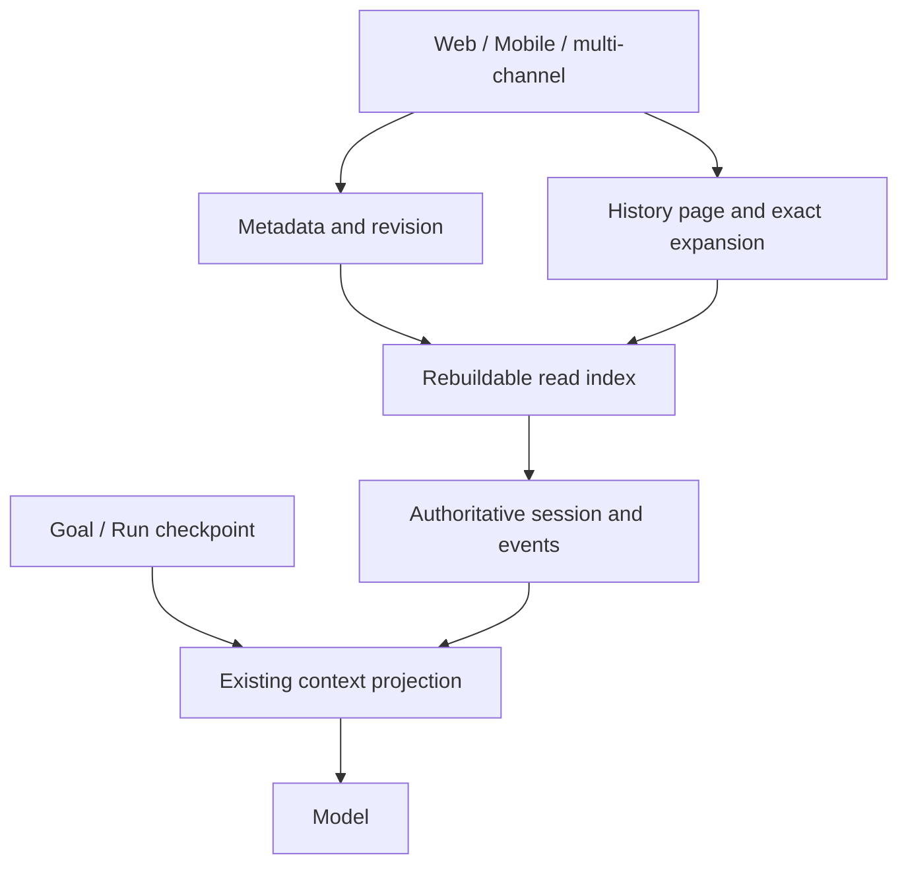

# LFL 长会话轻量化与增量执行——需求及实现设计书

版本：v1.0（实施基线）

日期：2026-11-24

范围：Web / 移动 Web / 多端会话读取、持久化与模型工作集；不改变既有 Goal/Run 权限。

状态：设计确定，分阶段实施；所有性能目标待实测验收。

## 1. 问题与证据

- 2026-11-24 Web 卡顿期间日志约 20,935 行含 EMFILE（含重复堆栈，不是独立请求数），Mac 继承的文件描述符软限制为 256；现有 P0 热修复单独收口。
- 事件日志约 12 GB、5,734 个 JSONL；会话文件约 2.5 GB。取消唯一活跃 Run 后接口恢复，不能由此断定内存泄漏。
- 单次只读历史请求 limit=1：249 条、约 1.2 MB 会话 33 ms；7,533 条、约 36 MB 会话 1,437 ms。另有超过万条消息的会话。
- 当前 SessionStore.load 先加载完整会话；历史路由只在此后切页；缓存按 8 个对象计数，无源字节预算。save 在锁内全量序列化；元数据缓存 miss 仍全量解析；前端空闲探针每 20 秒读取最新正文。协调板读取 Lane 历史后聚合。
- 既有 Web 会话索引热缓存和移动端修复已进入 origin/main（919e64bd9 为祖先）；不得重复开发。既有历史投影、压缩、锚点、工作状态证据校验应复用。

## 2. 反向拷问与决策

| 问题 | 决策 |
|---|---|
| 必须保存所有历史吗？ | 在用户未要求删除且符合保留策略时，保留完整原文、事件与证据。 |
| 必须每次读取所有历史吗？ | 否。列表、状态、分页、展开、搜索、导出分别按需读取。 |
| 必须每次将所有历史送模型吗？ | 否。保留 1M 容量，使用既有投影与模型自主选择；不按固定轮数强制总结。 |
| 是否必须新建数据库？ | 否。先用可重建派生索引；仅在实测证明必要时迁移写路径。 |
| 摘要能替代原始证据吗？ | 否。必须可按稳定引用精确回读，授权与执行状态仍以权威记录为准。 |
| 是否增加新服务或复杂门禁？ | 否。沿用现有进程、锁、审查与发布流程。 |

## 3. 需求（EARS）

| ID | 需求 | 验收 |
|---|---|---|
| R01 | 当列出会话时，系统应只返回必要元数据，支持置顶、归档、工作区与稳定分页。 | 冷/热列表不解析未选中会话正文；排序及权限与旧行为一致。 |
| R02 | 当打开会话时，系统应优先读取最近 30–50 条可显示消息，受响应字节预算约束。 | 万条历史首屏不依赖全量解析；超长单条仍可展开原文。 |
| R03 | 当向前翻页时，系统应按稳定消息身份和快照版本返回无重叠、无遗漏的历史。 | 新消息并发写入、撤回、分支切换测试通过。 |
| R04 | 当用户显式搜索、展开或导出时，系统应提供授权的原文读取与单调分页。 | 原文哈希一致；不得反复返回第一页。 |
| R05 | 当会话未变化时，空闲刷新应只比较轻量 revision；变化时获取增量或明确重新同步。 | 不变时不读取正文；断线、乱序、重连无丢失。 |
| R06 | 系统应同时限制完整会话缓存条目数和源字节预算，超大对象不进入常驻缓存。 | 缓存上限、淘汰、跨进程变更、save 失效与原文保真测试通过。 |
| R07 | 当索引缺失、过期或损坏时，系统应有界重建或明确降级，不把过期数据伪装为最新。 | 源数据不变；无并发重建风暴；可重建且可回滚。 |
| R08 | 当 Run 活跃时，系统应保持普通 Web 读请求有界响应，不抢占或重复执行任务。 | 单 Run、跨端并发、取消与重启恢复测试通过。 |
| R09 | 当模型需要旧事实时，系统应提供可发现、可授权、可精确水合的历史引用。 | 工具调用与结果配对、撤回、隐私投影及引用原文一致。 |
| R10 | 当恢复 Goal 时，系统应核验 Goal/Run 身份、工作状态与未结副作用，不因摘要而重复执行。 | 断点恢复、未知外部副作用 HOLD、旧授权失效。 |
| R11 | 系统应保持模型实际支持的上下文容量，不强制截短用户指令或引入自动语义裁决。 | 任务质量与现有基线非劣；规则、Skill、当前输入保真。 |
| R12 | 系统应记录有界性能指标，不记录敏感正文、Key 或隐私工具结果。 | P95、FD、RSS、读写量、缓存命中与降级可观测。 |

## 4. 实现设计

### 4.1 权威源与派生视图

现有 Session JSON、EventStore、Goal/Run 账本及撤回记录仍为各自权威源。Web 派生视图不是执行授权，也不替代模型证据。

索引优先复用既有能力；若需要 SQLite，仅作为本地可重建读索引，按工作区隔离，沿用现有权限。索引包含 session identity、revision、消息身份/顺序、可读取位置、必要元数据及源一致性标记。不得把 fail-open 事件日志当作完整事实；源版本变化、撤回、删除或身份不匹配必须失效。禁止未授权正文跨工作区复用。

### 4.2 读取与同步契约

保持现有 API 兼容，新增能力先经契约测试。首屏建议 50 条，后续每页 50 条；字节上限按真实负载标定，超大内容提供明确 preview 与原文入口。稳定 cursor 绑定 session identity、快照 revision、消息位置；快照失效返回明确 resync，不能静默跳页。空闲探针仅获取 revision，变化后增量读取；后台标签页退避，SSE 复用既有同步通道。手机与桌面保持滚动锚点、错误时保留已有消息，不自动重发任务。

### 4.3 缓存与持久化

M1 首个最小修复：在现有 SessionStore 完整对象缓存上叠加源文件字节预算，建议初值 64 MiB（可通过测试调整），仍最多 8 项；命中更新 LRU；源文件过大不缓存；写入、损坏和外部变更继续失效。源字节仅为缓存权重代理，不等于 Python RSS 硬上限；以真实 RSS 和解析峰值决定后续预算。不可改变原文、retraction overlay、身份检查或 Run lease。

M1 后续：元数据/历史页索引增量维护、跨进程一致性与有界重建。先在隔离数据验证，再启用生产；不在 Web 请求中无界扫描全历史。M2 只有实测显示全量 save 仍是瓶颈时，才设计增量写/快照和原子提交，保持旧数据可读、回滚与崩溃恢复；禁止双权威源。

### 4.4 模型工作集

M3 复用 history_projection、compaction_contract、working_state_checkpoint、知识与原文水合工具。模型保留当前指令、规则、Skill、未结工具组、必要近期对话和自主选择的历史证据；程序只处理物理预算、身份、权限、引用与完整性。摘要必须绑定来源、哈希、覆盖范围，不能替代原文；不自动增加模型调用，不改变 1M 容量或模型档位。

## 5. 分阶段实施与退出条件

| 阶段 | 工作 | 退出条件 |
|---|---|---|
| M0 | 基线、P0 EMFILE 独立收口、合并冲突检查 | 记录精确 SHA、冷/热读与 Run 负载；P0 不重复实现 |
| M1a | 完整会话缓存字节预算与定向回归 | 现有缓存语义、淘汰、超大对象、保存与外部变更通过 |
| M1b | 元数据、revision、真正分页及原文水合 | 无全量解析热路径；并发、撤回、权限与旧 API 兼容 |
| M1c | Web/移动增量刷新、虚拟列表、协调栏轻量化 | 交互与滚动、断线、跨端同步实机通过 |
| M2 | 依据基线决定是否增量持久化 | 写放大下降；崩溃恢复与原文保真通过，否则不改 |
| M3 | 模型工作集与 Goal 精确恢复 | 任务质量非劣、关键证据可恢复、无重复副作用 |

## 6. 验收与测试

在隔离合成数据上建立 100/1,000/10,000/100,000 条消息的矩阵，覆盖小消息和大工具回执；每档区分冷/热缓存、空闲/活跃 Run、单端/多端，记录 P50/P95、解析次数、读取字节、RSS、FD、错误率。生产只做有界只读抽样。目标：本地列表 P95 ≤200 ms、万条会话首屏 P95 ≤500 ms、点击反馈 ≤100 ms、健康 P95 ≤200 ms；历史增长十倍首屏成本不明显增长；EMFILE=0；原文保真=100%；已完成副作用重复=0；模型质量不低于基线。以上是目标而非已达成结果。

安全回归：跨工作区/用户隔离、撤回、删除、并发写与分页、索引损坏、旧版本、事件缺失、超大消息、重启恢复、授权撤销、未知副作用。测试使用隔离候选与项目 .venv；不降低既有门禁。最终候选独立 Reviewer（P0/P1=0）→ 原版 R9 → 受管 push/PR/CI → 合并 main → 主分支 CI → 协调一次受管部署 → Mac/Deepin/移动端实机验收。

## 7. 回滚与实施约束

M1a 可直接回滚代码，不迁移数据；后续派生索引可关闭并重建，旧权威源保持可读。任何新读路径不得绕过身份、撤回、Run/Goal 约束。与其他 Lane 先协调文件范围；不覆盖主工作树、不重复 P0 R9、不为本专项强制终止其他 Run。每阶段以实际代码和测试收口，不进入反复文档拷问循环。

## 8. 证据与追踪

基线：origin/main 1465210ea（设计时已观察远端跟踪引用）；P0 候选 f21bf5323 正在独立 R9，未将其视为生产生效。参考：src/llm_loop/core/session.py、src/llm_loop/web/routes.py、webui/src/core/conversation.ts、webui/src/components/conversation/MessageList.tsx、src/llm_loop/introspection/lane_board.py、src/llm_loop/core/prompt_build/stages/history_projection.py、src/llm_loop/core/prompt_build/stages/ingress_resolution.py、docs/DEVELOPMENT_REPAIR_SAFETY.md。阶段证据以候选 SHA、测试回执及生产 live SHA 为准。
