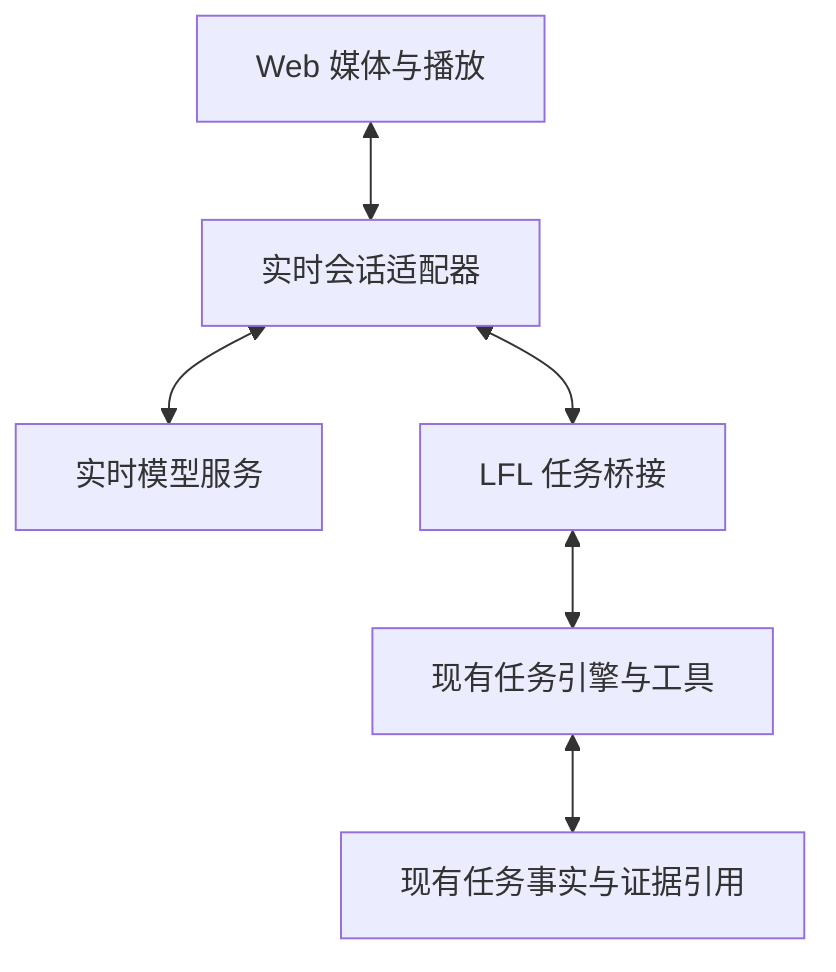

# LFL 实时多模态需求与实现设计书

版本：v1.0 · 日期：2026-10-23 · 状态：设计交付，尚未实施或完成真实音视频验收。

核查基线：`main@36a3388ea195c172a092e956e6224ff41c80306c`。

本机核查仓库：`~/Project/llm-first-loop-mirror`。全部代码结论以该提交的文件为依据，不把当前其他分支、工作树修改或历史发布记录当作生产事实。

## 1. 决策摘要

目标产品是一个能连续听说、理解当前共享页面、接受途中纠正，并可靠完成实际任务的 LFL 工作助手。

首版采用“实时会话 + LFL 任务执行”协作方式：实时模型处理低延迟听说和视觉指代；现有 LFL 引擎负责任务、工具、授权、证据、恢复。首个可验收版本覆盖连续语音、按需页面关键帧、一个真实只读工具、播放打断、同会话任务续接与断线恢复。可写工具列入后续实施阶段，不纳入首版完成声明。

实现顺序为 M0 能力与基线核验 → M1 音频会话 → M2 任务桥接 → M3 页面视觉与联合验收 → M4 可写工具扩展。M3 完成前不能宣称“实时多模态 MVP 已交付”。

默认选择一条经过验证的原生实时音频链路，先实现一个 Provider 适配器。语音识别→LFL→语音合成可以作为明确标识的降级方式；单次浏览器听写继续可用，但不计为连续实时语音交付。LFL 现有任务模型配置继续由原配置管理，本设计不指定替换为其他文本模型，也不假定 GLM-5.3 文本接口具有原生实时音频能力。

本轮授权范围是调查、拷问和设计文档。本轮没有创建实施 Goal、调用收费音视频模型、修改仓库行为、合并、推送、部署，或重启 Web / Feishu / Learning。

## 2. 证据、现状与结论边界

### 2.1 已核实事实

| 编号 | 基线中的事实 | 对设计的影响 |
| --- | --- | --- |
| E01 | `webui/src/components/conversation/DictationButton.tsx` 调用 `SpeechRecognition` / `webkitSpeechRecognition`；`interimResults=false`、`continuous=false` | 当前是单次听写；需要新增连续媒体会话，而非只改变按钮文案 |
| E02 | `Composer.tsx` 将听写结果追加到输入框；在 `conv.streaming` 时禁用听写按钮 | 不能把现有入口当作回答中语音插话；新媒体控制须与文本 streaming 状态解耦 |
| E03 | `src/llm_loop/web/vision.py` 明确把图片/文档识别成文字，交给无视觉能力的主模型，独立于核心调用链 | 可复用附件和识别能力；原始图像、坐标、时序不能只靠图转文摘要承载 |
| E04 | `/api/v1/chat/queue/interject` 认领队列项，并校验精确 `run_generation`；接口说明“立即”指下一安全决策边界 | 桥接使用已有队列与 Runner 服务，不用 HTTP 接收成功冒充任务已经改变 |
| E05 | `/api/v1/chat/cancel` 支持精确 Run 代次；SSE 断开只停止订阅，后台任务仍可能继续 | 媒体断连、停播、回复取消、任务取消必须分别建模 |
| E06 | Phase6 交付报告记录：模拟 1.2 秒调用窗口、10 个样本中，插话 P50/P95 为 29.6/59.5ms；无取消钩子的调用可能后台自然结束 | 这是历史模拟检查点结果，不是语音端到端延迟，也不证明实际推理计算已取消 |
| E07 | 已有 `memory/attachments.py::AttachmentStore`、`workspace/artifacts.py::WorkspaceArtifactStore`、`core/loop/runner.py::BackgroundRunner` | 优先复用源文件引用、任务句柄和已有事实存储；不在 Web 层另造完整任务系统 |
| E08 | 在该提交 `src`、`webui/src` 中对 WebRTC、getUserMedia、AudioWorklet、音频输入输出等常见实现符号进行大小写不敏感搜索，未命中完整实时链路 | 只能裁定“本次未找到完整实现”；关键词未命中不能证明所有私有扩展、插件或运行进程都不存在该能力 |
| E09 | `introspection/tools_skills.py::run_grill_me` 生成五类固定问题；后续层主要是继续追问提示 | 模板覆盖检查不等于完成实质评审，必须逐项回答并补场景反例 |

### 2.2 本次拷问方式

已读取提交中的 `grill_me` 实现，并抽取其中无外部依赖的模板逻辑执行一次，得到五类共 22 个问题及后续层提示。没有创建 LFL 对话或调用外部模型。随后基于代码事实进行三轮场景化追问：基础 22 问、实时多模态 16 问、反例复核 10 问，共 48 问，回答和裁决见第 4 节。

这些是本次分析产生的设计结论，不是用户逐题作答记录，不是独立 Reviewer PASS，也不是运行验收结果。无需重复调用同一模板来制造“深度评审”次数。

### 2.3 外部能力参考

截至本次查阅，OpenAI Agents SDK 文档支持持久会话、增量音频、工具和中断，并强调按实际播放位置维护被打断的历史 [S1]。OpenAI 服务端控制文档支持媒体与服务端工具控制协作，并要求一个动作只有一个执行所有者 [S2]。Google Live 文档提供流式音频、图片帧输入、部分模型的异步工具调用及会话恢复机制 [S3][S4]。

这些只证明可用的集成模式，不证明 LFL 已接入、不构成性能保证。具体模型、API 版本、认证方式、限制和价格必须在 M0 按当时官方接口冻结，禁止混用不同代接口的事件和字段。

## 3. 产品范围与用户体验

### 3.1 主要使用场景

| 场景 | 用户意图 | 完成行为 |
| --- | --- | --- |
| U1 页面排错 | “看看这个页面最后一条错误，查一下原因。” | 用户主动共享页面；系统绑定关键帧，调用真实只读工具，口头解释并显示来源 |
| U2 途中纠正 | “等等，只看最后一条，先别改。” | 立即停止旧播报；提交修正，显示任务何时收到、何时采用；后续行为符合新范围 |
| U3 长任务协作 | “你继续分析，我问一下刚才那项是什么意思。” | 保留原任务身份；能解释现状，不因每次语音新建无关联会话 |
| U4 断线续接 | 网络中断后返回页面 | 保留已提交需求、工具事实和任务状态；明确未识别的语音，不自动重复操作 |
| U5 移动端使用 | 说话、上传截图、切到后台再回来 | 根据实测能力提供语音或文字；屏幕共享不支持时可用截图；不假装仍在后台采集 |

### 3.2 首版必备与后续扩展

首版必备：中文连续语音、可编辑转写、语音播报、用户开口时打断播放、显式任务停止按钮、当前页面关键帧、真实只读工具、已有会话绑定、可见任务状态、重连、清理资源、指标记录、文字降级。

后续扩展：相机连续观察、电话/SIP、多说话人分离、复杂音频事件识别、可写工具、原生移动端后台音频、跨设备接力。它们不能作为首版延期时不断扩大的前置条件。

本设计不承诺硬实时控制、音视频会议平台、高帧率通用视频分析或机器人控制。首版不引入 SFU、独立消息中间件、全局多 Agent 调度系统或新的通用授权体系。

### 3.3 用户可见控件

- “开始语音 / 结束语音”：只管理媒体会话，结束时清楚展示后台任务是否仍运行。
- “麦克风开 / 关”“静音播报”：分别控制上传与播放，不能混成同一个状态。
- “共享页面 / 停止共享”：显示实际共享来源和最近画面时间；首次由用户手势触发。
- “停止任务”：调用现有精确代次取消；保留“正在停止 / 已停止 / 部分操作已完成”事实。
- 转写区区分“识别中”和“已提交”；用户能修正，修正追加为新事件。
- 状态只显示用户需要的信息，如正在听、正在回答、正在查询、等待确认、已断开；诊断标识放折叠详情。

语音与文字共享当前 LFL 会话。仅预览画面、开关麦克风或重连不自动创建新的长期任务 Goal。

## 4. 三轮拷问记录与裁决

### 4.1 第一轮：基础覆盖，Q01–Q22

| 问题 | 回答与裁决 | 落点 |
| --- | --- | --- |
| Q01 空输入、噪声、超长输入怎么办？ | 空转写不提交任务；噪声不能触发工具；长语音按可回显的语义轮次提交，遇供应商上限明确说明，不能静默截成尾部。 | R03、R17；T01、T06 |
| Q02 时钟跳变、网络中断、磁盘满怎么办？ | 耗时使用单调时钟；网络中断进入恢复；持久化失败不确认“已保存/已派发”，保留本地未提交文本并反馈。 | R09、R10、R15；T12、T15 |
| Q03 同一操作并发 100 次怎么办？ | 相同事件幂等认领；同一会话一个活动媒体写入所有者；不同会话互不串扰，不把 100 次重复请求变成 100 个任务。 | R07、R08；T10、T11 |
| Q04 身份或权限缺失怎么办？ | 使用现有会话鉴权和归属检查；失败时停止受影响媒体/工具路径，保留可恢复文本，不另造身份系统。 | R01、R12；T16 |
| Q05 依赖或协议版本不一致怎么办？ | M0 固定 SDK/API 和能力清单；协商不通过显示具体缺项，不能伪装全功能。 | R13；T02、T20 |
| Q06 最坏失败是什么？ | 重复副作用、旧指令作用于新页面、未经选择上传媒体，以及嘴上宣布未完成的操作成功；这些列为明确失败条件。 | R06、R07、R12；T08、T13、T16 |
| Q07 失败怎样恢复和降级？ | 媒体失败可回文字；屏幕共享失败可上传截图；模型恢复失败重建会话上下文，保留任务身份并明确感知缺口。 | R10、R13；T12、T14 |
| Q08 怎样发现失败？ | 记录断连、取消、帧龄、识别提交、工具回执、用量与队列拥塞；用户能看到出错环节，日志默认不复制媒体正文。 | R15；T15、T23 |
| Q09 重试是否合理？ | 连接握手有界退避；失去确认的工具调用先查事实；结果不明时不自动重派发。 | R07、R10；T13 |
| Q10 错误是否可理解？ | 告诉用户“麦克风未授权”“当前画面已失效”“任务仍运行”等可采取行动的信息；堆栈只进诊断。 | R16；T02、T20 |
| Q11 规模扩大 1000 倍先哪里瓶颈？ | 先测媒体带宽、供应商并发、播放队列与模型成本；首版按单用户/有限会话设计，容量实测后再扩容，不提前增加分布式平台。 | R11、R14、R18；T23 |
| Q12 热路径与冷路径如何分开？ | 采集、停播、转发为低延迟路径；长任务、证据整理和学习消费异步执行。已有任务核心继续是权威。 | R02、R07；T03、T19 |
| Q13 缓存怎么失效？ | 未绑定预览帧可被新帧替换；已绑定用户问题的帧为不可变证据；页面代次变化后不当作当前画面。 | R04、R17；T08、T09 |
| Q14 哪些状态需要持久化？ | 已提交转写、任务链接、工具事实、已绑定证据需要；原始流默认短暂缓存；崩溃后不声称恢复未保存的音视频。 | R09、R12；T12、T14 |
| Q15 输入是否可信？ | 网页内容、截图文字、模型工具参数均是待核验数据；截图里的提示不能变成用户授权，继续使用 LFL 现有权限边界。 | R07、R12；T16 |
| Q16 敏感数据怎样处理？ | 用户先选共享来源；长期 Key 留服务端；媒体正文默认不进通用日志或 Learning；远端保留政策另行说明，不能承诺供应商零留存。 | R12；T16、T17 |
| Q17 谁能调用、读、改？ | 媒体会话、附件引用和任务都绑定当前用户、LFL 会话与 workspace；仅知道 ID 不能读取或控制。 | R01、R08、R12；T16 |
| Q18 重放怎样处理？ | 应用事件 ID 去重，工具调用绑定起源；失效连接的事件不能更新当前会话。浏览器和服务端不得各执行一次同一工具。 | R07、R08；T10、T13 |
| Q19 首次 30 秒能否理解价值？ | 一个“开始语音”，按需“共享页面”，完成一次解释或只读查询；不先让用户学习新的 Plane、Goal 或授权协议。 | R16；T20 |
| Q20 错误能否自助修复？ | 麦克风拒绝给出权限入口；播放受限给出“点击播放”；共享不可用给截图入口；重连给状态和文字入口。 | R13、R16；T02、T20 |
| Q21 能否观察和调试？ | 正常界面展示听说与任务状态；折叠详情展示 trace、取消阶段和证据时间，避免把内部术语塞进主流程。 | R15、R16；T23 |
| Q22 是否符合原有心智？ | 同一个聊天会话和任务；默认开口只打断播报，明确“停止任务”才请求任务取消；按钮文案与实际范围一致。 | R06、R08、R16；T04、T05 |

### 4.2 第二轮：实时多模态边界，Q23–Q38

| 问题 | 回答与裁决 | 落点 |
| --- | --- | --- |
| Q23 把听写设成 continuous 就算完成吗？ | 不算。还缺服务端会话、轮次检测、流式播放、取消、恢复与任务桥接；现有按钮 streaming 禁用也需解耦。 | R02、R05；M1 |
| Q24 用户只说“停”停止什么？ | 先停当前声音；有明确任务取消意图才调用任务取消。歧义只澄清一次，不能靠单词匹配扩大为取消所有任务。 | R06；T04、T05 |
| Q25 环境噪声误判插话怎么办？ | 允许短暂停播且可继续；噪声不提交需求、不取消任务；提供按住说话作为可选模式。 | R02、R06；T06 |
| Q26 模型生成了但用户没听到的内容算已沟通吗？ | 不算。按实际播放进度维护实时会话；任务执行事实独立保存，不能随播报截断删除。 | R05、R09；T07 |
| Q27 扬声器回声被识别成用户怎么办？ | 启用浏览器可用的回声抑制并实机验证外放/耳机；不能仅凭 VAD 开启就宣称可双向交互。 | R02；T06 |
| Q28 临时识别文本能驱动工具吗？ | 只能用于字幕；首版桥接在当前轮次已提交、能回显最终文本后派发工具；迟到识别不得反向改写已执行的输入。 | R03、R07；T01、T18 |
| Q29 原生模型先发工具调用、后发转写怎么办？ | 桥接暂存调用并关联轮次，等待提交条件；超时明确返回未执行，不能猜文本。M0 验证该条件是否可满足。 | R03、R13；T18 |
| Q30 看图转文字足够支持“点这个”吗？ | 不足。需保留原始帧、来源、尺寸、区域与时间；首版只读解释，可写阶段还需核对当前页面目标。 | R04、R17；T08 |
| Q31 一开始必须传高帧率视频吗？ | 不必。页面任务先用按需关键帧、变化检测和原始证据回读；采样上限服从实际 Provider 能力。 | R04、R14；T09 |
| Q32 重连后自动重发最后一条工具调用吗？ | 不自动重发。先从 LFL 查当前状态和调用回执；不明结果保持 unknown。 | R07、R10；T13 |
| Q33 两个标签页都拿麦克风怎么办？ | 同一 LFL 会话只有一个活动媒体写入者；第二个提供显式接管，接管使旧连接失效；不影响其他会话正常使用。 | R08；T11 |
| Q34 每次说话都新建任务更容易实现，能这样做吗？ | 不能。媒体 session、语音轮次与 LFL 长期会话分别标识；对当前任务的纠正必须绑定原任务。 | R08；T19 |
| Q35 两个模型会不会各自执行一次工具？ | 浏览器只显示/上传，服务端桥接是唯一执行入口；实时模型的调用请求通过现有 LFL 机制，不获得并列执行权。 | R07；T10 |
| Q36 长答案全部朗读会不会阻塞交流？ | 默认播报用户所需的重点，完整结果保留可回读引用；明确要求逐字朗读时分段播放，支持中断和继续。 | R05、R17；T07、T24 |
| Q37 没有实时 Provider 凭据如何交付？ | 可完成离线实现与文字/听写降级，但实时验收必须标为未完成；不以模拟波形、预录声音或假工具结果代替。 | R13、R20；M0、M3 |
| Q38 停止共享页面要同时关闭麦克风吗？ | 两者独立。停止共享立刻停轨道和上传并使“当前画面”失效，语音可继续，已绑定历史证据仍有明确标签。 | R04、R18；T17 |

### 4.3 第三轮：反例复核，Q39–Q48

| 反例追问 | 最终裁决 | 落点 |
| --- | --- | --- |
| Q39 用户喊停前，远端操作已经完成，能显示“已撤销”吗？ | 不能。停止后续派发，报告已完成部分；撤销是独立动作，按已有能力和授权处理。 | R06、R07；T05、T13 |
| Q40 旧回复音频在新回复开始后迟到怎么办？ | 按连接代次及回复 ID 隔离，只拒收旧播放；不误停新回复，不靠全局布尔取消标志。 | R05、R08；T07 |
| Q41 队列采用 latest-wins 会丢掉用户问的旧画面吗？ | 只有未绑定预览帧可以替换；用户指向的帧先固化为引用。问历史画面可用旧帧，依据当前画面操作必须刷新核验。 | R04、R17；T08、T09 |
| Q42 已派发后 ASR 又修正了关键字怎么办？ | 追加修正事件，不回写原记录；已完成事实保留，未完成任务按现有插话/取消机制调整。 | R03、R09；T18 |
| Q43 恢复令牌失效、模型上下文全丢怎么办？ | 新建远端连接但沿用 LFL 会话；用已提交转写、任务摘要及可水合证据重建，明确音频间隙，不假称完整音色/声音历史已恢复。 | R10、R17；T14 |
| Q44 UI 已停止，供应商实际推理还在继续怎么办？ | 分别显示播放停止、取消已请求、取消已确认/不支持；实际账单与尾部请求继续计量，限制残留并发，不无限起线程。 | R06、R14、R18；T04、T23 |
| Q45 网络差导致延迟不达标，可以删慢样本吗？ | 不能。按网络、设备、冷暖启动分层报告；失败与超时计入分母；不达标就报告限制或缩小明确支持范围。 | R11、R20；T03、T23 |
| Q46 远端压缩把任务要求丢了怎么办？ | LFL 的任务事实与可回读源独立于实时模型的窗口；按需补上下文，不把每个音频块灌入核心历史，也不只剩不可恢复的摘要。 | R09、R17；T14、T24 |
| Q47 等待工具期间，授权被撤销怎么办？ | 实际执行前仍使用现有 LFL 授权检查；媒体会话存在不代表可绕过检查。只终止受影响动作，保留解释与恢复入口。 | R07、R12；T16 |
| Q48 文档写全、模拟测试绿就能宣布上线吗？ | 不能。真实麦克风/扬声器、真实只读工具、视觉指代、长会话和网络故障证据缺一项，就列为未验收。 | R20；T21–T23 |

### 4.4 拷问带来的实质修订

1. 把单一 Stop 改成播放、回复、任务三个作用范围，并区分请求与真实完成。
2. 把所有媒体进任务历史，改成短暂媒体缓存与已提交事实分开；任务证据可精确回读。
3. 把最新帧覆盖队列，改成预览可替换、用户已指向帧不可变。
4. 把重连后重试，改成先核对任务与回执，处理不明结果。
5. 把临时转写驱动操作，改成字幕先行、输入提交后执行，修正追加记录。
6. 把一套巨大多 Provider 框架，收敛为一个实测适配器、少量能力声明与现有任务引擎桥接。
7. 把历史毫秒指标当成绩，改成独立端到端指标与真实设备验收。

## 5. 需求及验收追溯

优先级说明：P0 为首版正确性或交付必需；P1 为首版体验、可靠性及质量要求。M4 的可写工具条件单独标示，不能倒算首版已支持写操作。

| ID | 需求 | 优先级/阶段 | 验收依据 |
| --- | --- | --- | --- |
| R01 | 用户主动启用麦克风与共享来源，复用登录及会话归属鉴权 | P0/M1 | T02、T16、T17 |
| R02 | 连续采集、轮次检测、回声处理；回答中可以继续输入；可选按住说话 | P0/M1 | T01、T03、T06、T21 |
| R03 | 区分转写 delta/final/committed；工具只用已提交输入；修正追加 | P0/M2 | T01、T18 |
| R04 | 页面关键帧与问题绑定，显示来源、帧龄、历史/当前状态 | P0/M3 | T08、T09、T17 |
| R05 | 增量播放、逐回复取消、播放进度、未听内容历史对齐 | P0/M1–M2 | T04、T07、T24 |
| R06 | 停播、回复取消、任务取消分别结算；精确 Run 代次；反馈最终状态 | P0/M2 | T04、T05、T19 |
| R07 | 唯一服务端工具入口；复用任务检查及事实；幂等认领，不明结果不盲重试 | P0/M2；写操作/M4 | T10、T13、T16、T18 |
| R08 | 保持 LFL 会话；媒体连接代次隔离；同会话媒体写入者接管 | P0/M1–M2 | T10、T11、T19 |
| R09 | 已提交需求、任务链接、工具事实和证据引用可恢复 | P0/M2 | T12、T14、T15、T24 |
| R10 | 有界重连、恢复失败可重建远端上下文；缺失语音明确告知 | P0/M2 | T12、T13、T14 |
| R11 | 端到端声音延迟和停播延迟满足声明的支持配置 | P1/M3 | T03、T04、T23 |
| R12 | 长期 Key、会话恢复令牌、工具凭据不下发或记日志；素材默认私有 | P0/M1–M3 | T16、T17 |
| R13 | 固定一个实测 Provider 能力档案，缺项降级，界面如实标识 | P0/M0–M3 | T02、T18、T20 |
| R14 | 媒体用量与任务用量分别计量，复用预算；拥塞和残留请求有上限 | P1/M2–M3 | T09、T23 |
| R15 | 建立事件、取消、帧龄、工具、用量的关联观测；默认无原始媒体正文 | P1/M1–M3 | T15、T23 |
| R16 | 桌面与移动端可操作；支持文字/截图降级、键盘、焦点与可访问状态 | P1/M3 | T02、T20、T21 |
| R17 | 原图和完整结果可授权回读；摘要与原始来源、过期与删除有明确区别 | P0/M2–M3 | T08、T14、T24 |
| R18 | 结束、切换、接管、异常时释放媒体和连接；后台任务生命周期独立 | P0/M1–M3 | T11、T17、T22 |
| R19 | 原文字流、附件、插话、取消、任务恢复行为保持兼容 | P0/各阶段 | T19、T22；项目原版回归门禁 |
| R20 | 模拟、真实设备、真实 Provider、生产部署四类证据分开报告 | P0/M3 | T21、T22、T23；第 12 节交付检查 |

## 6. 总体设计

### 6.1 责任划分



这是逻辑职责，不要求六个独立服务。首版在现有 Web 与任务进程边界内实现薄模块，不增加通用工作流平台。媒体字节走适配器协商的媒体链路，图中箭头不代表必须经过 LFL 文本 SSE。

| 组件 | 职责 | 不承担的职责 |
| --- | --- | --- |
| Web 媒体控制 | 设备权限、采集、播报、停播、字幕、帧预览、用户手势 | 不持有长期 Provider Key；不直接执行远端工具 |
| 实时会话适配器 | 建连、媒体事件规范化、轮次与回复、Provider 取消和恢复 | 不另建长期任务事实，不擅自启动第二份工具执行 |
| 任务桥接 | 输入提交、运行代次映射、调用认领、状态和结果反馈 | 不复制现有授权、审查、预算、任务调度实现 |
| LFL 现有核心 | 规划、任务工具、准入、执行事实、恢复和证据 | 不处理每一个音频采样块，不阻塞浏览器本地停播 |

实时会话可调用少量语义清楚的桥接能力，例如提交任务、查询任务状态、提交纠正、请求取消。沿用已有工具发现和授权，不把全仓工具 schema 与所有历史每轮灌入实时模型。具体内部函数由 M0 对现有服务接口确认，不能仅因新路由方便就复制一套引擎。

长任务运行时，实时会话仍能回应简短问题。只有收到真实 LFL 进度或结果，才播报相应事实；模型的“我正在处理”不能代替真实派发回执。

### 6.2 传输与 Provider 选择

1. 先选择一个满足连续音频、可靠本地停播、最终输入转写和工具事件关联的 Provider。M3 还须支持图像输入，或用明确标识的独立视觉适配路径完成联合体验。
2. 浏览器低延迟媒体优先使用该 Provider 正式支持的 WebRTC；服务端通过受信控制通道执行工具。若所选 API 只支持 WebSocket，则采用服务端媒体代理，音频格式依能力档案转换。
3. 只实现所选的一条媒体传输；协议接口预留替换能力，不同时建设两套生产实现。
4. 长期凭据只在服务端。浏览器如需直连，使用该接口正式支持的短期、受限凭据或后端握手方式。不能自行拼造“临时 Key”。
5. Python 实时 SDK 与浏览器 WebRTC 不是同一实现；不能因为 Python 示例能连，就认为浏览器媒体链路已完成 [S1]。

M0 的能力档案至少包含：Provider/模型/API/SDK 版本、传输、输入输出格式、最终转写事件、轮次结束语义、取消与播放截断能力、工具调用关联、图像支持、恢复方式、连接限制、已核实用量字段、地区/网络实测条件。每项记录“官方说明、实测结果、未知项”，禁止只填一个 `multimodal=true`。

### 6.3 模块落点

以下为拟新增位置，均不是已存在文件声明；实施前按当时目录与依赖规则校准。

| 位置 | 计划内容 |
| --- | --- |
| `webui/src/components/conversation/realtime/` | 媒体控件、字幕、共享来源、真实播放状态 |
| `webui/src/core/realtime/` | 媒体 session、播放队列、事件归并、连接与资源清理 |
| `src/llm_loop/realtime/` | Provider 协议、单个适配器、会话状态、桥接；保持对 Web 框架无反向依赖 |
| `src/llm_loop/web/` 的薄路由模块 | 鉴权、会话建立、控制及状态；路由注册沿用项目结构 |
| `core/loop/runner.py` 等现有服务 | 优先直接复用；只有已证实接口缺口才做最小扩展 |
| `memory/attachments.py`、`workspace/artifacts.py` | 复用原始帧与结果的稳定引用及授权读取，不在 Web 建第二个证据库 |
| 前端定向测试与 `tests/realtime/` | 事件时序、桥接、恢复、音画关联及资源清理测试，名称按现有约定调整 |

`DictationButton` 继续承担单次听写降级；新的连续语音控制不再被 `conv.streaming` 一概禁用。原有文本“停止”语义不因新增语音按钮而改变。

### 6.4 应用接口与适配器最小契约

下面是拟定的应用接口，实施时结合现有路由注册与鉴权校准；它们不表示当前已经存在。

| 接口 | 输入/输出要点 | 约束 |
| --- | --- | --- |
| `POST /api/v1/realtime/sessions` | 输入已有 `session_id`、音频模式及是否启用按需视觉；返回媒体 ID、代次、能力档案和传输初始化数据 | 服务端决定 Provider 配置；不得接收浏览器提交的任意远端 session 或长期 Key |
| `WS /api/v1/realtime/sessions/{id}/events` | 双向应用控制、字幕、状态、恢复序号和回执；音频不强制走此通道 | 校验现有登录身份、Origin 和媒体归属；Provider 原始事件不能直接视为用户命令 |
| `GET /api/v1/realtime/sessions/{id}` | 当前连接、麦克风/播放、任务链接、取消阶段及最后确认序号 | 查询不创建任务、不更改代次；越权不可读取 |
| `DELETE /api/v1/realtime/sessions/{id}` | 幂等结束媒体会话，返回关闭状态及独立任务状态 | 不等同于取消 LFL 任务；最终用量缺失则明确 incomplete |

控制通道只需要表达输入提交、回复中断、播放进度、共享状态、纠正、任务取消和媒体关闭。任务内容进入现有提交/队列服务；原 SSE 任务订阅继续使用，不能同时启动第二份任务消费者。

所有会改变状态的消息含事件 ID 和连接代次，服务端返回接收回执及最终状态；401/403 表示身份或权限问题，409 表示代次/所有权冲突，429 表示已配置额度或容量不足，503 表示依赖不可用。不能把所有错误统一包装成成功的“正在处理”。

Provider 适配器的最小职责为建立会话、接收规范化事件、补充上下文、按回复中断、关闭，以及可选恢复。媒体发送、编码和握手细节留在所选传输实现内。首版不为未选 Provider 编写空适配器。

用户点击开始后先完成本地设备与权限准备，再建立收费远端会话；只有服务端就绪才上传。共享另由用户触发。鉴权接入方式在 M0 与现有 Web 登录机制对齐，不能把长期凭据或接入令牌放进 URL。

## 7. 会话、事件与工具执行契约

### 7.1 最少身份字段

| 字段 | 含义与约束 |
| --- | --- |
| `session_id` | 已有 LFL 长期会话；服务端校验用户归属 |
| `media_session_id` | 本次语音会话；绑定 LFL 会话及选定能力档案 |
| `connection_epoch` | 建连/接管代次，由服务端签发；旧代次输入不能更新新连接 |
| `turn_id` | 一次用户输入轮次；可包含最终文本与绑定证据 |
| `response_id` | 一段模型回复；播放和取消必须指向具体回复 |
| `run_generation` | 关联已有 LFL Runner 代次；任务纠正/取消必须精确绑定 |
| `tool_call_id` | Provider 调用起源及桥接调用映射；不可拿参数哈希替代身份 |
| `event_id` / `seq` | 应用控制事件去重和恢复；原始音频块不必逐块持久化 |
| `source_ref` / `source_epoch` | 不可变证据引用及画面来源代次 |

Provider 原始事件可能没有上述全部字段，适配器在已鉴权、已绑定的连接上下文中补齐应用归属；不能假设供应商音频事件自带幂等 ID 或真实播放时间。

普通控制事件示例，字段为拟定应用协议，不是供应商 API：

```json
{
  "version": 1,
  "type": "turn.committed",
  "event_id": "evt-example",
  "session_id": "existing-lfl-session",
  "media_session_id": "media-example",
  "connection_epoch": 2,
  "seq": 18,
  "turn_id": "turn-example",
  "payload": {
    "text": "只分析最后一条错误，先不要修改",
    "evidence_refs": []
  }
}
```

只有已提交需求、任务链接、工具事实和必要恢复状态进入持久记录。临时字幕、全部声音分片和未使用的预览画面不进入任务 Journal。文本来源要标明语音识别，不能把它标成原始音频的无损副本。

### 7.2 输入提交与修正

`input.delta → input.final → turn.committed → task/answer`。

- delta 是暂定字幕；final 表示识别器完成；committed 表示服务端已接受并按所需持久化成功。三个阶段不能混用。
- final 的多次到达按 turn 与修订号归并；只有一次已提交输入进入现有队列。
- Provider 提前请求工具时，先关联并暂存，等该轮提交；不可无限等待，超时返回明确未执行状态。
- 无可靠输入转写的 Provider 不满足首版工具桥接要求；可以展示为纯语音聊天能力，不算本方案完整交付。
- 已提交后修正形成新的 correction 事件。未执行动作可被更新；已执行事实不改写或删除。
- 纠正当前运行任务走已有队列认领/插话机制；“已接收”与“已生效”分别展示。不能从 Web 线程直接改写引擎历史。

### 7.3 工具调用、幂等与不明结果

工具调用状态采用现有执行事实表达，至少可区分 `requested / claimed / running / succeeded / failed / cancel_requested / cancelled / outcome_unknown`。实现复用既有 Journal 或调用记录；M0 先核实其可持久认领与查询能力，不假定已有原子事务。

执行顺序：确认会话及输入归属 → 关联精确任务代次 → 持久认领调用 → 现有授权和预算检查 → 派发一次 → 记录实际结果 → 通知实时会话。没有可核实的认领记录时，不派发副作用工具。

首版单进程可使用现有持久记录配合本进程锁；若持久层不能跨外部副作用原子提交，崩溃窗口必须表达为 `outcome_unknown`。不为规避这个事实提前建设分布式事务平台。

同一事件重复到达返回已知状态。模型在新轮次明确提出相同参数的合法新请求，不应被永久参数哈希黑名单误拦。

外部系统如支持幂等键，按其契约使用；不支持时，客户端无法保证任意外部副作用恰好一次。结果不明先查远端事实，不能以“自动恢复”为名重复写入。首版真实工具选择只读操作；写操作的崩溃窗口与核对方法须在 M4 单独验收。

### 7.4 事件过期与真实结果

旧连接的音频、预览及回复不能影响当前播放与决策。旧工具结果仍是事实：写入其原任务记录，依据当前任务关系选择是否通知用户。不得为了拒绝旧音频，把真实已完成的工具事实一起丢弃。

同一事件从浏览器数据通道及服务端控制通道同时收到时，仍只有服务端桥接派发一次 [S2]。任务查询、纠正和取消都要验证当前运行代次，沿用现有 409 冲突语义并向用户说明变化。

### 7.5 生命周期与结束顺序

连接状态按 `opening → ready → reconnecting → ready / failed → closing → closed` 表达。麦克风开关、播放状态和任务状态分别记录，避免一个 `streaming` 布尔值同时代表四种事实。连接 ready 不等于麦克风已授权，也不等于任务已派发。

用户结束语音时，先在本地停止采集与播放，拒收该代次后续音频；再请求远端关闭、收集可获得的最终用量；在可配置的有限收尾窗口后释放连接和工作线程。未取得最终事件则记录关闭/计费未完全确认，不能一直占用麦克风等账单。后台任务继续从现有任务接口显示状态。

切换 LFL 会话时释放原媒体写入权，不自动把麦克风流、原截图或迟到结果转给新会话。恢复需要服务端确认新的连接代次和任务映射后才能继续上传或播放。

## 8. 音频、中断与视觉设计

### 8.1 音频采集与轮次

采集要求使用浏览器已支持的媒体接口；采样率、声道、编码依所选 Provider 协商。不要固定抄另一个后端的 PCM 参数。浏览器提供的回声抑制、降噪、自动增益按能力启用，实际外放表现另测。

轮次检测可由原生实时模型或供应商提供，适配器归一化 speech-start、speech-end、committed 事件。最终验收包含停顿、长句、中文夹英文、数字、专有名词、回声、环境噪声。用户可选按住说话，不把固定静音阈值当作唯一中文断句策略。

新的语音输入在模型回答时仍可采集。播放输出不应被回声送成新的任务。浏览器自动播放受限、设备切换、蓝牙变化和音频上下文挂起要有明确状态及恢复入口。

### 8.2 三种停止范围

| 事件/操作 | 立即效果 | 后台任务效果 | 用户反馈 |
| --- | --- | --- | --- |
| 用户开口 | 本地暂停/清除当前回复播放，发送对应回复中断请求 | 不直接等同取消任务；等待完整新意图 | 正在听 |
| 用户说“先别说了”或按静音播报 | 停止当前声音，按需要取消当前回答 | 原任务可继续 | 播报已停止，任务状态另示 |
| 用户明确纠正需求 | 停旧播报；提交新轮次 | 向精确 Run 代次插话，下一安全边界采用 | 已接收 / 已采用分别反馈 |
| 用户点“停止任务”或明确要求取消任务 | 本地停播；立即请求取消对应 Run | 使用现有取消机制；检查真实终态 | 正在停止 / 已停止 / 已完成部分 |
| 用户结束语音 | 释放麦克风、播放和媒体连接 | 默认保留独立后台任务，结束前显示其状态 | 语音已结束；后台任务仍运行或已结束 |

本地停播不等待服务端确认。Provider 取消成功、LFL 取消成功与实际计算停止分别观测；不支持取消的后端如实标注。

音频按 `response_id` 排队及清除。新回复开始后，旧回复迟到音频不得重新播放；延迟到达的旧取消也不能清掉新回复。播放进度以客户端实际输出时间线为准，不能把下载字节、生成 token 或服务端音频范围当作用户听到的位置。

中断时同步实时会话的未听内容；任务执行 Journal 和完整产物单独保留。转写无法与声音精确对齐时采用保守的已确认边界并记录精度限制，不虚构字符级播放位置。

M4 可写阶段：用户正在有效说话期间，暂缓新的副作用工具派发，直到新轮次提交或误触发被解除；已在途操作不能承诺即时撤回。该机制只协调输入与派发时序，不裁决用户语义。需提供关闭自动插话/切换按住说话的出口，避免噪声造成永久停滞。已有授权检查不因媒体状态而减少。

### 8.3 页面关键帧

首版只在用户主动共享后采集所选来源。页面截图不是 DOM 读取权限：DOM 只能来自已有、已授权且目标精确的浏览器工具。普通 Web 页面不能读取任意外部标签页 DOM。

每个关键帧包括来源标识、source_epoch、捕获时刻、服务端接收时刻、宽高、选区及不可变内容引用。来源变化、共享停止、页面代次变化要更新有效性。

默认从按需采集开始，可增加低频变化采样；建议初始 0.5–1fps，必须受 Provider 上限与实际费用约束。等待队列只保留少量未绑定预览帧，拥塞时替换过期预览，不丢弃已提交用户指令、绑定帧或工具事实。

“这个/这里/最后一条”在输入提交时绑定候选帧；候选不唯一或没有可用画面时提一个具体澄清问题。当前页面问题建议使用捕获至绑定不超过 2 秒的帧，此值是初始体验目标，可在 M0 按任务校准。明确问历史画面不受“必须最新”限制；可写操作必须另核对执行时页面及目标。

帧龄主要在客户端同一单调时钟上计算，服务端另记录传输与处理耗时。不能直接用浏览器和服务器两个未经校准的 wall clock 相减。

模型需要看原图时提供可授权读取的原图或局部；图转文结果是派生证据。用户指定区域可裁剪降成本，但应保留所绑定原图的稳定引用和裁剪关系，避免不可恢复丢失。

### 8.4 存储和保留

原始连续音频和预览画面默认只在有界运行缓存中存在，不长期录制；结束或超时清理。缓存大小按字节及时间双限配置，溢出时明确暂停/降级，不能默默丢失并宣称完整理解。

已提交最终转写、任务链接、调用结果和被使用的关键帧引用，沿用当前会话/附件保留策略。被绑定的帧在投影、裁剪或摘要之前保存精确源；授权回读应支持完整读取或单调分页。用户删除或保留期到期后，引用返回明确失效，不能用摘要假装原图仍在。

原始音频默认不留存意味着不能承诺精确重放。需要音频级审计的场景单独提供显式录音选项，说明来源、保留期限及删除行为。转写同样属于用户数据，不进入普通调试日志；Learning 仅按现有明确的数据消费策略接收，不自动吸收每个媒体片段。

## 9. 恢复、资源、预算与安全边界

### 9.1 三种恢复路径

| 故障 | 恢复行为 | 不得宣称的事实 |
| --- | --- | --- |
| 短暂媒体/控制断连 | 本地停旧播放，显示断线；有界退避连接并更换连接代次；从已确认事件序号核对 | 断线期间仍连续理解 |
| Provider 连接过期且支持恢复 | 按官方恢复机制续接；恢复令牌仅在服务端受保护保存 | 连接恢复即工具恰好一次 |
| 恢复失败或令牌失效 | 保留 LFL 会话与任务，从已提交输入、摘要及证据引用重建远端上下文；用户重新开始未提交语音 | 所有未保存音频、原始模型状态均已恢复 |

初始重连策略建议三次自动尝试，退避约 0.5/1/2 秒并抖动，之后给出手动重连与文字入口；参数可调。鉴权失效、配额不足及协议不兼容不进行无意义循环重试。共享权限不能被重连自动重新授予；需要用户操作时显示入口 [S5]。

恢复时先拉取 LFL 真实状态，不重播未听完的旧回答，不重派发失去确认的工具。离线输入可保留为本地草稿，但上线后需明确提交；不能自动把整段过时语音按当前页面执行。

### 9.2 资源与背压

同会话媒体写入者通过服务端代次与可续租占用管理；显式接管或租约过期后才转移，旧连接随后即使恢复也不能写入新状态。租约只管媒体所有权，不能取消独立任务或替代授权。

音频、预览帧、控制事件使用不同的拥塞处理：可替换预览帧可以丢弃；用户输入与任务控制不可静默丢弃；音频严重积压时暂停采集/响应并显示状态，不长期播放已经过时的回答。具体容量在 M0 按格式计算，记录实际峰值。

结束语音、切换 LFL 会话、标签页退出、接管及异常均释放 MediaStream tracks、播放节点、计时器、监听器、连接和残留 Worker。取消不支持的 Provider 请求设置残留并发上限并计量，不通过不断创建后台线程掩盖不可取消。

首版不把所有线程串行化，也不让同步图像识别或长工具占用实时事件循环。复用 BackgroundRunner；原模型任务的输出预算与上下文策略不因低延迟语音而被一概调低。

### 9.3 预算与用量

复用现有预算配置入口，新增的媒体计量采用 Provider 的真实模态单位，分别记录音频输入/输出、图像、文本和任务工具/模型用量。不同模态不能全部当普通文本 token 相加，也不能仅以连接时长推断账单。

M0 冻结当时价格来源、计费单位、配置额度及测试可用范围；不在本文捏造固定费用。用量尚未回报时区分估算与结算；异常断连缺最终账单时标为 incomplete。到达既有预算要求时停止新的受限请求并给文字状态，已在途调用及任务事实仍要结算，不伪报零成本。

关注“每次成功任务成本”“每分钟有效交互成本”和人工接管次数。预览去重、按需原图、简短播报和按需上下文用于减少浪费；不能靠隐性截断需求、降低原任务模型能力来达成成本目标。

### 9.4 安全与可访问性

媒体入口使用现有认证、session/workspace 归属校验和相应的 CSRF/Origin 检查。长期 Key、工具凭据、恢复令牌不出现在前端 bundle、URL、常规日志或转写。短期会话凭据的范围与时效由所选正式 API 保证，不能让浏览器自由绑定任意远端 session。

截图中的指令、网页提示和模型调用不能提升权限。真实工具检查沿用 LFL；实时层不另造语义黑名单或审批平台。媒体采集要求安全上下文与浏览器权限；屏幕共享需要用户手势且每次重新取得权限，自动恢复不能绕过浏览器 [S5][S6]。

界面支持键盘操作、可辨认按钮和焦点恢复。字幕 live region 采用节流更新，不能每个音频事件触发屏幕阅读器播报。移动端对锁屏、来电/音频焦点、切后台和返回做实机验证；没有实测支持就明确暂停或降级，不承诺 Web 后台持续采集。

## 10. 性能目标与验证方法

以下全部是拟定目标，不是已测成绩。M0 可以基于真实基线修订，但必须在最终测试前记录修订理由、支持配置与阈值，禁止看到结果后降低标准冒充通过。

| 指标 | 初始目标 | 计量口径 |
| --- | --- | --- |
| 无工具自然对话首声延迟 | P50 ≤1 秒，P95 ≤2 秒 | 用户真实说话结束至首段有意义声音实际输出；包含断句等待；冷启动单列 |
| 本地插话停播 | P95 ≤200ms | 用户开始说话至旧声音实际停止，包含语音起点检测；不能只计收到 VAD 后的 JS 时间 |
| 本地按钮停播 | P95 ≤100ms | 用户按钮事件至本地输出停止，独立于 Provider 取消确认 |
| 视觉新鲜度 | 当前页面问答初始目标 ≤2 秒 | 捕获至问题绑定；同时报告传输/推理耗时；历史画面单列 |
| 工具反馈真实性 | 误报完成 0 次 | 接收、派发、执行结果与播报逐项核对，不把“收到”当完成 |
| 关键时序正确性 | 测试集中重复派发、跨会话串扰、旧音频复活均 0 次 | 明确样本数与事件覆盖，不能推导生产永不出错 |
| 长会话 | 至少 3 场各 30 分钟 | 包含工具、纠正、媒体重连；无持续资源泄漏，恢复事实可核对 |
| 成本与体验 | 给出实测值和文字基线 | 同任务成功率、耗时、接管、费用；不先编造改善百分比 |

工具型回复分别测：用户说完到真实接收反馈、工具开始、工具完成、结果声音。简短“好的”不能计为完成回答；延迟慢的工具不能从任务指标中隐藏。

延迟主指标尽量由客户端同一单调时钟测量，并用设备输出/录音回路确认可闻边界；自动日志是定位证据，真实声音测量是交付证据。记录测量方法及精度，不能用服务器生成时间代替播放时间。

每个对外声明支持的基准配置至少收集 100 个无工具中文轮次，分布在至少 10 个会话；插话测试另收集至少 100 次。区分网络、设备、外放/耳机、冷暖连接；报告样本、超时、失败、P50/P95 和最大值。不能将不同配置混成一个漂亮总数。

体验对照建议选择 30 个相同的页面任务，用文字入口和语音/视觉入口配对比较成功率、有效耗时、纠正次数及成本。样本只反映该任务集，不宣称通用模型能力提高。

## 11. 测试矩阵

| ID | 场景及注入方式 | 通过条件 | 证据级别 |
| --- | --- | --- | --- |
| T01 | 空音频、长句、转写 delta/final 重复 | 无空任务、无临时字幕执行、已提交输入恰一次；长句无静默截断 | 确定性事件测试 + 真语音 |
| T02 | 拒绝麦克风、无设备、播放被阻止、协议缺项 | 明确缺项及恢复入口；文字/听写能力标识正确 | 浏览器实测 |
| T03 | 连续自然对话与长任务并行 | 无阻塞采集，首声指标达标，真实慢样本保留 | 真设备/Provider |
| T04 | 声音输出中开口、按停播，取消 ACK 延迟/缺失 | 本地立即停；取消阶段如实；不取消其他回复/任务 | 事件竞态 + 真音频 |
| T05 | “停一下”“先别说”“取消这个任务”；操作已完成后取消 | 作用范围正确，精确代次；不谎称撤销已完成操作 | 事件测试 + 人工语义核对 |
| T06 | 外放回声、噪声、停顿、夹英文及按住说话 | 不把模型声音变成用户任务；误停可恢复；无噪声工具派发 | 真设备 |
| T07 | 旧声音迟到、取消迟到、未听完历史截断 | 旧回复不复活，新回复不被误停；任务事实保留 | 可控乱序 + 播放核对 |
| T08 | 指代一帧后页面切换、选区变化、历史画面提问 | 绑定不可变；历史/当前区分；缺帧澄清；原图可回读 | 事件 + 真实页面 |
| T09 | 限带宽、帧拥塞、连续变化 | 预览有界且替换可见；绑定帧不丢；控制事件不静默丢弃 | 故障注入 |
| T10 | 同调用通过两个通道重复 100 次；不同用户请求相同参数 | 原调用派发一次；合法新调用不被错误合并 | 确定性并发测试 |
| T11 | 同会话两标签、显式接管、旧连接恢复 | 单媒体写入者、旧代次拒收、其他会话正常 | 双浏览器页实测 |
| T12 | 断网 3/10/30 秒，断在语音未提交与提交之后 | 缺失语音明确，已提交不丢，恢复不新建无关长期会话 | 网络故障注入 |
| T13 | 派发前/后崩溃、结果持久化前掉线 | 先核对回执；结果未知不重写；只读首版真实工具验收 | 桥接故障注入；写操作另验 |
| T14 | 恢复令牌失效、Provider 会话过期、上下文重建 | 沿用 LFL 任务，原证据可读，未保存声音不假装恢复 | Provider + 事件测试 |
| T15 | Journal/附件写入失败、磁盘满、日志出口失败 | 不伪报已持久化；媒体与任务失败范围明确；错误可定位 | 确定性故障注入 |
| T16 | 越权 session/ref、失效授权、网页提示注入、凭据扫描 | 无越权读取/调用，无长期 Key 泄漏；既有检查生效 | 安全定向测试 |
| T17 | 停共享、停麦克风、删附件、退出语音 | 对应采集/上传真实停止；引用按保留规则失效；后台任务独立 | 浏览器 + 存储核对 |
| T18 | 先工具事件后转写、转写迟到、执行后修正 | 提交前不派发；超时可见；修正追加且旧事实不改写 | 可控事件乱序 |
| T19 | 运行中插话、Run 变化、媒体断开但任务继续 | 队列/取消代次一致；不把 SSE 或媒体断连当任务取消 | 现有 Runner 定向回归 |
| T20 | 首次使用、键盘、焦点、字幕、屏幕共享不可用 | 主流程可理解，降级可用，辅助技术不被连续事件淹没 | 可访问性与可用性核对 |
| T21 | 桌面目标浏览器和手机真实设备 | 记录具体版本；每项能力单独声明；后台恢复不虚报支持 | 真设备 |
| T22 | 30 分钟会话、反复进出语音与切换会话 | tracks/连接/节点回收，无持续增长；原文字流和后台任务兼容 | 长稳态 + 原回归 |
| T23 | 指标、成本、取消残留、网络分层报告 | 可核对 trace/用量；分母完整；未知费用不标成零；目标达标或明确未过 | 真实测试报告 |
| T24 | 长结果、按需全文、已绑定原图、分页与删除 | 可完整授权回读或单调翻页；摘要不冒充全文；删除明确 | 核心存储与集成回归 |

测试数量按责任边界控制：优先覆盖上述真实竞态、故障与旧能力回归，不为每个字段和组件再复制一组只镜像实现的测试。真实语音测试保留转写和必要测量记录；未经明确选择不长期保存用户原始录音。

## 12. 分阶段实施与完成标准

### M0：确认能力、接口及基线

工作：重新冻结当时 main；读取开发防退化契约；核实 Web 会话鉴权、Runner、队列、附件及 Journal 实际接口；选择一个 Provider 及一种传输；冻结能力档案、API/SDK、价格与测试条件。记录当前文字、听写、图片与取消基线。

产物：需求/测试追溯表、能力档案、接口映射、真实网络基线、测试素材和用量范围。现有配置可用则复用；新增凭据或外部数据发送必须有对应授权，不能用本设计自动替代。

完成条件：连续音频、最终转写、取消、工具关联及图像路线的可行性有官方与实测依据。实际缺凭据或接口能力时列明阻断，不能仅靠 mock 宣布完成。

### M1：连续音频与本地播放

工作：接入采集、轮次检测、增量播放、本地停播、回复隔离、字幕、独立媒体状态及清理；保留原文字和单次听写。

验收：T01–T04、T06、T07、T17、T21 中本阶段相关项；至少一次真实麦克风与扬声器双向交互。此时只可称“音频会话基础完成”。

### M2：LFL 任务桥接与恢复

工作：输入提交；绑定现有会话/Run；接入一个真实只读工具；分级任务状态、纠正/取消、认领去重、持久事实、重连及不明结果处理。

第一个工具优先复用现有 `read_file`，读取隔离 workspace 内的真实诊断文件。测试运行时写入新的校验值，要求通过实际工具回执读取，防止预置答案冒充工具调用；不读取生产凭据或依赖生产写操作。完成该链路后，再选一个真实工作页面任务验证实际价值。

验收：T05、T10–T19、T24 中本阶段相关项；完成“提出需求→工具执行→口头反馈→插话纠正→续接”的真实闭环。不能用假工具回包代替。

### M3：页面视觉与完整 MVP 验收

工作：用户选定共享来源，关键帧与指代绑定，原图引用、过期判断、拥塞处理；完善手机降级、可访问性、用量和诊断；运行完整联合矩阵与性能测试。

验收：第 11 节全部首版用例；第 10 节支持配置的延迟目标；3 场 30 分钟长会话；真实 Provider、真实页面与只读工具；需求及失败项逐项回读。

首版完成须同时具备：可运行候选、真实证据、兼容回归、清楚的设备/Provider 支持范围、已知限制、回滚方式和安装/使用说明。缺项标“未完成”，不靠缩减描述掩盖。

### M4：可写工具扩展，首版之后

按已存在授权和检查机制逐个接入实际工具，验证说话期间派发协调、精确目标、既有审查要求、取消边界、外部幂等键和不明结果核对。真实写测试先在隔离可回滚目标进行。已完成操作的撤销要作为独立能力验证。

不把首版只读测试结果泛化成“任意工具安全执行”。不为每种语音模式新建一套审批规则或把所有现有工具永久限制成只读。

### 实施过程与发布边界

每阶段先定责任及定向验证，冻结候选后按仓库现有规则完成独立审查；存在代码变更时，再按实际项目要求运行原版完整门禁。实际运行的命令、退出码、候选指纹和失败项均保存，不能提前写“PASS”。

合并、推送、正式部署或服务重启依据当时用户授权分别执行。本设计本身不授予这些操作权限。本次禁止修改或重启生产 Web、Feishu、Learning 的约束继续有效。

上线需要的授权具备后，先做配置与产物回滚检查，控制在 Web 相关能力范围；出现串会话、重复派发、无法停播、凭据泄漏或资源持续增长时，关闭新增媒体入口并恢复原文字入口。关闭媒体入口不应删除任务事实或中断其他服务。

## 13. 风险与简化原则

| 风险 | 处置 | 不采用的捷径 |
| --- | --- | --- |
| 文本任务循环过重造成语音慢 | 实时模型保留当前意图及必要状态，长任务在现有 Runner 执行 | 统一缩小所有模型输出预算或静默裁掉任务历史 |
| 浏览器/Provider 的取消能力不同 | 分开量测停播、取消确认与实际终止；能力缺项明确 | UI 收到请求就显示计算已停止 |
| 页面变化与指代错位 | 绑定不可变帧，当前操作前核对来源与目标 | 一直用最新帧覆盖用户指向的旧帧 |
| 多通道及重连导致重复工具 | 唯一执行入口、调用归属、持久认领、unknown 状态 | 无条件重试，或用参数哈希永久阻止合法新请求 |
| 上下文恢复变成只剩摘要 | 保留原始任务事实、全文/原图引用和模型可调用的回读 | 只有磁盘文件，没有稳定可水合引用 |
| 延迟目标与网络条件冲突 | 分层实测、展示限制、保持可用降级 | 删除慢样本或用“好的”代替有效首声 |
| 媒体功能带来新控制负担 | 复用现有授权、预算、队列与证据；仅增加媒体时序和能力协商 | 额外堆叠通用 Gate、Review 平台和状态数据库 |
| 低延迟牺牲 LFL 实际能力 | 实时路径与任务路径分工，任务模型参数保持独立 | 把低延迟等同于限制原模型思考、上下文或工具 |

新增机械控制只用于模型无法替代的事实边界：连接归属、身份、字节格式、精确代次、已提交状态、资源上限和去重。语义理解、任务取舍和答案组织继续由模型承担。可调参数与降级入口应可见，不能形成无出口的启发式拦截。

## 14. 实施前待核实事项

以下未知项不妨碍本设计交付，但必须在相应阶段开始前查清并记入能力档案；不能留到验收时靠猜。

| 项目 | 默认设计/待核实事实 | 解决阶段 |
| --- | --- | --- |
| 实时 Provider | 默认一条原生实时链路；尚未核实当前账号凭据、地区和额度 | M0 |
| API 与 SDK | 按当时官方版本冻结，不复用本文示意字段为供应商请求 | M0 |
| 最终转写与工具顺序 | 必须证明可关联输入轮次并满足提交条件 | M0 |
| Journal 认领 | 核实现有事实存储能提供哪些持久与查询保证，不能假设跨副作用事务 | M0 |
| 网页实际承载环境 | HTTPS、反向代理、认证和媒体连接条件需真实检查；Sites 评分站不作为媒体后端 | M0 |
| 设备支持 | 先声明实测桌面配置，手机按能力验证；未实测不承诺连续后台音频 | M1、M3 |
| 媒体计费与预算 | 价格、用量单位、预算映射和结算失败行为需实测 | M0、M3 |
| 可写操作 | 具体工具、目标、幂等/恢复方法和已有授权尚不在首版范围 | M4 |

## 15. 交付状态与后续起点

本设计已完成代码事实核查、48 问拷问与裁决、需求追溯、架构、事件和中断语义、视觉证据、恢复、隐私、成本、性能、测试和分阶段实现计划。

本轮未执行独立 GLM-5.3 文稿审查，未运行代码门禁或真实音视频压测，未实施、上线或改变任何生产服务。当前可作实施依据和审查输入，不能作功能已交付或生产可用证明。

下一项具体工作是 M0：在当时最新 main 的隔离候选上核实接口与真实 Provider 能力，先完成一次“连续听说→本地打断→同会话只读工具”的最小探针，再进入实现。探针结果若推翻本设计假设，先修订相应裁决与验收，不强行套用接口。

## 附录 A. 核查文件指纹

以下 SHA-256 针对基线提交中的原始文件字节，不代表当前运行服务已加载这些文件。

| 文件 | SHA-256 |
| --- | --- |
| `webui/src/components/conversation/DictationButton.tsx` | `c3720bd3b0b1a91b758a68ae6e2bd34576e69454471f3d27bddc499ff1c54118` |
| `webui/src/components/conversation/Composer.tsx` | `c38dc4f0497780b3932336e2acac07e7793fe9415d5bcd5aa4c9960cac9ca9e1` |
| `src/llm_loop/web/vision.py` | `44df23e725e13e554e67dd03bf5fcfa499d5af9986e3e5ddb6ba2aaa7bb8540c` |
| `src/llm_loop/web/routes.py` | `a5a194ab1866c1f7af5b4bc6490ea77d450e5219f8b8253af773951d4cfd9a4b` |
| `src/llm_loop/introspection/tools_skills.py` | `29d727e060aa2556b2e29c40473ae03a7b35c9b3c0c2765641bb3e43e558ffea` |
| `docs/phase6-delivery-report.md` | `1fe59e21db8f6e23f97f37cd927e44203ebf801487633394ec371b3f772bad4b` |
| `docs/phase5-stream-interrupt-design.md` | `10cf50e2ac5be0d9a2e139d3bf058e1e85961cefd5428696d7ba9cf9f81410d0` |
| `docs/DEVELOPMENT_REPAIR_SAFETY.md` | `01d1b2b8349e08f316eecb372af37ab7d863a039da13a511cd0f0a7b8fb7c11b` |
| `AGENTS.md` | `a741052dbc20070288ca83f461d4f480eb2821c2c5d83e56f92c09172088b9c4` |

核查执行输出参考：`command:sess-96575-940:stdout`、`command:sess-96575-941:stdout`、`command:sess-96575-944:stdout`、`command:sess-96575-946:stdout`、`command:sess-96575-948:stdout`、`command:sess-96575-949:stdout`。命令输出引用是本次调查定位线索，不替代 Git 对象和文中事实；部分长预览截断，不影响通过固定提交重新读取原文件。

## 附录 B. 一手资料

以下资料于 2026-10-23 查阅。供应商功能与字段可能变化，实施时必须重新核对所选版本。文中架构、性能目标、阶段与验收数量均为本设计建议，不是供应商承诺。

- [S1 OpenAI Agents SDK：Realtime agents guide](https://openai.github.io/openai-agents-python/realtime/guide/)：会话、工具、打断与实际播放历史；Python 默认传输与浏览器传输的区别。
- [S2 OpenAI：Server-side controls](https://developers.openai.com/api/docs/guides/voice-server-controls)：媒体与服务端工具控制协作、动作所有权、本地播放控制及凭据边界。
- [S3 Google：Live API capabilities](https://ai.google.dev/gemini-api/docs/live-api/capabilities)：流式音频、图像帧与不同模型的工具能力。查阅时文档标注 Preview，不能默认所有模型功能一致。
- [S4 Google：Session management with Live API](https://ai.google.dev/gemini-api/docs/live-api/session-management)：连接/会话限制、压缩与恢复机制；不能等同于应用任务恢复。
- [S5 MDN：getDisplayMedia](https://developer.mozilla.org/en-US/docs/Web/API/MediaDevices/getDisplayMedia)：用户选择来源、权限及瞬时用户激活要求。
- [S6 MDN：getUserMedia](https://developer.mozilla.org/en-US/docs/Web/API/MediaDevices/getUserMedia)：安全上下文、设备与权限行为。

