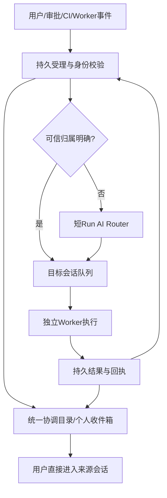

# LFL Super-Agent 非阻塞路由、统一协调与审批闭环设计 v1.0

- 日期：2026-11-25；状态：实施基线（待独立设计/代码审查及真实验收）
- 目标：让主筹长期可用、短 Run 处理事件，所有明确归属的消息绕开主筹模型，统一协调与审批查询，减少等待、错投和重复执行。
- 研究基线：DSH 原型 8c32a9dc5d72c033816c6a8110b37f40cf94fba4；LFL origin/main 6349346d8a93cfd98d2ba464fc0dc45a4db84b51（PR121）。
- 实施原则：复用现有权威、最小修复、单问题族单 writer、分阶段可回滚；不引入新的消息中间件或第二套审批/调度体系。

## 1. 事实与边界

| 观测 | 证据及含义 |
|---|---|
| 主筹消息 q_ebb6d094b472 | 主筹 60178c68-fce2-4139-ab20-8de4cd35fa3c 的 queue/status 接口曾显示 queued 约40分钟，后续超过44分钟且 running=false；证明存在空闲未派发，不能归因于单一模型慢。 |
| 全局消息历史指标 | 312样本/133会话；ack P95 49.138s，persist 91.427s，effect 117.567s，applied 147.407s；自然边界147.730s、空闲77.868s、可中断46.719s、流式中断24.965s。不同指标含义不同，不直接相减；不是专项压测。 |
| 协调板 | 23活跃Lane、24待协助、5阻塞、22 baseline stale、27待决策（快照口径，非互斥计数）。 |
| 运行版本 | 初次健康接口4f1157055，落后于main 6349346d8；PR120/121已合，不等于已部署。 |
| 后续观测 | 07:20+08 已有受管部署 generation456，四服务 restart barrier 属于同一 operation svc-8071c38625314e29a7531933873c34ab；07:22/23有 web_queue_dispatch 拒绝审计。当前屏障是可证实的派发阻断之一，不能解释07:20之前的全部滞留。不得强行释放、重复重启或绕过。 |
| 已有并行工作 | lane-73752c78 正处理 session_wake/tools_help；lane-5b063995 正处理 EvolutionPanel 审批反馈；lane-de8b5813 的 PR121 性能成果已合待运行验收；PR120 多入口版本统一已合。必须复用并与原owner协调，不抢写。 |

源码证据：
- [DSH README](https://github.com/deepseek-ai/dsh-superagent-prototype/blob/8c32a9dc/README.md)：研究原型、非生产安全边界。
- [DSH execution](https://github.com/deepseek-ai/dsh-superagent-prototype/blob/8c32a9dc/docs/003-execution.md)、[Router prompt](https://github.com/deepseek-ai/dsh-superagent-prototype/blob/8c32a9dc/prompts/orchestrator.md)、[intake.ts](https://github.com/deepseek-ai/dsh-superagent-prototype/blob/8c32a9dc/src/core/intake.ts)、[effects.ts](https://github.com/deepseek-ai/dsh-superagent-prototype/blob/8c32a9dc/src/app/effects.ts)：订阅直达、短等待、持久effect、worker槽位、人类消息额外槽位；ordered relay/notice 仍可能队首阻塞。
- LFL：src/llm_loop/introspection/tools_help.py（help投递/应答；基线描述投递即止）、web/human_turn_queue.py（单Web进程JSON权威、原子claim、真实回执）、web/queue_recovery.py（服务端兜底、屏障/运行状态检查、默认60s龄）、runtime/admission_barrier.py、core/scheduler.py、web/coordination_routes.py、introspection/task_claim.py。
- 既有设计 docs/design/DESIGN-20261101-cross-session-coordination-v1.md、DESIGN-20261116-multiagent-coordination-closure-v1.md、docs/SPEC-20260923-queue-recovery-server-owned.md；实施时先对齐其约束。

## 2. 反向拷问及裁决

1. Router 模型卡死？接收、持久化、精确归属路由与状态查询由确定性服务处理，模型只处理未知归属/拆分/冲突。
2. 所有消息都进主筹？禁止。目标会话、审批、Goal、Lane、PR、Job 绑定明确则直接路由，主筹只订阅必要摘要。
3. 单消息失败阻塞其他人？按目标会话隔离领取和退避；同一会话因果顺序保留，独立会话不共用全局FIFO队首。
4. 只靠提示词限制主筹？不够。独立角色、工具白名单、短调用预算、禁止同步长任务和等待；到期记录待处理事件，不丢任务。
5. Worker 满载？保留协调/人工调度容量，限制普通Worker并发；不宣称保留槽位可突破Provider限流。
6. 重启或消息超时？先查原ID、Run和副作用证据，未开始才重排；不确定进入核验态，禁止整轮重放。
7. 审批失效？业务事项持续可查询，短期凭证必须过期；由原会话重核动作、权限、代次，生成新申请并关联旧ID；不得自动延长或代批。
8. 归属错误或多owner？确定性拒绝/退回到待研判；不广播敏感信息、不自动获得写权。
9. 目录是第二个事实源？不是。现有Goal/Lane/审批/队列/事件投影；不可用如实标记，禁止伪零。
10. 是否重构整个Loop？否。优先修复现有派发及唤醒，复用现有Run、TaskClaim、CAS、审查和部署入口。

## 3. 目标架构

Router 只做新任务研判、分解、分配、依赖/优先级、异常冲突和结果汇总；不执行代码、R9、CI轮询、长shell、同步Reviewer、审批等待或重启。明确角色由受信配置绑定，不由消息正文自封。Router 每次短Run处理一个或小批事件，派工后退出；事件回传再唤醒。普通会话保持原能力与单会话单Run规则。Reviewer 与开发角色分离，交付Worker复用现有受管入口。

## 4. 可执行需求（EARS式）

| ID | 要求 |
|---|---|
| R01 | 当协调消息到达，系统须在持久提交成功后返回唯一事件ID和受理回执；受理不等于送达/执行。 |
| R02 | 当消息携带可信目标session/Goal/Lane/审批/PR/job绑定，系统须确定性直达唯一目标，不调用Router模型。 |
| R03 | 当绑定缺失、冲突、失效或越权，系统须返回可查询的待研判/拒绝原因；不得猜测归属。 |
| R04 | 当Router运行长任务、等待、超时或429，受理/已知路由/状态查询仍须可用；Router未决事件持久保留。 |
| R05 | 当Router接单，须使用受信角色白名单、有限上下文/工具预算，禁止同步执行长任务；派工后结束Run。 |
| R06 | 当任务分配成功，须登记owner、Goal、Lane、TaskClaim及依赖；重复分配同一幂等键不得创建第二writer。 |
| R07 | 当目标会话忙，消息须持久等待或通过已有受控插话机制交付；不得启动第二Run。 |
| R08 | 当目标空闲且准入可用，服务端须主动派发，无需浏览器轮询；失败保留原因与下一次尝试时间。 |
| R09 | 当一个目标失败或被限流，其他目标须继续派发；保留同一目标因果顺序及公平性。 |
| R10 | 当存在服务重启/安全屏障，禁止绕过；显示具体服务、阻塞原因、时长，解除后受控自动接续。 |
| R11 | 当claim超时，须以机械Run/ingress/terminal证据区分未启动、运行、已终结、不确定；不确定禁止自动重发。 |
| R12 | 当重启恢复，须恢复未决事件及claim/回执；同一消息不得重复执行外部副作用。 |
| R13 | 当投递失败，须有界退避、告警及可查询隔离/人工重试入口；重试保持原事件身份和权限。 |
| R14 | 当用户发送停止/撤销/审批决定，优先于普通进度；不能绕过安全/所有权，普通消息须防饥饿。 |
| R15 | 当普通Worker占满资源，保留协调/人工操作容量；资源不足须如实显示，不能承诺突破上游限制。 |
| R16 | 当审批创建，事项须关联来源session、Goal/Run代次、动作摘要、风险、有效期、状态和可点击会话链接。 |
| R17 | 当审批凭证过期，事项仍可查；旧凭证不可使用，来源会话可重新核验并申请新凭证。 |
| R18 | 当审批批准/拒绝/撤销/过期，回执须持久并直达原会话；批准不等于动作成功。 |
| R19 | 当用户重复点击审批，须幂等/CAS，过期或代次不符明确拒绝；禁止自动扩大权限。 |
| R20 | 当用户查看协调栏，须有全局目录与当前会话视图，支持未读、待我回复、待审批、阻塞、已完成、失败/过期筛选。 |
| R21 | 当用户点击任务/审批/回复中的会话链接，须打开真实来源会话；目标不存在/无权限须明确提示。 |
| R22 | 当用户在协调栏回复，须绑定原消息ID及目标session；回复状态区分受理、送达、处理、失败。 |
| R23 | 当投影源读取失败，须显示不可用/带时间旧快照；不得显示虚假空列表或完成。 |
| R24 | 当普通进度频繁更新，可合并最新投影；用户指令、审批、审查及副作用回执不可覆盖丢失。 |
| R25 | 当审查/R9/CI/部署完成，须关联精确候选SHA/证据ID，直接通知负责会话；Router仅汇总。 |
| R26 | 当Worker移交或退出，须核验旧owner、未决事件和副作用后CAS转移；禁止双writer。 |
| R27 | 当并行任务修改重叠路径，须复用Lane冲突与隔离worktree；不自动覆盖其他分支或共享dirty树。 |
| R28 | 当读取或展示协调内容，须遵守workspace/session/权限范围、脱敏与最小披露；事件文本不授予权限。 |
| R29 | 当系统记录延迟，须分别记录接收、持久化、路由、claim、实际应用及终态，保留失败/限流/屏障分桶。 |
| R30 | 当部署或回滚，须保持事件/审批事项兼容及可恢复，采用现有受管发布、固定SHA和真实运行身份核验。 |

## 5. 事实模型与实现约束

事件最小字段：event_id、kind、source_session、target_session、goal_id、lane_id、correlation_id、causation_id、idempotency_key、created_at、priority、status、attempt、next_due、receipt_ref、error_code、workspace_scope。只保留必要引用与脱敏摘要；身份/权限由服务端事实推导。不得将外部正文中的session或role直接视为授权。

消息状态：accepted（已持久）→ routed → claimed → received → applied/settled；分支 queued、deferred、delivery_failed、recovery_required、denied、cancelled。状态可映射现有队列，不要求新增重复账本；区分投递与业务终态。claim/代次/CAS与副作用证据沿用现有实现；只对确定无副作用的操作自动重试。

审批状态：事项 open → approved/denied/expired/revoked → action_result；新申请通过 supersedes 链关联旧事项，凭证独立绑定动作/主体/代次/期限。目录只展示脱敏投影，不暴露令牌或私钥。真实批准必须走既有可信入口。

协调目录：复用现有 board/API 与会话链接；全局/本会话两个视图，来源/目标、更新时间、优先级、状态、下一步、打开会话、回复/重试（受权）。按需增量刷新，避免每会话全量扫描；手机优先紧凑卡片和可触控按钮。模型仅获取有界摘要及证据引用。

## 6. 分阶段实施

- M0：复现 q_ebb6d094b472，核对真实队列年龄、runner/sync/claim、fallback线程、准入屏障及日志；先确认gen456受管操作终态与恢复。保留原消息，不重复提交、不手改账本、不强释屏障。与lane-73752c78原owner协同，复用其唤醒成果；定位07:20前滞留根因，补最小修复及真实回执。正常空闲路径不再依赖60s兜底；屏障解除后及时接续。
- M1：Router角色、工具白名单、短Run、异步任务分配/回执；先做最小真实纵切（新任务→派工→Worker结果→汇总），再做已知归属直达、目标隔离与公平调度。保留原会话能力，使用受管可回退开关。
- M2：复用审批来源跳转/恢复、演进反馈、协调导航及PR121读共享；完善统一目录、个人收件箱、关联回复与审批失效重申。只补实际缺口，避免重复实现。
- M3：4/8并行Run、长会话、Provider 429、失效审批、重复投递、重启、桌面/手机真实交互；基于测量决定是否隔离计算进程。默认不新增Redis/Kafka/数据库/守护进程。

## 7. 验收矩阵

| AC | 测试与判据 | 需求 |
|---|---|---|
| A01 | 真实空闲队列无浏览器可派发；原滞留消息只消费一次或明确阻断原因；解除屏障自动接续 | R01,R08,R10,R11 |
| A02 | 目标session/审批/Goal/PR/Job精确直达，模型调用计数为0；错误绑定拒绝 | R02,R03,R28 |
| A03 | Router 429/长调用/工具拒绝时受理和其他目标直达继续，未决事件可恢复 | R04,R05 |
| A04 | 同一任务并发重复派工仅一个owner；同会话单Run | R06,R07,R26 |
| A05 | 单目标连续失败不阻塞其他目标，退避/隔离可查询，公平性负测 | R09,R13,R14 |
| A06 | 崩溃前后、claim超时、ingress已写未终结、未知副作用四类恢复；无盲重放 | R11,R12 |
| A07 | 4及8并行Run下普通槽满，协调/人工操作仍受理；分别记录CPU/内存/Provider限制 | R15,R29 |
| A08 | 审批创建→过期→原会话重申→真实决定→结果回执；旧凭证拒绝、双击幂等、撤销/错代次负测 | R16–R19 |
| A09 | 桌面/手机全局和个人目录、打开来源、原消息回复、权限负测；失败显示真实原因 | R20–R23,R28 |
| A10 | 高频进度合并不丢审批/用户/审查回执；SHA绑定不串候选 | R24,R25 |
| A11 | 重叠Lane拒绝、原owner移交、保留其他并行成果 | R26,R27 |
| A12 | 受管部署及回滚，固定SHA，Mac/Deepin运行身份、队列恢复与真实交互 | R30 |

性能目标（拟定，非已达标）：持久受理P95≤500ms、已知路由P95≤1s、准入可用且空闲开始派发P95≤5s、正常Router研判P95≤15s；Router同步长等待0次；测试范围内跨目标阻塞、丢/错投、重复副作用、人工复制审批回执均0次。4与8并行各至少30条有效事件，另做故障样本；分别报告总样本、失败、限流、屏障、P50/P95、CPU/RSS及版本，禁止删掉失败样本冒充达标。模型/安全屏障造成的延迟独立标注，整体延迟仍报告。未达目标记录原因和复测，不伪造PASS。

## 8. 交付、回滚与Goal关闭

先核对最新main与并行Lane，建立原生Goal/Task/Lane并锁定单writer；主代理负责交叉核验，最多3只读子代理。冻结候选后独立Reviewer PASS、P0/P1=0；定向回归及原版完整R9真实exit0；受管push→PR/CI→保护合入main→main CI→与既有部署负责人协调一次受管切换→Mac/Deepin、桌面/手机及恢复/并发实机验收。A.5清单与真实证据按仓库规则提交，不用假回执或旧SHA替代。回滚通过现有受管代次和兼容读写路径；保留未决事件和审批事项，禁止重复外部副作用。

阶段结论分别记录设计、代码、测试、远端、运行证据。只在全部必要验收真实通过后关闭Goal。当前文档不代表任何实现或独立审查已完成；现有gen456屏障及原滞留消息根因需M0核实。

## 9. M0 首个隔离实施回执（2026-11-25）

- 实际基线故障注入：第一个目标的 is_running 探测抛异常，整个 tick 中止，第二个健康目标未启动，两条消息均 queued。该缺陷可复现，但未证实是生产历史滞留的唯一根因。
- 最小修复：QueueServerFallback.tick_once 对单目标 liveness 探测异常 fail-closed，保留其队列并记录错误，继续处理其他目标；不改变claim、权限、屏障或副作用恢复语义。
- 回归：`tests/web/test_queue_recovery.py` 当前完整文件 21 passed（0.38s）；`git diff --check` 通过。
- 仍待：原gen456受管操作收口、历史滞留完整根因、原生Lane登记/最终冻结SHA独立Reviewer、R9及交付。此处不代表M0整体完成。
- 当前工作树差异只读复核发现：`QueueServerFallback` 已按 `workspace_scope` 过滤，但 Web 浏览器入口 `POST /api/v1/chat/queue/dispatch` 仍调用 `dispatch_claim(..., claimed_by="web")`，没有传 `expected_workspace_scope`，因此新工作区过滤尚未覆盖浏览器领取路径。另 `expected_workspace_scope` 当前允许无 `workspace_scope` 的旧队列项被任一工作区领取；多工作区共享data_dir时，旧项归属不能仅凭缺字段推断。仓库已有 `SessionStore._identity_owner_for_background_read()` / `load_from_identity_owner()` 与 `global_presence_state()`：按全局identity tombstone或唯一legacy session文件确定owner，多个历史owner/只有Event历史/无可验证owner均fail-closed。应复用这一既有权威（必要时提供只读public facade），不能新建第二份session-owner账本或猜当前workspace。最后，`dispatch_claim` 对不匹配scope采用 `continue`，可能越过同一session的异工作区队首、领取后续条目；ServerFallback虽先检查oldest，但浏览器路径未做该前置检查，可能破坏会话FIFO。以上是当前未冻结候选的P1风险，须由该Lane owner补齐所有领取入口同一归属校验、旧项安全处置、队首阻断和负测后，才可声称跨工作区错投已关闭。主代理本轮只读发现，未修改该Lane的代码文件。

## 10. 模型角色路由补充设计（智谱官方指南；2026-11-25）

### 10.1 角色分工

| 角色 | 目标模型/策略 | 职责 |
|---|---|---|
| Router | 轻量、短 Run；已知归属确定性路由，不调用模型 | 只做接收、归属研判、拆分、派发和汇总，不等待Worker长任务 |
| Planner | `glm/glm-5.4` 候选，**完成输出预算资格测试前不得成为默认依赖** | 复杂方案比较、跨模块依赖和重大取舍 |
| Worker / Tester | `glm/glm-5.3-flash` | 按冻结方案开发、调查、复现和定向测试 |
| Reviewer | 仅由 `LFL_REVIEWER_MODELS` operator 可信配置提供候选；可选 `deepseek/deepseek-v4-flash` 或经资格验证的其他模型 | 冻结SHA独立审查；必须复用 `review_host_admission`，不能另建审查准入 |
| Final verifier | 原版R9、远端CI、Host/实机证据 | 机械验收，不以模型自评替代 |

上述模型名必须通过当前 Registry 以完整 `provider/model` 解析；不得按短名称、后缀或相似名称猜测。智谱指南是任务分工建议，不构成 LFL 模型能力、API资格、并发或输出预算的保证。

### 10.2 当前实现事实（已核）

- 当前 CLI Registry 可解析 `glm/glm-5.3-flash`、`glm/glm-5.4`、`deepseek/deepseek-v4-flash`；当前配置默认模型为 `glm/glm-5.3-flash`。
- `ModelClientPool` 已有 operator 配置的 `MODEL_FALLBACKS` 候选链；`engine` fallback 只在默认装配模型失败时触发，用户/会话显式模型选择走严格模式，不静默换模型。
- `SubAgentRunner` 支持显式 `model_ref`，但缺省会继承父 Run 当前模型；角色化 Worker 必须显式传入完整 `provider/model`，不得依赖继承，否则 Planner 升级会把所有子任务连带升级。
- 显式 Worker `model_ref` 目前不会自动进入主循环的默认模型 fallback 链；因此在角色级备用链实现并验证前，Worker遇到429/1305应先走同模型有界退避，耗尽后保留原任务并标记可查询/可重试，不得假装现有 `MODEL_FALLBACKS` 会自动接管该子代理。
- 子代理 fleet lease 默认 TTL 为 900 秒，并有每轮心跳续约；长任务应通过持久Task/Lane分段、checkpoint与租约续期承载，不得把单次15分钟TTL误写为任务总时限。续租失败须停止后续副作用并核对Run/claim事实。
- Reviewer 模型链已有可信配置与实际观察模型核验；模型身份未匹配、审查Run不完整或未取得PASS时不得签发审查资格。
- GLM-5.4 已做一次真实只读调用资格探测：Registry解析和模型切换成功，但本轮输出预算16,000 tokens几乎全部消耗于思考（15,999），正文0，`finish_reason=length`，Run incomplete。此结果不是429/权限错误；在输出预算、effort与短计划模板重新资格化前，GLM-5.4只能是候选，不可成为Router/Planner必经依赖。不得仅为消除此现象盲目扩大输出预算。

### 10.3 P1设计裁决（进入Phase 1前必须满足）

1. **长任务与租约**：Phase 0实测租约实际续期、重启恢复和过期回收；长任务以Task/Lane持久状态分段，不能让一个Worker Run承担无限时程。续租失败时禁止继续产生副作用。
2. **唯一账本写者**：Worker只返回结构化结果与证据引用，不创建第二套Goal/Lane/审批账本；Goal checkpoint、TaskClaim/Lane状态、知识结算和最终关闭由现有owner/主统筹会话通过原生受管入口统一写入。
3. **角色派发必须显式模型**：每次角色化Worker/Tester/Reviewer派发均携带完整 `provider/model` 的 `model_ref`；禁止依赖SubAgent缺省继承父模型。派发回执同时记录requested与actual模型。
4. **模型选择优先级**：用户显式session/per-call override优先且严格不静默更改；未显式指定时才应用受信角色映射；普通自动默认路由最后才使用运行默认模型。角色映射必须与用户选择分开记录。
5. **角色级降级**：Flash的HTTP429/1305先复用现有同模型有界退避；耗尽后默认将Worker任务标记可查询/可重试并让出队列，不自动升级GLM-5.4。只有operator显式配置并资格化的同角色备用模型才可替补；Planner失败不得把复杂决策伪装成Flash已完成；Reviewer失败一律fail-closed，不得PASS。所有备用链有独立次数/Token/费用预算与熔断。
6. **Reviewer与投递身份**：Reviewer唯一准入入口为现有 `review_host_admission`，模型只来自 `LFL_REVIEWER_MODELS`；事件幂等键作用域至少绑定workspace、目标session、事件kind和请求幂等键。跨工作区派发还须核验owner、workspace epoch、TaskClaim/Lane归属；错投判定以服务端身份事实为准，不采信消息正文自报session/role。

### 10.4 P2测量与运行细节

- 影子路由只做确定性/静态计算与日志记录，`routing_reason=shadow_inferred`；不得额外调用Planner/Worker Provider，不得将影子建议计为真实调用节省或质量提升。
- 统一时间戳：`received_at`（请求进入）、`persisted_at`（持久提交）、`route_started_at`、`route_decided_at`、`dispatch_claimed_at`、`worker_run_started_at`、`first_result_at`、`terminal_at`。分别计算受理、路由、排队/派发和端到端延迟；所有已受理样本纳入，失败/429/屏障分桶披露，不得删除失败样本。
- Phase 0核验ModelClientPool/provider层是否已有全局并发上限及预算协调；没有实证前不新增常驻限流服务。若确有缺口，优先复用现有Pool/ProviderCallCoordinator实现有界并发。
- 当前 `ProviderCallCoordinator`/`ResourceGovernor` 的并发租约依赖可证明的本地运行时资源；代码文档明确远端/cloud调用尚未进入后续cloud concurrency/rate治理阶段。`ModelClientPool` 的RLock保护Registry/cache一致性，不等同Provider全局并发限流。4～8 Run云端压测必须如实记录429/限流，未证实前不得声称已有云端全局并发保护。
- 主统筹在Worker回执后继续承担Goal checkpoint、help/协调应答、知识结算和用户通知；Worker不直接替主统筹关闭Goal。
- 影子开关的生效边界须实测：若仅启动时读取则回滚需要受管重启；不得声称即时切换。Phase 0默认不改生产默认模型、不启用自动派工。
- Phase 2对照基线固定为同一批任务的当前静态分配事实与同期影子建议；最小负测至少包括429/1305、超时、断连、Reviewer身份不匹配、重复提交、跨workspace错投各1例。

### 10.5 GLM-5.4 Planner资格门

在启用Planner前，先用短、无工具、低风险任务验证：实际模型身份、思考Token、正文Token、finish_reason、总耗时、费用/usage和超时。至少覆盖短方案、跨模块方案各一组；输出预算不足、正文为空或usage未知时判定不合格，不增加重试风暴。未通过时Router必须保持非阻塞，复杂任务转为可查询待研判/人工确认，不得等待GLM-5.4无限完成。

### 10.6 本轮定向回归

- `tests/web/test_queue_recovery.py`：21 passed（0.38s）。
- `tests/unit/test_subagent_provider_routing.py`、`test_model_fallback.py`、`test_review_host_admission.py`：307 passed（119.09s）。
- 以上仅证明现有子代理模型解析、默认fallback和Reviewer准入的既有合同回归通过；不证明角色路由已实现，也不证明GLM-5.4输出预算合格或云端并发受控。

### 10.7 独立模型审查回执

- GLM-5.3-Flash只读设计审查：session `8ff21d6b-79e2-427c-a271-248e5fafd6fc`，run generation `8bed15ee53264c7c87a406acc23e04a7`，`status=completed`、`run_incomplete=false`，tokens_in=32,899、tokens_out=6,620；结论 `REVISE`，P0=0、P1=6、P2=6，明确允许进入Phase 0只读影子阶段，不允许跳过P1直接进入Phase 1。
- GLM-5.4只读设计审查尝试：session `ea9e0bbd-2a28-42ab-9493-0f0ca2ed8ec0`，run generation `7233aade531249078ef0a6c61fb3ca12`；`status=incomplete`，输出预算16,000 tokens中思考15,999、正文0，`finish_reason=length`。不得把模型切换成功误报为Planner资格通过。
- GLM-5.4短任务补充资格探测（3行短计划、无工具）：命令90s超时并以SIGKILL结束，未取得正文或Provider终态；具体耗时归因UNKNOWN，不将其断言为429。第二次独立短任务也未证明可在目标时限内返回，因此Planner资格继续HOLD，不再重复同类请求。
- GLM-5.3-Flash审查未能独立核验源码 §10.2 的实现陈述；本节源码事实由主代理随后路径级检查及307项定向回归补充，仍不等于外部Reviewer对代码候选的PASS。
- P1逐项复核的第二次GLM-5.3-Flash调用在180s命令截止后被取消（session `5ad67ef8-b0c7-411b-bb57-befb22ccb848`，`run_incomplete=true`、tokens_in/out均0），未取得第二轮裁决；不得将其记为复审PASS，也不重复同类调用。
