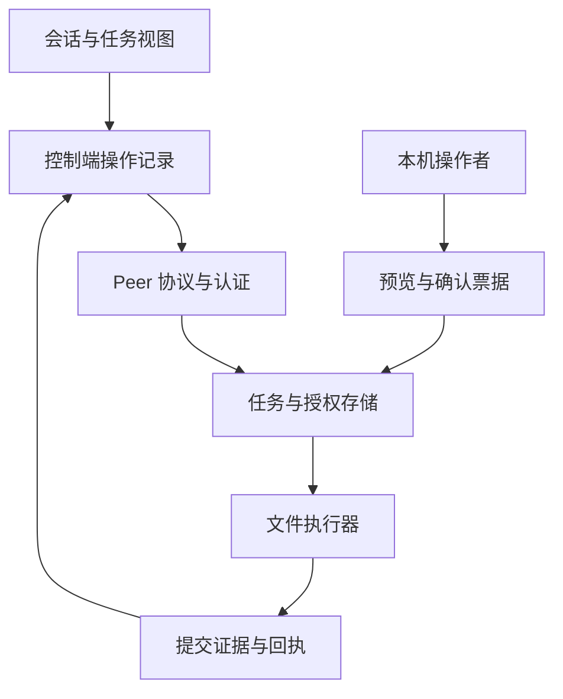
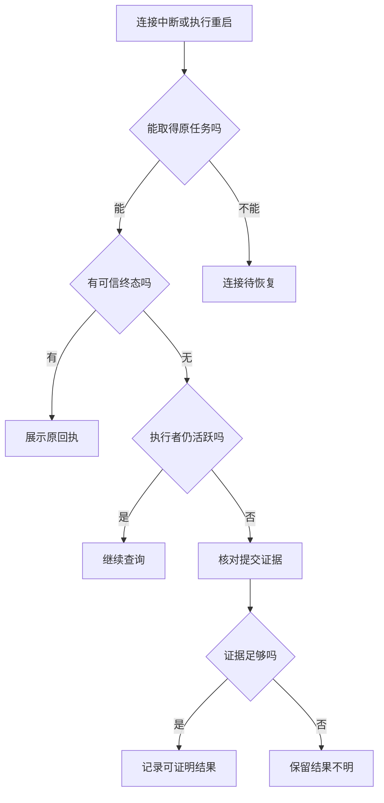

# LFL Peer 跨设备协作完善需求与实施设计书

版本：v1.1（拷问完善轮）  
日期：2026-11-11（北京时间）  
状态：供实施审查；本文交付需求、设计与验收计划，不代表功能已经实现或上线。  
审阅基线：`main@fcfb40270e1dd50cc423934153baf77fb294ddd3`。v1.1 拷问复核：2026-11-11 HEAD 仍等于该基线，`src/llm_loop/peer/` 与 `scripts/peer_*` 自基线零提交漂移；E01–E10 经定义面复核无一证伪。新增 E11/E12、R35–R38 与 A01/A04/A05/A07/A09/A11 扩展，逐项依据见第 15 节。实施前重新核对目标基线与差异。  
目标：让受控文件协作做到容易连接、看清授权、可靠执行、方便恢复，并以真实操作成本衡量便利性与效率。

## 1. 实施结论与范围

下一阶段先把现有文件能力形成成品闭环，分三批交付：

1. **第一批 P0：写入与状态一致性、认证重放边界、安装成品双机验收。**
2. **第二批 P1：确认内容预览、设备与任务工作台、跨会话恢复。**
3. **第三批 P2：连接与只读授权复用、按内容摘要减少传输；固定清单批量确认仅作后续可选扩展。**

本期执行面保持 `fs.read`、`fs.list`、受监督 `fs.write`。写入默认关闭、限定本机写域并逐次确认。`shell.exec`、Peer 桌面操作、无人值守写入和任意共享目录的通用事务不纳入首批。

本文不要求新建调度平台、独立授权服务、消息队列或分布式数据库。优先复用 PeerStore、AdmissionStore、票据、工件与现有控制端工具。

## 2. 已核验基线与证据边界

### 2.1 当前事实

| 编号 | 事实与依据 | 证据等级与处理方式 |
| --- | --- | --- |
| E01 | 历史 macOS→Deepin、Deepin→macOS 只读各 13/13；隧道断线恢复与 QA 进程重启恢复各 8/8 | 已读隔离 QA 报告；限定当时同源冻结快照 |
| E02 | Deepin 本机人工确认写入 9/9，文件、额度、准入与 consumed 票据一致 | 已读实机报告；不代表当前安装 wheel 或混合版本已验收 |
| E03 | 当前 TaskRecord 已有持久 `supervision_expires_at`；CLI 已停用自行计算监督期限 | 本轮读码确认；保留回归并补成品验证，不能再当作未修复 TTL 缺陷 |
| E04 | Peer 入口已要求显式安全参数，只有 `**kwargs` 不能证明监督能力 | 本轮读码与既有回归名称确认；不是当前生产部署已通过的证明 |
| E05 | `fs.write(overwrite=false)` 先 `lexists`，后 `_atomic_write` 中 `os.replace` | 静态发现并发覆盖窗口；本轮未进行竞态复现，应先形成稳定 RED 用例 |
| E06 | 写域模块明确说明路径检查与落盘之间仍有 TOCTOU 窗口 | 已读代码；本机私有写域是部署前提，不能宣传为内核沙盒 |
| E07 | 票据一次性消费、额度 CAS、并发名额与恢复逻辑已存在 | 继续复用；同任务并发确认、拒绝/超时竞争及崩溃组合仍需针对性验证 |
| E08 | NonceCache 是进程内有界缓存 | 运行期重放拒绝有测试；重启、多进程及有效记录被淘汰后的连续保护资格未证明 |
| E09 | 控制端 effect_id 当前由 run_key、peer、kind、params 派生 | 同一 Run 的幂等不等于跨 Run 恢复；需要持久保存原操作身份 |
| E10 | CLI 确认展示原始参数 JSON，可能包含 Base64；要求输入任务号后六位 | 已读代码；改善预览，不把 TTY 检查夸大为独立真人证明 |
| E11 | 读取路径有边界检查：`_open_regular_file` 先 `require_path_allowed`（realpath 判定授权）再 `O_NOFOLLOW` 打开，`ELOOP` 映射为 `path_outside_allowed_paths`；`_walk_bounded` 不跟随目录符号链接且条目数与深度封顶 | v1.1 定义面复核；realpath 与实际打开之间仍存在替换残余窗口，沿用现状不放宽，授权边界以解析后真实路径为准 |
| E12 | `_atomic_write` 已含文件级 `fsync` 且先 `chmod` 后 `os.replace`；父目录项 fsync 缺失；`operator.py` 已有 `_fsync_dir` 先例。写入硬上限 `MAX_WRITE_BYTES=1MiB`，`content_b64` 与 `artifact_ref` 两种内容源同限 | v1.1 定义面复核；目录项同步是 W3 的精确落点；1MiB 与“文件交接”任务的产品匹配度由 R35 决策 |

### 2.2 资格口径

代码已实现、安装成品可用、目标机器已部署、真实任务已验收分别登记。历史 PASS 只覆盖其精确候选、测试范围和环境。

本次为源码与既有报告审阅，未重新执行 Peer 双机实验、崩溃注入或生产验收。下文新增项均是待实施、待验证的要求。

## 3. 用户任务与边界

| 用户任务 | 期望体验 | 必须保留的边界 |
| --- | --- | --- |
| 将两台自己的设备配对 | 向导清楚说明双方身份、可用能力和授权目录 | 网络可达、SSH 主机可信、Peer 身份确认分别核对 |
| 多次读取一个授权目录 | 有效租约内直接读取，过期或撤销时给出具体原因 | 设备在线或已配对不自动带来目录权限 |
| 把一份文件交给另一台设备 | 展示目标、内容、差异、有效期，确认后能找到结果 | 本机写域、租约、票据与实际任务必须同时匹配 |
| 网络中断后继续 | 打开原任务，先核对远端状态 | 超时不等于没执行；不得因此自动创建新的写入意图 |
| 重启后查一笔结果不明的写入 | 提供证据和可执行的核对步骤 | 相同文件摘要本身不能证明是谁写入、何时提交 |

威胁模型：应防御未配对请求、越权对端、认证消息重放、并发正常请求、配置漂移和进程异常退出。Peer 控制端与受控端仍须信任本机操作系统、账户和密钥存储。

**TTY 是当前操作通道条件，不是完整的真人身份与在场证明。** 同 UID、可创建伪终端或可写票据目录的 Agent 不能仅靠 `isatty()` 与输入任务号被隔离。首批不得声称解决了此类本机账户失陷；图形化批准或更高保证的人工在场通道须独立设计、独立验收。远端任务提交接口不提供自批准能力。

默认写域使用受控的私有落地区，目录权限建议 `0700`，配置与票据建议 `0600`。共享目录、网络文件系统和不受 Peer 协调的外部写入者，须单列资格；无法提供冲突保证时，交付到私有 inbox，再由本机用户应用文件或补丁。

监督期限、票据到期与 nonce 时间窗均以受控端本机墙钟为唯一裁决源。受控端时钟回退会延长等待，时钟前跳会提前过期；本设计不引入跨设备时间同步，只要求绝对截止时刻持久化且不重算（R36），时钟异常场景按 A01 验收。

## 4. 完善需求

下列 SHALL 表示必须满足的产品行为；阶段列限定何时交付。验收编号对应第 9 节。

### 4.1 权限与身份

| ID | 优先级 / 阶段 | 需求 | 验收 |
| --- | --- | --- | --- |
| R01 | P0 / M1 | 当没有显式启用监督、写域或有效租约时，系统 SHALL 拒绝写入，不因升级、配对或 UI 展示而扩大权限。 | A01 |
| R02 | P0 / M1 | 当任务参数、目标或确认快照变化时，系统 SHALL 使原确认失效，要求核对新的操作内容。 | A03 |
| R03 | P0 / M1 | 系统 SHALL 将授权、幂等查询和回执访问绑定到已认证请求方；对端不得通过猜测 effect_id/task_id 取得他人任务或工件。 | A02 |
| R04 | P0 / M1 | 在认证时间窗内，系统 SHALL 对重启及共享状态的多个接收进程统一拒绝已接受的同一 nonce，不以容量淘汰放行仍有效的记录。 | A09 |
| R05 | P0 / M2 | 涉及文件内容、确认内容或配对秘密的传输 SHALL 使用已验证 SSH 隧道或经独立验收的加密通道；HMAC 不作为内容加密。 | A10 |

### 4.2 写入、并发与恢复

| ID | 优先级 / 阶段 | 需求 | 验收 |
| --- | --- | --- | --- |
| R06 | P0 / M1 | 当 overwrite=false 时，即使目标在预检后出现，系统 SHALL 原子拒绝提交并保留既有目标字节。 | A04 |
| R07 | P0 / M1 | 覆盖确认 SHALL 绑定用户看到的原文件快照；在支持的单一写入管理域内，执行前变化 SHALL 返回冲突，不静默覆盖。 | A03、A05 |
| R08 | P0 / M1 | 文件路径解析、临时文件创建和提交 SHALL 使用同一受约束父目录身份；不支持的平台或目录布局 SHALL 明确拒绝相应写入。 | A06 |
| R09 | P0 / M1 | 同一任务的确认、拒绝和到期处理 SHALL 进行带版本的原子裁决，只有一个决定取得执行所有权。 | A07 |
| R10 | P0 / M1 | 系统 SHALL 记录决定、票据、执行尝试、额度与文件提交的关联，避免把竞争失败方记录为另一笔实际执行。 | A07、A08 |
| R11 | P0 / M1 | 对提交后、回执前崩溃的写入，系统 SHALL 保留 unknown_outcome 或核对状态，禁止自动重新写入。 | A08 |
| R12 | P0 / M1 | 恢复程序 SHALL 先核对任务执行所有权，不能把仍由活跃 CLI 执行的任务当成失联任务收尾。 | A08 |
| R13 | P0 / M1 | 若文件提交已发生但持久化或回执写入失败，系统 SHALL 不返回“肯定未执行”；能力不足、磁盘满和提交失败须区分。 | A08 |
| R14 | P0 / M1 | 服务与 CLI SHALL 继续使用任务持久化的监督期限；缺失或损坏值 SHALL 保守拒绝，不重新延长期限。 | A01 |
| R35 | P0 / M1 | 写入内容大小上限 SHALL 有产品级定义；`content_b64` 与 `artifact_ref` 两种内容源同一上限，预览与拒绝行为一致呈现，超额 SHALL 明确拒绝且不截断执行。 | A04、A11 |
| R36 | P0 / M1 | 监督期限 SHALL 以受控端持久化的绝对截止时刻为唯一裁决源；时钟异常（回退延长等待、前跳提前过期）SHALL 作为已声明权衡记录，不引入跨设备时间同步。 | A01 |
| R37 | P0 / M1 | 覆盖确认快照 SHALL 同时绑定原文件字节摘要与权限位；执行前重查任一不符 SHALL 返回冲突，不静默沿用变化后的权限。 | A05 |

### 4.3 成品、兼容与可诊断性

| ID | 优先级 / 阶段 | 需求 | 验收 |
| --- | --- | --- | --- |
| R15 | P0 / M2 | 节点诊断 SHALL 区分安装版本、构建身份、协议、运行代码身份与本次验收身份，未取得的字段标记 UNKNOWN。 | A10 |
| R16 | P0 / M2 | 成品 SHALL 自带相匹配的 Peer 服务与操作员入口；旧 API 缺少监督能力时明确拒启，不通过丢弃参数降级。 | A10 |
| R17 | P0 / M2 | 兼容报告 SHALL 列出已支持并实测的版本组合，不把版本号接近或同源 QA 作为混版本通过依据。 | A10 |
| R18 | P0 / M2 | 首批双机验收 SHALL 直接使用两端安装成品，记录摘要和导入来源，不借 PYTHONPATH 指向临时源码。 | A10 |
| R19 | P1 / M3 | 错误结果 SHALL 给出原因、已知副作用情况、建议动作与原任务入口，不只返回 HTTP 状态或堆栈。 | A11、A12 |

### 4.4 操作体验与连续性

| ID | 优先级 / 阶段 | 需求 | 验收 |
| --- | --- | --- | --- |
| R20 | P1 / M3 | 配对向导 SHALL 展示双方身份、指纹核验步骤、传输方式、实际能力与授权范围；未核验项保持可见。 | A11 |
| R21 | P1 / M3 | 设备视图 SHALL 分别展示连接、身份、权限和兼容状态，不能以单一“在线”表示可以执行。 | A11 |
| R22 | P1 / M3 | 写入确认 SHALL 展示来源设备、规范化目标、新建/覆盖、字节数、完整摘要入口、内容预览或 diff、权威到期时间。 | A03、A11 |
| R23 | P1 / M3 | 预览受长度限制时 SHALL 标记截断并提供同权限的完整读取路径；二进制或无法安全解码的内容不伪造文本 diff。 | A11 |
| R24 | P1 / M3 | 每个任务 SHALL 可从所属会话和任务列表重新打开；复制链接不携带密钥，也不赋予访问权限。 | A12 |
| R25 | P1 / M3 | 恢复旧操作 SHALL 沿用持久保存的原 effect_id 和请求语义；用户主动发起新操作时才创建新的操作身份。 | A12 |
| R26 | P1 / M3 | 连接中断时系统 SHALL 分开展示连接状态、最后可信任务状态与观测时间，恢复后先查原回执。 | A12 |
| R27 | P1 / M3 | 状态查询重试 SHALL 有退避、抖动和上限，并使用新 nonce；写入是否重发由原操作状态决定。 | A12 |
| R28 | P1 / M3 | 无独立操作者通道的 Web 首版 SHALL 提供查看、预览和前往本机确认入口，不向远端 Agent 暴露批准接口。 | A11 |
| R38 | P1 / M3 | Peer 查看/预览页面 SHALL 与主控制面同等认证，未认证请求 SHALL 取不到任务内容与文件预览；页面能力边界在设备视图中可见。 | A11 |

### 4.5 效率与扩展

| ID | 优先级 / 阶段 | 需求 | 验收 |
| --- | --- | --- | --- |
| R29 | P2 / M4 | 有效只读租约 SHALL 可复用，且复用请求仍执行身份、期限、路径和额度检查。 | A13 |
| R30 | P2 / M4 | 客户端 SHALL 在相同身份与传输配置内复用连接；撤销、换钥和配置变化时销毁不再适用的连接。 | A13 |
| R31 | P2 / M4 | 内容摘要比较 SHALL 在权限检查后进行；内容相同不等于对端获得工件访问权。 | A02、A13 |
| R32 | P2 / 后续可选 | 固定清单批量确认若实施，SHALL 逐文件绑定路径、内容与原文件条件，并明确部分成功语义；清单变化后旧批准失效。 | A14 |
| R33 | P1 / M3 | 验收报告 SHALL 同时记录成功率、人工操作次数、恢复耗时、传输量和资源成本，并标明样本与环境。 | A15 |
| R34 | P0 / M0–M4 | 每阶段 SHALL 复用现有测试和门禁入口，冻结实际候选；有新红先定因，不以重复运行、扩大基线或泛化 skip 替代修复。 | A16 |

## 5. 架构与改动落点

Web 是适配层，持久操作身份、执行所有权和文件提交事实保留在 Peer 核心层。模型可读取授权范围内的完整任务与证据，选择策略；机械存储负责状态、身份、权限和副作用边界。

| 现有落点 | 最小改动职责 |
| --- | --- |
| `src/llm_loop/peer/executor.py` | 不覆盖提交、父目录约束、文件快照、权限和持久化结果 |
| `src/llm_loop/peer/write_gate.py` | 写域条件及受支持目录布局；消除路径字符串检查与提交脱节 |
| `src/llm_loop/peer/store.py`、`models.py` | 带版本的任务裁决与内部操作记录；复用现有跨进程锁 |
| `src/llm_loop/peer/service.py` | 确认/拒绝/超时裁决、所有权核对、证据收敛 |
| `src/llm_loop/peer/operator.py` | 预览快照绑定、一次性票据及内部格式版本 |
| `src/llm_loop/peer/auth.py` | 已验签 nonce 的跨进程持久查重与容量处理 |
| `src/llm_loop/peer/client.py`、`tools/builtin/peer_tools.py` | 恢复原操作身份、查询优先与连接复用 |
| `scripts/peer_serve.py`、`scripts/peer_operator.py` | 成品入口能力检查、可读预览与诊断 |
| `src/llm_loop/web/peer_routes.py`（v1.1 勘误：现有文件是受控端 `/peer/v1` API——manifest/tasks/receipt/artifacts，四头 HMAC 认证——不是 UI 落点） | 维持协议面职责，不在本文件添加操作者页面 |
| 主 WebUI 控制面（`src/llm_loop/web/routes.py` 挂载与 `static/` 前端，实施时新建 Peer 页签组件） | 授权范围内的设备、任务、预览页面（R38 认证与暴露边界在此落点生效） |
| `tests/peer/`、既有 schema 校验与成品测试入口 | 扩展已有用例，避免重复建设测试框架 |

外部 `lfl.peer.v1` 的严格 schema 和封闭 reason_code 不可静默添加字段。首批优先通过内部记录和现有字段完成修复；确需新增公开字段、错误码或恢复接口时，同步 schema、注册表、客户端、示例和校验，按项目现行契约版本策略升级。未协商的新能力不得派发到旧节点。

## 6. 关键实施设计

### 6.1 原子创建与有条件覆盖

**新建路径：** 在受控父目录创建临时普通文件，先设置最终权限并完成内容同步，再执行原子“不替换已有目标”的发布。

优先评估同文件系统的临时文件加 `link` 发布方案：目标已存在时由系统调用返回冲突，成功后移除临时名字；不得把临时文件加 `os.replace` 当作不覆盖提交。[W1、W2]

平台必须实测该语义。无 hard-link 能力、跨文件系统或无法提供所需保证时返回不支持；不得静默退回先检查后覆盖，也不采用直接写最终文件再声称具有完整原子可见性。实现选型可用经验证的原生 no-replace 原语替换上述方案。

**覆盖路径：** 本机预览阶段取得原文件摘要、长度及类型；确认绑定该快照。执行在同一路径管理锁内重查，再按批准内容提交。

该锁只协调遵守它的 Peer 写入者。面对任意外部进程改写文件，普通摘要检查加 rename 不能提供通用文件 CAS。首批支持条件是 Peer 管理的私有写域；无法证明单一写入管理的目录使用私有落地加本机应用流程，不承诺自动覆盖安全。

`create_parents` 属于可见副作用：默认关闭。显式启用时仅在私有写域内逐级创建并记录；失败后留下的目录也须计入核对结果，不得报告“无任何副作用”。

`link` 发布成功后、移除临时名字之前崩溃，会同时留下目标名与临时名指向同一 inode（`nlink>=2`）。该切点不落在“尚未发布的临时文件”清理规则内，且本身就是“本操作已发布”的强证据：核对程序据摘要与提交前记录一致后收敛为成功，再移除多余链接名；不得把该临时名当外部写入清理，也不得误判为未发布。临时名须含 task/attempt 标识以便归属，避免与外部临时文件混淆。

新文件权限按 umask 推导、覆盖沿用原权限位（现状语义，见 E12）；预览展示的“将写入权限”按同一规则计算并纳入 R37 快照，不引入第二套权限来源。

### 6.2 路径与持久化边界

从可信写域根出发逐级打开目录，拒绝符号链接和不符合支持条件的目录；后续临时文件和发布均相对已持有的父目录描述符进行。仅对最终文件加 O_NOFOLLOW 不足以约束中间路径。

持有目录描述符并不能独自解决目录被外部重命名出写域的问题，因此仍需要私有写域、明确目录所有权及无外部并发搬移的部署条件。首批不宣传通用沙盒隔离。

文件数据同步与目录项同步分别验证。Linux 文档明确，文件 `fsync` 不自动保证父目录项已同步。[W3] v1.1 精确化：`_atomic_write` 已含文件级 `fsync`，缺的是父目录项同步；`operator.py` 的 `_fsync_dir` 是仓库内既有实现先例，修复直接复用该模式（见 E12）。macOS 与 Deepin 各自做能力探针与故障验收：区分进程崩溃可恢复、断电耐久与当前文件系统不支持的保证。提交后同步失败应标记结果待核对，不能伪装成确定未写入。

不删除用户文件来“回滚”不明结果；自动清理仅覆盖已证明属于本操作、尚未发布的临时文件。

### 6.3 并发裁决与最小提交记录

复用现有存储增加内部版本化记录，不另建工作流引擎：

| 内部字段 | 用途 |
| --- | --- |
| `record_version` | 明确本地存储迁移格式；不等同公开协议版本 |
| `operation_id`、`task_id`、`effect_id`、`requested_by` | 关联用户意图、任务与已认证请求方 |
| `decision_generation`、`decision`、`decided_by` | CAS 裁决确认、拒绝或到期；记录决定来源 |
| `attempt_id`、`owner_lock_ref` | 唯一执行尝试及进程持锁所有权 |
| `params_digest`、`target_snapshot`、`approval_digest` | 绑定请求、预览原文件与批准内容 |
| `grant_id`、`admission_id`、`ticket_ref` | 保留原有授权与审计关联 |
| `commit_phase`、`commit_evidence_ref` | 区分准备、开始提交、提交已确认、结果已记录 |

建议顺序：

1. 在短存储临界区内按任务版本裁决，原子登记获胜决定和执行尝试。
2. 执行者取得并持有任务所有权锁；拒绝和超时处理遇到已获胜执行决定时返回当前事实。
3. 复核权威期限、租约、写域、原文件快照、票据；按既有额度规则以 effect/attempt 关联消费一次。
4. 通过现有 AdmissionStore 落准入事实；审计不可用时禁止开始文件副作用。
5. 在第一次文件副作用之前消费一次性票据并持久登记；对 create_parents 同样适用。
6. 写临时文件，记录提交前事实，提交文件，再记录提交结果与最终回执。

不持全局 PeerStore 锁执行磁盘 I/O 或网络请求。任务锁、路径锁、存储锁采用固定顺序；锁序须写成文档化不变量并配交叉路径并发回归（A07 扩展：双任务交叉路径并发确认无死锁）；新增尝试不能通过重新取票据绕过旧尝试的未决结果。

`owner_lock_ref` 的实现载体优先复用内核文件锁（flock）的自动释放语义：执行进程退出即释放，不自建保活心跳。恢复程序以“非阻塞取锁失败=执行者仍活跃”加 `commit_phase` 记录组合判定，不以 PID 存活为唯一依据；能取到锁不等于执行已结束，还须核对提交证据（见 6.4）。

**这里不承诺票据、授权 JSON、审计文件和目标文件构成一个跨文件事务。** 明确每个崩溃切点及收敛语义；消费了票据但未开始写入时保留可核对失败事实，需要新的人工决定才能另发操作，禁止自动补执行。额度是否退还沿用现行规则；若要改变须单独说明并补对应回归。

### 6.4 中断后的查询和核对

复用 `unknown_outcome`，不因页面展示需要随意增加公共状态。恢复首先检查所有权锁，不能仅依据 PID 或历史 running 标记认定进程已死亡。

能核对的证据包括任务绑定的临时文件、提交前记录、原文件快照、期望新摘要、实际目标、已完成提交记录及其时间关系。**摘要相同仅证明当前字节相同，不能单独证明本任务完成。** 证据有歧义时保持结果不明并给出本机核对步骤。

客户端为每次明确的用户操作持久保存原请求 ref 与 effect_id。恢复、刷新、切换会话继续引用它；用户主动“重新发送一份”才创建新 operation_id。通过既有 effect_id 幂等查询或明确版本化的恢复接口查询远端，不能跨身份枚举。

查询请求使用新 nonce 并有界退避。已知任务失败、被拒或过期时停止自动查询，提供下一步；写入结果不明时不自动换 effect_id 重试。此设计遵循幂等重试需要保留原请求意图的原则。[W4]

### 6.5 重放保护与传输

保持先校验节点、时间窗和签名，再登记 nonce 的顺序。最小实现可在 PeerStore 私有目录中按节点与密钥代际分桶，以既有跨进程锁加原子文件/排他创建完成“首次接受”的唯一裁决。

持久记录覆盖完整签名有效时间窗，含允许的时钟偏差；在有效期内不得因 LRU 容量不足删除已接受记录并继续放行。容量用尽时拒绝新请求并返回可诊断过载；验证垃圾签名不能消耗持久槽位。缓存只用于加速，不能成为跨进程唯一真值。

分桶结构按“节点+密钥代际+时间窗”三级组织：窗口整体过期后原子清理整桶，窗口内记录结构性永不淘汰，使“有效记录被容量淘汰”从设计上不可达。容量下限按“峰值请求数 × 签名窗时长 × 安全系数”推导并写入配置说明；配置不足时的行为是拒绝新请求（fail-closed）并暴露过载指标，不静默放行。换钥时旧代际桶保留至其签名窗（含时钟偏差）完全结束才可清理（A09 扩展：换钥后旧窗内旧钥签名重放仍被拒绝）。

每个已验签请求的 nonce 持久登记遵循“先持久、后响应”的安全顺序，不可批量或异步化；其每次请求一次持久写（锁+fsync）的成本计入第 10 节重复读取指标与 A15 对照，防止只读高频路径因防重放持久化而不可用。

清理使用有界批次；系统时钟异常回退、记录损坏或存储不可用时，不通过重新初始化空记录来恢复写入资格。初次从旧内存缓存切到持久记录时，应采用经本机确认的换钥或关闭受理并等待旧签名窗口结束，处理过渡窗口后再声称连续保护。首批旁路新身份配对可直接从新记录起步。

继续优先复用已验证的回环监听加 SSH 加密隧道。直连 HTTPS、证书部署或服务发现若需要，分别设计，不在本次顺手增加长期凭据分发系统。

### 6.6 预览、设备与任务工作台

确认视图由受控端可信事实构造，至少展示：

- 来源设备与已验证身份、目标设备、任务编号、所属会话入口。
- 规范化目标路径，原文件是否存在，新建/覆盖、字节数、完整 SHA-256 入口。
- UTF-8 文本预览或差异；二进制文件显示类型、长度、摘要并提供授权下载核对。
- 到期绝对时间与剩余时间；倒计时只是展示，服务端仍按持久期限裁决。
- 将创建的父目录、覆盖条件、已知权限与最终结果查询入口。

内容按纯文本转义显示，不执行远端 HTML、不解释终端控制序列。完整内容通过有权限的稳定 ref 回读；截断的预览不能冒充全文，也不能仅靠预览摘要替代实际内容摘要。[W5]

Web 首版显示连接、身份、权限、兼容四组事实；在桌面和移动端均能滚动查看任务、预览和错误建议。操作默认是查看原回执、前往原会话、复制本机确认入口、核对内容。链接或复制命令不包含密钥；确认码不提供给 Agent 作为可自动输入的动作。

图形化批准如后续启用，须建立区别于任务提交者的操作者认证及用户在场机制，重新核验 CSRF、来源、票据绑定、重放与共享 UID 边界。仅将 CLI 包成 HTTP confirm 端点不满足要求。

### 6.7 成品兼容与迁移

先验同一候选成品在两端实际安装运行，再验确有需求的相邻版本组合。保存 wheel 摘要、安装包版本、模块导入来源、Peer 入口能力、协议与本次测试身份。

现有 TTL 与显式安全参数检查作为不可退化行为，不重复重写。新内部记录格式须有备份与一次性迁移；旧等待任务或旧票据缺少必需批准快照时保持不可执行并解释原因，不能补默认字段后继续写入。

只读任务可按已经验证的旧协议继续；新写入要求在旧节点未具备时明确不可用。新内部数据不支持被旧程序读取时，回退程序前先停止任务受理并保留现场，禁止覆盖存储强行降级。

### 6.8 效率优化与批量边界

只读租约复用和连接池先做，保留每次请求的授权检查。目录比较先传清单与摘要，实际文件按需获取；摘要缓存的有效期、大小和权限来自同一读取上下文，内容变化后重新核验。

固定清单批量确认不是首批必需项。后续若实施，一次批准必须绑定完整有限清单：每个文件的目标、内容摘要、原文件条件、总字节数、过期时间与批次摘要。修改清单重新批准；逐项记录结果，不宣称多文件原子事务。失败后不得自动撤销已成功写入，也不得扩大为“本设备以后全部允许”。

## 7. 阶段计划与交付物

| 阶段 | 工作与交付 | 通过条件 |
| --- | --- | --- |
| M0：冻结事实 | 重核基线、现有脏文件与其他工作树；复现 E05；确认写域与平台能力；登记本次最小变更范围 | 真实失败用例与支持边界明确；不清理他人资产 |
| M1：P0 正确性 | 原子不覆盖、快照确认、任务裁决与崩溃核对、持久防重放；扩展现有回归 | A01–A09 有证据；所有权、额度、票据与目标可对账 |
| M2：成品与双机资格 | 相同候选 wheel、成品入口、独立 QA 根、双向文件交接与恢复；登记版本组合 | A10 通过；不借源码覆盖；未覆盖组合明确 UNKNOWN |
| M3：P1 体验 | 预览、设备/任务视图、原会话链接、跨会话恢复、错误建议与测量 | A11、A12、A15 通过；确认范围保持逐次本机操作 |
| M4：P2 效率 | 根据 M3 实测瓶颈选择只读授权、连接或摘要复用 | A13 有收益且无权限退化；没有收益不继续扩建 |

固定清单批量确认在 M4 后按实际需求独立选择，不阻塞 M1–M3。每个阶段一个职责边界；不能把完成设计解释为已获准重启、生产切换或启用新授权模式。

## 8. 测试与交付门禁安排

开发阶段先跑新增回归与相邻 Peer 测试，复用现有 Ruff、类型与 schema 检查。竞态通过 barrier、事件或进程握手稳定构造；时钟使用受控注入，不用固定 sleep 碰运气。

产品行为变化在最终冻结候选上按当前有效规则完成 GLM-5.3 独立审查、必要的原版完整 R9，然后进入已授权的合并或受控验收。本文不修改现行门禁，也不把既有优化建议冒充已生效规则。

同一精确候选默认完成一次必要独立审查和一次完整验证；新增改动使相关证据失效时补受影响验证，并按现行规则决定是否重跑完整门禁。只有网络上传失败、凭据失效或纯查询恢复时，先核对候选和目标，复用有效证据，不机械重复全套。

只对涉及 Peer 文件、认证、成品或发布的变更触发相应成品/双机测试，不让每个普通文档提交承担多主机全矩阵。使用项目真实统一门禁入口，执行前确认路径与模式；不另起包装脚本绕过既有锁或检查。记录原始退出码、完整性和覆盖范围；串行绿不能自动清除并发失败。[G1]

代码冻结、审查、测试、安装及运行验收分别绑定候选与工件。未获得的结果写 NOT RUN/UNKNOWN；文档生成本身无需运行产品完整 R9。

## 9. 验收矩阵

| 编号 | 场景与方法 | 可判定的通过标准 |
| --- | --- | --- |
| A01 | 写默认关闭、无写域、撤销/过期租约、权威 TTL 缺失/损坏/跨进程、受控端墙钟回退 | 写被拒；TTL 不重算延期；时钟回退只延长等待，绝对截止仍收敛、不无限滞留；报告准确区分文件与目录副作用 |
| A02 | 两个认证节点交叉猜测任务、effect 与工件引用；摘要缓存命中 | 他人任务内容与工件不可取得；缓存不扩大权限 |
| A03 | 预览后改变参数、原文件、路径或到期时间 | 原批准无效；实际执行内容与用户批准一致 |
| A04 | 在存在性检查和发布间插入另一创建者；两个进程同目标创建；内容超上限（`content_b64` 与 `artifact_ref` 两种来源） | 至多一个发布成功；失败方不改变胜出文件字节与权限；超额明确拒绝且不截断执行 |
| A05 | 同路径覆盖竞争，原快照冲突（摘要或权限位任一变化），非受控共享写域 | 受支持模式拒绝陈旧覆盖（摘要与权限位任一不符即冲突）；不支持条件明确拒绝或转私有落地 |
| A06 | 最终与中间目录符号链接、目录搬移、跨盘、创建父目录失败 | 不越过受支持写域；拒绝或副作用记录准确，不冒充通用沙盒 |
| A07 | 同任务双确认、确认对拒绝、确认对到期、不同任务抢配额、双任务交叉路径并发 | 唯一获胜决定、至多一次执行、一次额度消费；竞争方取得当前状态，审计无矛盾；交叉并发无死锁 |
| A08 | 票据消费后、提交前、提交后回执前 kill 子进程；同时有活跃 CLI | 不自动重写；活跃执行不误收尾；证据不足保留不明；相同摘要不自动判成功 |
| A09 | 重启、多进程、有效 nonce 容量满、坏签名、时钟回退、旧缓存切换、换钥后旧窗内重放 | 同一有效请求只有首次接受；存储故障不放行；旧窗口过渡有明确处理；换钥后旧窗内旧钥签名重放仍被拒绝 |
| A10 | macOS↔Deepin 真实安装成品，双向读取/列举/人工确认写入、断线、QA 重启、旧 API | 精确 wheel 与入口可追溯；实写与回执一致；不兼容明确拒绝；不改生产服务 |
| A11 | 配对、预览、文本/二进制/超长/控制字符、桌面与移动端、非操作者访问、未认证请求取任务预览 | 关键信息可见、可滚动、完整内容可取；默认无远程批准面；未认证请求取不到内容与预览 |
| A12 | 提交响应丢失、换会话、重开页面、远端已成功但本地离线 | 原 effect/请求语义保留；新 nonce 查原任务；无重复写入；链接不授予权限 |
| A13 | 重复读取和目录比较，租约撤销、换钥、内容变化、连接失效 | 正常复用减少成本，失效及时重核；权限检查不减少 |
| A14 | 可选批次改清单、部分成功、超时或撤销 | 清单变化旧批准失效；逐项回执，无隐含全成功或自动补写 |
| A15 | 相同真实任务的优化前后对照 | 报告完成率、操作次数、耗时、字节和成本；列明样本与缺失项，不外推 |
| A16 | 最终候选、门禁输入与交付工件核对 | SHA、材料指纹、依赖、命令、退出码和安装摘要可关联；失败有明确处置 |

A08 的进程终止实验不等于断电试验；断电耐久如未在对应平台验证，保持 UNKNOWN。文件系统原语的单测不替代 A10 成品双机结果。

## 10. 便利性与效率指标

先在同一设备组合和网络条件测基线，再确定承诺值。下表为产品目标，当前没有测得这些改进幅度。

| 指标 | 测量方式 | 首轮目标 |
| --- | --- | --- |
| 首次配对成本 | 从打开向导至身份、传输和只读资格完成；分别记录用户等待与操作 | 必需步骤一次展示，失败能定位下一步；目标耗时在取得基线后冻结 |
| 单文件确认成本 | 固定文本文件任务，记录查找、核对与确认次数 | 有效配对与租约下不重复配置；一次内容核对加一次本机确认 |
| 恢复成本 | 故意丢失提交响应后，从原会话重新取得可信结果 | 网络恢复后自动查询原任务；人工不需重新构造派单 |
| 重复读取成本 | 相同内容、大小与权限的任务对照 | 传输量或连接建立次数下降；报告实际数值 |
| 正确性 | A04、A07、A08 中的文件、票据、额度和审计观察 | 已覆盖场景中零误覆盖、零重复副作用、零错误成功声明 |
| 日常完成率 | 记录至少 10 次可撤销的真实交接及每次失败原因 | 全部可解释并可恢复；小样本只作上线试点观察 |

性能报告记录 OS、架构、构建、文件大小、网络、冷热连接、并发与样本数。先用确定性任务验证工程收益，不引入收费模型评测依赖。

## 11. 上线、回退与停止条件

1. 先在独立工作树完成 M1，保护现有未提交知识资产和其他任务；按实际路径登记变更。
2. M2 使用独立 QA 身份、私有写域、回环端口与已验证隧道。生产身份和真实业务数据不参与故障注入。
3. 首次试点从只读开始，再由本机操作者显式开启有限监督写入。升级不得自动启用写入。
4. 切换前核对候选、安装摘要、实际模块与回退能力。需要生效时只切换相关 Peer 组件，不能连带重启 Web/Feishu/Learning。
5. 出现越域写入、误覆盖、重复副作用、错误成功、无法解释的审计或授权退化，立即停止接收新的写入并保留现场；只读能否继续按故障影响判断。
6. 回退先关闭新写入准入、等待或核对已有尝试，保留新格式存储与不明任务证据；不让旧程序读取不兼容数据，不自动重放任务。

删除或改写真实目标文件不作为自动回退方法。旧任务、票据、审计和结果不明记录保留到明确核对完成；按现行保留策略清理，不凭“看起来成功”提前删除。

## 12. 不过度工程化的实施约束

- 已有 TTL 与 API 修复继续复用，以成品回归确认，不另造第二套期限或能力判断。
- 只新增能对应可信失效模式的记录、锁和用例；新控制措施说明其机械边界及现有工具为何不足，不编写语义评分器替模型判任务是否完成。
- 模型可查询拒绝原因、读取完整证据、提出修正任务或请求本机操作者决定；诊断出口不包含绕过身份、租约、监督或写域的开关。
- 首批不用 Redis、消息总线、通用审批平台、自动语义重试或自适应授权。
- M1–M3 完成后先观察实际交接；没有明确瓶颈不继续建设批量调度、远程 shell 或桌面能力。

## 13. 交付检查单

- [ ] 锚定实施基线、支持平台、写域与实际变更范围。
- [ ] 为 E05 建立稳定失败用例，再提交原子不覆盖修复。
- [ ] 完成任务裁决、票据、额度、路径和崩溃证据的一致性验证。
- [ ] 核验持久重放保护、容量和升级过渡窗口。
- [ ] 取得最终候选独立审查与必要完整验证的真实回执。
- [ ] 用两端实际安装成品完成 A10，版本组合与未覆盖项可查。
- [ ] 完成可读预览、任务返回入口与跨会话恢复。
- [ ] 记录便利性和效率基线，按观测结果选择 P2。
- [ ] 更新既有 Peer 设计、实现说明与实际相关的方法/经验，移除过时状态，不扩写无关资产。
- [ ] 交付报告分开展示已实现、已部署、已实测及 UNKNOWN。

## 14. 依据与参考

### 14.1 本项目材料

- [P1] 本轮只读源码：`src/llm_loop/peer/{service,store,operator,executor,write_gate,auth,client,models}.py`，`scripts/peer_serve.py`，`scripts/peer_operator.py`；基线见文首。v1.1 拷问轮复核：executor.py、operator.py、state.py、web/peer_routes.py 全文，service.py、store.py、auth.py、client.py、models.py、write_gate.py、scripts/peer_operator.py、tools/builtin/peer_tools.py 关键定义面（grep/sed 定位），errors.py REASON_CODES；E01–E10 无一证伪，新增 E11/E12。
- [P2] `docs/DESIGN-20261108-peer-supervision-channel.md`、`docs/peer-implementation-brief.md`；其中历史实施状态须结合当前源码解读，不能单独当当前真值。
- [P3] `LFL_Peer_CrossHost_Validation_Update_2026-11-09.md`；同源双机只读与恢复证据，早期 NOT RUN 项以随后报告补充。
- [P4] `LFL_Goal8ab7_Peer_TTY_Acceptance_And_Next_Steps_2026-11-09.md`；本机人工确认写入与范围限制。
- [P5] `LFLM 对比评分站.txt`，2026-11-11 捕获版本 7；用作资格索引，不作统一性能基准或生产身份证明。
- [G1] `LFL_Test_Gate_Optimization_2026-11-09.md`；测试与流程优化建议，不冒充已生效规则。
- [G2] 仓库 `AGENTS.md` 与 `docs/DEVELOPMENT_REPAIR_SAFETY.md`；实施前按最新版本核对。

### 14.2 外部技术依据

- [W1] [Python os.replace](https://docs.python.org/3/library/os.html#os.replace)：已有目标可能被替换；原子替换不等于原子不覆盖。
- [W2] [Linux link(2)](https://man7.org/linux/man-pages/man2/link.2.html)：目标已存在返回 EEXIST；macOS 与目标文件系统须另做资格验证。
- [W3] [Linux fsync(2)](https://man7.org/linux/man-pages/man2/fsync.2.html)：文件与父目录的持久化需要分别处理。
- [W4] [AWS：Making retries safe with idempotent APIs](https://aws.amazon.com/builders-library/making-retries-safe-with-idempotent-APIs/)：以请求身份保留重试意图，并处理相同标识的语义冲突。
- [W5] [OWASP Transaction Authorization](https://cheatsheetseries.owasp.org/cheatsheets/Transaction_Authorization_Cheat_Sheet.html)：确认重要操作数据、执行前校验及每次操作授权的一次性。

引用说明：上述依据支持设计取舍，不构成对 LFL 当前生产系统的安全认证。本文未包含凭据、配对秘密、真实业务文件内容或需要公开的运行环境地址。

## 15. v1.1 拷问完善记录

2026-11-11 拷问轮方法：先把 §2.1 断言还原为定义面可核命题直读源码对质（E01–E10 复核，无一证伪），再对设计逻辑做追问。发现与处置：

| # | 拷问发现 | 处置 |
| --- | --- | --- |
| Q1 | `link` 发布成功后、移除临时名前崩溃：同 inode 双名不落在“尚未发布的临时文件”清理规则内，且是可用的提交强证据 | 6.1 补收敛语义、归属标识与 `nlink` 证据用法 |
| Q2 | 读取路径边界检查现状未入 E 清单，易被当作未审视 | 新增 E11 |
| Q3 | `_atomic_write` 已有文件级 fsync、缺父目录项 fsync；仓库已有 `_fsync_dir` 先例 | 新增 E12；6.2 精确化 W3 落点 |
| Q4 | 写入硬上限 1MiB 与“把一份文件交给另一台设备”任务存在产品张力，需求清单无上限决策 | 新增 R35；A04 扩展超额场景 |
| Q5 | 监督期限/票据/nonce 三处时间裁决源未声明时钟异常权衡（回退延长等待、前跳提前过期） | §3 声明唯一裁决源；新增 R36；A01 扩展 |
| Q6 | 覆盖快照只绑摘要：确认后 chmod 变化不会返回冲突（`_file_mode_for` 沿用原权限位） | 新增 R37；A05 扩展权限位 |
| Q7 | `owner_lock_ref` 未指名实现载体，自建保活心跳有过度工程与误判风险 | 6.3 明确复用 flock 自动释放语义与“取锁+commit_phase”组合判定 |
| Q8 | 任务/路径/存储三级锁固定顺序无死锁验收 | A07 扩展双任务交叉路径并发 |
| Q9 | nonce 持久化若用 LRU+容量上限，“容量配置错误→正常流量被拒”是可用性单点；每请求持久写成本未入指标 | 6.5 改“节点+代际+时间窗”分桶、窗口内结构性永不淘汰、容量下限推导；成本入 §10 与 A15 对照；A09 扩展换钥过渡 |
| Q10 | §5 把 UI 组件错挂在 `peer_routes.py`（实为受控端 `/peer/v1` API，无 UI） | §5 落点表勘误；UI 落点改指主 WebUI 挂载与 `static/` 前端 |
| Q11 | R28 只约束“不暴露批准面”，查看/预览内容本身的暴露边界未定义 | 新增 R38；A11 扩展未认证请求 |

拷问中被否决的候选（记录以免重复提出）：票据并发消费已由 `os.replace` 原子性兜底（第二消费者 `FileNotFoundError`→`supervision_ticket_consumed`），无需新增互斥；`awaiting_supervision` 状态机完整且 `unknown_outcome` 仅可自 `running` 进入，无需新状态；CLI 双 TTY 并发确认已被票据消费原子性覆盖，并入 A07 而非新增验收编号。
