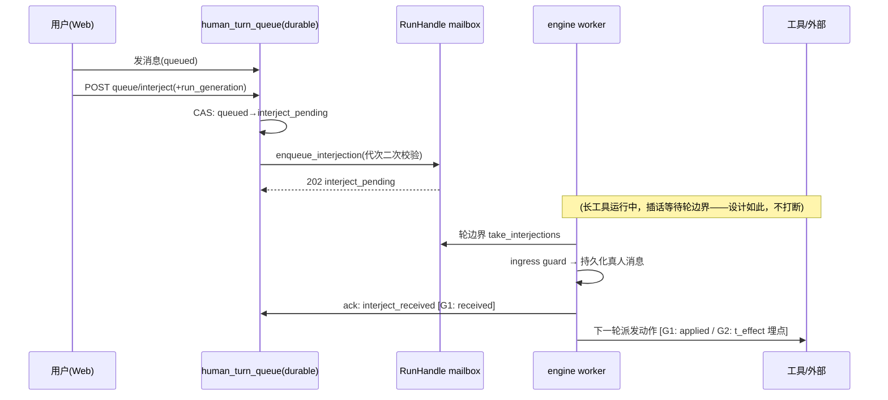
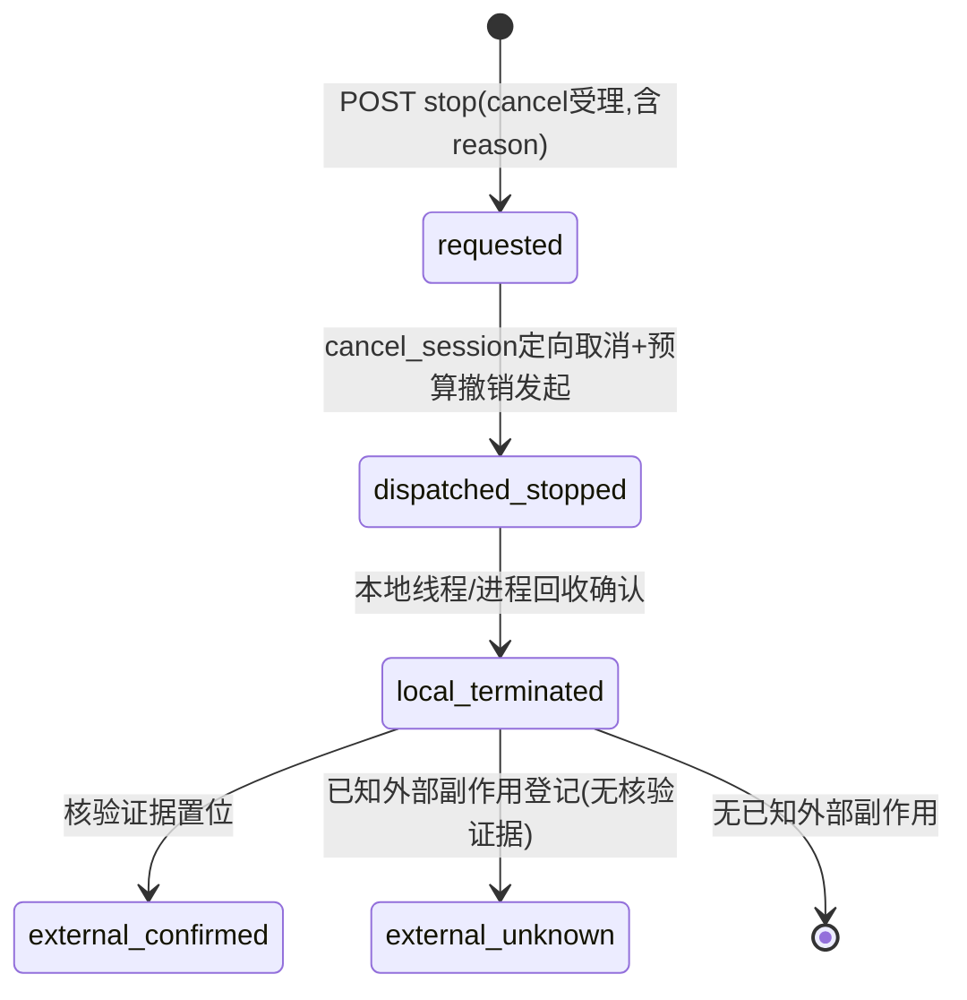

# 阶段3「可插话任务助手」需求实现设计方案书

| 项 | 值 |
|---|---|
| 版本 | v1.0（两轮拷问后定稿） |
| 日期 | 2026-10-13 |
| 状态 | 待评审 → 待实施（G0 可立即启动，零代码改动） |
| 作者 | LFL |
| 事实核验基线 | 本地工作树源码（2026-10-13 01:00–01:10 核验；运行代 3e598c2b / generation 244） |
| 输入材料 | ① 外部评审报告（GPT，LiveKit Agents 对照视角）；② LFL 对该报告的核验与修正结论 |

> 本文所有「现状」条目均有源码出处（文件:行号，见附录 A）。凡未核验项均显式标注 **[未核验]** 并列入 M0 补核清单（§9.2）。

---

## 0. 背景与本文目的

外部评审（GPT）将 LFL 当前状态定位为「阶段 2 → 阶段 3 过渡」：异步任务、后台子代理、预算与取消入口齐备，但**交互式纠偏闭环**（插话生效、停止语义、事件唤醒、时延度量）尚无端到端证据。LFL 核验后确认该定位成立，同时修正了报告的三处偏差（§2.6）。

本文目的：把上述结论转成**可执行的需求与实现方案**，经过两轮强制追问式评审（grill）暴露并关闭 8 类盲点（§5），给出验收矩阵（§6）、度量口径（§7）与实施切分（§8）。

**一句话目标：让用户在任务运行中说话能被听见、被确认、被生效；让用户喊停能分清「停了什么、停到哪、还有什么停不掉」；让等待外部事件不再靠空转。**

---

## 1. 术语与口径

| 术语 | 定义 |
|---|---|
| 插话（interjection） | 任务 run 进行中，用户经 Web 插入的新真人消息 |
| 轮边界（model-round boundary） | 一次模型决策完成、下一次模型调用开始之间的安全点；`_consume_live_interjections` 的唯一消费时机 |
| 生效（effect） | 插话被消费后，产生至少一轮包含该消息的模型决策，且该轮派发了工具调用或改变了最终回答（机械判据，见 §7.1） |
| 停止（stop） | 用户或运维对进行中 run 的取消请求（`cancel`，reason 默认 `user_stop`） |
| 外部副作用（external side effect） | 已发出、本进程无法单方面撤销的外部动作（浏览器已提交表单、外部 API 已发请求、远端进程已启动） |
| 事件唤醒（event wake） | 由 subject_refs 对象状态变化（而非到点）触发的一次性同会话续跑 |

---

## 2. 现状事实基线（已核源码）

### 2.1 插话链路：消息必达的 durable queue + 轮边界消费

```
用户发消息 ──► human_turn_queue（durable，source of truth）
                  状态机: queued ─► interject_pending ─► interject_received
                          │              │                    │
                          │(无 live run) │(CAS 认领)          │(engine 消费后 ack)
                          ▼              ▼                    ▼
                     作为普通排队    RunHandle mailbox      queue projection
                     开新 run        (进程内 handoff)      (回执可见 8s)
```

关键事实：

1. **端点语义**（`routes.py:1738-1822`）：`POST /api/v1/chat/queue/interject`。端点 docstring 明确："立即"= 下一个安全模型决策边界；Web 线程**永不**改写 Session 历史，**永不**为了显得即时而取消进行中的工具/provider 操作。
2. **CAS 与代次守卫**：`claim_interject`（`human_turn_queue.py:272-292`）把 `queued→interject_pending` 原子化并记录 `interject_run_generation`；端点先比对 `payload.run_generation` 与 live handle 代次（不一致→409 `interject_run_changed`，消息保留排队）；`runner.enqueue_interjection`（`runner.py:433-454`）再做第二次代次校验，失败→`release_interject` 回滚 queued + 409。
3. **消费与持久化**：`engine.py:147-200 _consume_live_interjections` 在 engine 工作线程执行（Session 单写者保持）；每条插话过 `user_ingress_guard`（DENY 则丢弃并告警），以 `role=user, source=USER, metadata.human_interjection=true` 持久化为真人消息，然后 best-effort ack（`acknowledge_interjection`，fail-open，`runner.py:466-474`）→ `mark_interject_received`。
4. **两个消费点**：轮首（`engine.py:967`，消费后重对齐 `user_text`）与**最终回答前**（`engine.py:2334-2353`）：无工具调用的回答只有在 mailbox 仍空时才是终态，否则同一 run 继续（记 `human.interjection/continued_before_final` 动作）。这条防止「答案已在生成、插话刚好到达」被吞。
5. **恢复与必达取舍**：进程重启 `_load()` 把 `interject_pending` 回滚 queued（`human_turn_queue.py:78-86`）；`reap_orphan_interjects`（`human_turn_queue.py:314-337`）按 `runs_alive` 代次事实回收孤儿（run 已死/代次已换→回滚 queued，audit 标记 `interject_run_ended`）。源码 docstring 明示取舍：**宁可承受 ack 失败窗口下的重复投递，也不让用户消息静默滞留（消息必达优先）**。
6. **回执可见性**：`interject_received` 在 queue projection 中可见 8 秒（`INTERJECT_RECEIPT_VISIBLE_S=8.0`，`human_turn_queue.py:36`）。

### 2.2 停止链路：双路径受理 → 定向工具取消 → 预算撤销

1. **受理**：`runner.cancel`（`runner.py:476-520+`）双路径——registry 命中的后台 run 置 `handle.cancelled/cancel_reason`；未命中但同步 run 活跃（飞书 engine.run 直驱）写 `_sync_cancelled` 登记。无 run 返回 False。
2. **检查点**：轮边界兜底 + LLM 流内细粒度检查（`engine.py:121-134`；原因判定用标记位查询，明令禁止匹配错误文本）。
3. **定向工具取消**：`registry.cancel_session`（`registry.py:614-650`）——`future.cancel()` 只能取消未开始的任务；运行中的外部进程**只有工具自选实现 `terminate_session`** 才被硬终止；**刻意不回退到全局 `terminate()`**，因为工具实例跨会话共享，全局终止会误杀别的会话。失败 fail-open，由循环取消标志收尾。
4. **预算撤销**：`cancel_active_task_budget`（I4-C，`runner.py:501-518`）撤销 *exact Run* 的预算；durable CAS 失败时留本地 fail-closed latch 并**如实记录 uncertainty，不把布尔 ACK 当物理/计费闭环**。
5. **传输层中断**：`TaskBudgetExecution.track_transport / abort_active_transports`（`task_budget_dispatch.py:77-113`）只关本 Run 注册的 socket；注释明言该回调**永不**被视为远端取消/计费 ACK；注册时在锁内二次检查本地停止，Stop 已排干后不得再挂新回调。
6. **后台任务**：`job_registry.py:441` 有同构 `cancel_session`（execute_command 后台 job 取消路径）。

**结论：停止的「受理→禁派发→本地回收」三段都有实现；缺的是第四段——外部副作用的如实标注与收敛（§4 G3）。**

### 2.3 唤醒与等待

1. `schedule + wake`（`schedule.py:30-42, 72-78`）：**一次性同会话续跑**；仅当前真人 run 可授权；后台续跑不可递归再唤醒；不可周期唤醒；重启后按授权恢复（re-arm），无持久授权需同会话真人 re-arm，窗口内未恢复才降级通知。wake 续跑 prompt 自动附加后台任务机械现状投影。
2. `subject_refs` 闭集 `{job_id, expected_generation, action_id}`（antidrift R1，`schedule.py:26-27`）：扩展须显式登记，不加白名单。
3. `docs/wake-fork-protocol.md`：独立验证/巡检类子任务可分叉会话承接（选项披露非门禁），父会话只留结论摘要。
4. `wait` 工具（E5，`wait.py`）：child 专用确定性只读阻塞——等待期零模型调用；父取消 ≤0.5s 唤醒；单次 ≤120s、每 child 会话累计 ≤600s。
5. **触发维度现状：只有时间触发（after/at）。事件触发（对象终态）不存在。**

### 2.4 度量现状

M59 `ttft_ms` 已实现闭环：`message.py:125` 字段 → `session.py:230/262` 持久化 → `run_finalizer.py:343` 聚合 → `routes.py:2580/2595` Web 暴露。**插话生效时延、停止各段时延无任何埋点。**

### 2.5 拷问后确认的现状行为（v1 结论的修正）

> **对 LFL 自己上一轮结论的修正**（诚实记录）：上一轮曾说「run 结束后插话静默返回 False——用户视角是说了话但没反应」。核验 queue-interject 端点与回收器后确认该说法不完整：端点在无 live run / 代次变化时返回 **409 + 明确中文 detail（"消息仍保留在排队中"）**，`reap_orphan_interjects` 保证 `interject_pending` 孤儿必被回滚为普通排队（下轮 run 消费）。**消息不会静默丢失（at-least-once）**。真实缺口不是"必达"，而是：①回执只到"已收到"，没有"已生效/未生效及原因"；②生效时延无度量；③临界窗口内 409 与回收的边界行为无端到端验证。

### 2.6 对外部评审报告的修正表

| # | 外部报告说法 | 核验结论 | 影响 |
|---|---|---|---|
| 1 | 版本 `5a4b47ac402d` | 过时；当前 `3e598c2b`（generation 244） | 不影响结论方向，机制仍在 |
| 2 | "事件唤醒"是纯缺口 | 已有雏形：schedule+wake 一次性授权续跑、wait 零成本阻塞、subject_refs 闭集 | G4 应改造现有 wake，非新建 |
| 3 | 缺"快速 ack 通道" | 已有 best-effort ack（interject_received，8s 可见） | G1 应升级现有 ack 分级，非新建 |
| 4 | 建议测插话真实生效 | 正确，且应补具体场景：代次竞态、长工具期间到达、终答前到达 | 已纳入 §6 验收矩阵 |
| 5 | （未提及）插话消息必达语义 | durable queue + 双回收器已保证 at-least-once | 缺口定位改为"回执分级+时延"，非"消息会丢" |

---

## 3. 需求（G0–G4）

每个需求给出：动机 / 内容 / 量化验收 / 非目标。

### G0 验收基线（先于一切开发）
- **动机**：所有后续优化都需要"现状真实行为"做对照；避免按外部清单盲改。
- **内容**：构建 §6 验收矩阵（≥12 场景），用**现有机制**跑一遍，记录真实行为与时延，产出 baseline 报告。零代码改动。
- **验收**：12 场景全部有记录（含失败/异常分支）；baseline 报告落 docs/；至少 3 个「预期与实际不符」的发现被显式记录（若全符预期，说明场景设计不够刁钻，需加场景）。
- **非目标**：不做任何修复。

### G1 插话分级回执
- **动机**：用户现在只能知道"已收到"，不知道"是否生效、为何没生效"。
- **内容**：把回执从单级 `interject_received` 升级为分级：`received`（已入会话历史）→ `applied`（该 run 因插话至少多跑一轮且派发了动作或改变了终答）/ `continued_before_final`（终答前拦截续跑，已存在，纳入分级）；负向显式：`denied`（ingress 拒绝，含原因码）、`requeued`（run 已结束，回滚普通排队，audit `interject_run_ended`）、`no_content`（空内容漏网）。全部走**现有** queue projection 扩展字段 + engine 现有动作事件，不新增写路径。
- **验收**：任一插话在 projection 中可查到终态分级；`denied/requeued` 附原因；不改变 Session 单写者与消息必达语义（回归 §6 场景 1–5、11–12 全绿）。
- **非目标**：不做"计划变更 diff"语义级回执（机械判据见 §7.1，语义判据成本高且不可靠，明确不做）。

### G2 生效时延度量
- **动机**："感觉变快了"不可交付；需要口径先行的数字。
- **内容**：定义并埋点三口径（§7.1）：`t_ack`（发送→received）、`t_persist`（→入 Session）、`t_effect`（→首个因插话而发生的动作），P50/P95；复用 M59 埋点模式（字段→持久化→run 终态聚合→Web 暴露）。
- **验收**：baseline 报告与后续版本各有一张三口径 P50/P95 表；`t_effect` 的 P95 在"长工具运行中插话"场景被如实记录（预期≈最长单工具时长+一轮）。
- **非目标**：不承诺绝对时延值（那是 G4/G5 优化的输出，不是本需求输入）。

### G3 停止语义四态
- **动机**：现状三段（受理/禁派发/本地回收）都有，但对外部副作用（浏览器已提交、外部 API 已发）是盲区，用户无从知道"还有什么停不掉"。
- **内容**：停止状态机四态：`requested`（受理回执，含 reason）→ `dispatched_stopped`（定向工具取消+预算撤销已发起；预算 CAS 失败如实标 uncertainty）→ `local_terminated`（本地线程/进程回收确认）→ `external_unknown | external_confirmed`（外部副作用清单：工具名+目标+发起时间；`confirmed` 只能由核验证据置位，**不设自动 TTL 强转**，防假装闭环）。可查询（run 终态+独立查询端点）、可审计（动作事件）。副作用登记采用与 `terminate_session` 同构的工具自选参与（opt-in），覆盖 execute_command 后台 job、浏览器 mutation、dsh_task 等。
- **验收**：§6 场景 4–7 下四态可达且可查；外部副作用清单为空时能明确说"无已知外部副作用"而非沉默；`external_unknown` 清单可枚举、有人工核验指引。
- **非目标**：跨进程分布式取消协调；远端补偿自动执行（只提供指引）。

### G4 事件谓词唤醒
- **动机**：现在只有时间触发；等待 job 终态/代次达成只能周期空转或人肉盯。
- **内容**：在 `schedule` 现有 `after/at` 之上增加事件谓词参数（闭集内）：`job_terminal(job_id)`、`generation_reached(expected_generation)`、`action_settled(action_id)`；超时+事件**竞速**（先到者触发，后到者只记事件不唤醒）；一次性 armed 标记即焚（防重放）；**授权语义完全不变**（仅同会话真人 run 可签发，事件只是触发条件、不是授权来源）。
- **验收**：§6 场景 8–9 扩展事件分支：job 先终态→事件唤醒一次且 armed 即焚；超时先到→降级为普通通知+事件后补记录；两者同时到→恰一次唤醒。
- **非目标**：周期唤醒、递归唤醒、跨会话唤醒授权（均为现状明令禁止，不放开）。

---

## 4. 总体设计

### 4.1 关键不变量（任何实现不得违反）

1. **Session 单写者**：Web 线程永不改写 Session 历史（现状端点 docstring 明文；插话持久化只在 engine 工作线程）。
2. **消息必达优先于恰好一次**：at-least-once 取舍已在源码声明，本方案不改变。
3. **取消不误伤**：永不无参全局 `terminate()`；预算/传输中断只作用于 exact Run。
4. **布尔 ACK ≠ 物理闭环**：预算撤销与 socket 中断的回执永不宣称远端/计费已闭环。
5. **授权与触发解耦**：wake/ingress 授权永远来自真人路径；事件、定时、后台路径不得自造授权。
6. **单写者不破坏的前提下新增回执一律 fail-open**：回执/事件/埋点失败不得阻断主链路（与现有 ack 同构）。

### 4.2 实现切分 M0–M4（独立可交付）

| 模块 | 需求 | 主要触点（现状文件:函数） | 变更形态 |
|---|---|---|---|
| M0 | G0 | `docs/` + 验收脚本 | 纯增量（脚本+报告），零核心代码 |
| M1 | G1 | `human_turn_queue.py:_public/状态机`、`engine.py:_consume_live_interjections/_record_action`、`routes.py` projection | 扩展字段+事件；不改状态机迁移规则 |
| M2 | G2 | `human_turn_queue.py`（时间戳字段）、`run_finalizer.py`（聚合）、`routes.py`（暴露） | 仿 M59 模式 |
| M3 | G3 | `runner.py:cancel`（状态记录）、`registry.py`（副作用登记 hook）、各长工具 opt-in、新查询端点 | 状态机+hook，opt-in 不强制存量工具 |
| M4 | G4 | `schedule.py`（谓词参数）、scheduler 核心（armed/竞速）、闭集登记 | 参数扩展，授权路径零改动 |

### 4.3 关键时序（插话生效与停止四态）





### 4.4 错误分级与降级（对齐 schedule 现有分级）

| 失败 | 分级 | 处理 |
|---|---|---|
| queue 持久化失败 | `definitely_not_committed` | 前端可安全重试 |
| queue 持久化结果未知 | `commit_outcome_uncertain` | 禁盲重试；返回 sid+现状机械事实（与 schedule 同构） |
| ack/回执/事件写入失败 | 辅助路径 | fail-open，日志告警，不阻断 |
| ingress DENY | `denied` | 消息不入历史，显式回执+告警 |
| 预算撤销 CAS 失败 | `uncertainty` | 本地 fail-closed latch + 如实记录（现状已如此，G3 只做暴露） |

**[未核验]** queue._save() 磁盘满行为与 message 长度上限现状 → M0 补核（§9.2）。

---

## 5. 拷问记录（两轮强制追问 → 设计决策）

方法：grill 强制盘问模式，两轮，领域覆盖 edge_cases / failure_modes / security。每条问题逐条作答（不允许"略过"），作答中暴露的盲点收敛为设计决策 D1–D8。以下为问答摘要与决策。

### 5.1 第一轮问答摘要

**Q（edge）空/null/超长输入？** A：空插话现状会被 `_nonempty_interjected` 过滤但仍 ack received（引擎层已核）；超长上限**[未核验]**。→ **D1**。
**Q（edge）时钟/网络/磁盘满？** A：schedule 已区分 `definitely_not_committed` vs `commit_outcome_uncertain`（已核 docstring）；queue 侧是否同构**[未核验]**；事件竞速若用墙钟序会错判先后。→ **D2、D3**。
**Q（edge）同一操作并发 100 次？** A：同 queue_id 并发 interject 由 CAS 收敛（`status != "queued" → None → 409 interject_claim_conflict`，已核）；100 条不同消息并发则全部入 mailbox，轮边界一次 drain，顺序=append 顺序。→ **D4**。
**Q（edge）权限缺失？** A：消费侧有 ingress guard DENY 兜底（已核）；Web 路由鉴权层现状**[未核验]**。→ **D7**。
**Q（edge）配置/版本不一致？** A：`claim_interject` 的 run_generation 参数缺省时旧调用语义不变（docstring 明示）；新字段一律可选+缺省旧语义。→ 已纳入 M1/M3 变更形态约束。
**Q（fail）最坏场景丢数据吗？** A：durable queue 是 source of truth，最坏是 ack 前崩溃→重启重投→重复消费一次（at-least-once，源码已声明取舍）；Session 主链路不受辅助路径失败影响。→ 维持现状取舍，文档化。
**Q（fail）如何检测？** A：现状无插话/停止时延监控。→ G2 埋点 + external_unknown 清单（**D5**）。
**Q（fail）重试策略？** A：interject 端点不自动重试（409 语义让前端决策）；持久化失败按 §4.4 分级。→ 沿用。
**Q（fail）信息对用户友好？** A：现状 409 detail 已是人话中文；分级回执沿用同风格，不暴露堆栈。→ 纳入 G1 验收。
**Q（sec）输入可信？日志敏感数据？** A：插话过 ingress guard；日志现状只打 sid/qid（已核 DENY 告警），维持并明文化。→ **D6**。
**Q（sec）权限边界/滥用重放？** A：queue_id 重放被 CAS 状态机单调性挡住；跨代次投递被 expected_run_generation 挡住（均已核）；事件唤醒须防"事件重放变相多次唤醒"。→ **D3、D8**。

### 5.2 设计决策（盲点 → 决策）

| # | 盲点 | 决策 |
|---|---|---|
| D1 | 空内容插话会被 ack received 但永不 applied，产生"已收到但没下文" | 发送端禁止空内容；漏网者在 projection 显式 `no_content`，不计入 applied 统计 |
| D2 | queue 持久化错误若不分级，前端会盲重试造成重复消息 | 对齐 schedule 二分法（§4.4）；M0 补核现状 |
| D3 | 事件竞速若按墙钟判定先后，时钟回拨/乱序会双唤醒或漏唤醒 | 竞速判定用持久序号+代次比较；一次性 armed 标记触发即焚；后到者只记事件 |
| D4 | 批量插话消费顺序未声明，测试会随机 | mailbox drain 按 enqueue 顺序 FIFO；同轮多条合并一次注入（现状行为，文档化） |
| D5 | external_unknown 若无收敛路径会永久沉默 | 四态中外部未知必须登记可枚举清单（工具+目标+时间）+人工核验指引；禁自动 TTL 强转 confirmed |
| D6 | 插话正文进日志会泄漏会话隐私 | 日志红线：只打 sid/qid/状态码/原因码，不打正文 |
| D7 | Web 鉴权层、消息长度上限、磁盘满行为未核 | 列入 M0 补核清单（§9.2），核验结果回填本文 |
| D8 | 事件谓词可能被误用为"后台自造授权" | 授权与触发解耦写入不变量 §4.1-5；谓词参数不携带任何授权语义 |

### 5.3 拷问工具的诚实说明

grill 工具为无状态清单生成器：两轮返回同构追问集，第二轮未基于第一轮回答生成新题。其价值在于**强制逐条作答**（本文 §5.1 即作答记录）——盲点全部来自"回答问题"而非"工具智能"。此说明防止后续读者高估该环节的自动化程度。

---

## 6. 验收矩阵（M0 baseline 场景，≥12 条）

执行纪律：每场景记录——请求/响应原文、时间戳链、queue item 状态迁移、engine 动作事件、日志（不含正文）。预期列为**假设**，实测列才是事实；不符项显式记录并回填设计。

| # | 场景 | 操作 | 预期（待验证的假设） | 度量 |
|---|---|---|---|---|
| 1 | 长工具运行中插话 | 起 run→execute_command(sleep 30)→运行中插话 | 工具不被打断；轮边界消费；received 后下一轮 applied | t_ack/t_effect（预期 t_effect≈剩余工具时长+一轮） |
| 2 | 空闲插话 | 无 run 时 queue/interject | 409 interject_no_live_run；消息保留 queued 成普通排队 | — |
| 3 | 临界竞态 | run 结束瞬间 interject | 409 run_changed 或 reaper 回滚（audit interject_run_ended）；消息必达下轮 | 竞态窗口宽度 |
| 4 | 停止后台 job | execute_command 后台任务运行中 stop | job_registry.cancel_session 生效；job 终态可查 | 停止→job 终态时延 |
| 5 | 停止浏览器 run | 浏览器表单提交后 stop | 已提交副作用 external_unknown；未提交动作不再派发 | 四态可达性 |
| 6 | 停止预算长工具 | 预算内长工具 stop | 预算撤销成功路径；工具终止 | requested→local_terminated |
| 7 | 预算 CAS 失败注入 | 故障注入（只读观察现状行为） | fail-closed latch+uncertainty 日志 | 日志可检索 |
| 8 | wake 一次性 | schedule(wake) 到点触发 | 续跑一次+投影附加；再次到点不唤醒 | 触发→续跑首 token 时延 |
| 9 | wake 重启恢复 | 授权 wake 后重启进程 | re-arm 或窗口内真人 re-arm，未恢复降级通知 | 恢复成功率 |
| 10 | 空内容/超长 | 空串与超长串入队/插话 | 现状行为记录（含 D1/D2 前置事实） | 上限值 |
| 11 | 并发 100 次 interject 同 queue_id | 并发轰炸 | 恰一次 claim 成功，其余 409 claim_conflict | 成功数=1 |
| 12 | 进程重启 interject_pending | 认领后立即 kill 进程 | _load() 回滚 queued；必达 | 重投次数=1 |

M4 扩展分支（事件唤醒上线后追加）：8a job 先终态→事件唤醒恰一次且 armed 即焚；8b 超时先到→通知+后补事件记录；8c 同时到→恰一次唤醒。

---

## 7. 度量口径定义（先行钉死，否则实测不可比）

### 7.1 插话三口径

| 口径 | 起点 | 终点 | 说明 |
|---|---|---|---|
| `t_ack` | queue item 入队时间戳 | `received_at`（interject_received） | 含排队+认领+轮边界等待 |
| `t_persist` | `received_at` | 真人消息写入 Session 时间戳 | 消费侧单写者开销 |
| `t_effect` | `received_at` | 消费轮之后**首个工具派发**或因插话改变的终答时间戳 | **机械判据**：不判断"计划是否真的变了"，只记录"包含该消息的模型决策产生了首个动作"。语义级"计划变更"明确不做（不可靠且昂贵） |

统计：P50/P95，按场景分组（长工具中/空闲竞态/终答前）。已知字段缺口：入队时间戳与首个效果时间戳**[未核验]**是否已有持久字段，M2 核验后补齐，缺则新增（向后兼容缺省 0）。

### 7.2 停止口径

四态迁移时间戳差：`t_stop_dispatch`（requested→dispatched_stopped）、`t_stop_local`（→local_terminated）、外部清单大小与 `external_unknown` 存活时长（人工核验后转 confirmed 的时长也记录）。

---

## 8. 实施计划

依赖关系与顺序（每项独立可交付、独立验收，可单独回滚）：

```
M0 验收基线 ──┬──► M1 分级回执 ──► M2 时延埋点（复用 M1 的状态/事件）
              ├──► M3 停止四态（与 M1/M2 无代码耦合，可并行）
              └──► M4 事件唤醒（与 M1–M3 无耦合，可并行；但验收依赖 M0 场景 8/9 baseline）
```

| 里程碑 | 交付物 | 验收门 | 预估规模 |
|---|---|---|---|
| M0 | 验收矩阵脚本+baseline 报告（docs/） | §6 全场景有记录；≥3 个预期偏差被显式记录；D7 补核完成并回填 | 脚本+文档，无核心代码 |
| M1 | projection 分级字段+engine 事件扩展 | §6 场景 1–3、11–12 回归通过；denied/requeued 含原因 | 小（两文件+只读端点） |
| M2 | 三口径时间戳+聚合+暴露 | baseline/新版各一张 P50/P95 表；长工具场景 t_effect 如实记录 | 小（仿 M59） |
| M3 | 停止状态记录+副作用登记 hook+查询端点 | §6 场景 4–7 四态可查；空清单显式"无已知外部副作用" | 中（多工具 opt-in） |
| M4 | schedule 事件谓词+armed 竞速 | §6 8a/8b/8c 恰一次唤醒；闭集登记；授权路径零改动 | 中 |

节奏建议：M0 先行且必须完成（它同时校准 G1–G4 的验收预期）；M1→M2 串行；M3、M4 与之并行。**语音方向不在本计划内**（同意外部评审：接入成熟框架，不自研媒体层；属独立立项）。

---

## 9. 风险与开放问题

### 9.1 已识别风险

| 风险 | 等级 | 缓解 |
|---|---|---|
| `t_effect` 机械判据被误读为"计划变更" | 中 | §7.1 明文声明机械语义；面板文案用"首个后续动作"不用"计划已改" |
| M3 副作用登记依赖工具 opt-in，覆盖不全→假阴性（漏登记≠无副作用） | 高 | 查询端点对未登记工具的 run 显式标注"登记覆盖范围"；M0 场景 5 先量化现状盲区 |
| 事件唤醒增加 scheduler 复杂度，可能引入双唤醒 | 中 | D3 持久序号+armed 即焚；8a–8c 三个竞速场景为硬验收 |
| queue 持久化现状未分级而前端已按分级实现 | 低 | M0 补核前置；未分级前 G1 不发布重试建议 |
| 分级回执写入失败 fail-open 导致状态停在 pending | 低 | 与现有 ack 同构；reaper 已兜底必达；M2 监控 pending 存活时长 |

### 9.2 M0 补核清单（本文所有 [未核验] 项）

1. Web 路由鉴权层现状（queue/interject 端点是否鉴权、以何身份）。**[已核 2026-10-13]** 全部 v1 路由 `Depends(require_api_key)`（web/__init__.py:250），session cookie/Bearer；loopback 受信豁免（auth.py:106）。
2. queue message 长度上限现状（入口校验位置与值）。**[已核]** `QueueEnqueueRequest.message` 无 max_length（schemas.py:118）；100k 字符实测全链路无阻（M0 报告 S10/F3）。
3. `human_turn_queue._save()` 磁盘满/IO 异常行为（是否分级）。**[已核]** tempfile+os.replace，异常 raise 原始 OSError（human_turn_queue.py:92-103），端点未分级 → 磁盘满为 500。D2 落地确认。
4. queue item 是否已有入队时间戳与可复用的效果时间字段。**[已核]** 有 created_at/interject_requested_at/received_at/terminal_at 等；received_at 即轮边界消费点（M0 报告 S01：ACK 2.0ms vs 生效 2492.9ms），M2 可复用为 t_effect 口径。
5. 外部副作用可登记工具清单盘点（哪些长工具有 terminate_session、哪些有外部副作用无撤销）。**[已核 2026-10-13，01:53 审查修订]** 停止回收分两层：① in-flight 工具 `terminate_session`（execute_command.py:260、spawn_subagent.py:108）；② 会话级 cancel hook——factory.py:731 注册 `JobRegistry.instance().cancel_session`（后台 job 含 dsh_task 按会话回收，生产实测 0.1ms killed）、factory.py:2342 覆盖 subagent。**无撤销面**：浏览器 mutation、playwright、send_feishu、文件写入。注意：tests/conftest.py 装配缺 JobRegistry hook（与生产不一致），M0 初版曾据此误判「停止不停后台 job」，已在 M0 报告 §2 撤回；M3 需补装配一致性验证与四态可查，不需新增回收机制。

> 五项核验的完整实测与偏差清单见 `docs/phase3-m0-baseline.md`（M0 交付物）。

---

## 附录 A：证据清单（2026-10-13 01:00–01:10 本地源码核验）

| 主题 | 文件:行号 |
|---|---|
| 插话入队/守卫/回执 | runner.py:433-474（enqueue/take/acknowledge）；routes.py:1738-1822（端点+CAS+409 分级） |
| durable queue 状态机与回收 | human_turn_queue.py:36, 78-86, 177-182, 248-350（cancel/claim/release/reap/mark_received） |
| 轮边界消费与终答前检查 | engine.py:147-200（ingress guard 持久化）；engine.py:960-974（轮首消费）；engine.py:2334-2353（continued_before_final） |
| 停止链路 | runner.py:476-520+（cancel 双路径+预算撤销）；engine.py:121-144（取消检查点）；registry.py:614-650（定向工具取消）；job_registry.py:441（后台 job 取消）；task_budget_dispatch.py:77-113（传输中断语义） |
| 唤醒与等待 | schedule.py:26-42, 72-78（一次性授权/re-arm/闭集）；wait.py:1-42（E5 零成本阻塞）；docs/wake-fork-protocol.md（分叉协议） |
| 度量现状 | message.py:125；session.py:230/262；run_finalizer.py:343；routes.py:2580/2595（M59 ttft） |
| 运行版本 | service_control 回执：3e598c2b / generation 244（2026-10-13 01:01 重启） |

## 附录 B：与外部评审报告的收口对照

| 外部建议 | 本方案落点 |
|---|---|
| 验证插话真正改变行动 | G0 场景 1/3 + G1 applied 分级 + G2 t_effect |
| 停止语义分层 | G3 四态（比外部建议多"空清单显式说无副作用"与"禁 TTL 假闭环"） |
| 事件驱动唤醒 | G4 事件谓词（基于现有 wake 改造，非新建；外部报告未识别已有雏形） |
| 快速响应/深度执行分离 | 暂缓——现有轮边界消费+ack 已覆盖主要痛点；待 M2 数据证明需要再立项 |
| 语音接入 | 不在本方案（独立立项，用成熟框架） |
| （外部未提）验收口径定义 | §7 先行钉死三口径+四态停留时长 |
