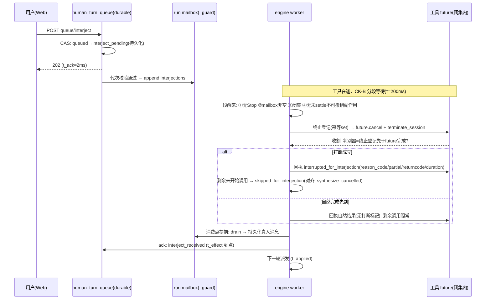

# 阶段4「生效时延优化（t_effect）」设计方案书

> 前置：阶段3「可插话任务助手」已交付并上线（发布验证记录见 docs/phase3-delivery-report.md §8，generation 246 / git_head 0f6fad29a）。
> 本设计以 Phase3 M2 度量（docs/phase3-m2-metrics.md，reports/phase3/m2/metrics.json）为**真实基线**，非推演。
> 目标一句话：把「可中断工具在途」时的插话生效时延从「工具剩余时长」量级降到「检查点传播+取消收割」量级，全链路零语义降级。
>
> **修订记录**：r2（2026-10-13）——评审子agent（21 rounds / 47 tools，HEAD=0f6fad29a 全量核验）出具 P0×1+P1×4+P2×9，全部处置：决策事实源改为 mailbox 真值（P0）；竞速机械判别器（P1-1）；取消原语改单调用粒度（P1-2）；等待点归属 registry._run_with_timeout+变更面盘点（P1-3）；空窗桶窗口钉死+第四桶（P1-4）；P2 全部并入对应章节。处置映射见 §9。

## 1. 真实基线（Phase3 M2 实测）

**M1+M2 代码，3 次独立 run，各一次长工具（2.0s）中插话：**

| n | P50 t_ack | P50 t_persist | P50 t_effect | P50 t_applied |
|---|---|---|---|---|
| 3 | 1.9 ms | 1994.7 ms | 1996.6 ms | 1998.8 ms |

P95：t_ack 2.0ms / t_persist 1999.9ms / t_effect 2001.9ms / t_applied 2004.1ms。
M0 基线（2.5s 工具单样本）：t_ack 2.3ms / t_persist 2490.6ms / t_effect 2492.9ms。

**量化本体**：t_effect − t_ack ≈ t_persist ≈ 工具剩余时长（2.0s 工具→~1995ms；2.5s 工具→~2490ms）。受理（毫秒级）与生效（秒级）的差值完全由在途工具决定——「回执≠生效」的可测差距即此。

## 2. 瓶颈：工具执行段无插话检查点（机制成因）

1. **消费点不在工具执行段**：插话消费点有两处——轮首（engine.py:1056 `_consume_live_interjections`）与终答前（engine.py:2429-2452，`at_final_gate=True`）。两点均只在 LLM 流边界，**工具执行段无检查点**——这是 t_persist ≈ 工具剩余时长的机制根源。
2. **工具同步在途**：LLM 返回的工具序列在轮内逐个同步执行，阻塞轮循环；插话必须等当前序列完成、回到下一轮轮首才被消费。
3. **流内检查不对齐**：取消（Stop）在 LLM 流内有细粒度检查（engine.py:1050 注释），但工具执行段没有对等的插话检查点。
4. **已具备的原语**（本设计复用，不新造取消机制）：
   - **单调用粒度取消先例**：registry 超时路径（registry.py:1603-1612）已示范「单个 future + 该工具实例 terminate_session」的定向形态——插话打断复用**此粒度**。
   - ⚠️ **不可直接复用** `registry.cancel_session`（registry.py:614-670）：它是**会话级**（取消该会话全部在途 future + 逐工具 terminate + 触发 `_session_cancel_hooks`，含 job_registry.cancel_session 杀后台 durable job）。插话打断**不得**经它（见 §4.2 CK-C 与 §4.1-3）。
   - 后台 job 取消：`job_registry.cancel_session`（src/llm_loop/tools/builtin/job_registry.py:441）。
   - 已实现 `terminate_session` 的工具：execute_command（execute_command.py:260，进程终止，返回 None——判别器需另建，§4.1-7）、spawn_subagent（spawn_subagent.py:108；**注：其 registry_timeout_s=5.0s 且 execute 为异步启动（spawn_subagent.py:17,195），并非长阻塞在途工具，留在闭集无害但时延收益≈0，如实标注**）。
   - 工具等待收口（单一）：修改类工具经 execute_many 串行直调 `execute`（registry.py:1317-1318）→ `_run_with_timeout` 的 `future.result(timeout=...)`（registry.py:1589）——tool_cycle 仅经 `_execute_allowed_with_wal`（tool_cycle.py:487）委托，自身不等待。**闭集两成员同走此收口**（好消息：变更面单一）。
   - 队列压力只读 probe：`interjection_pressure_probe`（engine.py:676 定义，web/__init__.py:433 注入 `hq.interject_pressure`；现状仅用于 convergence 回执事实段，只读不决策）。
   - mailbox 到达真值：插话入队即 append 到 run 的 interjections mailbox（runner.py:434-455，`_guard` 下），消费点 drain（runner.py:457-465 `take_interjections`）——**mailbox 非空本身就是零成本到达信号，无失真面**。
   - 不可撤销副作用登记：side_effects.py（revocable=False / external_unknown 语义，登记 189-237、settle 四态 285-302；items 无删除路径，依赖工具侧 settle()）。

## 3. 目标与非目标

**目标**
- T1：可中断闭集工具在途时，t_effect P50 ≤ 500ms / P95 ≤ 1000ms（场景：剩余 ≥1.5s 的 2.0s 长工具中插话，注入时刻构造见 §6 S13）。
- T2：序列间隙/轮间隙（M1 检查点或轮首即时收割可达窗口）插话 t_effect P50 ≤ 50ms——**空窗定义钉死为此窗口**（非「run 进行中任意无工具时刻」，后者大多为 LLM 流内在途，属自然边界，见 §7 第四桶）。
- T3：零语义降级——消息必达、工具回执如实、停止四态不受影响、D 红线（Phase3 §4.1）全保。

**非目标（明确不做）**
- N1：**不打断不可撤销副作用在途**（revocable=False 登记中 / external_unknown 风险面）——Phase3 M3 红线，时延目标永远让位于副作用安全。
- N2：不优化 t_ack（已 1.9ms，无收益空间）。
- N3：不改停止四态语义。Stop（取消整个 run）与插话打断（收割轮边界、run 继续）语义正交，仅共用底层取消原语粒度。
- N4：不造工具内协作取消协议——工具自选 `terminate_session` 原样复用；未实现者不入闭集。
- N5：不承诺不可中断工具与 LLM 流内在途场景的 t_effect 改善（自然边界语义保持，如实报告）。
- N6：不改授权链（插话授权=真人入队，Phase3 已定；打断触发只来自真人消息到达）。
- N7：不做跨进程分布式打断（单进程内 run 的在途工具；外部执行体只经既有 job/external 登记面如实标注，不宣称远端闭环）。
- N8：不给 LLM 流生成段加插话检查点（流内取消已有 Stop 检查；插话等待流边界，属自然边界桶）。

## 4. 总体设计

### 4.1 关键不变量重审（Phase3 §4.1 六条逐条 + 新增两条）

1. **Session 单写者（重申并强化）**：检查点触发的插话消费仍由 **engine 工作线程**执行；打断决策只读 mailbox 真值（`_guard` 下 peek，纯读操作，无写路径）；打断决策、消费、持久化全部留在 engine 线程。Web 线程不因 Phase4 获得任何 Session 写路径（r2：决策事实源改为 mailbox 后，Web 线程与 Phase4 的耦合面=零）。
2. **消息必达优先于恰好一次**：被打断工具回执必达且如实标注；被跳过的未开始工具调用同样逐条回执（skipped_for_interjection），消息序不破裂；插话消息本身 at-least-once 语义不变。
3. **取消不误伤**：打断只用**单调用粒度**定向原语（当前等待的 future.cancel + 该工具实例 terminate_session，registry.py:1603-1612 同型先例）；**不调用 registry.cancel_session（会话级）**、不触发 `_session_cancel_hooks`、不写 StopRecord——否则「停止四态回归零变化」验收门被自己的打断路径污染。闭集外工具永不打断。
4. **布尔 ACK ≠ 物理闭环**：打断回执不宣称外部进程已确认终止；terminate_session 调用成功≠远端闭环；竞速中工具自然完成先到时不冒充打断（判别器见第 7 条）。
5. **授权与触发解耦**：打断触发=「真人入队消息到达」（**mailbox 真值非空**，非内存标志）；事件/定时/后台路径不得触发打断。
6. **fail-open（Phase3 第 6 条「新增回执 fail-open」的扩展改写）**：本阶段 fail-open 面=检查点探测/mailbox peek 失败 → 不打断，继续分段等待，轮首消费兜底（现状语义），日志告警，不阻断主链路。r2 删去了原 CK-A「到达标志」设计：标志是易失真信号（已消费后陈旧置位→「无新消息也打断」的语义污染，评审 P0），mailbox 真值本身零成本、无生命周期问题。
7. **（新增）打断幂等与竞速机械判别器**：工具自然完成先到 → 如实按自然完成入账（无打断标记），**判别机制**：插话打断路径在调用 terminate_session 前，先在**工具实例上登记**「本会话 pid 已被定向终止」事实（幂等 set）；工具 execute 返回路径核对自身 proc 是否在终止集合内 → 是则回执附 `reason_code=terminated_for_interject`。收割侧以「终止登记是否先于 future 完成被观察到」的事件序判定（登记在取消调用前完成写入、future 完成后收割时读同一 set），**不比较墙钟时间戳**。同轮多次到达只收割一次（消费点 drain 幂等）；terminate_session 对已终态对象 no-op（registry.py:614-620 docstring 声明的幂等性）。
8. **（新增）保守默认闭集**：可中断性 opt-in 登记，未登记工具默认不可中断；闭集登记以「工具已实现 terminate_session 且作者声明取消安全」为准，不推断。

### 4.2 方案：轮内插话检查点（三要素）

**CK-A 到达真值（决策事实源）**：打断判定谓词唯一事实源 = **mailbox 真值**：engine 线程在 `runner._guard` 下 peek `h.interjections` 非空且代次一致（新增只读 `interjections_pending()`，零拷贝计数）。mailbox 由受理路径在 CAS 落盘+代次校验通过后 append（runner.py:434-455）——「在 mailbox」即「持久化真值存在」，不存在标志类失真窗口。**不设内存到达标志**（r2 删）。

**CK-B 分段等待**：工具 future 的单段阻塞等待（现状：`_run_with_timeout` 的 `future.result(timeout=registry_timeout_s)`，闭集成员上界 execute_command=60s，registry.py:310）改为**有界分段等待**：`future.result(timeout=τ)` 循环，τ=检查点周期，初始 200ms。每段醒来判定（顺序固定）：①`_background_cancel_reason` 非空 → 放弃检查点走停止链路（Stop 优先，engine.py:1051 同源信号）；②mailbox peek 非空（代次一致）→ ③当前工具 ∈ 可中断闭集 → ④当前 run_generation 内无未 settle 的 revocable=False 副作用登记（限定 run 内：防跨 run 陈旧项静默阻断；串行执行下该条件防御面小，如实标注）→ 进入打断收割。任一条件不满足 → 继续下一段。工具序列间隙（无在途工具）peek 非空 → 无需打断，直接进入消费收割。

**CK-C 打断收割**：**单调用粒度**定向取消（该 future.cancel + 该工具实例 terminate_session；§4.1-3 声明的三不：不调用会话级 cancel_session、不触发 session hooks、不写 StopRecord）→ 有界等待收割 → 按判别器（§4.1-7）入账：
- 自然完成先到 → 回执按工具自然结果入账（无打断标记），剩余未开始调用照常执行；
- 打断成立 → 工具回执标注 `interrupted_for_interjection` + `reason_code=terminated_for_interject`，回执规范：partial_output（已产出的 stdout 前缀，如有）、returncode（被终止时如实为负值/None）、executed_duration_ms（已执行时长）。回执**不引用插话正文**（D6 同源纪律）；
- 序列中剩余**未开始**的调用逐条回执 `skipped_for_interjection`（WAL 声明/started 记录需同步处理，对齐 `_synthesize_cancelled` 先例 tool_cycle.py:441-445, 491-503）→ 轮内直接进入消费点（轮首消费逻辑提前复用，含 user_text 对齐与 applied 回执链）→ 下一轮派发。

**初始闭集**（保守，N4 约束下唯一可登记成员）：
- execute_command（同步长命令：terminate_session 进程终止——**本设计时延收益主要来源**；后台 job：job_registry.cancel_session）
- spawn_subagent（terminate_session；5s 上界+异步启动 → 收益≈0，留闭集为一致性，如实标注）
- 其余全部默认不可中断（含 browser 系列：副作用 revocable=False；web_fetch/web_search：无取消原语；agent_followup 等 registry_timeout_s=None 复合工具：未实现 terminate_session，不入闭集）。

**与停止的竞速**：Stop 与插话打断同时发生时 Stop 优先（run 终态 > 轮边界收割）。次序锚点：CK-B 每段醒来与 CK-C 收割前均先查 `_background_cancel_reason`，非空则放弃收割走停止链路；Stop 路径的 cancel_session 与 CK-C 各自取消幂等（对已终态对象 no-op）。

### 4.3 关键时序（可中断工具在途插话）

### 4.4 错误分级与降级

| 失败 | 分级 | 处理 |
|---|---|---|
| mailbox peek/检查点探测失败 | 保守降级 | 不打断，继续分段等待，轮首消费兜底（现状语义）；日志告警 |
| terminate_session 抛错/不可用 | 如实 | 视为不可中断：等待自然完成，回执自然入账，**不**跳过后续、**不**标打断 |
| 取消已发但收割超时 | 如实 | 等待自然完成；回执按实际结果入账，不冒充打断（§4.1-4/7） |
| 闭集查询失败 | 保守降级 | 视为不可中断（默认保守，§4.1-8） |
| **CK-C 收割/消费窗口内新插话到达** | 无丢失 | mailbox 单调增长，drain 只发生在消费点 → 新消息由紧随的下一轮轮首兜底消费；收割窗口本身不消费（收割后立即轮内消费点会一并 drain） |
| 消费点本身失败 | 不变 | Phase3 既有 fail-open 回执链（denied-receipt/applied-receipt 失败不阻断） |

**短工具开销留痕**：`future.result(timeout=τ)` 在工具完成时立即返回——短工具零额外时延，段间判定仅闭集成员承担，开销可忽略。

## 5. 实现切分 M0–M4（独立可交付）

| 模块 | 需求 | 主要触点（现状） | 变更形态 |
|---|---|---|---|
| M0 基线扩展 | T2 验收前置+场景规格落地 | tests/phase3_baseline/ 模式 + reports/ | 纯增量：S13–S16 场景脚本 + 现状对照数据（零核心代码） |
| M1 间隙检查点 | mailbox peek + 间隙收割 | runner.py:447-465（peek/take 面）、engine 轮循环、tool_cycle 序列执行 | 新增只读 interjections_pending()；序列间隙消费；skipped 回执含 WAL/started 同步处理（对齐 _synthesize_cancelled 先例 tool_cycle.py:441-445）。行为风险如实评估：skipped 回执是模型可见历史新形态，语义可接受，由回归门覆盖 |
| M2 在途打断 | CK-B+C | **registry._run_with_timeout:1589（单一等待收口）**、registry.py:1603-1612（单调用粒度取消先例）、execute_command terminate_session+终止登记、闭集登记 | 分段等待+定向取消+判别器+interrupted/skipped 回执；变更面清单：WAL 声明/started 记录（tool_cycle.py:394-399）、_synthesize_cancelled 对账先例（441-445, 491-503）、checked_tool_dispatch 预算包裹（registry.py:1198-1203）、record_tool_octet、批次保存边界（tool_cycle.py:523-528） |
| M3 度量验收 | T1/T2 实测 | HumanTurnQueue.aggregate + metrics 端点 | 分桶扩展（四桶，§7）+ 对照报告 |
| M4 终局 | 全量收口 | 全仓库 | 设计评审（本设计已过 r2 评审，见 §9）+ 全量回归 + 发布验证 |

各里程碑可独立回退：M1 行为面=间隙消费+skipped 回执（回归门覆盖）；M2 闭集为空时零行为差异（回退组合：M2 回退必先于/连同 M1，写明依赖）。

## 6. 验收门（含场景规格）

**场景规格**：
- **S13（可中断在途）**：execute_command 同步长命令（sleep 2.0），命令启动后 ≤0.5s 注入插话（构造精度：注入时刻锚定命令 started 事件后 0.3s，容差 ±0.2s）→ 预期打断收割。Phase4 前（现状代码）跑同场景作基线锚点：t_effect ≈ 2.0s − 0.3s ≈ 1.7s。
- **S14（不可中断保守）**：不可中断工具在途（如 browser/web_fetch 类，≥2.0s）同窗口注入 → 无打断、无 skipped、t_effect ≈ 自然边界。
- **S15（竞速如实）**：工具自然完成与打断判定并发构造（如 sleep 0.25s 工具+τ=200ms 检查点对齐）→ 自然完成先到则回执无打断标记；打断成立则 reason_code=terminated_for_interject。两分支各覆盖 ≥3 次。
- **S16（空窗=T2）**：构造=序列间隙/轮间隙到达（前序工具完成事件后立即注入，容差 ±50ms 内无新工具 started）→ t_effect 目标 ≤50ms。

**里程碑门**：
- **M0**：S13–S16 脚本在现状代码上可复跑并产出对照报告（S13 基线锚点 ≈1.7s 量级确认）。
- **M1**：间隙场景——前序工具完成、后续未开始时插话到达 → 后续调用逐条 skipped_for_interjection 回执 + 插话消费生效 + t_effect 脱离工具剩余依赖（单测+场景双覆盖）。
- **M2**：S13 复跑达标（§7）；S14 保守等待；S15 竞速两分支如实；停止四态回归零变化（打断路径不写 StopRecord 不触发 session hooks 的专项断言）。
- **M3**：每桶 ≥5 样本实测报告（PHASE4_REPORT_DIR 独立快照）+ metrics 端点分桶字段。
- **M4**：全量回归零新增失败 + 发布验证（冒烟+关键核验，对齐 Phase3 §8 惯例）。

## 7. t_effect 目标值与验收口径

**口径不变**：t_effect = received_at − created_at（Phase3 M2 §1 持久化时间戳机械推导，零墙钟注入；百分位最近邻序法 P50/P95；仅统计 interject_received* 终态项）。

**分桶验收（四桶，机械归属）**：

| 桶 | 到达窗口 | 目标 | 归属规则（机械） |
|---|---|---|---|
| interruptible 在途 | 闭集工具 execute_command 在途（S13 构造） | P50 ≤ 500ms，P95 ≤ 1000ms | 报告侧场景打标（场景脚本注入）+ 校验：该次 interjection 的同轮工具回执含 interrupted_for_interjection |
| 自然边界在途 | 不可中断工具在途（S14 构造） | **不设目标**，如实报告 | 场景打标 + 校验：同轮回执无 interrupted 标记 |
| **LLM 流内在途（r2 新增第四桶）** | LLM 流生成期间到达 | **不设目标**，如实报告 | 场景打标（到达时刻在流窗口内）+ 无 interrupted 标记 |
| 空窗 | 序列间隙/轮间隙（S16 构造：前序完成事件后 ±50ms 无新工具 started） | P50 ≤ 50ms | 场景打标 + 到达时刻与工具事件序核对 |

依据：interruptible 传播链 ≈ τ(200ms) 检测 + 取消收割（进程 kill 收割实测百 ms 级）+ 消费；500ms 留 ~2× 余量，M0 实测后可校准（修订留痕）。**弱样本警示（诚实纪律，对齐 Phase3 n=3 先例）**：n=5 的 P95 为最近邻序估计，置信弱，报告须标注样本量与估计方法，不宣称精确分位。

样本量：每桶 ≥5（P50/P95 最近邻序法）。验收数据独立快照目录 reports/phase4/（参数化，不复用 M2 目录）；每里程碑证据 refs 留痕（对齐 Phase3 惯例）。

## 8. 与 Phase3 成果的关系

- 复用：队列状态机与持久化（M1）、四口径度量（M2）、停止四态与副作用登记（M3——闭集判定直接消费 revocable 登记，限定 run_generation 内未 settle 项）、单调用粒度取消纪律（Phase3 §4.1-3 收窄）。
- 不改：状态机迁移规则、at-least-once 取舍、授权链、D6 正文红线（打断回执只含原因码与目标标识，不含插话正文/页面正文）。
- 本设计评审流程：**r1 评审（P0×1+P1×4+P2×9）→ r2 处置（§9 映射）→ r2 复核通过（独立复核子agent，2026-10-13，终局判定=定稿通过）**，对齐 Phase3 终审惯例；**「M5 评审」是本设计定稿流程环节，不占实现里程碑 M0–M4**。复核非阻断留痕：`interjections_pending()` 落地时须与 `take_interjections` 同守 `_guard`（M0 实现注意项）。

## 9. r2 评审处置映射（评审子agent 2026-10-13，HEAD=0f6fad29a 核验）

| 级别 | 问题 | 处置位置 |
|---|---|---|
| P0 | 到达标志易失真→无新消息打断 | §4.2 CK-A 改 mailbox 真值 peek（interjections_pending 只读）；标志删去，§4.1-6 fail-open 面随之收窄；§4.4 补决策源失败行 |
| P1-1 | 打断 vs 自然完成无机械判别器 | §4.1-7 判别器：终止登记（幂等 set）+reason_code=terminated_for_interject+事件序判定（不比时间戳）；S15 两分支规格 §6 |
| P1-2 | registry.cancel_session 会话级误伤 | §2.4-④/§4.1-3/CK-C：单调用粒度（registry.py:1603-1612 先例）+三不声明（不调会话级/不触发 hooks/不写 StopRecord）+ M2 门专项断言 |
| P1-3 | 等待点归属失准+变更面不足 | §2.4-④ 收口=registry._run_with_timeout:1589；「无界」改单段阻塞（execute_command 60s 上界）；spawn_subagent 收益≈0 如实标注；§5 M2 变更面清单（WAL/started/_synthesize_cancelled/checked_tool_dispatch/record_tool_octet/批次边界） |
| P1-4 | 空窗桶不可达/不可验收 | §3 T2+§7：空窗钉死序列间隙/轮间隙；新增第四桶 LLM 流内在途（不设目标）；S16 构造精度 §6 |
| P2×9 | 消费点两点表述/S13-S16 规格/分桶归属/降级表两行/revocable 限定 run 内/Stop 次序锚点/CK-C 回执规范+D6/短工具开销/称谓与 M1 措辞 | 分别并入 §2.1、§6、§7 表、§4.4 两行、§4.2 CK-B④、§4.2 Stop 段、§4.2 CK-C、§4.4 尾注、§8、§5 M1 |
