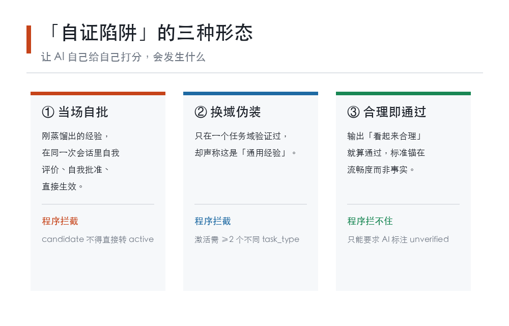
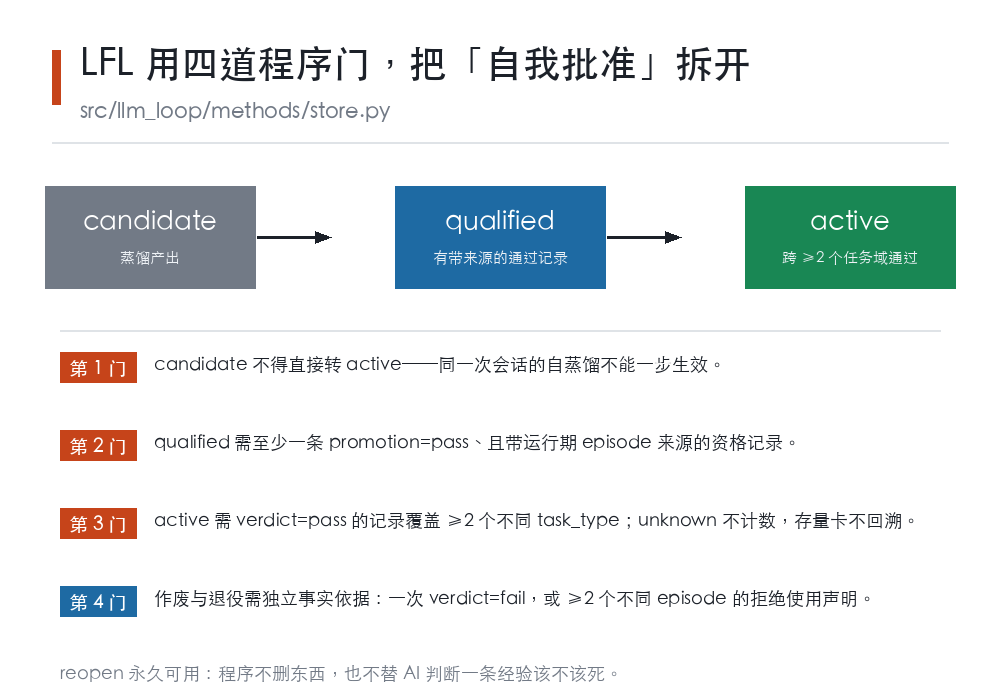
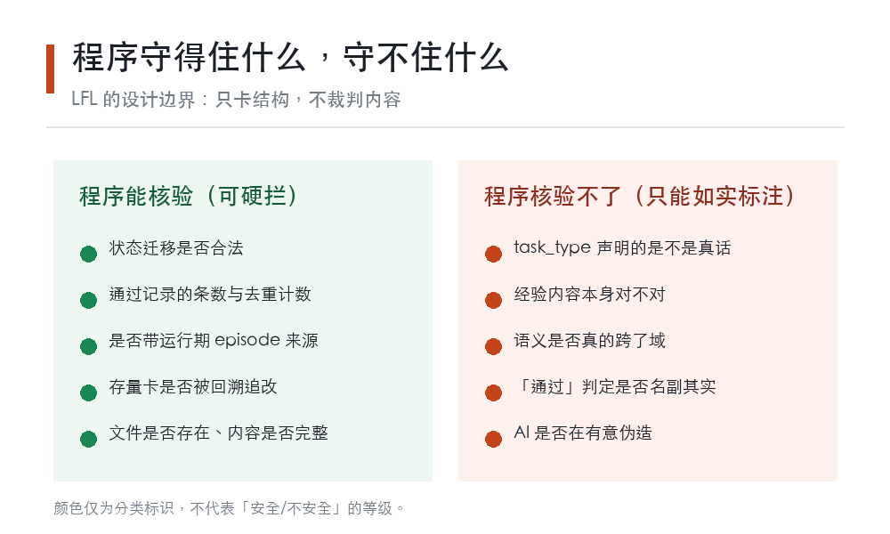
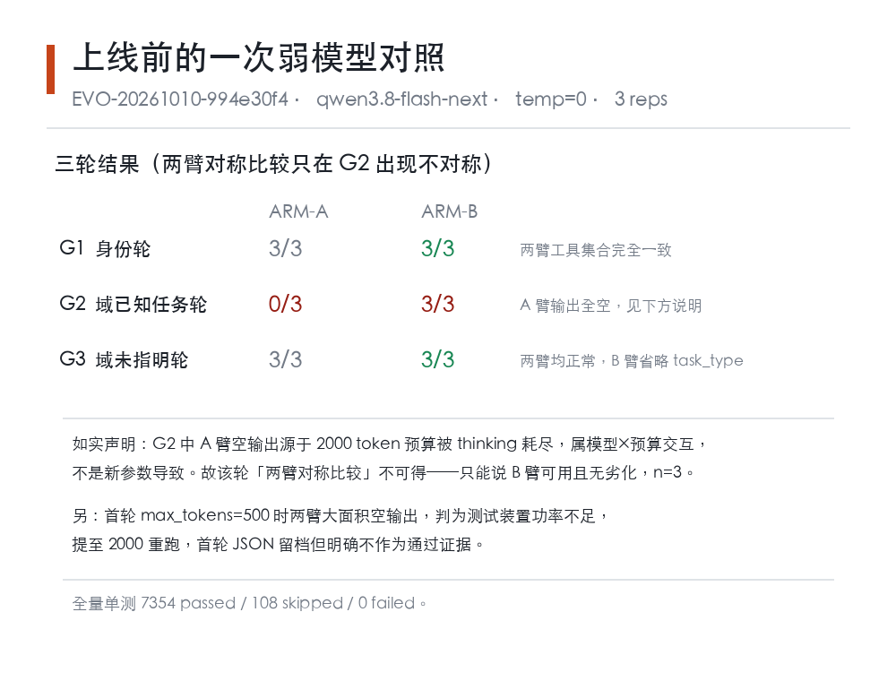

# AI 说"我改进了一下"，你信吗？——拆开 Agent 自我进化里的"自证陷阱"

> 过去一年，AI Agent 圈最热闹的词之一是"自我进化"：让 AI 从失败里总结经验，把经验存起来，下次遇到同类任务直接调用。
>
> 但很少有人追问一个更尖锐的问题：**这些经验，是谁判定"它确实变好了"的？**
>
> 如果答案是 AI 自己，那这件事的性质就变了。
>
> （这是本系列第二篇。第一篇《当大模型开始"记住自己"》聊的是 Agent 的记忆该存什么；这篇顺着记忆往下走一步，问存下来的经验**凭什么被采信**。）

## 一、一个反直觉的实验结果

先看一组来自 2026 年 10 月 8 日的实验数据。论文《All Verdicts are Not Equal: Rethinking LLM Judge Reliability》（arXiv:2610.12083，被 AACL IJCNLP 2026 主会接收）系统性地审计了"用大模型当裁判"这件事。

作者压测了 6 个前沿模型、4 个基准、5 种提示词格式、2 种呈现顺序、3 个采样温度，每个条件重复 10 次。结论有三条，每一条都值得停下来看：

**第一条：温度设为 0，判定照样会变。** 同一个输入、同一个模型、同一份提示词，重复运行，判定结果并不稳定。这推翻了一个很普遍的默认假设——我们以为温度 0 就意味着确定性输出。

**第二条：调换选项顺序，会翻转大多数判定。** 在困难任务上，把 A 和 B 的呈现位置对调，模型的胜负判断跟着翻转。也就是说，部分判定根本不是由"内容质量"驱动的，而是由"谁排在前面"驱动的。

**第三条，也是最有意思的一条：6 个受测模型中，判定最"确定"的那一根，一致率满分，但在困难任务上和标准答案的吻合率只有 51%。**

怎么做到的？它非常稳定地重复**同一个错误答案**。一致性测的是"两次答得一样吗"，不是"答得对吗"。当一个裁判把错误答案背下来，它的一致性指标会非常漂亮，正确性却惨不忍睹。


> 图 1：同一根裁判的两项指标。判定一致率 100%，与标准答案吻合率 51%——满分的一致性来自一遍遍重复同一个"错"。（数据来源：arXiv:2610.12083）

论文为此提出了一个综合指标 **trustworthy verdict rate（T）**，衡量"可复现 + 顺序无关 + 准确"三者的联合概率，并给出了位置偏差单独造成的准确率理论上限。它还有一个反直觉的发现：**可靠性是条目级（item-specific）的，不是模型级的**——同一个模型，在 A 题上可靠，在 B 题上未必。

作者的结论是：从"两两对比打分"转向"整体评分细则（holistic rubric）"，比任何单一提示词技巧都更能提升可信度。

## 二、"自证陷阱"的三种形态

把上面的实验结论放回 Agent 工程场景，"自证"大致有三种形态。



> 图 2：三种自证形态，以及各自能被程序拦住的部分。（本文归纳）

**第一种：当场自批。** Agent 刚总结出一条经验，在同一次会话里自我评价、自我批准、直接投入使用。听起来像是"自我进化"，实际上这条经验从未离开过自己的房间，从未在真实任务上被检验过。

**第二种：换域伪装。** 经验只在一种任务上验证过，却因为"看起来有普适性"而被当作通用经验。相关论文 Skill-V（arXiv:2610.11781）把技能定义为**带版本、可证伪的契约**，要求把语义意图和可观测的行为标准绑在一起；它的结论直接指出：技能库不能只靠堆量增长，必须知道**该保留什么、什么时候该修订、什么时候根本不该用**——它为此专门做了一个"适用性过滤器"。

**第三种：合理即通过。** 这是最隐蔽的一种：输出的东西"看起来合理"，就被当作"验证通过"。FinRegQA-EU（arXiv:2609.36856）在欧盟金融监管问答上做过一个很说明问题的实验：用大模型当裁判打分，监督微调（SFT）拿到了**最高分**；但换成规则方法统计引用事实后，SFT 的**规则式 Citation F1 反而是最低的**。值得注意的是论文的补充观察：SFT 产出的答案更长、引用数量是其他方法的三倍，其中大部分并无支撑。换句话说，**裁判的高分和引用的真实性在这套评测里是脱钩的两件事**。

> 这一条需要读者格外当心：**裁判打的高分，衡量的是"像不像有依据"，不是"是不是真有依据"。**

顺便一提，同样在 10 月上旬，Rubric-CEPR（arXiv:2610.12469）走的是另一条防自证的路子：**冻结的 critic**——让一个不参与训练的评审模块给候选打分解式分数，并且用"非补偿性闸门"直接拒掉不达标的候选，而不是让被改进的那个模型自己给自己打分。**这里要说清楚：论文里的 critic 读的是被改进编辑器自身的内部特征，不是完全独立的第三方，所以它防的是"自己给自己打分"，不是"绝对可靠的外部裁判"。**Turbo Harness（arXiv:2609.40330）则把 harness 本身的优化也纳入递归改进，并指出一个容易被忽略的事实：**平均最优的 harness，不一定对每个具体实例最优**。

这两篇和下一节要讲的内容，指向的是同一个问题。

## 三、LFL 的做法：把"自我批准"拆成四道程序门

第一篇讲到 Learning Plane 的防自证设计——"程序只证明 episode 身份，不让一条经验自己给自己打分"。这一节把那个设计背后的程序面完整拆开看。

上面这些学术结论，在开源项目 llm-first-loop（GitHub: deyi2026/llm-first-loop，Apache-2.0）

> **版本说明（重要）**：本文写作时，仓库发布版 `main` 分支仍为 **0.6.27**（CHANGELOG 最新条目 v0.6.27，2026-10-08）。本文分析的第四道门来自**尚未随发布版分发的本地提交 `3b5f9d29`（0.6.28）**，对应演进建议 EVO-20261010-994e30f4。你在 GitHub 上按当前 `main` 搜索 `cross_task_type_qualification` 是搜不到的——它要等 0.6.28 发布。这一点我如实标注，避免读者照着找不到还以为文章编造。里被翻译成了具体的程序约束。它不试图让 AI"变得更会自我判断"，而是**在程序层把自证路径直接掐断**。

代码位置在 `src/llm_loop/methods/store.py`。



> 图 3：Method 生命周期上的四道程序门。（来源：`src/llm_loop/methods/store.py`）

**第 1 道门：candidate 不能一步变成 active。** 代码注释写得很直白——一次自蒸馏不能在同一次写入里就变成生效状态。想生效，必须先经过 qualified。

**第 2 道门：qualified 需要带来源的通过记录。** 必须存在至少一条 `promotion=pass` 的资格记录，且它带有运行期产生的 episode 来源（`qualification_episode_ref` 或 `task_ref`）。**光有一句"我觉得它行"不算数。**

**第 3 道门：激活要求跨任务类型验证。** 这是最新加入的一道（提交 `3b5f9d29`，对应演进建议 EVO-20261010-994e30f4，2026-10-10）：一条经验要转成 active，必须在 **≥2 个不同的 task_type** 上都拿到 `verdict=pass`。缺失或标为 unknown 的 task_type 不计数，源任务本身算一个。

这道门针对的正是上面说的"第二种自证形态"——单域验证冒充通用经验。另外值得注意的是它的**回溯策略**：已经处于 active 状态的存量卡片不回溯，**这个检查只作用于"进入 active"的迁移**。项目选择不追溯追改历史数据（retire 后再激活则适用新门）。

**第 4 道门：作废和退役需要独立事实依据。** 要把一条经验标记为失效或退役，必须有：至少一条 `verdict=fail` 的资格记录，或者来自 **≥2 个不同 episode** 的拒绝使用声明。代码注释说明了理由——"程序永远不决定一条方法该不该死，它只拒绝记录一个仅仅建立在单次会话自我判断上的定罪"。

另外还有一道更早的检查：处于 `teacher` 状态的卡片生命周期不可变更，只能由它蒸馏出候选方法。

同时，**reopen 永久可用**——程序保证可以反悔，但"文件永不被删除"是文件系统层面的约束，不是本机制提供的保证。

## 四、这套设计最值得学的，是它承认自己做不到什么

我认为比四道门本身更值得看的，是这套设计**主动划出的能力边界**。



> 图 4：程序能硬拦的部分，与只能要求 AI 如实标注的部分。（依据 store.py 与 EVO-20261010-994e30f4 的上线自检文档）

第 3 道门有一处诚实的自我限制，写在代码注释和上线检查文档里：**task_type 是模型的声明，程序无法验证任务域的真伪。** 同一次 episode 里声明两种不同类型，就能伪造出"跨域验证"的样子。

项目对此的定性是：这道门**防的是"单域蒸馏直接激活"这种系统性风险，不防蓄意伪造**——它和其余的 verdict 字段处在同一认识论层级（评估者是模型本身），既没有降低也没有提升声明面的可信度。

这张图想说明的是一条更普遍的原则：**程序擅长核验结构（状态迁移合不合法、记录条数够不够、来源字段在不在），但不擅长核验内容（任务域是真是假、经验内容对不对、"通过"判得是否名副其实）。** 所以正确的分工是——程序死死守住结构，内容的判断权交还给模型，同时**要求模型如实标注自己没把握的地方**。

一个能自我标注 `unverified` 的系统，比一个永远声称"验证通过"的系统更值得信任。这不是能力问题，是认知诚实问题。

## 五、一份真实的上线前自检报告

2026-10-10，项目上线那道"跨任务类型门"之前，做了一次弱模型对照实验，报告完整留档在 `docs/analysis/ELIG-20261010-994e30f4-method-task-type-gate.md`。这份报告本身，比结论更值得读。



> 图 5：弱模型档三轮对照结果。（来源：ELIG-20261010-994e30f4）

实验设计：用本地端点模型 `qwen3.8-flash-next`（thinking 模式），设两个对照臂——ARM-A 是剥离了 `task_type` 的旧 schema，ARM-B 是新 schema，其余字节相同；温度 0，重复 3 次。

结果：ARM-B 在"已知任务域"这一轮 3/3 全部给出良构调用；ARM-A 0/3，原始输出全部为空。

**但报告没有把这写成"新设计更优"。** 它写的是：ARM-A 的空输出是因为 2000 token 的预算被 thinking 模式全额耗尽，属于"模型 × 预算"的交互，**不是 ARM-B 引入的回归**。因此报告明确声明——这一轮"两臂对称比较"是**不可得的**，结论只能是"ARM-B 可用且无劣化"，样本量 3 次复跑。

还有一处更值得注意：第一轮实验用的是 `max_tokens=500`，结果两个臂大面积空输出，判据无法评估。报告的处理是——判定为**测试装置功率不足**，把 `max_tokens` 提到 2000 重跑，并且明确写明**首轮 JSON 留档但不作为通过证据**。

同时报告如实列出了已知限制：task_type 是模型声明，同一 episode 声明两种类型可以伪造成"跨域"；这道门防系统性风险，不防蓄意伪造。

最终上线判定是"通过"，全量单测 7354 passed / 108 skipped / 0 failed。存量 dry-run 显示：2 张已 active 的卡片 distinct 数为 0，grandfather 语义生效不拦截；而唯一的 qualified 卡（`schedule-cadence`）distinct 数同样为 0，**按新门激活会被拦下**——这正是这次演进的预期效果。

把这两条合起来读，结论其实比"回溯豁免"更值得注意：**现库里没有任何一条方法带有跨域的通过证据**——2 张存量 active 卡是靠 grandfather 豁免留下的，那张唯一够格的 qualified 卡则按新门必被拦下。也就是说，这道门在当前数据上确实会拦住东西，而不是一道永远为真的空规则；代价是，在真实跨域证据积累起来之前，方法库暂时无法新增 active 卡片。

我把这三处原文摘出来，是想说明一个判断：**一份报告的价值，很大程度上取决于它有没有把自己不成立的部分写清楚。** "ARM-A 是空的所以 ARM-B 更好"是一个诱人的结论，但报告拒绝这么写。

## 六、上手

安装和最小闭环的步骤与第一篇完全一样，这里不重复；项目是 Apache-2.0 协议，要求 Python ≥ 3.13。

```bash
uv sync --frozen --extra dev
export LLM_API_KEY=sk-xxx
export LLM_BASE_URL=https://api.deepseek.com/v1
.venv/bin/python -m llm_loop.cli "请读取 data/notes.txt 并总结内容"
```

如果你对本文讲的四道门感兴趣，可以在**本地仓库 HEAD（0.6.28）**打开 `src/llm_loop/methods/store.py`，搜索 `cross_task_type_qualification`——那道 2026 年 10 月 10 日才加上的激活门就在这段代码里；前四道门在已发布的 0.6.27 中可以找到。同样地，第五节那份自检报告 `docs/analysis/ELIG-20261010-994e30f4-method-task-type-gate.md` 也随 0.6.28 分发，读者可从提交 `3b5f9d29` 处取到。

## 结语

"让 AI 自我进化"是一个让人兴奋的方向，但兴奋不该盖过一个问题：**谁来验证？**

从 arXiv:2610.12083 中那根「一致率 100%、与标准答案吻合率 51%」的裁判，到 Skill-V 强调的"可证伪契约"，再到 llm-first-loop 用四道程序门掐断自证路径——不同团队给出了不同答案，但问题的形状是一致的：**一个不能被独立证伪的"改进"，和一个没发生过的改进，在系统里看起来一模一样。**

所以我更看重那种敢于写下"这里我做不到"的设计。程序守不住内容，那就只守结构；模型判断不了真伪，那就要求它如实标注。**一个会说"这一条我没把握"的经验系统，比一个永远说"我改进好了"的系统，更接近真正意义上的进化。**

如果你也在做 Agent 相关的工程实践，你更倾向哪种路线：让 AI 自我判断然后自我批准，还是让程序卡住关键环节？

**参考来源：**
- arXiv:2610.12083 — All Verdicts are Not Equal: Rethinking LLM Judge Reliability（AACL IJCNLP 2026 Main）
- arXiv:2610.11781 — Skill-V: Verifiable Self-Evolving Skill Library for Interactive Agents
- arXiv:2609.36856 — FinRegQA-EU: Corruption-Based Preference Data for Grounded EU Financial Regulatory Question Answering
- arXiv:2610.12469 — Rubric-CEPR: Self-Evolving Image Editing via Reward-Verified Self-Distillation
- arXiv:2609.40330 — Turbo Harness: Instance-Adaptive Harness Optimization
- 本地仓库 llm-first-loop：src/llm_loop/methods/store.py、docs/analysis/ELIG-20261010-994e30f4-method-task-type-gate.md（提交 3b5f9d29，2026-10-10）
