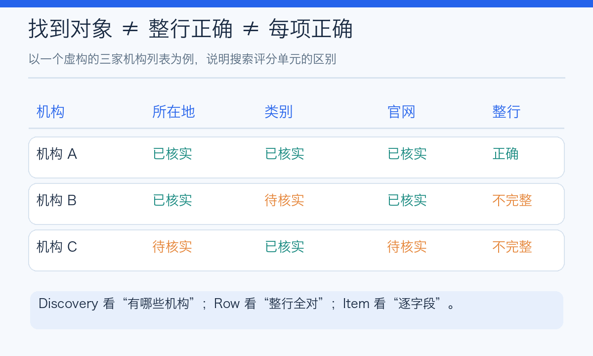
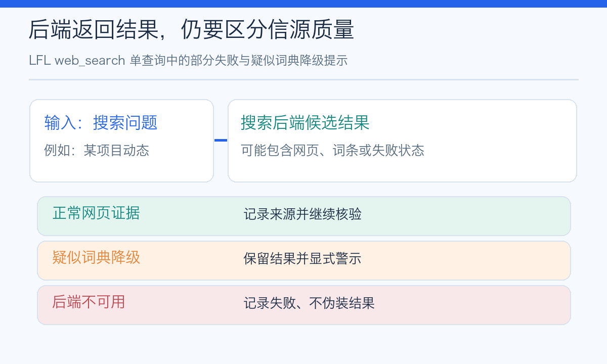
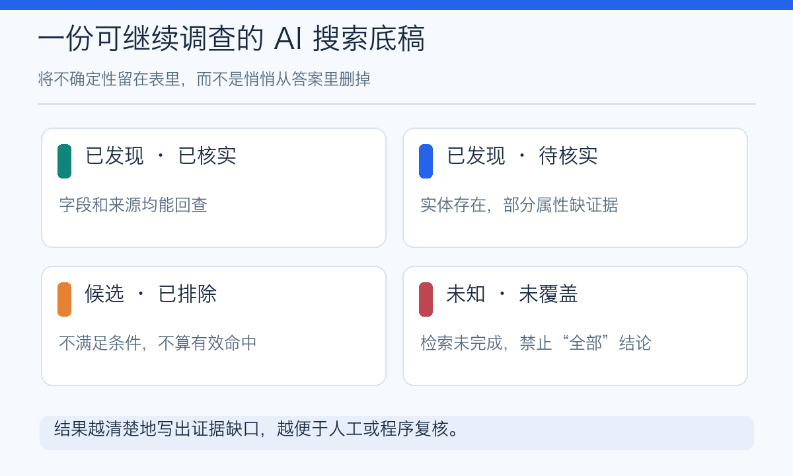

# AI 搜出十条结果，为什么还可能只完成了任务的一小半？

> LFL 原创科普 · 第六期候选稿 · 2026-10-10（北京时间）。本文讨论 10 月 8 日公开的 ATLAS 搜索型 Agent 评测预览；它来自搜索服务商 Exa 自己的研究博客，并非本文独立复现实验。示意图由本文原创绘制。LFL 的代码观察时点为 `release/v0.6.29@8a56bff20c71`。

问一个 AI 搜索助手：“请列出所有符合条件的公司，以及每家公司的所在地、融资阶段和公开来源。”

几秒钟后，它交出十个名字，格式整齐，还有几条链接。你可能会觉得：真快，事情办完了。

但问题是：**这十个名字是不是找全了？那些融资信息是不是每一项都对？找不到的公司有没有被悄悄省略？**

这和“模型是否会写一段漂亮总结”是两种不同难度的事。

## 一、一份新研究把“找到答案”拆成了三种准确

10 月 8 日，搜索服务商 Exa 公布了名为 [ATLAS](https://exa.ai/blog/atlas-benchmark) 的评测预览，旨在测试 Agent 完成“广而深”的实际资料检索任务的能力。

按照项目方描述，ATLAS 包含 **547 个研究任务**。每个任务要求发现一组满足条件的实体，例如公司或人物，再为每个实体搜集 **2—10 个属性**。它不仅考察“能不能搜到一家公司”，也考察“有没有遗漏别的公司”“公司对应的每个字段正确吗”。

项目方把三类分数区分得很清楚：

**Discovery F1**：统计实体本身。找到的是不是目标，有没有漏掉应该找到的对象？

**Row F1**：统计整行。只有这家实体的所有必填属性都正确，整行才算正确。

**Item F1**：统计单元格级项目。逐项看哪些实体、哪些属性找到并做对了。

*图 1：概念例子，自行绘制，数字为虚构示例。三种 F1 的统计单元不同，不可互换，也不能用单个“查准率”代替。*

这些指标都涉及两个方向：**precision（返回的结果有多少是对的）** 和 **recall（应该返回的结果找回了多少）**。F1 才是两者的调和平均，不是“看起来差不多正确”的主观分。

即使一份表格里每行都正确，如果它只找到了本应找到的一半对象，recall 仍会很低。反过来，如果把所有可能的名字都塞进去，却混入大量错误，也不会有好的 precision。

## 二、搜索不仅要深，还要知道什么时候没找全

ATLAS 项目方报告：它的任务中 **74% 需要列出至少 10 个实体**，而每个实体又需要 2—10 个属性；按其数据构建日志估算，完整发现并填充平均任务所需的域名数中位数约为 **18**。

这说明这类工作不像问“某个城市今天几度”那样查一条就结束。它更像做市场研究、尽调、采购清单：你得跨网站核对，多次回溯来源。

Exa 的自有实验进一步声称：在其设定的一分钟、每任务低于 1 美元的预算约束下，没有受测系统获得超过 0.5 的整行 Row F1。**这是一家厂商对其自行设计的基准的结果披露**，不能推广成“全世界 Agent 在真实工作中正确率不到一半”。

对普通人而言，更实用的启示不是追求某个排行榜分数，而是学会问 AI：

- 你搜过哪些类型的来源，哪些领域还没查？
- 哪些公司是“没找到”，哪些是“已核实不符合条件”？
- 表格中每个关键字段的原始链接是什么？
- 查不到、网页无法打开或证据相互矛盾的地方在哪里？

**没找到**与**确认不存在**不是一回事。把两者混淆，最容易让“看起来齐全”的表格变成误导决策的材料。

## 三、Agent 甚至可能没有真正搜到网页，却拿到了一堆像答案的词条

多搜索后端工具还有一个隐蔽问题：网络检索异常时，有的结果可能退化成词典释义、无效来源或泛泛解释。

例如你问一个专有技术项目的资料，工具返回的是普通单词的百科式解释。它可以拼成顺畅的自然语言，却没有你真正需要的新闻、项目主页或证据。

这时一个负责任的工具，不该悄悄把“疑似词典结果”冒充“找到了真实信源”。

在开源项目 [llm-first-loop（LFL）](https://github.com/deyi2026/llm-first-loop) 的 `release/v0.6.29@8a56bff20c71` 代码里，`src/llm_loop/tools/builtin/web_search.py` 对普通搜索单查询做了这样一项针对性修订：

当后端返回的结果被规则检测为**疑似词典降级**、而查询本身又不是主动找词典时，工具会附加 `[词典降级]` 提示，并向上层呈现 `degraded_backend=..._dictionary_fallback`；如果前置搜索源出错，也可以附加 `[降级记录]`。该路径仍把检索结果保留给模型参考，没有擅自删掉结果。

*图 2：按上述单查询源码路径归纳。它并非“全局搜索质量检验器”，不会保证任何结果的真实性、完整性或实时性；词典检测本身也可能漏报或误报。*

这套机制的价值是**让失败或降级更容易被看见**，而不是承诺所有来源一定准确。即使工具明确告诉 Agent“结果可能是词条，不是网页”，Agent 接下来是否改写查询、补充来源、还是把不确定性如实告诉用户，仍要看它的后续行为。

这也是 harness 的意义之一：为模型提供带来源和状态的观察，而非只交给它一大段没有可信度标签的文本。

## 四、别把“搜到了”当成“核实完成”

下面这个小例子可以用来检查你正在使用的 AI 搜索助手。

假设你要调查某一行业的所有机构，并给出地址、产品类别和官网。你让 AI 输出四种不同状态：

1. **已发现、属性已核实**：机构和所需字段都有相应来源。
2. **已发现、部分属性待核实**：机构确认存在，但地址或类别缺证据。
3. **候选但条件不符**：核验后明确排除，不应偷算为已找到的有效机构。
4. **未知或未覆盖**：还没查全，不能对整个行业下穷尽性结论。

*图 3：本文的交付物设计建议，与 ATLAS 原评测数据无关。*

做到这一步，AI 交给你的不只是“十个看起来很像答案的名字”，而是一份可以继续调查的工作底稿。它也更容易被人类、程序或另一个 Agent 复审。

## 五、让 AI 搜索真正有用，关键不是永远自信

如果要总结这次研究启示，我更愿意用一句话：

**一个好搜索 Agent，不只是能找到答案，还得知道自己有哪些答案尚未找到。**

它需要好的搜索后端，也需要任务范围、来源引用、错误状态和完成条件；需要能发现某个网页，却也需要敢于报告“这条结果可能是后端降级”“这部分资料尚未核实”。

LFL 的搜索降级标记只是一个具体、有限的工程尝试，离全面的检索覆盖率验证还有很长的路。我们也欢迎用户提交真实搜索失败案例和可复现实验，一起研究哪种工具回执才真正帮助 Agent 减少错误。

开源地址：[github.com/deyi2026/llm-first-loop](https://github.com/deyi2026/llm-first-loop)。

---

**主要来源**

- Exa 官方研究博客（2026-10-08），*ATLAS: Evaluating Agents on Search-Intensive Tasks*，https://exa.ai/blog/atlas-benchmark 。特别说明：这属于商业搜索服务商的自发布评测与预览，文中实验数据尚未由我们独立重跑，也不用于给 LFL 排名。
- LFL 代码快照 `release/v0.6.29@8a56bff20c71`：`src/llm_loop/tools/builtin/web_search.py` 的 `execute()` 单查询路径与词典降级标记，相关早期提交 `692aef752`（仅为源码核验锚点）。
