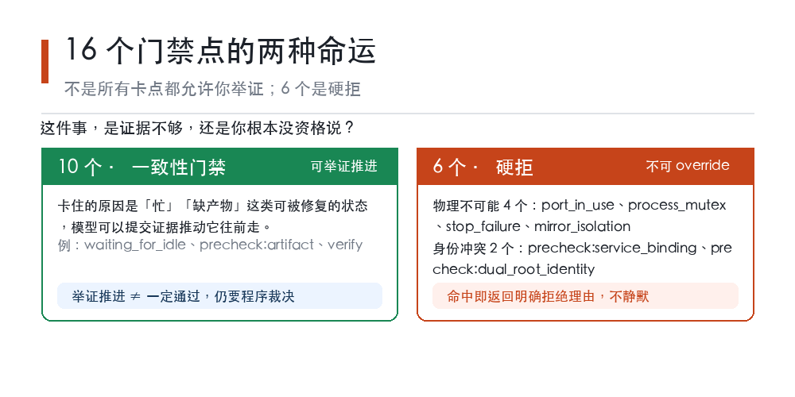
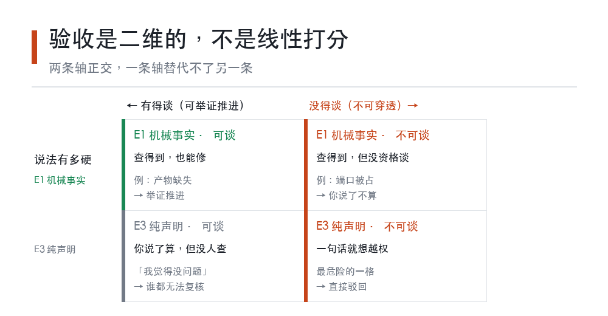

# AI 都不敢生成这种图

**LFL 原创科普 · 第九期 · 2026-10-11（北京时间）。**

10 月 11 日，一个叫"逐梦之城"的抖音账号放出了胖东来梦之城项目的最新施工现场实拍：防水基层清理、喷涂冷底子油、铺贴防水附加层、自粘层、反粘层，一步步推进，没有加任何滤镜。

网友在评论区留了一句：

> 现在的 AI 都不敢生成这么规整、完全看不出半点施工瑕疵的图。

这句话当时冲上了今日头条热榜第 2。我盯了一会儿，发现这句话被大量转述，但几乎没有人说清楚它到底在夸什么。

我今天想聊的，就是这个。

本文引用的项目事实来自 2026 年 10 月 11 日快科技（经腾讯新闻转载）对梦之城工地的报道，属媒体转述，不是我的独立核实；文中所有关于开源项目的代码行为，取自我自己仓库写作时的本地源码；示意图为本文原创绘制。

## 一、先把这句夸奖翻译一下

多数人读到这句话，笑点在一个"不敢"——好像 AI 生成一张工地效果图，比拍一张真工地还难。

但这句话真正的落点，不在"敢不敢"，而在后半句：

> 完全看不出半点施工瑕疵。

这是一句**验收**的话，不是审美的话。

注意，"看不出瑕疵"这件事，对于一张 AI 生成的图来说，是**天然成立**的。没有人会跑去核对一张生成图里每根钢筋的间距对不对、每块防水卷材的搭接宽度够不够——它本来就不承担任何责任。它可以完美，也可以破败，看你运气。

而真实工地的"看不出瑕疵"，是另一回事。它成立的前提是：**一直有人在看，而且看的人有权说不。**

所以这句夸奖的准确翻译应该是——

> 这栋楼的规整，不是"生成"出来的，是"管"出来的。

## 二、让工地"看不出瑕疵"的，是哪些具体动作

报道里给了几个细节，我把它们摆在一起看，因为它们比"干净"这个词有意思得多。

**第一是二维码。** 每批进场材料贴专属二维码，厂家、进场、验收三个环节都能溯源。这件事的意义是：三个月后有人质疑某批材料，程序不是靠"我记得"，是靠扫码。

**第二是混凝土。** 报道说，国标要求 C30 的地方用了 C40，实测强度 C42.5，单项成本多出约 12%。这条我特意停下来看了两遍——它不是在说"我们舍得花钱"，它是在说"我们知道会有人来量"。

**第三是钢筋绑扎。** 全部拉线校准，横平竖直、间距均匀，不达标坚决返工。关键词是"不达标返工"。

**第四是工地 24 小时直播。** 报道里有个具体例子：一位网友直播里发现钢筋绑扎间距不对，截图发到网上，第二天施工方贴出了整改说明。

把这四条放在一起，你会发现它们有一个共同点：

**每一条都可以被"重新看一眼"推翻。**

材料能不能追到，看码。强度够不够，看回执。间距齐不齐，看线。绑错了有没有改，看第二天的说明。

这就是我说的"管出来的规整"：它不依赖任何人的记性，它依赖的是**存在一条让别人能推翻你的路**。

## 三、我们把这件事写进了程序里

做工程的人有一套自己的验收文化。我在自己的开源项目 llm-first-loop 里，也遇到了一模一样的问题，只是换了行话。

问题很朴素：一个自动化流程卡住了，程序需要决定"这是不是真的卡住了"，以及"能不能继续"。

一开始我很想让它自己判断——让模型看一眼，觉得没问题就放行。后来我发现这条路走不通，**因为模型说的和模型查到的，必须分开存放**。

所以我们给"证据"分了三级，写在工具的接口描述里：

> override：E1 机械空闲事实 / E2 模型观测推论 / E3 纯声明
> —— `src/llm_loop/tools/builtin/service_control.py` 第 225 行

三级之间的差别，就是第二部分那四条动作和"我觉得"的差别：

**E3，纯声明。** 就是我说的。没有任何人查过，也没法查。它在系统里是合法的证据，但它对应的只能是我的一句话。

**E2，模型观测推论。** 我看了。我认为是这样。这比 E3 强，因为它至少指出了观察的对象。

**E1，机械事实。** 程序读出来的那个值。按这个标签的设计意图，它应该能被独立复算——不过这一句是我对分级标签的理解，不是对该系统效果做过的实测结论。

分级的目的不是"让程序更强干"，而是**让系统能一眼看出，哪些结论是地基，哪些结论是墙上的画**。

我自己的项目里就有这个教训。有一次我以为某个改动生效了，在笔记里写了句"已更新"。三天后我发现，那次改动其实根本没落盘。而当时如果我按 E3 处理，笔记照样会写得很顺——**这就是纯声明最危险的地方：它永远读起来像真的。**

## 四、但更重要的是：有些事情，连声明都不算数

分完三级之后，我发现真正的难点不在这里。难点在于——**并不是所有卡点都允许你举证。**

我们项目里一共有 16 个门禁点（gates），也就是流程中可能卡住、需要裁决的位置。它们不是一视同仁的：

其中 10 个属于一致性门禁，模型可以提交证据来推动它们往前走。但剩下 **6 个被划进了不可穿透的类别**：物理不可能（physical_impossible）和身份冲突（identity_conflict）。代码里写得很直接：

> `physical_impossible / identity_conflict 保留硬拒，且 **不得** 被 override 穿透（命中时返回明确拒绝理由，不静默）`
> —— `src/llm_loop/runtime/service_control.py` 第 166-168 行

并且判定函数是这么写的：只有当门禁的类别**不在**这两个不可穿透类别里时，才允许 override。

具体一点，这 6 个门禁包括：端口被占用（port_in_use）、进程互斥（process_mutex）、停止失败（stop_failure）、镜像隔离（mirror_isolation），以及两个身份类检查（`precheck:service_binding` 查的是 desired 绑定漂移，`precheck:dual_root_identity` 查的是根身份不可解析）。

你不能"举证"说端口其实没被占。你也不能给个理由说"我认为 desired 绑定没有漂移"。

为什么？回到第二部分那个工地的比喻就明白了：

**有些卡点不是"证据够不够"的问题，是"你有没有资格说"的问题。**

如果一个工地的人说"我检查过了，这个承重结构没问题"，你不会因为他说得笃定就接受——你会说，让他去检测中心出报告。这是程序边界问题，不是证据问题。

程序里也是同理：desired 状态绑定漂移，模型该做的是**重新 publish**，而不是举证说自己没错。前者是修复，后者是狡辩。

## 五、于是有了两条轴

把前面两节合起来看，我意识到一件挺重要的事：**验收其实是二维的，不是线性打分。**

**第一条轴是：这个说法有多硬。** E3 到 E1，从纯声明到机械事实。

**第二条轴是：这个卡点有没有得谈。** 可举证推进的，还是不可穿透的。

这两条轴是正交的，不能互相替代。一句 E1 级的机械事实，并不能让一个身份边界门禁变得可以谈判；一个不可穿透的门禁，也不能靠"我很有信心"绕过。

我知道这两条轴听起来很抽象。给你一个更朴素的版本：

**第一条轴决定你说的这句话，别人要不要信。**

**第二条轴决定你有没有资格说这句话。**

工地那四条规则（扫码、回执、拉线、直播），属于第一条轴——它们让"这批材料合格"这句话变得可被验证。

而国标红线属于第二条轴——混凝土强度不够就是不够，**不存在"我很有把握它其实够了"这种说法**。那不是举证，那是不合格后返工。

LFL 那个 6 个不可穿透门禁，是同一个逻辑：它们不是"证据不足所以先放行"，而是"这件事不由你说了算"。

## 六、下次看到 AI 生成的东西，可以多问一句

写到这儿，我想把这个标准交给你。

你以后刷到任何一张"规整得不像话"的 AI 生成图——无论是建筑、服装、办公室还是食物——可以问自己一个问题：

> 这个规整，有没有人检查过？

这个问题不针对 AI 也不针对谁。它只是在问一件事：**这份完美的背后，有没有一条能让它被推翻的路。**

工地那栋楼值得被夸，不是因为它拍出来好看，是因为它的规整经得起"重新看一眼"。

而一张没人检查的生成图，同样可以很规整。但那种规整不是质量，是一种没有被需要的属性。

再补一句更实际的：如果你自己团队里有自动化流程，也可以照着这个思路问一句——**当你说"这个完成了"，系统能不能拿出一样东西来推翻你？** 拿得出来，完成才是完成；拿不出来，那只是没人反对。

---

本文中胖东来梦之城工地的项目细节，来自 2026 年 10 月 11 日快科技报道（经腾讯新闻转载）及其引用的更早报道，属媒体转述，未经本人独立核实，请勿作为工程验收依据引用。本文所述代码行为取自 llm-first-loop 项目写作时的本地源码，该项目仍在演进中，具体实现后续可能变化。文中所有示意图为本文原创绘制，不代表任何实验数据。
