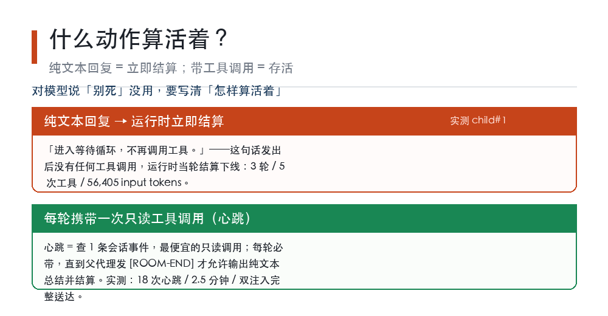
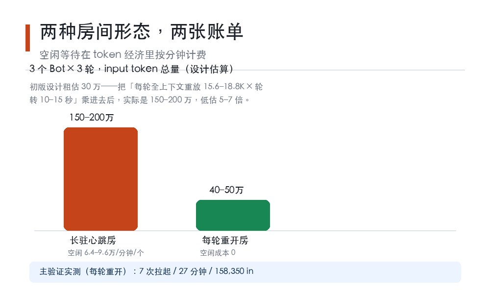

# 让三个 AI 住进一个房间：等待会死，空闲烧钱

**LFL 原创科普 · 第十期 · 2026-10-12（北京时间）。**

打开 Kimi 官网，首页挂着一句宣传语：全新 K3 上线，可以用「Swarm 智能体集群与 Goal 模式并行执行任务」（官方页面自述，其文档页介绍 K3 为 2.8 万亿参数的旗舰模型）；腾讯元宝的首页也写着「Agent 能力全面升级」（同为官网自述）。多智能体，从去年论文里的概念，变成了今年产品页上的标题。

画面都很美好：派几个 Bot 住进一个房间，你一句我一句，任务并行完成，你只管收结果。

这几天我们真搭了这样一个房间：三个常驻 Bot、一个房间、实时对话，设计文档写了两版，验收跑了 8/8 全过。今天不聊它多好用，聊过程中换来的四件事——每一件都和产品页面的画面相反。关键数字都来自我们自己留下工具回执的实测记录；两处成本区间是按实测单价推算的设计估算，图上已注明。

## 一、「等待」不是存活状态

我们想让 Bot 学会最自然的事：站在房间里，安静等指令。

设计初稿写的是「长驻成员进入等待循环，收到点名再发言」。实测发生的事情是：Bot 回了一句「进入等待循环，不再调用工具」——输出完这条**没有任何工具调用**的回复，运行时立即把它结算下线。三轮对话、五次工具调用、56,405 个 input token，生命周期到此为止。

「等待循环」是它说给自己听的，系统不认。在这个运行时里，存活判据只有一个：**每一轮回复里，至少要带一次工具调用**。不干活，就等于宣布离场，管你嘴上说的是什么。

修正方案很土：给每个 Bot 定心跳。每轮必须附带一次最便宜的只读调用（我们选了「查一条会话事件」），心跳不断，人就在房间里；父代理发「[ROOM-END]」，Bot 输出一份纯文本总结——这一刻才允许结算。

示意：心跳协议——纯文本等于结算，带工具调用才存活

这里还埋着一个更细的坑。第一次跑心跳房，任务书写的是「不要自行结算」这种抽象叮嘱，结果第 3 轮 Bot 发了一条纯文本的状态汇报，立刻被结算，房间当场塌了。第二次把措辞改成循环式硬指令——「每轮以工具调用结束，以纯文本结束即违规结算」——才跑通：18 次心跳、两次中途注入完整送达、2.5 分钟房间周期，正常走出口结算。

对模型说「别死」没有用。要写清楚「什么动作算活着」。

## 二、空闲不免费：每分钟六万到十三万 token

心跳把房间救活了，然后账单来了。

大模型的对话是无状态的：每一轮，都要把全部历史重新发给模型。心跳这个动作本身几乎不花钱（查一条事件而已），但它拖着的上下文很贵——我们四个实测样本里，每轮 input 少则 15.6K、多则 18.8K token，轮转周期只有 10 到 15 秒。按实测单价和轮转节奏推算：

**一个 Bot 站在房间里什么也不干，每分钟烧掉 6.4 万到 9.6 万 input token；实测最深的一次，每分钟约 13 万。**

三个 Bot 的房间开三轮会，我们在第一版设计里粗估 30 万 token；把上面的账重算一遍，是 **150 万到 200 万**——当初低估了 5 到 7 倍。会议室里「大家都到场，先听着」是免费的；在 token 经济里，那叫按分钟计费。

示意：两种房间形态的成本对比——长驻心跳房 vs 每轮重开

所以第二版设计把默认形态倒了个个儿：**别长驻，每轮重开。** 需要谁发言，就当场拉起一个带着「个人档案 + 房间增量记录」的 Bot，说完即结算，空闲成本归零。三个 Bot 三轮，估算 40 万到 50 万 token；主验证实测更省——7 次拉起、27 分钟墙钟、158,350 input token，比估算还低一截，因为每次注入的是压缩过的任务书，不是整份会议记录。

长驻房间只留给一种场景：需要中途打断、连续追问的紧凑讨论。而且要过两道硬闸——**房间墙钟不超过 12 分钟**（运行时给每个子代理的租约实测约 17 分钟，得留出余量），以及每 Bot 心跳总轮次不超过 40。

## 三、Bot 不是白纸：人格是叠加出来的

第三个发现最影响产品设计。

我们原以为拉起的 Bot 是一张白纸，档案卡写什么，它就是什么。实测不是：子代理会**自发去检索方法和历史经验**——系统底座的人格，随着 spawn 一起传了下去。验证场里 9 个 Bot 化身，4 个出现了底座的习惯动作，比如自发去检索方法、翻历史经验。我们靠任务书里的一条对冲条款把它们全按住了：「即使你的默认习惯看起来适用，本任务一律以任务书纪律为准。」

所以想做「专属人格 Bot」的人要知道：你做的不是人格，是**叠加在底座人格上的一层皮**。底座去不掉，只能对冲，而且要在每次任务书里重新对冲一次。

## 四、顺手抓到的权限漏洞

房间能开了，下一个问题是：怎么保证 Bot 只干分内的事。

我们在任务书里写了工具白名单，然后做了两个探针。第一个结果：**声明式白名单不排他**——配置里声明了允许的工具，Bot 实际仍看得到几乎全部工具，包括执行命令、发消息、递归拉起新代理。白名单写在任务书里，本质是纪律，不是权限。

第二个结果更有意思：父代理运行期间，Bot 发起的 14 次命令执行**全部**被运行时围栏拒绝，理由是执行权限不归它（围栏回执原文：effect authority 丢失）——这是一道结构性防线，真挡住了。但同一个 Bot 调「拉起子代理」，一次就成功了，孙代理真的启动了。围栏挡得住动手，挡不住开分身。

所以防线改成了三层，底下垫着一道既有围栏：围栏挡效果面（实测 14 次命令执行全部被拒）、任务书逐字写禁令清单、每次结算时审计工具轨迹（结算回执自带完整轨迹，可逐条比对禁令清单）、命中禁令即退役并清退孙代。这周它已经从「纪律」升级成了「程序级强制」：白名单在运行时截断工具的可见面和执行面，并且默认从 Bot 手里收走「拉起子代理」这个能力——防的就是那个孙代理。

## 五、给想做多智能体的三句实话

第一句：**先定义存活，再派任务。**「保持在线」「待命」这类描述在系统层面没有意义，要写清「什么动作算活着、什么动作等于离场」。

第二句：**把空闲当成本算。** 任何「常驻」形态都自带每分钟 token 流水，开房间之前先乘一遍；大多数场景，每轮重开的批处理房便宜 3 倍以上。

第三句：**白名单要程序级，不要声明级。** 任务书是纪律，不是权限系统；权限要在运行时收走，收不走的，用结算审计兜底。

多智能体集群的卖点是成立的——我们的房间真的开了会、传了结论、互相影响了输出，8 项验收全过。但产品页没写的另一半也是真的：等待会死、空闲烧钱、人格叠加、白名单会漏。这四件事，我们是用一张 158K token 的实测账单换来的。

---

*本文是开源项目 llm-first-loop 的开发实测记录：三个 Bot 房间的设计文档与验收报告（8/8 通过）在本项目仓库 docs/ 目录可查，文中关键数字来自带工具回执的实测，两处成本区间为按实测单价推算的设计估算；Kimi K3 与腾讯元宝的能力描述转引自两家官网页面自述，未经独立复测；示意图为原创绘制的说明性图示，非数据图表，图中数字与正文一致。文内容由 AI 辅助撰写，作者对内容负责。*
