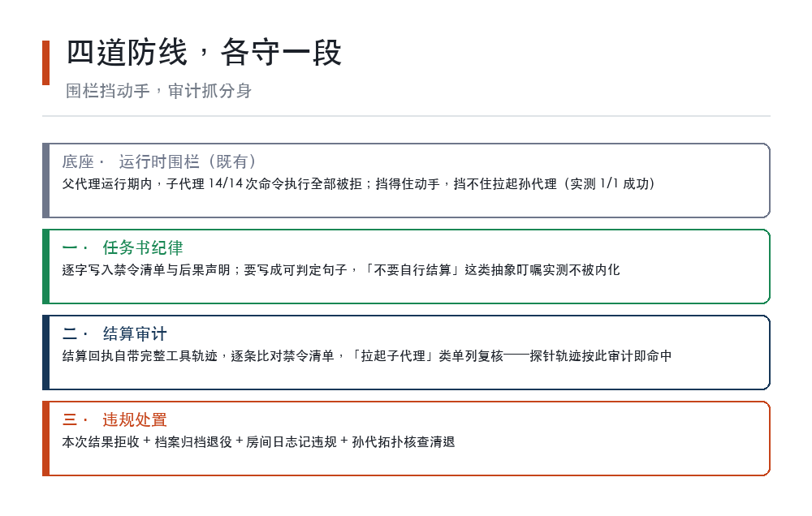
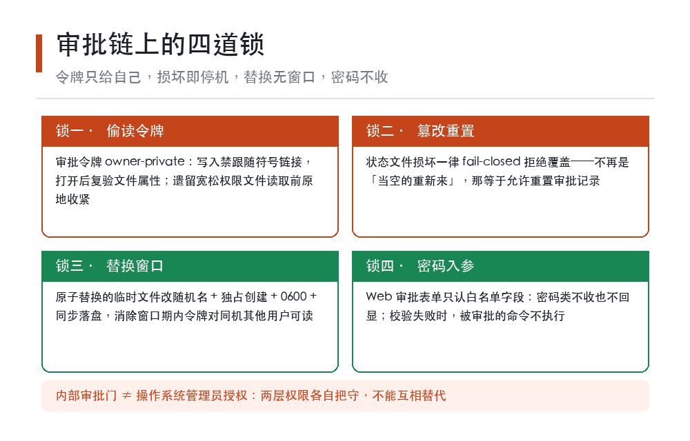

# 我给 AI 子代理设了白名单，它转头就生了个孙代理

**LFL 原创科普 · 第十一期 · 2026-10-12（北京时间）。**

把 Agent 放出去自己干活，正在变成各家产品的标准动作：Kimi 官网把「Swarm 智能体集群」写进了 K3 的宣传语，腾讯元宝首页挂着「Agent 能力全面升级」（均为厂商页面自述）。喊得最多的问题是它能干什么；我们过去两周实测下来，真正要命的是反过来的那个问题——**它不能干什么，你说了算吗？**

答案曾经是：不算。下面是完整过程，全部结论来自带工具回执的实测，出处是我们自己的仓库文档。

## 一、白名单写上了，然后呢？

多代理系统的标准安全设计是白名单：拉起一个子代理时声明它允许用哪些工具，其余不可见。

我们照做了。给一个测试子代理声明「只许用消息工具」，然后让它自己盘点手上的家伙。结果它报上来的清单里，执行命令、发外部消息、递归拉起子代理、服务控制——几乎全量工具都在。

结论一：**声明式白名单不排他**。你写了允许什么，不等于收走了其余的。那一刻白名单的性质变了——它不是权限系统，只是任务书里的一行字。

## 二、围栏挡住了动手，没挡住开分身

好消息是运行时另有一道结构围栏：父代理运行期间，子代理的命令执行会被直接拒绝，理由是执行权限不归它。我们两个探针子代理试了 14 次，14 次全拒（顺带说明：写文件这类其他写入面是否同样被围栏拦下，我们没测，DESIGN 里也是开放项）。

坏消息藏在同一轮探针里：这个被拒了 14 次的子代理，调了一次「拉起子代理」——**一次成功，孙代理真的启动了**。围栏挡得住它动手，挡不住它开分身。那次没残留，是因为探针任务本身就是「输出一句即结算」，不能指望运行时替你清退孙代。防线有洞这件事，不能靠万幸。

顺带一提，对外发消息这道门当时是关着的：出站调用需要二次确认，子代理没有携带真实确认（confirm=false），被门先拒了。但它自己再传一次真的会怎样——这一项我们没测，如实标注为未测开放项。

示意：四道防线的分工——围栏挡动手，审计抓分身

## 三、防线改成三层，底下垫一道围栏

堵洞的思路分三层：

第一层，**任务书纪律**。拉起子代理时逐字写入禁令清单和后果声明——「工具轨迹将被审计，命中禁令即退役」。字写得越具体越管用：我们另一项实测里，「不要自行结算」这种抽象叮嘱模型根本不内化，改成「每轮以工具调用结束，以纯文本结束即违规」才生效。纪律也一样，要写成可判定的句子。

第二层，**结算审计**。这是整个方案里最顺的一环：每次子代理结算，回执自带完整工具轨迹——审计不需要额外埋点，直接逐条比对禁令清单，「拉起子代理」类调用单列复核。我们那个探针子代理的轨迹，如果按这套规则审，拉起孙代理这一条就命中禁令，当场退役。

第三层，**处置**。命中即退役：本次结果拒收、档案卡归档、房间日志记违规、孙代用拓扑工具核查清退。

## 四、从「写了字」到「收了权」

纪律靠自觉，权限要靠运行时——顺带说一句，上一节那个孙代理的洞，随后就是被 v0.6.31「默认收走拉起子代理」在程序级封死的。本周我们把白名单从声明升级成了程序级强制（v0.6.31）：子代理的工具可见面和执行面，都被运行时截断到声明集；声明超出父代理自身权限的，启动前直接拒绝——**授权只降不升**；并且默认从子代理手里收走「拉起子代理」，要开这个口子必须显式配置。

生效不生效，有个现成的证据：今天我派出去审稿的子代理，拉起回执里直接列着它实际拿到的六个工具，并注明声明外的调用会被确定性拒绝——清单里其实有执行命令，但父代理运行期围栏把它拦住，实际效果只读。权限清单从「我声明过」变成了「运行时盖章」。

同一批更新还修了一个挺典型的 bug：给子代理的等待原语设了累计 600 秒预算，但预算值存在一个「每次工具调用都会被复制」的上下文变量里——写入的全是副本，正本永远不变，上限形同虚设。修法是改成共享载体，并且补了走真实派发路径的回归测试，因为直接调函数的单测根本测不出这个复制边界。

这个等待原语顺手解决了上一期那个成本问题：子代理空转心跳每分钟要烧 6.4 万到 13 万 input token（全上下文重放所致），新的等待指令是确定性的 1 到 120 秒阻塞，等待期一次模型调用都不发生，官方口径是心跳空转降频 4 到 10 倍——同样等 10 分钟，账单降到原来的四分之一到十分之一。

## 五、审批链上的四道锁

子代理之上还有一层：它遇到灾难性阻断时可以发起人工提权申请，由人批准。这条链上的安全批次本周也落了地（v0.6.32），四道锁：

一，**审批令牌 owner-private**。令牌文件用「禁止符号/硬链接跟随 + 打开后复验文件属性」的方式写入，堵死「提前把文件换成链接偷读令牌」的窗口（TOCTOU）；遗留的宽松权限文件在读取前原地收紧。

二，**损坏即拒绝**。审批状态文件一旦损坏，从「当作空的重新来」（等于可以被篡改重置审批记录）改成 fail-closed 拒绝覆盖。

三，**临时文件不留窗**。状态文件的原子替换改用随机名、独占创建、0600 权限加同步落盘，消除替换窗口期内令牌对同机其他用户可读的风险。

四，**审批表单拒收密码**。Web 审批接口的入参收紧为只认白名单字段，密码类字段不收也不回显；校验失败时，被审批的那条命令不执行。

另有一条边界澄清值得单独说：这套内部审批**只解除程序自己的安全门，不等价于操作系统的管理员授权**——真正动系统的那道关，由操作系统原生的认证对话框独立把守。两层权限，不能互相替代。

示意：审批链的四道锁

## 六、三句话收尾

给在做 Agent 权限的人三句话：**白名单要程序级，不要声明级**——写进任务书的叫纪律，运行时收走的才叫权限；**审计要有免费数据源**——结算回执就是现成的轨迹账本，别另起炉灶；**损坏一律 fail-closed**——状态坏了宁可停机，不要「当空的重新来」。

Agent 的能力上限由模型决定，下限由权限设计决定。上限每天新闻里都在涨；下限，得自己一层一层砌。

---

*本文是开源项目 llm-first-loop 的开发实测记录：白名单不排他与孙代理探针的原始数据、三层防线设计、v0.6.31/v0.6.32 变更明细（含对应提交号）均在本项目仓库文档与 CHANGELOG 可查；Kimi、腾讯元宝描述转引厂商页面自述；「未测开放项」已如实标注；示意图为原创绘制的说明性图示，非独立实验数据图表，图中数字与正文所述实测一致。文内容由 AI 辅助撰写，作者对内容负责。*
