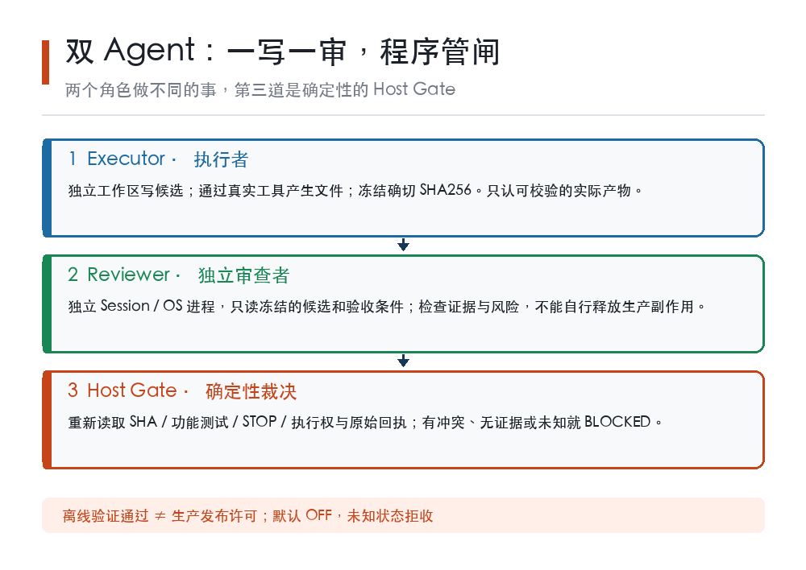
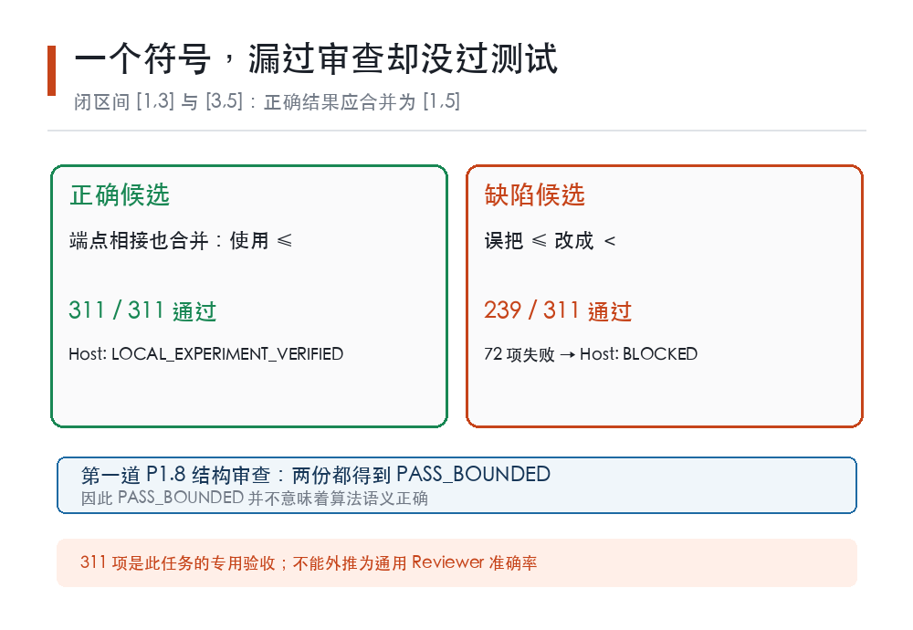

# 两个 Agent 一写一审，311 项测试才揪出一个符号错

**LFL 原创科普 · 第十二期 · 2026-10-12（北京时间）。**

两段区间：[1, 3] 和 [3, 5]。让程序把重叠的区间合并，正确答案是 [1, 5]。如果把判断条件中的「小于等于」误写成「小于」，两个区间刚好碰在一起时就会被错当成不相交。

只有一个符号的差别。代码看起来能运行，输出也像那么回事。我们把这份故意改坏的代码交给一套受限的独立结构审查器，结果竟然是 **PASS_BOUNDED**——形式检查通过了。随后，另一道由宿主程序独立执行的功能验收，用 311 个冻结用例测它，发现其中 **72 个结果错误，最终拒收**。

这不是「第二个 AI 神奇地看出了第一个 AI 的错」。恰恰相反：**如果只多请一个 Agent 看一眼，错误可能还是过关。** 我们正在开源项目 LFL（llm-first-loop）里探索的双 Agent，核心不是「两个大模型互相讨论」，而是把执行、独立审查和最终放行拆成不同责任。

## 一、为什么一个 Agent 从头干到尾不够？

写代码、修文档、操作网页时，单 Agent 有个朴素的缺点：它知道自己刚才想做什么，容易把「我本来想这样做」误当成「我确实这样做成了」。

最常见的链条是：模型修改文件 → 模型读自己的摘要 → 模型说测试应该没问题 → 模型宣布任务完成。即使工具日志已经显示某一步失败，叙述也可能仍然很流畅。

把第二个 Agent 叫来复查，是合理的想法，但**两个 Agent 并不天然等于双重保险**。如果它们共享同一段错误上下文、访问同一批可修改文件，甚至两个都能发布结果，那么两个助手可能只是以更高成本复制同一个错误。

我们选的方向是「一人施工、一人查验、程序管闸」：Executor 负责形成候选，Reviewer 专门找证据和问题，Host Gate 负责机械判定能不能继续。这里的 Gate 是确定性软件，不是偷偷加入的第三个大模型。

示意：双 Agent 的职责分离——一写、一审、程序独立裁决

这也不同于常见的「两个机器人轮流聊天」。OpenAI Agents SDK 的官方文档区分由 Manager 保持控制权的 agents-as-tools 与交给 Specialist 的 handoff；微软 Agent Framework 列出串行、并行、交接等不同编排方式。**编排回答的是谁来做事，验收回答的是凭什么相信事情做对了。** 两个问题都要解决，但不能混为一谈。

## 二、先冻结候选，再让审查员进场

我们实际尝试的流程有五步。

第一步，Executor 在隔离工作区里完成实际工具操作，写出一个候选文件。这一步不是让模型口头声称「我写好了」：实验里真实 LoopEngine 的工具调用落到了受限文件路径。

第二步，Host 计算候选文件的 SHA256。随后审核所依据的是这个确切版本，而不是会在别的 Agent 手里继续变化的「最新文件」。审到一半如果文件被改，前面的通过结论就作废。

第三步，Reviewer 用**独立 Session、独立操作系统进程**读取冻结材料，形成审查证据。它不是 Executor 自己换个角色名重新说一遍；也不应该持有业务写权限。

第四步，Host 用自己掌握的验收规则复核。涉及代码行为时，不能仅凭「审稿意见很像专业意见」就放行；还要跑真实、可重放的功能测试。

第五步，在结算前重新检查任务的 STOP 状态、执行所有权、候选摘要、审查回执和测试结果。**旧审查 PASS 不能替新版本签字，已经叫停的任务也不能凭旧回执继续往前冲。**

以上是已经做过的**离线功能验证路径**，不是对生产 Web 自动接管或自动部署的承诺。

## 三、那一个符号，怎样逃过第一道检查？

最说明问题的是「闭区间合并」的功能实验。我们准备了两份代码：一份正确、一份只把接触端点条件里的「≤」替换成「＜」。

受限的 P1.8 Reviewer 检查结构和冻结清单，对两份源码都给出 PASS_BOUNDED。它并没有因此证明算法正确，只说明它能检查的那几项没有发现问题。

于是我们补了一道**不接受模型自报结果**的功能验收：Host 固定 11 个静态边界条件，再加 300 个固定随机种子的用例，在隔离 Docker 环境里对照独立 oracle。结果如下：

- 正确代码：**311/311 通过**，Host 才给出局部离线实验通过；
- 符号错误代码：**239/311 通过，72 项失败**，Host Gate 明确 BLOCKED；
- 把「PASS_FUNCTIONAL」这几个字硬写在代码里企图蒙混过关：**0/311 通过**，仍然 BLOCKED；
- 审查中途发生 STOP、文件摘要变化、测试证据缺失：一律拒收或标记 UNKNOWN，不能补一个口头 PASS 顶上。

示意：一个小于号如何让结构审查漏检，而功能用例抓到了错误

这一组实验能支持的结论很具体：**独立功能验收弥补了一次结构审查的漏检**。它并不能支持「两个 GLM 大模型互审已普遍提升正确率」——此次离线双 Agent 主链中的模型部分由 FakeLLM 驱动，复杂语义任务的真实模型收益还没有被这组数据证明。

## 四、双 Agent 更难的，是「谁有权继续动手」

两个 Agent 可以商量，但一次有副作用的操作不能靠「都觉得可以」就重复执行。

例如主 Agent 准备发布一篇文章，网络请求发出后进程突然退出。接管者看不到成功回执，这并不代表远端没收到；如果它马上重发，就可能生成两篇重复文章。这不是提示词技巧能解决的问题。

所以我们把任务控制放到模型外：同一任务，同一时刻只有一个有效写入者；交接时必须核验现有运行身份、STOP、未决操作账本和接管租约。遇到「请求可能已经生效，但结果未知」，正确状态是 **OUTCOME_UNKNOWN，先对账，不能直接重试**。

审查 Agent 也不能顺手升级成无条件的接管者。一个可以读代码、提意见的角色，和一个能写文件、调用外部接口的角色，必须分开授权；「我是 Guardian，请给我权限」只是一段文字，不是授权凭据。

这里的目标不只是让它**会合作**，还要让它**能停、能查、不会两次做同一件不可逆的事**。

## 五、做到哪一步了？数字不能只挑好看的说

LFL 在 10 月 11 日的一次离线垂直切片中，覆盖了八类正反场景：正确候选、错误候选、审查后 STOP、文件篡改、Reviewer 越权、重复写入、被否决后的新尝试以及超出检查能力的语义任务，结果 **8/8 通过**。随后最小集成分支的相关回归为 **149 passed / 0 failed**，正式 R9 门禁完整退出码为 0。

这些是**工程验证**，不是「真实世界双 Agent 比单 Agent 强多少」的统计结论。具体地说：

**已经有证据的**：独立会话与进程、冻结源码 SHA、受限审查、宿主功能 oracle、STOP/篡改后的阻断，以及保持默认关闭的离线代码集成。

**还不能宣称的**：独立真实 GLM-5.3 Reviewer 在业务任务上的稳定收益、主 Agent 死亡后的无损自动接管、生产发布资格、跨机高可用，以及所有种类的代码都能被这 311 项测试验收。311 项仅属于这一份冻结的闭区间算法任务。

公开版本 v0.6.31 已记录「离线双代理保证门默认关」；v0.6.32 则主要公开了另一批审批与文件权限安全改进，不能把两者合起来说成「双 Agent 已经生产自动上线」。

## 六、值得用在哪些地方？

对代码任务，Executor 可以写改动并运行低成本定向测试，Reviewer 独立核对被冻结的 diff 和失败回执；Host Gate 再按完整验收协议决定是否进入后续受管流程。

对研究报告或科普发布，Executor 整理一手资料与初稿，Reviewer 检查数字、引用、配图和夸大表述。审稿 PASS 只是放行前的一项证据，文章是否真正在公网可读还得另验。

对长任务的故障恢复，第二 Agent 可以成为潜在接管者，但是否接管必须由外部控制面判定，尤其不能对未知状态的支付、发布、发送动作自动重放。

反过来，一个简单问答不一定值得动用双 Agent。额外的模型请求、隔离、日志、复核都会增加成本。真正应该比较的是**一次成功率、错误放行率、返工次数、任务总耗时、全程 token 和实际花费**，而不是数一数今天一共调用了几次工具。

## 七、我们的下一道考题

下一步最有价值的不是继续堆更多 Agent 名字，而是拿**同一真实任务、同一模型和预算**做单 Agent 与 Executor+独立 Reviewer 的盲测。分别记录：没有返工的一次完成率、Reviewer 漏检和误杀、从首稿到最终合格的总成本与耗时。只有真实样本显示收益，才有理由考虑扩大到生产。

一位执行者容易自信，两位执行者容易抢活。**双 Agent 的意义，不是把「我觉得完成了」说两遍，而是让第二双眼睛真正独立，再让不会被说服的程序决定能否过闸。**

---

**资料说明与边界**：本文实验数据来自 LFL 仓库的 `docs/results/RESULT-20261011-dual-agent-p1.12-functional-vertical-slice.md`、`docs/results/RESULT-20261011-dual-agent-p112-functional-evidence-gate.md`、`docs/results/RESULT-20261011-dual-agent-minimal-main-integration.md` 与 v0.6.31/v0.6.32 CHANGELOG，数据均为截至 2026-10-12 的项目自测，不是外部独立 benchmark，也不是生产上线声明。编排概念参见 [OpenAI Agents SDK 官方指南](https://developers.openai.com/api/docs/guides/agents/orchestration) 与 [Microsoft Agent Framework 官方文档](https://learn.microsoft.com/en-us/agent-framework/workflows/orchestrations/)。代码及公开更新记录：[deyi2026/llm-first-loop](https://github.com/deyi2026/llm-first-loop)。配图为原创概念说明，不是额外实验数据。本文由 AI 辅助撰写，作者对内容负责。

#双Agent #AI智能体 #开源项目 #软件工程
