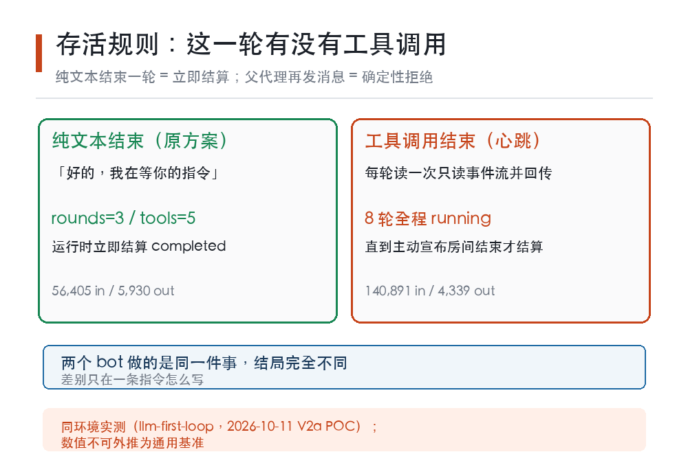

# 让 AI 别再「等等看」：一条把机器人从聊天气泡里拽出来的心跳指令

> **本文所有数据均来自本仓库可核验的实测记录，标注了文件与行号出处；测量环境是一个具体工程系统，不是通用基准，请按你自己环境复测后使用。**

去年用大模型的人都有过这个时刻：你让一个机器人助手「先去调研，等我的指令再动手」，它回一句「好的，我在等你的指令」——然后就结束了。不是它偷懒，是**它一停下工具调用，进程就结算了**。

听起来像玄学，但这是被实测钉死的确定性行为：一个只输出纯文本、不带任何工具调用的子代理，运行时立刻判定它已完成。所谓「空手等待」在工程上根本不是一个存活状态。

我们把这条坑摸清了，还顺手量出它的价码：**每轮空转约烧掉 13 万 input tokens/分钟**。今天这篇文章，讲的就是怎么用一条「心跳指令」把机器人从聊天气泡里拽出来，变成能持续接活的协作者——以及这条指令什么时候不值得用。

## 一、先说清楚：机器人的「存活」和你以为的不一样

很多人对 AI 机器人的心理模型是「它在那边待命，随时可以叫」。真实语义要苛刻得多。

在 llm-first-loop 这个系统里，一个子代理（bot）的存活判定只看一件事：**这一轮有没有发生工具调用**。只要有，它就 running，父代理随时能往里递消息；如果没有，它这一轮结束就 completed，之后再发消息会被确定性拒绝——不是排队，是拒绝。

这意味着「让 bot 等一会儿」这句话，翻译成工程语言是无效指令。你要它活着，就必须让它在每一轮都做点什么，哪怕是件只读的小事。

我们最初的房间协议就是这么设计的：让子代理「进入等待循环，不要调用工具，等我下一步指示」。实测结果——子代理确实回了 ECHO，然后运行时立即结算它，rounds=3, tools=5, 总共烧掉 56,405 input / 5,930 output tokens。结算后我们再发消息，收到的是确定性拒绝。

同一个实验，另一个 bot 改成每轮都带一次只读工具调用（读事件流当心跳），同样等到我们发指令：8 轮，140,891 in / 4,339 out，全程 running，直到我们主动宣布房间结束才结算。

两个 bot 干的是同一件事，结局完全不同。差别只在一条指令怎么写。

## 二、那条指令：每轮以工具调用结束，以纯文本结束=违规结算

修正后的心跳协议，措辞必须具体到能被机器执行。抽象说法无效——我们试过「不要自行结算」，化身在第三轮就用一句状态文本把它破了。

真正管用的表述是循环协议式的：

> 每一轮必须以一次只读工具调用结束；如果你用纯文本结束这一轮，等同于违规结算，房间失败。

配上具体动作：每轮读一次事件流（`event_stream`，最便宜的只读心跳工具），把当前房间序号回传成 `ECHO seq=N`，然后继续等。父代理那边按固定节奏轮询（25–30 秒一次），消息会在下一个 step boundary 送达。

这套机制跑通后的实测参数，全部来自 2026-10-12 的 3-bot 房间实测报告：

| 指标 | 实测值 | 出处 |
|---|---|---|
| 消息端到端时延 | 10–40 秒（下一 step boundary 消费，受父轮询节奏约束） | `docs/poc/POC-20261012-v2-gate.md` §三 |
| 单轮注入时延 | 10–40 秒，由父轮询节奏 + 子代理心跳间隔共同决定 | `docs/poc/POC-20261011-v2a-room-protocol.md` C7 |
| 心跳空转成本 | 约 130K input/分钟 | `docs/poc/POC-20261012-v2-gate.md` §三（#5 房 2.5 分钟 / 323K） |
| 心跳每轮成本 | 约 17.6K input（≈全上下文重放） | `docs/poc/POC-20261011-v2a-room-protocol.md` C6 |
| 单个 3-bot×3 轮房间 | bot 侧约 30 万级 input tokens（不含父代理编排侧） | 同上 C6 |

看到那个 130K/分钟了吗？**这是这条协议的价码，也是它的使用边界。**一个机器人在房间里空转一分钟，烧掉的上下文约等于重放它全部历史一遍——因为心跳工具调用确实会把整个上下文重新送进模型。

所以我们的默认决策是：**任务型房间用「回合制」（每轮有实质产出再轮换），不要用心跳房**。心跳房只留给一种场景——你需要机器人在两次指令之间保持可寻址，且这个间隔本身有价值（比如人工观察、外部事件等待）。

## 三、比指令更硬的两条边界

写对指令只解决了三分之一。真正让多机器人协作可用的，是另外两条从失败里换来的认知。

**第一条：别指望工具白名单能管住机器人。** 设计文档里原本写了一条「最小权限」要求：给调研员 bot 只开读工具，不给它执行命令的能力。实测直接证伪——`requires.tools` 不是排他白名单，子代理上下文里几乎能看到全量工具，包括 spawn_subagent、service_control、发飞书、execute_command、提权申请。

这条发现的意义很实际：**如果你的安全模型建立在「这个 bot 物理上碰不到危险工具」之上，它现在是漏的。**当前的约束只是任务文本层面的纪律，不是机制层的强制。要上生产，得自己在网关层做拦截，不能指望 spawn 参数。

**第二条：结算之后的机器人救不回来。** 一个常见设计思路是「让 bot 干完活先退场，有需要再叫回来」。实测：向已结算的 bot 发消息，是确定性拒绝（相邻边存活校验），不是「排队等派工」。唯一续命手段是 `agent_followup`——而它有硬配额：每个 bot 最多续 2 次，父会话 15 分钟窗口内累计 4 次。我们那次实测，一个房间跑完，父会话的 followup 配额已经是 19/4，跨 bot 累计耗尽。

翻译成人话：**「先退场再召回」在多机器人协作里不可作为主通道。**要么让它在房间里活着（心跳），要么把任务设计成一次成型。

## 四、什么时候值得用心跳，什么时候不值得

把上面三条摊开，使用场景其实分得很清楚。

**值得用心跳房的场景：**外部事件驱动、人工观察窗口、需要机器人在指令间隙保持上下文连续性。典型如「三个人类观察员轮流看同一批机器人的讨论，随时插话」——我们的心跳房实测跑了 18 次心跳 + 双注入，全程可寻址，2.5 分钟收尾，出口正常。

**不值得的场景：**任务型协作。我们自己的双 Agent「一写一审」跑的就是回合制，父代理按依赖推进，每轮有实质产出才轮换，跑下来单轮 0.5–1.5 分钟（轻任务）到 8.5 分钟（修订类重任务），成本可控。这个场景塞心跳房进去，等于每分钟白付 13 万 tokens。

**不要用的场景：**任何把「机器人能随时被叫回来」当作架构前提的设计。它不能。要么活着，要么重新 spawn。

## 五、一条可以照抄的检查清单

如果你要搭多机器人协作，按这个顺序核：

1. **先问「这个 bot 需要跨越指令间隙存活吗」**。答案是「需要」才继续，否则回合制 + 重新 spawn 更便宜。
2. **写指令时用循环协议措辞，不要用抽象禁令**。「每轮以工具调用结束，以纯文本结束=违规结算」有效；「不要自行结算」无效。
3. **给主持人的任务书写死输出字数上限**。子代理的 output 有 16,000 tokens 硬顶，长结构化输出（评审员一次吐五条意见那种）会触顶截断。我们实测撞上了，补救手段是同成员轮内第二次 spawn（补遗发言）。
4. **权限控制在网关层做，不要在 spawn 参数里指望**。
5. **唤醒其他 bot 用 stable ref 精确寻址，不要用语义搜索**。实测语义检索在同族档案卡之间会互相挤压——查谱系 0/3 精确命中，错卡 3/3 置顶。
6. **成本按 17.6K input/轮×机器人数×轮数预估**，再决定规模。

## 六、这件事真正的教训

回头看，最有价值的其实不是心跳协议本身，而是它暴露的一个普遍问题：**我们描述机器人行为时用的自然语言，和它真实的运行时语义之间，存在一道需要实测才能填平的沟。**

「等待」「待命」「随时可以叫」这些词，在人类协作里语义明确，在运行时里要么不存在，要么和我们想的不一样。填平这道沟没有捷径，只能一轮一轮试，把「原方案证伪」的条目记下来，换成有实测背书的表述。

我们这份记录里，证伪的条目比成立的还多：等待型 child 证伪、结算后寻址证伪、工具白名单证伪、抽象禁令证伪。每一条都是原本听起来很合理的设计。

**如果你的机器人昨天干了件让你意外的事，先别急着改 prompt——去查它那一轮有没有工具调用。**

---

*本文所有结论来自仓库内可核验实测记录，测量环境为 llm-first-loop v0.6.32 单仓库系统，机器人规模 3 个，测量时间 2026-10-11 至 2026-10-12。成本与时延数值为该环境实测，不可外推为通用基准。*

*本文由 AI 辅助生成，内容基于真实工程实测记录，未经人工事实核验，仅供参考。*
