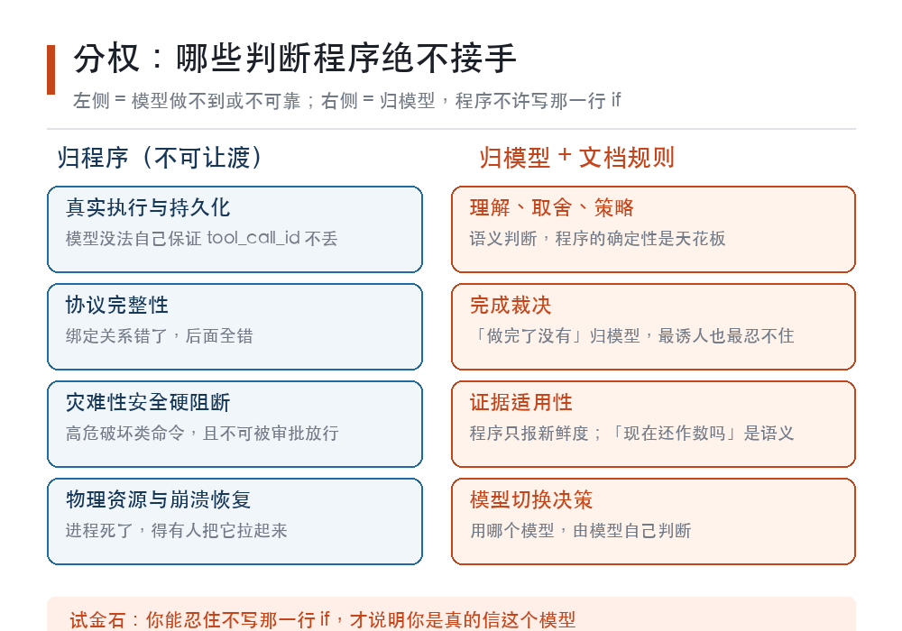
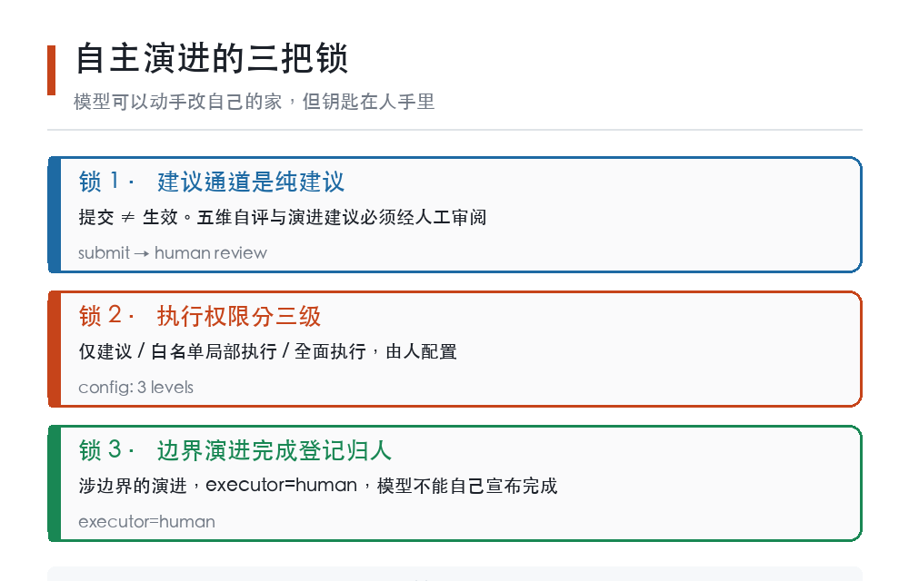

# 把程序从大脑降级为手脚：Agent 运行时的反直觉赌注

> 它写了十七万行代码，只为证明一件事——**框架最大的价值，是不替 AI 做决定。**

---

## 开场：一个让工程师难受的设计

如果你要造一个 AI Agent，第一反应大概是：

- 写一套状态机，把流程框死；
- 给每一步加校验，确保模型不跑偏；
- 模型输出不合规就重试，重试不行就降级；
- 最后再加一层"兜底逻辑"，保证系统永远不会崩。

这是主流做法。稳、可控、能上线。

有一个项目反着来。它叫 **LFL（LLM-First Core Loop）**，Apache-2.0 开源，当前版本 v0.6.32。

它的核心主张只有一句话：

> **程序是 AI 的感官和手脚，不是 AI 的大脑。**

翻译成工程语言就是：**凡是模型能自己判断的事，程序就别插手**（README 的原话是"尽量不用程序"——是尽量，不是绝不）。

这句话听起来像口号。但它背后有一整套被强制执行的设计，而且——这是最反直觉的部分——从 2026 年 8 月 10 日建库到现在，两个月出头、2771 次提交，它已经长到了十七万行。

一个"程序要最小化"的项目，为什么会有十七万行代码？

这个问题，是理解整个 Agent 赛道下一阶段的关键。

---

## 一、先说清楚：LFL 不是什么

三个最常见的误解，先拆掉。

**误解 1：它是又一个 Agent 框架。**
不完全是。LangGraph 是编排库，控制流显式写在图里；OpenHands 是产品化的软件工程 Agent 平台；Letta 把记忆当成操作系统内核。LFL 是**运行时（Harness）**——它不规定你怎么做任务，它规定"模型、程序、人"三者怎么分权。（这三家的定位取自项目 2026-09-07 审计报告的外部取证快照，该报告自己声明过外部条目未逐项重抓官方来源。）

**误解 2：程序最小化 = 功能少。**
恰恰相反。它的代码量远超同类极简 harness（社区里有 1 万行级别的"最小实现"标杆）。区别在于代码**花在哪儿**——不花在替模型做判断上，花在执行、持久化、协议、安全和可恢复性上。

**误解 3：AI 自主演进 = 无人监管。**
这是最危险的一个。LFL 的演进闭环里，**审批权在人手里，且不可下放**。后面第五节细说。

---

## 二、五步循环：一个 Agent 的"最小真相"

LFL 的架构核心被压缩成五个字：

**消息进 → 理解 → 行动 → 真诚回答 → 记住**

注意第三步和第四步之间的那个词：**真诚**。

这不是修辞。它是一条工程纪律，具体表现为：

- 工具调用成功、失败、异常，结果都**原样透传**，带 `[状态: xxx]` 标注；
- **绝不静默降级**。模型看到的是"这个工具挂了，原因如下"，而不是"好的，已处理"；
- 程序组件故障 → 如实报 `[程序异常]` → **循环继续**，不中断模型的发挥。

为什么这条如此重要？

因为 Agent 最隐蔽的失败模式，不是报错，是**被善意地骗了**。当框架为了"体验流畅"把失败包装成成功，模型就失去了修正的机会——它会在错误的地基上继续推理十步，输出一个看起来很自信的答案。

诚实反馈不是道德姿态，是**纠错链路的输入端**。

---

## 三、反直觉的核心：程序越"笨"，Agent 越聪明

这是 LFL 最值得被讨论的部分。

**先说清楚**：本节是作者对这套设计的因果解读。项目官方文档只保证"哪些归程序、哪些归模型"这张分工表，不背书"程序越少、Agent 越强"这个因果结论。

### 3.1 一条硬规矩：判断权不移交

LFL 把职责切成两半，切得很硬：

| 归程序（不可让渡） | 归模型 + 文档规则 |
|---|---|
| 真实执行与持久化 | 理解、取舍、策略 |
| 协议完整性（如 tool_call_id 绑定） | 语义判断 |
| 灾难性安全硬阻断 | 完成裁决 |
| 物理资源与崩溃恢复 | 自主修正 |
| 不可重复副作用的边界 | 模型切换决策 |

注意左侧那一列的性质：**它们都是模型"做不到"或"不可靠"的事**，不是"做不好"的事。模型没法自己保证 tool_call_id 不丢，没法自己防住 `rm -rf /`。

而右侧——包括"这件事做完了没有"这种终极判断——归模型。

绝大多数框架在这里会忍不住。因为"让程序来判断任务是否完成"太诱人了：可测试、可回归、可交付。

LFL 的立场是：**一旦程序开始判断语义，你就把最贵的算力替换成了最便宜的确定性**。省下的那点延迟，换来的是天花板。

### 3.2 一个具体例子：证据的"适用性"不归程序判

LFL 有一套证据系统（EvidenceRef）。一条证据被检索出来时，程序会如实告诉你：来源版本是最新的。

但它**不会**告诉你：这条证据对当前任务是否适用。

这是刻意留白。程序只有"新鲜度"（source currentness）这类机械事实的判断权；"这条两小时前的证据现在还作数吗"是语义判断，归模型。

看似是个小设计，实际是分权哲学的试金石——**你能忍住不写那一行 `if`，才说明你是真的信这个模型。**

### 3.3 十七万行代码花在哪了

既然不替模型做判断，那这十七万行在干什么？（口径说明：2026-09-07 本地审计快照记为约 7.5 万行，`src/llm_loop` 26 个子包 + 460 个测试文件；2026-10-13 20:40 实测 `src/llm_loop` 为 169,911 行、tests 196,403 行——一个月翻了一倍多，这个增速本身就是第七节"内核最小性审查"要解决的问题。）

答案是：**全花在"模型做不到"和"人必须在场"的地方。**

- **事件溯源单一真相源**：每次会话是一条 append-only 事件日志，可回放、可对账、可回滚。会话还能 fork——物理复制继承，源会话逐字节不变。
- **灾难性安全硬阻断**：`$VAR`/`~` 展开 + 复合命令切分 + `sh -c` 载荷递归检查，拦 `rm -rf`、mkfs、dd 写块设备、fork bomb、curl 管道执行。全量阻断审计落盘。（项目自述这不是完备沙箱，更强隔离靠 EXEC_MODE 分级与系统级沙箱。）
- **SSRF 内网拦截**：不只是拦 IP 字面量，还逐跳校验重定向（公网 URL 302 到内网也不放过），curl 通道用 `--resolve` 钉住已校验 IP 防 DNS rebinding（域名解析完再被改指内网）。
- **三端接入**（CLI / Web / 飞书桥）与**浏览器 CDP 感知操作**：读操作与写操作分离，写操作单派发，程序不做模糊匹配、不自动重试、不判断完成。
- **人工审批流与审计**：审批记录落盘可查；唯一不让渡的硬边界是不可逆删除与系统破坏，其余风险一律走带审计的反馈闭环（`data/audit/safety_blocks.jsonl`）。



看明白了吗？代码量不是"程序在做判断"的证据，而是**"把判断权交给模型"这件事本身很贵**的证据。

你想让模型自由发挥，就得给它配上可恢复的历史、可追责的审计、防住不可挽回的操作、以及一个随时能查运行时状态的自省通道。

**自由是有基础设施成本的。这十七万行，就是自由的账单。**

---

## 四、它敢让自己改自己

LFL 有一个多数框架不敢做的机制：**自主演进闭环**。

流程是这样的：

```
自我评估 → 演进建议 → 人工审阅 → 分级执行 → 全链路审计
```

模型可以主动发起五维自评（成功率 / 工具效率 / 诚实性 / 停滞率 / 异常率），可以提交架构演进建议，也可以在审阅通过后自主执行修改、验证、回滚。

但有三条锁：

1. **建议通道是纯建议**——提交不等于生效，必须经人工审阅；
2. **执行权限分三级**（仅建议 / 白名单局部执行 / 全面执行），由人配置；
3. **涉边界的演进，完成登记必须由人执行**（`executor=human`）。

第 3 条是关键。它意味着：**模型可以动手改自己的家，但搬家完成这件事，钥匙在人手里。**



还有一个细节体现了这套设计的成熟度：验证结论如果是"未验证"，就如实标注 `unverified`，不允许用"看起来成功"充数。

---

## 五、诚实的边界：92.1% 后面的那个括弧

LFL 用 SWE-bench 官方判定跑过实验，项目自报口径是：**114 个实例、9 个批次，resolved 92.1%**（"resolved"＝被判为已解决的实例占比；该报告的批次明细合计与合计行对不上，读者可在引用文件里自行核对，本文不对这个数字背书）。

但真正值得看的不是这个数字，是它后面跟着的括弧——项目自己写明的：

- 这是 **114 / 500**，不是全量；
- **重度依赖的仓库没跑**；
- 报告里已自声明这些限制。

在一个人人都在刷榜的赛道里，主动给自己的数字加限定条件，是一件违反本能的事。

但这也正是"诚实反馈"这条纪律从模型层传导到项目层的结果：**如果一个框架要求模型如实报告失败，它自己就不能对外粉饰成功率。**

行业里把这类能力叫 trust engineering（信任工程）。我认为它会成为下一阶段的核心竞争维度，理由在下一节。

---

## 六、未来趋势判断

以下是我的判断，不是项目官方宣言，标注为推测，供你对照检验。

**判断 1：竞争焦点从"功能堆叠"转向"信任工程"。**
当各家 Agent 都能调工具、都能写代码、都能开浏览器，差异化就落到了：历史能不能回放？证据能不能溯源？出错能不能定位到具体那一步？**可审计性会从"加分项"变成"入场券"。**

**判断 2：稀缺资源从"上下文长度"变成"注意力"。**
长上下文窗口会继续变便宜。真正的瓶颈是：模型在 20 万 token 里该看哪 2000 个。因此**"证据选择权归模型、程序只提供机械事实"这类分权设计会被更多框架采纳**——把相关性判断写进程序，就是在用确定性换天花板。

**判断 3：多 Agent 的战场从"并行数量"转向"身份与所有权"。**
现在大家比"能同时开几个子 Agent"。真正的难题在后面：进程重启后，父子映射、邮箱、待办句柄、执行权归谁？**双执行（两个 worker 干同一件事）会成为规模化多 Agent 的头号事故类型。**

**判断 4：自主演进会从"演示功能"变成"制度化流程"。**
让 AI 改自己的代码，两年内会从噱头变成标准配置。但审批权不会下放——**"AI 提议 + 人拍板 + 全链路留痕"会成为事实标准**，因为这是唯一能同时满足效率与合规的形态。

**判断 5：评测的诚实度会变成可交易的资产。**
随着 Agent 进入生产，"你的 92% 是怎么测的"会比"你有多少个集成"更重要。**主动公开样本构成与未覆盖部分的团队，会在长期赢得不成比例的信任。**

**判断 6：执行边界（沙箱）会成为标配而非选配。**
本地 / 容器 / 远程 × 文件系统 / 网络 / 凭据 / 部署权限，这个矩阵会被显式建模。现在"工具各自承载一部分权限语义"的散装状态不可持续。

**判断 7：记忆整理会补上，但不会以牺牲可审计性为代价。**
后台自动巩固（类似 sleep-time agent）确实有价值。但它产生的记忆**必须带来源、版本、可回滚**，且不能自动获得当前指令的权威——历史可恢复，但历史不会自动成为当下的授权。

---

## 七、需要攻克的技术方向

这一节不是我编的，来自 LFL 2026-09-07 的审计报告（本地实证 + 官方文档取证）。它把后续路线定成一条**严格串行**的线索——注意"串行"这两个字本身就是结论：**不允许并行扩功能。**

本节这张表的优先级对应审计报告"四、风险与行动项"的 P0/P1/P2；第 1、2 行取自同报告"五、下一阶段路线"，原文只给了串行次序、没有标优先级，带 * 的 `P0*` 是我按"continuity 概念重叠"归并出来的读法。原报告"明确不做"共 6 条，这里摘 3 条。

| # | 方向 | 要解决的真问题 | 优先级 |
|---|---|---|---|
| 1 | **Continuity Kernel（连续性内核）** | 收据、选择性证据、工作态检查点、截断恢复、跨会话交接等多种机制并存，概念重叠。需收敛出统一的 owner、生命周期、失效条件与恢复路径 | P0 |
| 2 | **确定性连续性矩阵** | 覆盖原始历史 / 收据 / 截断 / 重启 / 过期检查点 / 人工后到 / 工具失败重试配对等多机制的优先级。**正确性优先，不拿缓存命中率当正确性门** | P0* |
| 3 | **Durable SubAgent Topology Recovery** | 子会话能持久化了，但进程重启后的父子拓扑、邮箱、待办句柄、执行归属仍是进程内状态。需用 owner generation / lease 防双执行 | P1 |
| 4 | **评测外推补齐** | 补跑 django 等重依赖仓库批次（sympy 已跑 75 个实例子集），公开样本构成 | P1 |
| 5 | **Execution Workspace / Capability Boundary** | 统一 local / container / remote 与 fs / network / credential / deployment 的能力边界 | P2 |
| 6 | **Memory Maintenance** | 后台记忆整理只以"带来源标注 / 版本 / 可回滚的记忆改动建议"形态存在，不自动注入 prompt | P2 |
| 7 | **内核最小性审查** | 快照 7.5 万行、今日实测 17 万行 vs 同赛道 1 万行级最小实现——需周期性审查，防止框架膨胀反噬哲学 | P2 |
| 8 | **凭据卫生** | 本地明文备份 sprawl 风险（审计报告列为 P0-hygiene） | P0 |

配套还有三条"明确不做"，我觉得比"要做"更有信息量：

- **不强迫采用某个机制**——任何能力升级都必须由真实 Agent 采用率与最终保真度证据支持，不能靠强制字段或提示压迫；
- **不新增第二套状态表示**——状态机制只收敛不增殖；
- **不让程序判断证据的相关性 / 重要性 / 充分性 / 任务适用性。**

最后一条再次回到那句话：**你能忍住不写那一行 `if`，才说明你是真的信这个模型。**

---

## 八、现在该怎么看它

如果你是开发者，LFL 值得看的原因不是"又一个能用的框架"，而是它提供了一份**分权实验的完整记录**：哪些判断交出去效果好，哪些硬边界必须留，交出去之后要付出什么代价。

如果你在做 Agent 产品，最该带走的一条是：**诚实反馈不是成本，是纠错链路的输入端。** 你为了"体验流畅"藏起来的每一次失败，都会在十步之后变成一次更贵的错误。

如果你只是关心 AI 会怎么演化：LFL 押注的是——**Agent 的上限由模型决定，框架的任务是别成为瓶颈，并且在旁边把护栏和黑匣子装好。**

这个赌注对不对，取决于一件事：模型的判断力，会不会继续涨。

如果会，那"程序最小化"就是唯一正确的方向，而且越早越对。
如果不会，那所有 Agent 框架都会被重写一遍，把判断权收回来。

我的判断是前者。但这是判断，不是事实——**把这句话留给两年后的你检验。**

---

*项目：LLM-First Core Loop（LFL）｜ License: Apache-2.0 ｜ 版本 v0.6.32 ｜ Python ≥ 3.13*
*本文事实依据：项目 README、docs/analysis/AUDIT-20260907-lfl-vs-peers.md（本地实证快照，2026-09-07）、docs/analysis/SWE-bench-official-summary_20260818.md（92.1% 为该报告自报口径，非官方榜单成绩）；代码行数、提交数、版本号为 2026-10-13 20:40 本地复测，读者可用 `find src/llm_loop -name '*.py' | xargs wc -l` 与 `git rev-list --count HEAD` 一键复算。第三、六节的因果叙述与趋势判断以及文末结论为作者观点，非项目官方立场，文中已标注。*

*本文由 AI 辅助生成，事实部分已逐条对照上述仓库内可核验来源，未经人工事实核验，仅供参考。*
