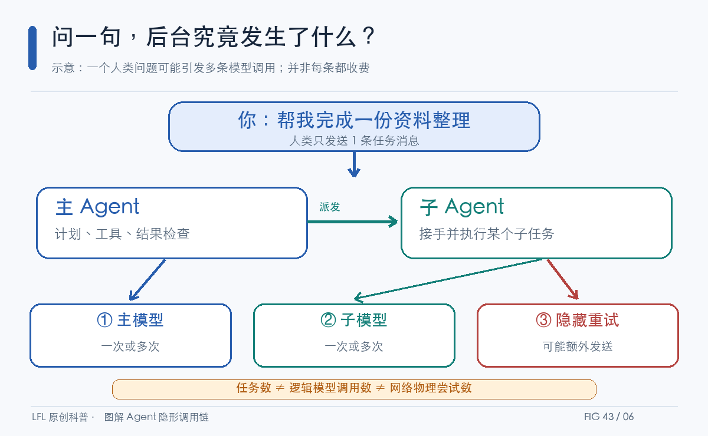
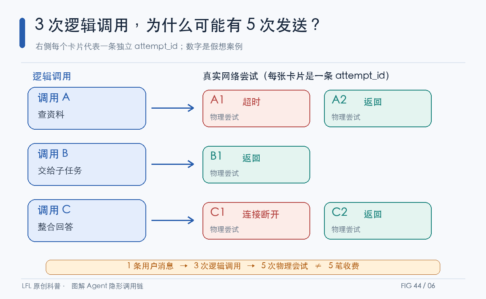
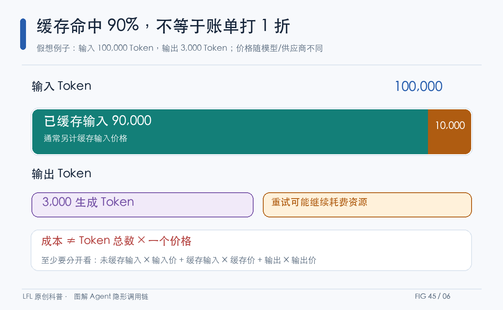
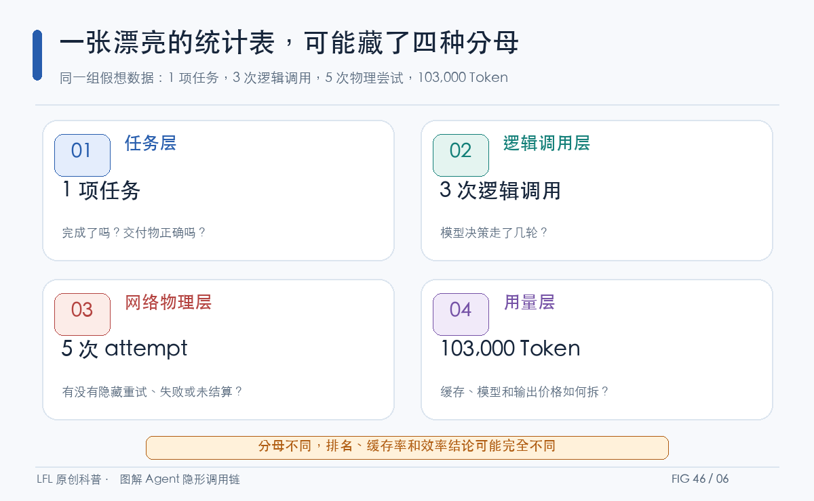
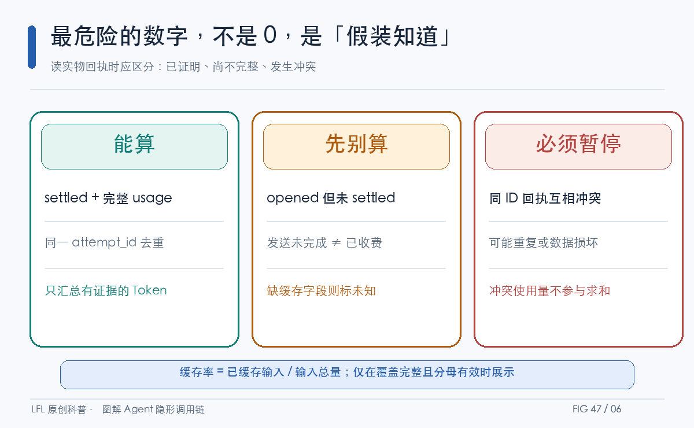
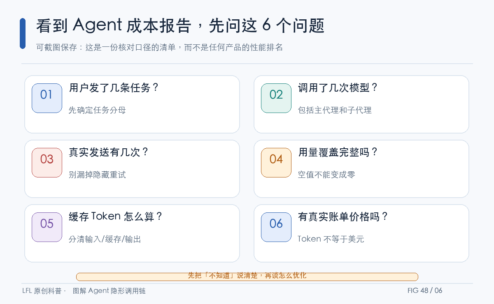

# 问一句，后台跑了几次？Agent 的隐形账本

> **LFL 原创科普 · 第 15 期 · 2026-10-13。** 一句看似简单的提问，可能在后台分裂成主 Agent、子 Agent、重试和缓存命中。这篇文章先看图，再说人话：究竟该数什么，才能知道 Agent 是否真的更快、更省、更靠谱？

---

## 一、一个问题，不代表一次请求

想象你对 AI 说：“帮我整理一份资料。”你只按了一次发送，屏幕里只有一条对话。

但后台可能有另一幅画面：主 Agent 想步骤，子 Agent 搜资料，某次网络调用失败后重新发送，最后主 Agent 汇总。**这是教学示例，不代表 LFL 每个任务都会走相同路线。**

**图 43｜一条用户消息，后台可能出现多条物理模型调用**

关键区别：用户问题数、模型逻辑调用数、真实网络尝试数，是三种不同单位。把它们混起来，“每任务成本”就从第一步算错。

## 二、3 次调用，为什么可能要记 5 笔网络尝试？

一次模型调用遇到超时，驱动层可能再尝试一次；调用代码上还是一个逻辑请求，网络上却出现了两个不同的 attempt。子代理也有自己的物理请求，不能只看父 Agent 的仪表盘。

**图 44｜三次逻辑调用与五次物理发送，属于不同计数层**

图中的 3 和 5 是**假设数字**，只为解释计数单位。更重要的是：**五次网络发送不等于五笔实际扣费**。失败尝试是否计费、是否返回 usage，要以 Provider 计费规则和真实凭据为准，不能臆测。

## 三、缓存 90%，绝不是“省了 90% 的钱”

在某些模型供应商那里，重复输入可以走提示词缓存。它常常有助于降低成本或延迟，但不是免费午餐，更不是“账单自动打一折”。

**图 45｜缓存输入、未缓存输入、输出，必须拆开核算**

图上假设输入共 100,000 Token，其中缓存 90,000，输出另有 3,000。缓存命中率可写成 90%，**但成本还依赖缓存输入单价、普通输入单价、输出单价，以及适用的供应商规则**。

如果缓存字段压根没有上报，显示“0% 命中”同样是错的。它应该显示：**未知或未上报**。

## 四、最会骗人的统计图：分母悄悄变了

说“每轮平均消耗多少”，有人把“轮”当人类任务，有人把它当模型调用，有人还把底层重试都算进去。大家看着同一个数字，却在讨论完全不同的东西。

**图 46｜任务、逻辑调用、物理网络、Token 四种统计层**

想评价 Agent 真正的效率，不能只挑最漂亮的指标。**任务成功率需要结果验收；Token 成本需要用量证据；真实账单还要接入价格及计费口径。** 这三者可以互相帮助，但不能互相替代。

## 五、LFL 的一个真实案例：缓存并没有消失，只是仪表盘漏记了

这部分有真实记录，不再是假想数字。

LFL 曾在一个历史子代理会话 D07 上发现：旧的子代理会话统计显示缓存命中为零，但物理 Provider 的回执里实际记录了缓存 Token。后来增加了**只读的物理 usage 汇总**，依据不同 attempt_id 的 settled 回执去重汇总。

这份 D07 记录来自特定的 **MiniMax-M3.1-Flash-Preview** 会话；并不代表 GLM-5.3、其他模型或所有 LFL 任务：

| D07 历史物理回执 | 复算结果 |
|---|---:|
| 逻辑 Provider 调用 | 23 |
| 已结算网络物理尝试 | 31 |
| 输入 Token | 1,132,294 |
| 缓存输入 Token | 1,069,021 |
| 未缓存输入 Token | 63,273 |
| 输出 Token | 25,312 |
| 缓存输入占比 | 94.41% |

**94.41% 不是成本节省率，也不是任务成功率。** 它只是这个真实会话里：已缓存输入 Token ÷ 已知输入 Token。

**图 47｜三种回执状态，决定哪些数据可以相信**

LFL 代码里还有两个很有意思的细节。首先，opened 但未 settled 的记录单独统计，不默认算作实际完成的扣费；其次，同一个 attempt_id 如果出现互相矛盾的 settled 内容，就标记冲突，不把不可信 usage 塞进合计里。

这是一种“**不知道就承认不知道**”的记账方式：缓存字段缺失时显示未上报，而不是伪造 0%。

它解决的是**账本可信度**问题，并不自动证明 Agent 便宜、任务完成得好，或者模型能力更强。

## 六、给每个 Agent 用户的一张成本检查卡

下次你看到有人宣称“我们的 Agent 缓存率 95%”“一次任务只用了三轮”，先不要急着比较排行榜。把这张图存下来：

**图 48｜六个问题，快速识别漂亮指标背后的统计陷阱**

如果有任何一项没有答案，那么最可靠的结论不是“这个 Agent 很差”，而是：**现在还缺足够证据评价它。**

## 七、它真正改变的是什么？

我们习惯拿一个总数给 AI 产品排名：最快、最省、最智能。

但 Agent 更像一支临时组建的团队：有人接单，有人分工，有人返工，有人交验收报告。只记“老板收到了一份报告”，看不到后台发生了什么；只数“员工说了几句话”，也看不到这份报告到底靠不靠谱。

**作者观点：下一代 Agent 的竞争，不应只拼“执行了多少步”，更该比较“同样合格的交付，用了多少真实资源，并能解释每一笔差异”。** 这是评价框架的建议，不是 LFL 已经实现同业领先的证据。

你可以允许 Agent 试错，但最好让每次试错都有记录；可以允许缓存提高效率，但别让缺失的字段偷偷变成零；可以让模型自己做决策，但不要让仪表盘替它编故事。

---

**事实依据：** LFL 源码 `src/llm_loop/core/provider_transport_usage_stats.py`；工程记录 `docs/results/RESULT-20261012-subagent-physical-cache-accounting.md`（2026-10-12，D07 历史会话）；相关单元测试 `tests/unit/test_subagent_provider_usage_stats.py`。D07 数据是特定模型、特定会话的历史回执，不能代表所有 Provider；本文图 43、44、45、46 为解释性示意图。上述实现是只读统计，不改变缓存策略、不推断货币账单。

**AI 辅助声明：** 本文由 AI 辅助撰写、绘图设计和资料整理；示意图并非实时产品截图。公开发表前须对正文数字、原始出处、配图内容逐项核对，不能将 AI 生成视为人工事实核验。
