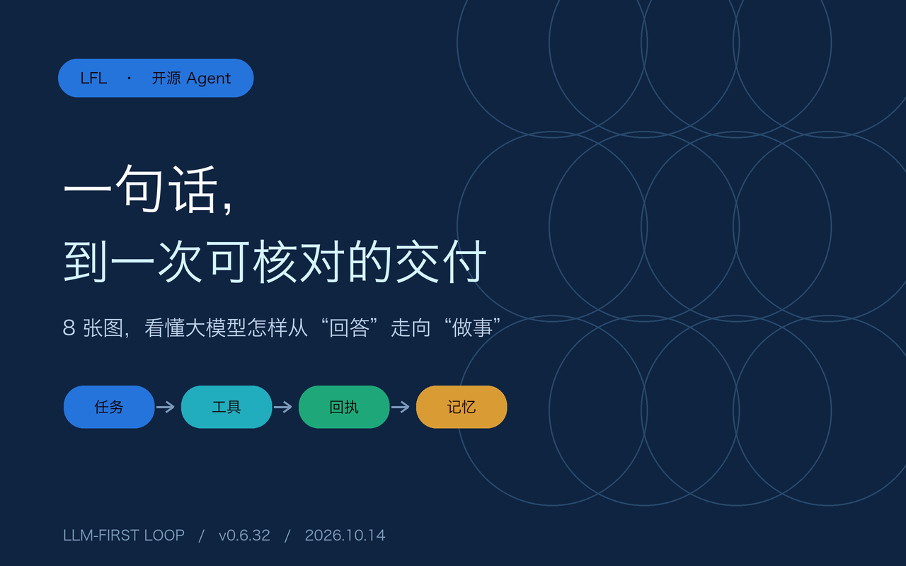
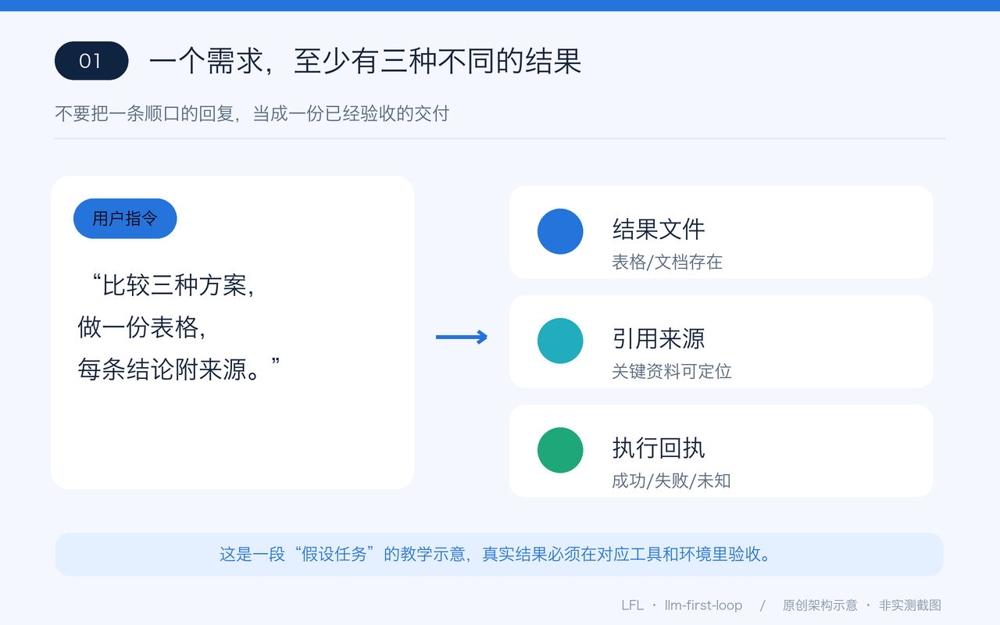
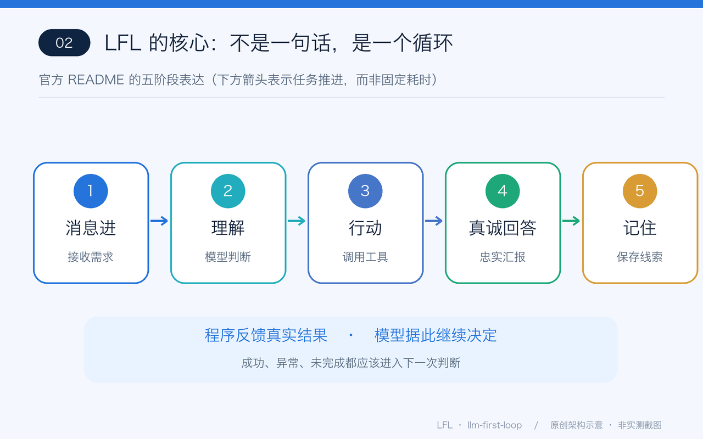
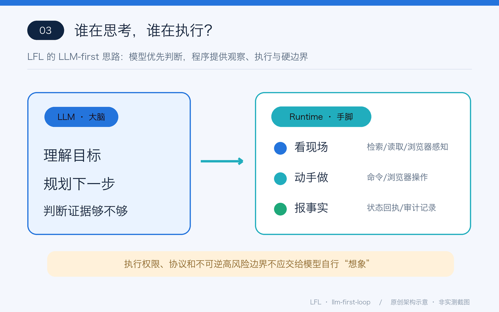
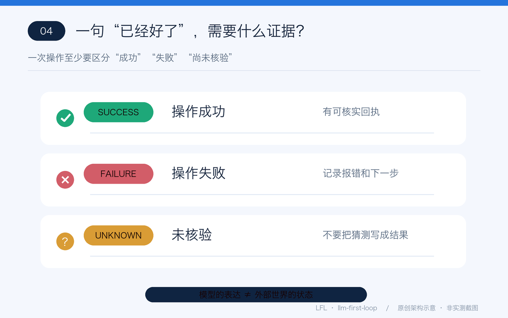
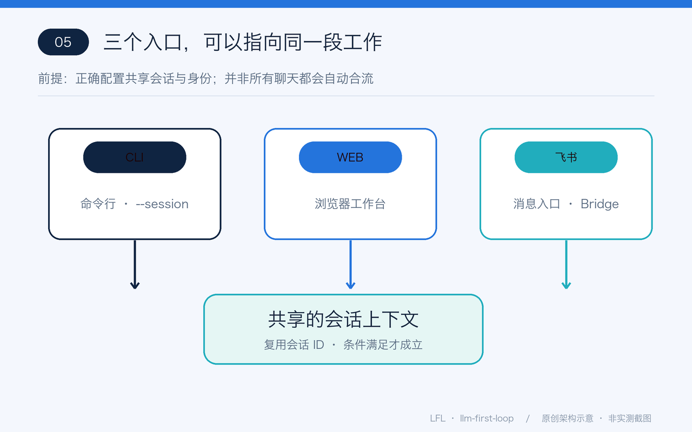
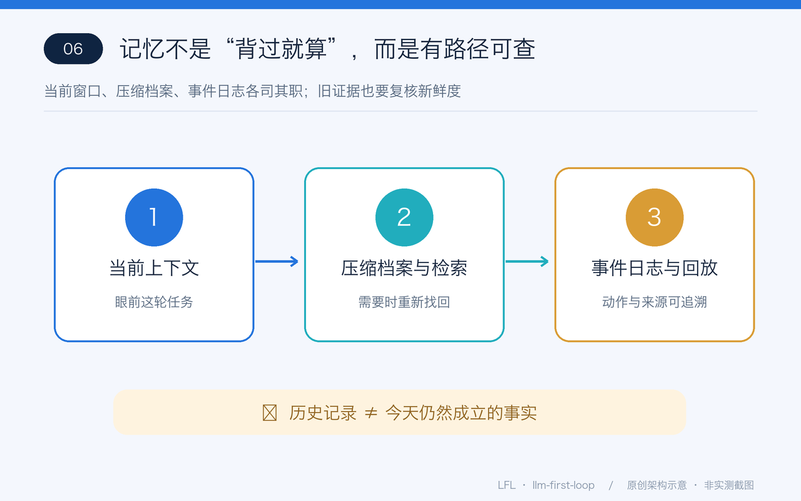
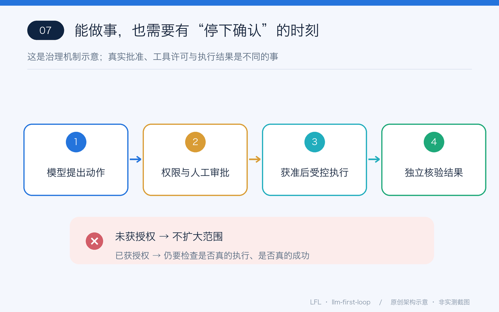
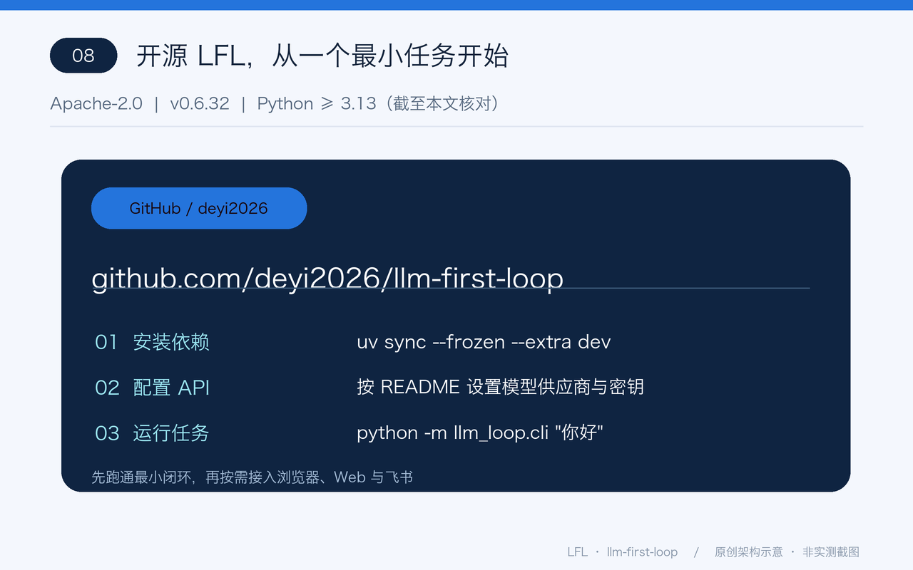

# 一句“帮我做对比表”，电脑里发生了什么？

> 开源 LFL 图解 · 2026-10-14 · 8 张原创示意图读懂 Agent 运行时

给 AI 发一句：“帮我比较三种方案，整理优缺点，附上资料来源。”屏幕上只有一句话，背后究竟应该发生什么？

普通聊天重在**回答**；真正要办事，得处理工具、证据、失败、授权和下次继续工作的问题。开源项目 **LFL（llm-first-loop）** 正在探索怎样把这些能力组合成一套以大模型为核心的 Agent 运行时。

## 1. 用户交代的是任务，不是一段漂亮回复

图里的“对比表”是教学情景，不是 LFL 实测完成截图。真实交付需依据可用工具、输入资料和验收结果判断；**模型说做完了，不等于已经做完**。

## 2. LFL 的底层节奏：五步

README 把核心循环描述为 **消息进 → 理解 → 行动 → 真诚回答 → 记住**。模型仍负责思考和选择；运行时负责让它接触外部世界，并记录发生了什么。

## 3. 让模型当“大脑”，让程序做“感官与手脚”

搜索、读文件、浏览器感知和操作，都有对应工具与接口。LFL 的设计重点不是靠一堆固定流程替模型做决定，而是尽量让模型有能力**先看清现场，再决定动作**。

## 4. “我试了”与“我成功了”之间，有一道回执

成功要有成功证据，失败就报告失败；没有可靠结果，应该说“未核验”。这比一味追求流畅、肯定的语气更适合真实工程任务。

## 5. 工作不一定只能关在一个聊天窗口

LFL 提供 CLI、Web 和飞书桥接入。**在正确配置身份与共享会话的条件下**，Web 和飞书可以续接同一会话；命令行可通过指定 session ID 继续。它不是自动同步所有历史任务的万能开关。

## 6. 长任务的价值，在于找回证据，而不是“记得很像”

上下文长了，可以保存压缩档案；之后通过检索定位过去的资料。事件日志支持回放与核对。过去的记录也可能过时，**历史信息不应自动冒充当前事实**。

## 7. 能行动，更要知道哪些动作应当停下来确认

高影响操作并不是一句“我授权你”就能无限扩大范围。LFL 设计了审批、执行分级与审计机制；实际边界还受配置和外部执行环境影响。**审批通过，也不等于操作一定成功**。

## 8. 想亲手试试？从最小闭环开始

项目地址：**https://github.com/deyi2026/llm-first-loop**

Apache-2.0 开源；截至本文所核的仓库 README，版本为 **v0.6.32**，要求 Python **≥ 3.13**。先按 README 配置模型 API 与运行环境，使用 CLI 完成一次小任务，再逐步接入 Web、浏览器或飞书。

**最后一句**：LFL 值得关注的不是“AI 永远不会出错”，而是把**做了什么、哪一步失败、证据在哪、下一步谁决定**变成一个可继续追问的问题。

---

事实依据：项目 README.md、LICENSE、docs/ai_rules.md（核对日期 2026-10-14）。8 张图片为原创程序绘制的教学示意图，不是系统运行截图或性能测试数据。本文含 AI 辅助创作。#开源项目 #AI智能体 #Agent
