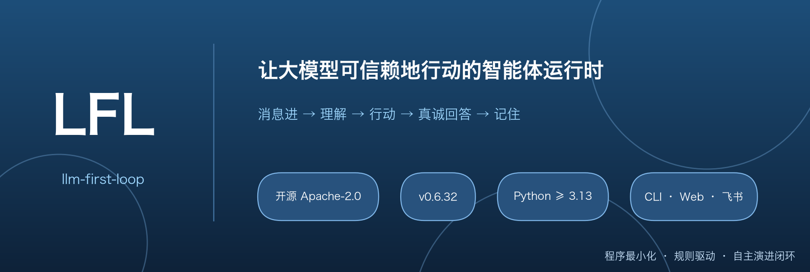
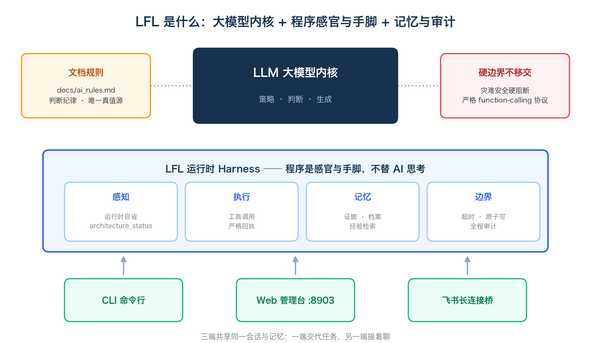
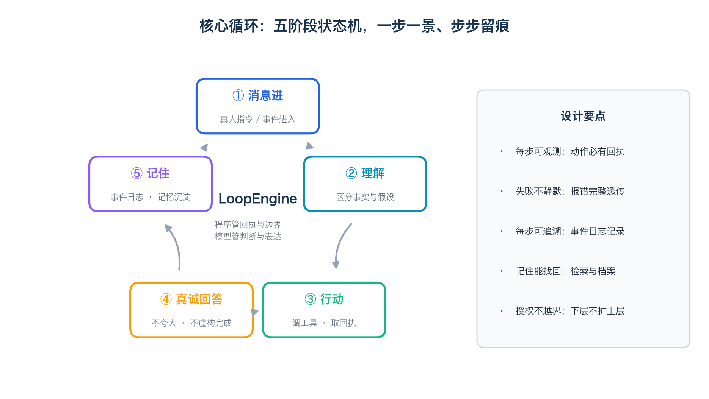
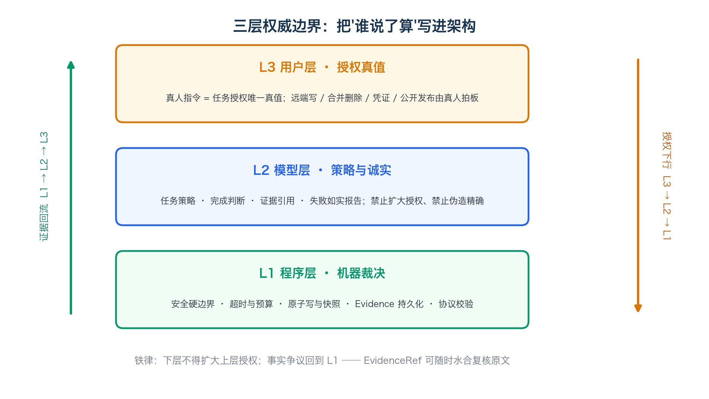
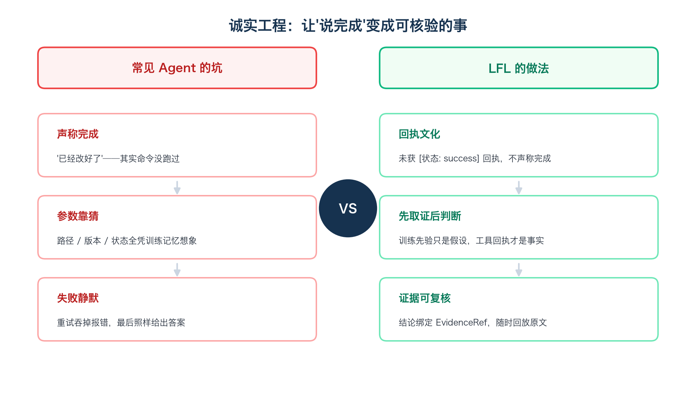
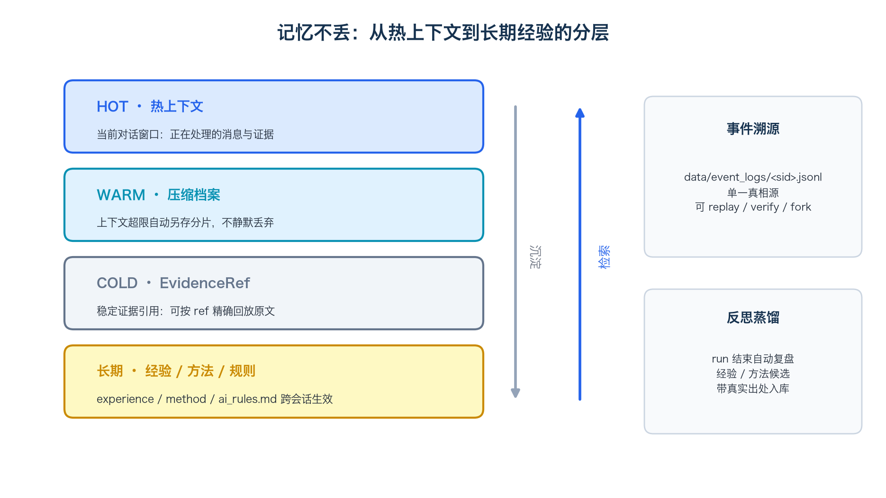
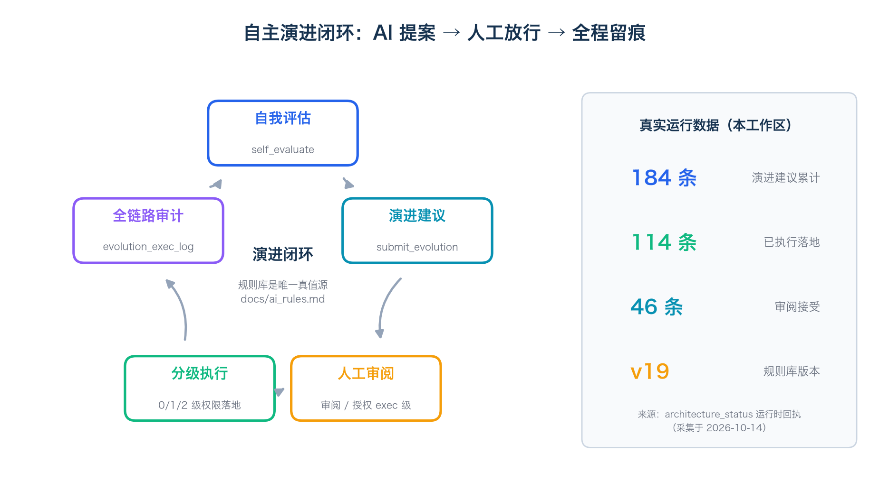
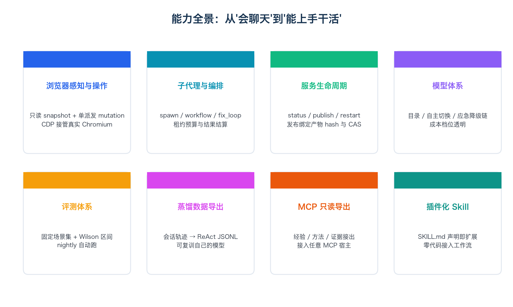

# AI 说"改好了"却没改？这个开源项目，专治智能体撒谎

你有没有被 AI 这样"坑"过——

让它改 bug，它拍着胸脯："已经修好了！"结果一跑，报错原封不动。

问它一个文件路径，它答得斩钉截铁，一打开：404。

昨天交代的长任务，今天问进度，它一脸无辜："什么任务？"

很多人以为这是模型不够聪明。但有个开源项目给出了另一种答案：不是脑子不行，是缺一层"体质"。

它叫 **LFL**（llm-first-loop），一个把"诚实、可核验、记得住"写进架构的 AI 智能体运行时。Apache-2.0 开源，当前版本 v0.6.32，命令行、网页、飞书三种接法都支持。



## 01 先看它的架构观：模型是大脑，程序是感官和手脚

官方给它的定位就一句话：以大模型为核心，程序最小化，文档和规则驱动，内置记忆、检索、事件溯源和评测体系。



它的架构原则写得挺狠：工具执行的成功、失败、异常，都必须如实构造回执，错误完整透传，不静默降级。**想糊弄？系统不答应。**

翻译成人话：AI 干了什么、干成没干成，系统里都有记录。想赖账？没门。

## 02 每句话都要走完的"五步闭环"

在 LFL 里，每条消息进来都走同一个流程：**消息进 → 理解 → 行动 → 真诚回答 → 记住**。



注意"真诚回答"这四个字，它是写进程序契约的：**没拿到"成功"回执，模型就不许说"已完成"**。

这不是靠自觉，是靠制度。

## 03 三层权威边界：AI 不许给自己涨权限



- **用户层**：真人指令是唯一授权真值。远程写入、删数据、公开发布，只由人拍板。
- **模型层**：可以定策略、做判断，但不许偷偷扩大自己的权限，更不许用精确的假细节装"我查过了"。
- **程序层**：安全硬边界、超时预算、原子写入，谁来都绕不过去。

铁律就一句：**下层不得扩大上层授权**。

## 04 诚实工程：先取证，后判断

传统 Agent 出错，常见三种姿势：报喜不报忧、拿训练时的旧记忆当现状、出错自己悄悄重试然后糊弄过去。



LFL 的规矩是：先取证，后判断。凡是涉及现在的代码、现在的文件、现在的运行状态，模型脑子里的记忆只算假设，必须去现场核实。

核实不了怎么办？明说"未核验"。**宁可承认不知道，不许编一个像样的答案。**

## 05 跨会话不失忆

昨天的事今天忘，是 Agent 的老大难。LFL 用分层记忆 + 事件溯源来治。



所有轨迹落进事件日志这个"单一真相源"：压缩档案自动另存，证据引用随时回放原文，经验和坑还能跨会话沉淀——这次踩过的坑，下次有据可查，不必重踩一遍。

## 06 最有意思的：它能给自己提改进建议



LFL 会基于自评发起演进建议，数据截至 2026-10-14 的运行时回执：

- 演进建议累计：**184 条**
- 人工审阅接受：46 条
- 已执行落地：**114 条**
- 规则库文档迭代到：v19

注意那个关键设计：**放行权始终在人**。AI 提议，人类拍板，动作全链路审计。

## 07 能力全景



浏览器接管（CDP 连真实 Chromium）、子代理编排、服务生命周期控制、模型目录与应急降级、评测体系（固定场景集 + Wilson 区间）、蒸馏数据导出、插件化 Skill。

（部分能力由配置开关控制，以运行配置为准。）

## 08 五分钟上手

```bash
cd llm-first-loop
uv sync --frozen --extra dev
export LLM_API_KEY=sk-xxx
export LLM_BASE_URL=https://api.deepseek.com/v1
.venv/bin/python -m llm_loop.cli --interactive
```

## 09 适合谁？也如实说说短板

**适合**：需要长任务、跨会话记忆和可审计自动化的开发者与团队。

**也请注意**（项目自己承认的）：安全上是"已知灾难模式硬阻断"，不是完备沙箱；演进闭环有人工审阅环节；版本 0.6.x，接口还在快速演进。

---

**结尾说两句**：AI 的"聪明"已经卷得很凶，但"可靠"才刚刚开始。项目 Apache-2.0 开源，感兴趣可以自己跑跑看。

你被 AI"骗"过最惨的一次是什么？评论区聊聊。

---

**事实与数据来源**：README.md（v0.6.32）；docs/STACK.md（v0.1 草案）；docs/ARCHITECTURE-ai-state-model-v1.md；CHANGELOG.md；docs/ai_rules.md（v19）；architecture_status 运行时回执（2026-10-14）。配图由本文作者用 matplotlib 生成。本文为项目推广文，由 AI 辅助撰写，功能描述以官方文档与实际运行为准。
